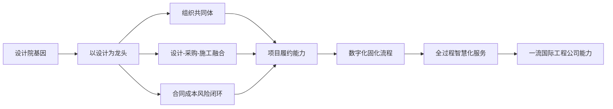

# Bank·第1章 导论：EPC工程审计与决算的市场全景与竞争格局 `[三态：融合]`
检索词: 工程审计、决算、审计市场、造价咨询、EPC、总承包 | 树子问: Q4, Q7, Q5
候选 5280 | 取 top 35
分层: tiers.json T1 词命中 9/35 条底料

## P000001 (分9 497,001字 crosspool:EPC-OVERSEAS research T1:1)
路径: EPC工程总承包项目管理要点与实践.md

---
title: EPC工程总承包项目管理要点与实践
author: 陈津生 编著
bookId: "3300219411"
format: epub
totalWords: 526275
partial: false
fetchedAt: 2026-09-19T11:38:27
source: 微信读书
---

# EPC工程总承包项目管理要点与实践

> 陈津生 编著 · 微信读书 · epub

**简介**：本书根据EPC项目的特点和实践编著而成。以管理组织、建设过程、管理目标、项目要素为顺序，阐述了EPC项目管理的要点。同时，每章配有项目管理典型实践案例，以供读者参考。本书具有针对性强、重点突出、叙述简洁、便于记忆、实用性强的特点。

本书可作为设计单位、施工企业、监理咨询单位的有关管理人员的学习资料，也可作为大中专院校相关专业研究生以及在校生的专业读物，还可作为EPC项目管理知识培训教材或辅导教材。

## 目录

- [封面](#封面)
- [版权信息](#版权信息)
- [前言](#前言)
- [第1篇 绪论篇](#第1篇-绪论篇)
  - [第1章 项目管理概述](#第1章-项目管理概述)
- [第2篇 组织篇](#第2篇-组织篇)
  - [第2章 企业管理组织](#第2章-企业管理组织)
  - [第3章 项目部组织](#第3章-项目部组织)
- [第3篇 过程篇](#第3篇-过程篇)
  - [第4章 项目策划](#第4章-项目策划)
  - [第5章 设计管理](#第5章-设计管理)
  - [第6章 采购管理](#第6章-采购管理)
  - [第7章 施工管理](#第7章-施工管理)
  - [第8章 试车管理](#第8章-试车管理)
- [第4篇 目标篇](#第4篇-目标篇)
  - [第9章 进度管理](#第9章-进度管理)
  - [第10章 质量管理](#第10章-质量管理)
  - [第11章 费用管理](#第11章-费用管理)
  - [第12章 安全管理](#第12章-安全管理)
- [第5篇 要素篇](#第5篇-要素篇)
  - [第13章 风险管理](#第13章-风险管理)
  - [第14章 资源管理](#第14章-资源管理)
  - [第15章 沟通管理](#第15章-沟通管理)
  - [第16章 合同管理](#第16章-合同管理)
- [第6篇 收尾篇](#第6篇-收尾篇)
  - [第17章 收尾管理](#第17章-收尾管理)
- [参考文献](#参考文献)

---

## 封面

## 版权信息

书名：EPC工程总承包项目管理要点与实践

作者：陈津生 编著

出版社：化学工业出版社

出版时间：2023-06-01

ISBN：9787122426932

品牌方：化学工业出版社

本书由化学工业出版社授权微信读书加工与传播

版权所有 · 侵权必究

## 前言

文前页

### 前言

EPC承包模式由于自身的优势，在国外受到业主的广泛青睐，应用已经十分普遍，涉及的行业领域也在不断扩大，包括房屋建筑、电力、水利、石油石化、道路等行业。近年来，我国的建设市场模式仍处于转型时期，单纯依靠传统的承包模式，已经无法适应市场经济发展的需要，必须与国际接轨。为此，国内正在积极推行工程总承包模式的应用，且推广工作的步伐越来越快，推广的力度也越来越大。

我们应该清醒地认识到，EPC承包模式的推行是对传统承发包模式的一场深刻的变革，这场变革必然会带来项目管理方式的转变。长期以来我国一直沿用传统的承包模式，习惯于一套传统承发包模式的项目管理方式。而EPC项目与传统项目具有很多不同的特点，以传统项目的管理方式去管理现代化项目，必然会带来诸多困难，会使项目建设处于被动局面，甚至有可能导致整个项目的失败。因此，企业在整个行业结构调整的大潮中，首要的就是应尽快学习、掌握EPC现代项目管理理论和方法，在传统承包模式基础上，迅速培养出一支掌握现代化项目管理技术的队伍，培养、储备管理人才是当前行业的一项十分迫切的任务。现代化承包模式管理人才的培养是推动行业EPC事业发展的急迫需要，是实现企业转型、提高项目管理效率和创造企业效益的充分和必要的条件，否则将贻误大事。

我们也应该看到，自EPC承包模式推广以来，随着人们对EPC项目管理的认识不断深化和科学技术的进步，项目管理的理论和方法已经发生了深刻的变革。进入21世纪后，项目管理领域呈现学术性、新技术、职业化的三大发展趋势。管理理论不断创新，例如，共赢理念、整合理念、全面管理理念、绿色管理理念、节能环保管理理念等层出不穷，特别是当今信息技术、网络技术、BIM技术的广泛应用以及项目管理逐步分工细化，形成一系列关于项目管理的专门职业，标志着项目管理已经进入全新的快速发展时代。新的趋势对行业的项目管理人员提出了新的、更高的标准和要求，只有不断调整自身项目管理知识结构，补充新知识，吸收新营养，运用新观念、新技术，按照职业化的要求，构建现代化的项目管理知识体系，才能站在这场变革的前沿，跟上时代发展的步伐，促进我国EPC事业的发展，与国际市场融合。因此，加强对EPC承包项目管理知识的学习是时代发展的需要，意义重大。

本书为了满足广大从业者学习项目管理知识的客观需要，搭建了一个学习EPC项目管理知识的平台，交流EPC项目管理知识和经验，进一步普及、提高现代项目管理水平，2023年是即将迎来原建设部印发的《关于培育发展工程总承包和工程项目管理企业的指导意见》（建市〔2003〕30号）二十周年的日子，出版本书也具有特殊的意义。

本书编著的宗旨是力求“全面、精要”地反映出EPC项目管理知识体系框架，既要突出重点、叙述简洁，又要兼顾实用性、操作性。全书分为绪论篇、组织篇、过程篇、目标篇、要素篇和收尾篇6篇共17章。各章按概念、组织、模式、重点、策略、方法为序加以阐述。同时，每章提供了一些国内外EPC项目管理的典型实践案例，供读者参阅，以期对读者能够起到举一反三的学习效果。

作者在编著过程中，参考了国内外一些理论与实践者的文献资料，在此，一并表示感谢。由于作者水平有限，难免存在不足之处，衷心欢迎行业同仁给予斧正，再版时加以修正，以便为广大读者提供更好的服务。

陈津生

 2022年10月

 北京.花园村

## 第1篇 绪论篇

### 第1篇　绪论篇

### 第1章 项目管理概述

EPC承包模式由于其自身的优势，目前得到越来越多业主的推崇，在国际市场上已成为一种主流承包模式。随着世界经济发展融合的趋势，我国政府积极推行这一模式，越来越多的企业积极投入EPC实践之中。EPC项目一般采用固定合同价格，业主要求标准高，与传统的模式相比，承包商需要承担很大的风险。因此，对EPC的项目管理成为承包方十分关注且需要研究的重点课题。

###### 1.1 项目管理的概念与特征

###### 1.1.1 项目管理的概念

项目管理是“对项目进行的管理”，这是其最为原始、广泛的概念。然而从项目管理概念和内涵的发展历程来看，项目管理的内涵得到了极大的丰富和发展。不同的团体、不同的应用领域对其有不同的描述。

美国项目管理协会制定的《项目管理知识体系指南》(PMI-PMBOK)对项目管理做了广义的定义：“项目管理是把项目管理知识、技能、工具和技术用于项目活动中，以满足项目要求。”

在FIDIC银皮书中将其定义为：“在一个统一的组织或它的法定代表负责领导下，对一个多专业组成的组织进行动员，以使项目建筑在业主要求达到的进度、质量与费用指标内完成。”

国际标准ISO 10006《质量管理　项目质量管理指南》将其定义为：“项目管理包括对项目各方面的策划、组织、检测和控制等连续过程的活动，以达到项目目标。”

中国勘察设计协会主编的《建设项目工程总承包管理规范》(GB/T 50358)对项目管理的定义为：“在项目实施过程中对项目的各方面进行策划、组织、监测和控制，并把项目管理知识、技能、工具和技术应用于项目活动中，以达到项目目标的全部活动。”这一定义的表述基本与国际标准一致。

中国石油和化工勘察设计协会和中国勘察设计协会建设项目管理和工程总承包分会编制的《建设项目工程总承包管理规范实施指南》对项目管理做了进一步解释：“本规范中项目管理是指工程总承包企业对工程总承包项目进行的项目管理，包括设计、采购、施工和试运行全过程的质量、安全、费用和进度等全方位的策划、组织实施、控制和收尾等。”

综合上述分析，所谓项目管理是指：在项目实施过程中，对项目的各个方面进行策划、实施、检验和控制，并把项目管理的知识、技能、工具和技术应用于项目设计、采购、施工等活动中，以达到项目目标的全部活动。对于EPC项目总承包管理的概念，我们可以进一步做如下理解。

①项目管理包括产品实现过程管理和项目管理程序的管理。产品实现过程管理包括设计、采购、施工、试车等；项目管理程序的管理包括项目启动、项目策划、项目实施、项目控制和收尾的管理。

②工程总承包项目部在实施项目过程中，每一管理过程都要体现策划(Plan)、实施(Do)、检验(Check)、处置(Action)，即PDCA循环。

③工程总承包企业的项目管理者必须提供资源，实施项目过程管理，组织、监视、测量、分析、评价和改进，通过管理评审回到管理职责闭环，开始新的PDCA循环。

④项目管理需要将各种知识、方法、技术充分运用于管理实践，涉及多个知识领域，包括时间、成本、质量、人力资源、沟通、风险、采购等范畴的管理知识和技术。

项目管理概念的不同层次见图1-1。

图1-1　项目管理概念的不同层次

###### 1.1.2 项目管理的特征

EPC项目与一般项目管理相比呈现以下特征。

(1)复杂性　EPC项目是受业主委托，按照合同约定对工程项目的勘察、设计、采购、施工、试运行（竣工验收）等实行全过程的承包，对于一些专业需要分包给其他单位去完成，因此，涉及多阶段、多单位的协作管理。项目管理工作较传统承包模式协调量大，工作更为复杂，对总承包商管理人员在素质、技术和以往的经验等方面的要求高。

(2)艰巨性　EPC项目采用固定合同价格，允许工期和费用索赔的机会很少，稍有不慎成本就可能超支，且工程总承包合同条款往往很苛刻，总承包商承担了大部分风险，稍有不慎就可能会造成亏损，项目管理面临的任务十分艰巨，因此，项目风险管理成为项目管理的重点和难点。

(3)持久性　项目管理的持久性是指EPC项目管理工作的时间较长。一般来说EPC项目建设周期长，少则一两年，多则五六年，甚至需要更长的时间。项目管理要贯彻始终。

(4)集成性　在项目管理中必须根据具体项目各要素或各专业之间的配置关系做好集成性的管理，而不能孤立地开展项目各个专业或对各专业进行独立管理。

(5)创新性　项目管理的创新性包括两层含义：其一是指项目管理是对于创新（项目所包含的创新之处）的管理；其二是指任何一个项目的管理都没有一成不变的模式和方法，都需要通过管理创新去实现对于具体项目的有效管理。

###### 1.2 项目管理内容与程序

###### 1.2.1 项目管理内容

EPC工程总承包项目是业主将整个工程的设计、采购、施工等全部工作交付总承包商进行，并对其质量、进度、费用、工期等负责。为此，EPC项目管理内容划分可以从以下四个层次阐述其主要管理内容。

①从项目管理活动过程角度划分，其内容可分为启动/策划（包含组织构建与实施计划策划）阶段、实施/控制（执行计划，并对实施活动进行控制）阶段、项目收尾（竣工验收、合同结算、文件归档等）阶段管理。

②从项目建设（产品形成）过程角度划分，其内容包括对设计、采购、施工、试运行的管理。

③从控制目标角度划分，其内容可分为进度、费用、质量、安全健康与环境目标管理。

④从项目其他构成要素划分，其内容可分为项目资源、沟通信息、风险管理、合同管理等。

EPC工程项目管理内容划分示意图见图1-2。

图1-2　EPC工程项目管理内容划分示意图

###### 1.2.2 项目管理程序

EPC工程总承包建筑工程项目管理程序示意图见图1-3。

图1-3　EPC工程总承包建筑工程项目管理程序示意图

(1)启动/策划阶段管理程序　工程总承包项目合同评审通过或合同签订后，项目进入启动/策划阶段。启动/策划阶段的管理程序为任命EPC项目经理、组建EPC项目部及团队、签订项目管理目标责任书、召开项目启动会议、策划编制项目管理计划与项目实施计划等。

(2)实施/控制阶段管理程序　工程总承包项目管理启动/策划工作完成后，进入项目实施/控制阶段。实施阶段管理程序为在勘察设计、采购、施工等过程中对目标要素和其他要素的管理工作。

(3)收尾阶段管理程序　项目竣工验收通过后，项目进入收尾阶段，主要管理程序为现场清理、项目竣工结算、竣工资料移交、项目总结、项目团队绩效考核、EPC项目部解散、工程保修与回访等。

###### 1.3 项目管理模式与体系

###### 1.3.1 项目管理模式

由于EPC工程项目一般具有规模大、分包参建单位多的显著特征，因此，无论是对目标的管理，还是对其他要素的管理，其管理模式一般采用二级管控模式，即企业层对项目的管理和项目执行层对项目的管理；也可以细分为三层管理模式，即企业层、企业职能层、项目层三层管理模式。

###### 1.3.2 项目管理体系

借鉴ISO9001质量管理体系，本书将项目管理体系划分为两部分，即项目管理体系=项目监控体系+项目保证体系。项目监控体系包括项目监控目标体系、项目监控流程体系。项目保证体系包括项目管理组织体系、项目管理责任体系、项目管理方法与技术保证体系、资源保障体系。项目监控体系框架示意图见图1-4。

图1-4　项目监控体系框架示意图

###### 1.4 项目管理组织与职责

工程总承包项目管理是将项目管理的理论、模式、程序、方法和技术运用于该项目设计、采购、施工、试

## P000002 (分9 337,096字 crosspool:EPC-OVERSEAS research T1:0)
路径: EPC工程总承包项目过程控制概论.md

---
title: EPC工程总承包项目过程控制概论
author: 汪寿建 编著
bookId: "3300225967"
format: epub
totalWords: 320257
partial: false
fetchedAt: 2026-09-10T11:02:56
source: 微信读书
---

# EPC工程总承包项目过程控制概论

> 汪寿建 编著 · 微信读书 · epub

**简介**：本书以通俗易懂的语言和国际先进的项目管理理论为基础，结合相关的项目案例，系统阐述了现代总承包项目管理过程的控制原理、控制程序和控制流程。

全书共分十五章，系统介绍了项目管理国内外的发展历程，工程公司及总承包项目组织结构，并对总承包项目设计、采购、施工、试运行全过程控制，各过程中的启动、策划、实施、控制和收尾子过程，项目目标控制要素（进度、质量、费用、HSE）和项目管理控制要素（综合、合同、范围、资源、信息、沟通、风险、变更）等进行了详细论述。

本书可供化工、石油化工、煤化工、医药、电力、基础设施建设等领域工程公司的项目经理，从事项目建设、项目管理研究和实施的工程技术人员，建筑企业的项目管理人员和技术人员，大中专院校管理类专业的师生参考阅读。

## 目录

- [封面](#封面)
- [版权信息](#版权信息)
- [前言](#前言)
- [第一章 总论](#第一章-总论)
  - [第二节 国际项目管理发展进程](#第二节-国际项目管理发展进程)
  - [第三节 国际项目管理发展趋势](#第三节-国际项目管理发展趋势)
  - [第四节 中国项目管理及建设模式发展进程](#第四节-中国项目管理及建设模式发展进程)
  - [第五节 中国工程勘察设计行业发展现状](#第五节-中国工程勘察设计行业发展现状)
  - [第六节 国际工程市场发展趋势](#第六节-国际工程市场发展趋势)
  - [第七节 国际工程公司的发展历程](#第七节-国际工程公司的发展历程)
  - [第八节 EPC项目全过程](#第八节-epc项目全过程)
  - [第九节 EPC总承包管理的发展趋势](#第九节-epc总承包管理的发展趋势)
- [第二章 工程公司组织结构](#第二章-工程公司组织结构)
  - [第二节 工程公司组织结构和应具备的能力](#第二节-工程公司组织结构和应具备的能力)
  - [第三节 工程公司需应对的各方面变化](#第三节-工程公司需应对的各方面变化)
  - [第四节 工程公司组织架构设立](#第四节-工程公司组织架构设立)
  - [第五节 工程公司项目部的典型组织机构](#第五节-工程公司项目部的典型组织机构)
  - [第六节 项目经理及各部门经理的岗位职责](#第六节-项目经理及各部门经理的岗位职责)
  - [第七节 EPC项目组织机构案例](#第七节-epc项目组织机构案例)
- [第三章 EPC项目建设阶段全过程管理](#第三章-epc项目建设阶段全过程管理)
  - [第一节 适宜的管理方法——戴明循环管理法](#第一节-适宜的管理方法戴明循环管理法)
  - [第二节 项目管理系统](#第二节-项目管理系统)
  - [第三节 项目启动过程](#第三节-项目启动过程)
  - [第四节 项目策划过程](#第四节-项目策划过程)
  - [第五节 项目实施过程](#第五节-项目实施过程)
  - [第六节 项目控制过程](#第六节-项目控制过程)
  - [第七节 项目收尾过程](#第七节-项目收尾过程)
  - [第八节 项目综合管理](#第八节-项目综合管理)
  - [第九节 项目合同管理](#第九节-项目合同管理)
  - [第十节 项目范围管理](#第十节-项目范围管理)
  - [第十一节 项目人力资源管理](#第十一节-项目人力资源管理)
  - [第十二节 项目信息管理](#第十二节-项目信息管理)
  - [第十三节 项目沟通管理](#第十三节-项目沟通管理)
  - [第十四节 项目风险管理](#第十四节-项目风险管理)
  - [第十五节 项目变更管理](#第十五节-项目变更管理)
- [第四章 EPC设计过程控制](#第四章-epc设计过程控制)
  - [第二节 设计启动过程](#第二节-设计启动过程)
  - [第三节 设计策划过程](#第三节-设计策划过程)
  - [第四节 设计实施过程](#第四节-设计实施过程)
  - [第五节 设计控制过程](#第五节-设计控制过程)
  - [第六节 设计收尾过程](#第六节-设计收尾过程)
  - [第七节 设计管理](#第七节-设计管理)
  - [第八节 总体设计管理](#第八节-总体设计管理)
  - [第九节 工艺包设计管理](#第九节-工艺包设计管理)
  - [第十节 三查四定设计管理](#第十节-三查四定设计管理)
- [第五章 EPC采购过程控制](#第五章-epc采购过程控制)
  - [第二节 工程采购模式](#第二节-工程采购模式)
  - [第三节 采购启动过程](#第三节-采购启动过程)
  - [第四节 采购策划过程](#第四节-采购策划过程)
  - [第五节 采购实施过程](#第五节-采购实施过程)
  - [第六节 采购控制过程](#第六节-采购控制过程)
  - [第七节 采购收尾过程](#第七节-采购收尾过程)
  - [第八节 采购管理](#第八节-采购管理)
- [第六章 EPC施工过程控制](#第六章-epc施工过程控制)
  - [第二节 施工启动过程](#第二节-施工启动过程)
  - [第三节 施工策划过程](#第三节-施工策划过程)
  - [第四节 施工实施过程](#第四节-施工实施过程)
  - [第五节 施工控制过程](#第五节-施工控制过程)
  - [第六节 施工收尾过程](#第六节-施工收尾过程)
  - [第七节 施工管理](#第七节-施工管理)
- [第七章 试运行过程控制](#第七章-试运行过程控制)
  - [第二节 试运行启动过程](#第二节-试运行启动过程)
  - [第三节 试运行策划过程](#第三节-试运行策划过程)
  - [第四节 试运行实施过程](#第四节-试运行实施过程)
  - [第五节 试运行控制过程](#第五节-试运行控制过程)
  - [第六节 试运行收尾过程](#第六节-试运行收尾过程)
  - [第七节 试运行管理](#第七节-试运行管理)
- [第八章 项目进度控制](#第八章-项目进度控制)
  - [第二节 进度控制基本原理](#第二节-进度控制基本原理)
  - [第三节 项目进度管理](#第三节-项目进度管理)
  - [第四节 项目进度计划](#第四节-项目进度计划)
  - [第五节 项目进度控制程序](#第五节-项目进度控制程序)
- [第九章 项目质量控制](#第九章-项目质量控制)
  - [第二节 企业质量管理要点](#第二节-企业质量管理要点)
  - [第三节 质量计划编制、实施与控制](#第三节-质量计划编制实施与控制)
  - [第四节 项目质量管理](#第四节-项目质量管理)
  - [第五节 项目质量计划管理](#第五节-项目质量计划管理)
  - [第六节 项目质量计划实施与控制程序](#第六节-项目质量计划实施与控制程序)
- [第十章 项目费用控制](#第十章-项目费用控制)
  - [第二节 成本类别及成本与期间费用的区别](#第二节-成本类别及成本与期间费用的区别)
  - [第三节 费用管理体系](#第三节-费用管理体系)
  - [第四节 项目费用估算和预算](#第四节-项目费用估算和预算)
  - [第五节 项目费用管理及体系](#第五节-项目费用管理及体系)
  - [第六节 项目费用管理基准](#第六节-项目费用管理基准)
  - [第七节 项目费用计划编制](#第七节-项目费用计划编制)
  - [第八节 项目费用管理程序](#第八节-项目费用管理程序)
  - [第九节 项目成本管理](#第九节-项目成本管理)
- [第十一章 项目HSE控制](#第十一章-项目hse控制)
  - [第二节 HSE管理体系](#第二节-hse管理体系)
  - [第三节 HSE管理计划](#第三节-hse管理计划)
  - [第四节 项目HSE管理](#第四节-项目hse管理)
  - [第五节 安全生产管理职责](#第五节-安全生产管理职责)
  - [第六节 项目HSE措施费用管理](#第六节-项目hse措施费用管理)
  - [第七节 三级安全教育培训管理](#第七节-三级安全教育培训管理)
  - [第八节 项目HSE计划实施及控制程序](#第八节-项目hse计划实施及控制程序)
- [第十二章 进度全过程控制](#第十二章-进度全过程控制)
  - [第二节 采购进度过程管理](#第二节-采购进度过程管理)
  - [第三节 施工进度过程管理](#第三节-施工进度过程管理)
  - [第四节 试运行进度过程管理](#第四节-试运行进度过程管理)
- [第十三章 质量全过程控制](#第十三章-质量全过程控制)
  - [第二节 采购质量过程管理](#第二节-采购质量过程管理)
  - [第三节 施工质量过程管理](#第三节-施工质量过程管理)
  - [第四节 试运行质量过程管理](#第四节-试运行质量过程管理)
- [第十四章 费用全过程控制](#第十四章-费用全过程控制)
  - [第二节 采购费用过程管理](#第二节-采购费用过程管理)
  - [第三节 施工费用过程管理](#第三节-施工费用过程管理)
  - [第四节 试运行费用过程管理](#第四节-试运行费用过程管理)
- [第十五章 HSE全过程控制](#第十五章-hse全过程控制)
  - [第二节 采购HSE过程管理](#第二节-采购hse过程管理)
  - [第三节 施工HSE过程管理](#第三节-施工hse过程管理)
  - [第四节 试运行过程HSE管理](#第四节-试运行过程hse管理)
- [参考文献](#参考文献)

---

## 封面

## 版权信息

书名：EPC工程总承包项目过程控制概论

作者：汪寿建 编著

出版社：化学工业出版社

出版时间：2020-07-01

ISBN：9787122359759

品牌方：化学工业出版社

本书由化学工业出版社授权微信读书加工与传播

版权所有 · 侵权必究

## 前言

20世纪80年代以前，国际上通行的现代项目管理及建设发展模式在中国几乎是空白，早期的基本建设体制、机制也束缚了经济建设和社会发展。中国全面改革开放带来了强劲动力，持续地推动政府部门、勘察设计行业及相关领域，开始对这片空白进行认识和探索。

随着全球国际竞争的加剧，项目管理活动日益扩大和复杂，大型或超大型项目数量急剧增加。项目管理团队超大规模和多元化，以及利益相关方冲突碰撞等，已越来越引起人们的关注。国际工程项目“以人为本”和“项目全生命周期”的发展理念；项目全过程咨询管理服务总承包以及PMC(IMPT)管理模式；项目全过程建设总承包EPC/交钥匙以及单一责任主体、固定总造价承包、设计主导、设计与全过程深度融合的模式；项目投融资许可建设运营服务总承包的模式均是现代项目管理发展的趋势和方向。

作者有幸在设计主导型的工程公司及工程建筑类行业工作多年，目睹了中国改革开放后基本建设体制深化改革、勘察设计改制及工程项目总承包试点推广的全过程，曾亲自参加过一些大型工程建设项目总承包工作，亲身感受到随着中国改革开放，国家基本建设改革和勘察设计单位改制所带来的深刻变化。正是在这种大背景下，编著了本书，以报答社会给予的发展机遇。

全书共分十五章，系统介绍了项目管理的发展历程，项目组织结构；并对总承包项目设计、采购、施工、试运行全过程控制，各过程启动、策划、实施、控制和收尾子过程控制，目标要素（进度、质量、费用、HSE）控制，管理要素（综合、合同、范围、资源、信息、沟通、风险、变更）控制等内容做了详细阐述。

本书以通俗易懂的语言、国际先进的项目管理理论及总承包项目的案例方式，对项目全过程控制进行梳理和归纳。本书在编制过程中，得到相关单位和专家提供的宝贵资料和意见，在此表示感谢！由于作者水平有限，书中难免有不当之处，欢迎读者指正。

汪寿建

 2019年6月

## 第一章 总论

#### 第一节　概述

##### 一、EPC总承包

EPC(engineering procurement construction)是国际通用的工程项目总承包的总称。其中，engineering（英文原意是“工程”，实际指“设计”）是指从工程项目内容总体策划到具体的项目设计工作；procurement是指从工程专业设备到建筑材料的采购工作；construction是指从工程施工、安装到工程交接等的工作。

EPC总承包是指总承包商（或工程公司）受业主委托，按照项目合同约定对工程建设项目的设计、采购、施工、试运行等实行全过程的（或阶段性的）总承包。通常总承包商在项目总价合同条件下，对其所承包工程的进度、质量、费用及HSE（健康、安全与环境）负责。

在一般的EPC总承包模式中：“设计”不仅包括具体的工程项目设计工作，而且还包括整个工程建设内容的总体策划以及整个工程实施组织管理的策划工作；“采购”不仅包括建筑材料采购，而且包括专业的设备、机械、电气、仪表及其他材料的采购；“施工”除包括建构筑物的施工外，还包括设备、机械、电气和仪表的安装、调试、单机试运行、联动试运行和工程中间交接等内容。

EPC总承包过程控制的本质是对总承包项目进行管理，即总承包商依据合同约定对工程项目的设计、采购、施工全过程进行管理控制，并对项目进度、质量、费用和HSE负总责。

##### 二、项目管理定义

###### 1.项目管理

项目管理(project management)在不同的标准和规范中有各种不同的解释。

美国项目管理学会(PMI)标准《项目管理知识体系指南》(AGuidetotheProjectManagementBodyofKnowledge)中对项目管理的定义是：“项目管理

## P000003 (分9 326,678字 crosspool:EPC-OVERSEAS research T1:0)
路径: EPC工程总承包项目过程控制概论.docx

PK�X*]3�8�J[Content_Types].xml��MO�@����/> {C��p(p,�D���8Y�/�L���:�U�P�.����}���gk�5D����y5*2p�7�-��nvS^�t�4�A]l��ɗ�l3;��%Q�.�%X���x��h%�a\� գ\��:}�;G%��|2��V�e���w'�?X�ُ�bbչ������_edF+I<k׼2+wV'�\�g��!M��r�|5�n ��H?��-�VH���Fh;�>�y����m��ƫ��H՗�>���w?���,�r2�Ei�)����Gx?|�R�HⓏ��uO=���\��bXS�+��h�<�s��>$�W!�	����T<�w+;�ȑ�7�%�x?�a�<�@�!����״�n[Pt���2e����4�/lO�A��}�]��|/"�O��PK�X*]y&K@��_rels/.rels���J1��>E�%�n�UD��^D�M�>����n~H�ھ�QD]X����cf֛��+�l�WbYՂ���X�)�_��	��!xT�Yl���#@e&�6fV >+��[)���A�BD_*mH�����t(Wu}-�ooFL�5�����lw��?�tH`�@�pS�Nd18�Iq�CI�ώ�������Ph[��.�COS^x$�ͼ�8g�<�Ѹ�G�-$#�Wz�fuރQp��0���Z���}��[6�PK�X*]��Si�docProps/core.xml���N�0E�|E�MV��EI*�JH�ع�45Ml˞6���mZ�+v�;��p>�7��c������d�Y��b���E*9���������&g:c���Q
��I�1]Lֈ:#IJ54Ԇ�!��R���BSMنV@�(�#
 �)遁��#�����������aL�^�ث	�r�lv�ZO���[1۶
�t���c�1~Z
��G�`R�e(�2�v�3@Q�Rw�V2���srq��v]���������@���[v�oĥ������-s%�?td�3����8'�a~�ݡ�w=g�	�����i1��I�A�I�H�,�͢��G��+�7��g^)�wC����PK�X*]����ldocProps/app.xml�T�n�0��+]t�iAQ���A�C�������"J��1�~}��9�/��;�;�����Af�NhU����Pq�
��������"s��V�]q_�ʭ�-	t�WP��{"�b��psO+�t�@޴{��Np|��e@E�v����P��ޘQ0O����h�y��=5G���Y��
Fa�3�y�i(وFM 1`���hj{t��d��gm[<�#@�,p����
�c��@~��Fp���(���� S��W��퐿XAǠ95�C(���#�jao���X��q�����;�K��;B��D*�CZ������o��78���X����杰�@iٺ$}��>E�˰�J�.�!=��'$��b+c)�W��C�Z]N[��5v%�~��o'�k=PGvZ��h�.�m1���u=�w8~��	��	l�Ɍ���lߗ�>�W�$;��U{lO����I?�OG���/�/�	�������PK�X*]���Nލword/document.xml�YsW�.�~��"-�	���8�'l��ڷ�����>ܸ*�e�-9$���}8a ��⤁(N8D�Oq!<�/����s�N�d�v%�vP@"s��<������ڟ�>����o�.r����߿���{������_����{��ڣ�w�q�����w��w��������_���w���|�F�������o~�������������;�n~s�������ͻ�����x�n�~���:;"��ۇ��?zD�����?�y�+5�7�n�o���>vvt���{���3z�m�}��~s�1}}�%=��߿��}��;��������c�����7�����_�1����3��	��O�|����{e��o3Iy�Ԗ��>x��5M���G_���߷w�~��������w����Ο�������7_��/1��'�!�o3��;������w�ss��q{�ۇ����ޏ������"B�C�Rgd.�я���_���蛻���������4#��k��_�=Q�?<��/��[���C����;w��k�k?&=���������K��t�����.�D�C\�@?)��|p��#��Σ��hS?����?<��+��Շ����y���G����W�Y�=-�s��ꄼ�����罸�S�T���������3jG�v��J���N.��q1�m%��7_�c��a�w�����ި��_igo�J���V�ܪV�9'3��l;��<���v࿦�v4-t��:{}����w�����h��Y{�H׺:;:{n�ձqklƞ=���t���}�G:~������=��n�>���;i��M�2N���k�kn�Z+oaOj���Y�Vz^�T�ݭZy�Y�r�]�?h���Ĕ��[��o�|�ｿ�.~���|�������@2�����O�i�N��\���#�/
��"���(�;������5�����/<V���w������V�>W#��lc���6���L�K�v��&S��w'�&�u^����΋UP���&W<���1�J�M
\�r��y����3>b�MX{��y�Xe[-���tAG�V꼝d�rXP���5�"�����5b�m{`�)}"�Y�sVa�V���ܵt�� �s�E'u	�
���]��J�b�]��VlZ��Kk��,ɚ��H�A�5�k"uA�����Q+/�EhmGȄ>��
��(����S�;�'��P[��,ŚL[�)k��ڈ�q���V*�V�SL�X_}1�5ʀ��!{�L�56g�g�ie��6���|D'G<�y�^tB�mਘ��wpT�%kyT-q��fx�ح���cJJ���gw�
V�j�v�qci��i;�Oq_ͩ�s������y��.˲��#;�9����:�(�`t��/��
������G��;q`�e���N��~����W��L]�ٯ:Օ�Z��,{�+ՆB��N�$vg��d�-Bq$u�e{���<�Zh�E(��1ud��oJ���5�hC."ڜG��x��aeb�"����;h�Ex,���I*�ٕ��\�ɽ�)О�0��j�]h�uxx�i�>��-�d�cs��
��8�Te{6��4��"�U�U�-�hW�V!�:�6�mf�"�U�U�ZD�ʶJ@W8�~\BDs;Z��>i�E(��:�t�+=ܮ�P�9�Y{e�蔕_�[.�G�'ϐ���mε�2/K�~[-BI�<�v=<��Ѯ��'��I������T���j��6=<���D��#�"��ۛE�"ڕ�*!�hW�X�:�6���E�"ڕ�*�Ѧ�U��mF]i�na�=w��mN]�:ڜ��u�9��ϣ�ɬ^G�SZ�Ml}�h3zK�8譗̘�*[�Kl��[+{�]i3KZ�)jCs�醔E�e��l�E|�&h!ֵ��~���@�z|�mQ�v��d��V�(��R�Hŋ�pNH�:�k4&bI��m�
"�qB��� қ'�vK	D�Ki��v#gV&f���3��~����$�8{U+��K�W���J}�@��t�nh��y4�W��S;}��W�i

K�����5���чvZMi���
�&H݌լT�x[�@��,Ŕ
�i)�xi�T�6L�ʢ��n7ݞÍ}f�O�Ҷ���ޮlD�B���S��P���V�e�����3�R�l��h����c�~K�Al�i5��!���-�cOϻ������\��1u.����s�

b�9�m�O��>�M�mz����Kit���W�c�Y���YĆԦD��^J���W�c��Y ���A��������Ҍ,�����H 	��Y02r��VM�x����7S�ߵ��؀�g�N:���_w����\ʷ�
�z��D�E���:��NY�3�q���5��A?`�oW�\ĻV�Ώ�N�4.���V{��e�gh�WQ������y�}	��qvV�B'�l0�g��-�[�S���h�f����;n��	��>����Y������������YObN2mϔC}�p�������S���Cf�z+���dk'���n(� ��NF��$��?;Ĭχ/-����
U��%wv�J3N�yo�U>�U�֪�4��'i��[+�����.9�"�в2��U��wT���j����
γ�3Jcڳ���MH(?KӔ�*{�Bj�{i�9Y�UF��}�U��L�NT��F�[�w�m�S���3�$jO�Y�-{i��N*VꕕڱR9�=s���b��ҕ{�ܪ,J�HDw��E�rr%kx��>b��`ON����U(���N2.�r�s��na�&igםb��8��˜��_e|PN�y�\�$q���mZ�y��A[3���Rv򙵱���{i맯ˣvb�=���;]D�b�@g�Z_��i�@ɭ��V�)w{��a��A"42���)��+�N��y�<�9�E{r��Mbǯܣ�.��N����Z�R��䂦��>�Y�Z��}t��ǝ%����%z;]�U���k�Ԛ�!�_u%e�����I��^�5���Վ-f�Ԛbd!���������P�0b�Gʺ{ϒH�A��Q�ܴ��jG2ӨJu@xY��PN���X�z�]�U��a�.�K�Y��k��F��`�]ΠV��Pô��4�����5V��A��lX�~�Z��[޾�!�E
����Z�4GT�*��^����t�F�\�|�V��	g������E@q�ę4�T&�#t)@�Ƴ�������]D���^u<��*��A�����tA�rg��+7���-�B�N�S��Y�*P58���H�W^�C+�ج�(
�h^�0+d�K�@�m�|��g���'�R(����}J��� Һ��L��Z	�Q��V�!vj�ٝ��T�k��F\b%�X<,�F'�g�<��DXS�UG�j�������Si��8!�U>"nԨA�H�
���  	:�*h��q�)���pt�����g�#��*#��o �G��-0!�"�����>��O���$�?����A)�WsID<�e�+��Qj1+�	��rQ5<�U����;��a+_�b�*�–S����a�kjZI�|֞{b�@?�$)2�g�6�=��XA�J�� ɸV4h/�|�`��y)ja��}�nB��I����YRJ��<B�C��<��k�'D���&i�܃C��<�fh�ݎ���{w�]�q6*Di����i�JV��U�'�\���Δv�g�p�.�J��I�<jm��\wϳ�T��t�Ih�3�����A�?��������G����������#�r�^L\�I�v1j9v�%c����F�0ޜ�m��Є	f�P3M�z��/�����������~n�z���G�~w
Ho��I���
o�߁�Ѫ�
�d
	�/aݳg�Vv�p�F%YVF"���_��.�ua|=Iw��Z5k�V(����Oxm
�Gg'W2B�X`ÐD�D��Fð�d/��`R���ܛ�q4ò�I��0���+v��~R���	��P)��e��:2ҚL����$,�,H��Svr�5Ԥ3�(\�"Q��v������/�l�|zP�#5���6_I�	Cy�.X���"�NI���Kk���h��0D<-Qʻ.�a���b�V�X�R)�d�� M�=X!�',g̖�����8oօOL�#FU��ї�L��Uڍ�r���{��Vzn������(nfyM���8�p�C>��4��4PVn������nc�!0N��)�f���ݡ����4y�@*��>��_MR-4��3�QJ�l�<��䢗B������8+�2�4J��J>hq��E�v���Ȇ��L�3�7l��KB/0�fu��;��if�D��ْ�iMl�Hf4E1_�+���)�-h�d�ك�"o@�w�*8�]"�P+'�������sB׉W������}s���/�e�`2��yܬƭ8d~w{�T,EƇH����O��TX��9�6�G�ݪ�,\��w�ސ��5�
�G+�nA�&_�2���^���������_�&{�;�E=��/��������/�

## P000004 (分9 274,194字 crosspool:EPC-OVERSEAS research T1:0)
路径: EPC工程总承包项目风险管理实用指南.md

---
title: EPC工程总承包项目风险管理实用指南
author: 陈津生主编
bookId: "33893015"
format: epub
totalWords: 259210
partial: false
fetchedAt: 2026-09-20T10:27:40
source: 微信读书
---

# EPC工程总承包项目风险管理实用指南

> 陈津生主编 · 微信读书 · epub

**简介**：本书结合国外EPC工程总承包项目风险管理的先进理念，以“前瞻性、系统性、多维性、实用性”为原则编写而成。本书共分为3篇14章，按照基本原理、方法与技术、操作与实例分别进行介绍，完整且多角度地反映了EPC工程总承包项目风险管理的要点、精髓与核心。同时，参考了企业EPC项目风险管理的实践经验，通过列举量大面广、多行业、多地域的项目风险管理案例，达到使读者增加认知、取长补短、举一反三的目的。本书可作为EPC工程总承包项目总承包企业、监理单位、咨询单位的决策层、项目经理以及一般管理人员、监理人员、咨询人员的学习材料；也可作为EPC工程总承包项目参建单位（设计、采购、施工、试车）管理负责人与管理人员的读物；还可作为建设行业推广EPC模式的培训教材，以及高等院校工程管理等相关专业的参考用书。

## 目录

- [封面](#封面)
- [版权信息](#版权信息)
- [内容提要](#内容提要)
- [前言](#前言)
- [第1篇 基本原理](#第1篇-基本原理)
    - [1.1 EPC工程总承包项目风险的概念](#11-epc工程总承包项目风险的概念)
    - [1.2 FIDIC银皮书的风险分担原则](#12-fidic银皮书的风险分担原则)
    - [1.3 我国示范文本的风险分担原则](#13-我国示范文本的风险分担原则)
  - [第2章 EPC工程总承包项目风险管理原理](#第2章-epc工程总承包项目风险管理原理)
    - [2.1 风险管理原理概述](#21-风险管理原理概述)
    - [2.2 风险管理与其他管理](#22-风险管理与其他管理)
    - [2.3 风险管理理论的发展](#23-风险管理理论的发展)
- [第2篇 方法与技术](#第2篇-方法与技术)
    - [3.1 风险识别概述](#31-风险识别概述)
    - [3.2 风险分类与识别程序](#32-风险分类与识别程序)
    - [3.3 风险识别的基本方法](#33-风险识别的基本方法)
    - [3.4 风险识别方法应用案例](#34-风险识别方法应用案例)
  - [第4章 EPC工程总承包项目风险评价](#第4章-epc工程总承包项目风险评价)
    - [4.1 风险评价概述](#41-风险评价概述)
    - [4.2 评价指标体系构建](#42-评价指标体系构建)
    - [4.3 风险评价技术](#43-风险评价技术)
    - [4.4 风险评价方法应用案例](#44-风险评价方法应用案例)
  - [第5章 EPC工程总承包项目风险应对](#第5章-epc工程总承包项目风险应对)
    - [5.1 风险应对概述](#51-风险应对概述)
    - [5.2 风险应对策略](#52-风险应对策略)
    - [5.3 风险应对策略的选择](#53-风险应对策略的选择)
    - [5.4 风险应对策略应用案例](#54-风险应对策略应用案例)
  - [第6章 EPC工程总承包项目风险监控](#第6章-epc工程总承包项目风险监控)
    - [6.1 风险监控概述](#61-风险监控概述)
    - [6.2 风险监控技术](#62-风险监控技术)
    - [6.3 风险监控技术应用案例](#63-风险监控技术应用案例)
- [第3篇 操作与案例](#第3篇-操作与案例)
    - [7.1 签约前的风险管理](#71-签约前的风险管理)
    - [7.2 设计阶段风险管理](#72-设计阶段风险管理)
    - [7.3 采购阶段风险管理](#73-采购阶段风险管理)
    - [7.4 施工阶段风险管理](#74-施工阶段风险管理)
    - [7.5 试车阶段风险管理](#75-试车阶段风险管理)
  - [第8章 EPC工程总承包项目阶段风险管理案例](#第8章-epc工程总承包项目阶段风险管理案例)
    - [8.1 欧洲某国地铁投标阶段风险管理案例](#81-欧洲某国地铁投标阶段风险管理案例)
    - [8.2 综合住宅区项目设计阶段风险管理案例](#82-综合住宅区项目设计阶段风险管理案例)
    - [8.3 天然气管道项目采购阶段风险管理案例](#83-天然气管道项目采购阶段风险管理案例)
    - [8.4 石化工程项目施工阶段风险管理案例](#84-石化工程项目施工阶段风险管理案例)
    - [8.5 化工工程项目试车阶段风险管理案例](#85-化工工程项目试车阶段风险管理案例)
  - [第9章 EPC工程总承包项目专项风险管理](#第9章-epc工程总承包项目专项风险管理)
    - [9.1 工期风险管理](#91-工期风险管理)
    - [9.2 费用风险管理](#92-费用风险管理)
    - [9.3 质量风险管理](#93-质量风险管理)
    - [9.4 HSE风险管理](#94-hse风险管理)
    - [9.5 外汇风险管理](#95-外汇风险管理)
    - [9.6 境外税务风险管理](#96-境外税务风险管理)
  - [第10章 EPC工程总承包项目专项风险管理案例](#第10章-epc工程总承包项目专项风险管理案例)
    - [10.1 厄瓜多尔CCS水电站工期风险管理案例](#101-厄瓜多尔ccs水电站工期风险管理案例)
    - [10.2 LXN电力工程项目费用风险管理案例](#102-lxn电力工程项目费用风险管理案例)
    - [10.3 斯卡波罗医院项目质量风险管理案例](#103-斯卡波罗医院项目质量风险管理案例)
    - [10.4 福建IGCC大型石油项目HSE风险管理案例](#104-福建igcc大型石油项目hse风险管理案例)
    - [10.5 中东M国水电站项目汇率风险管理案例](#105-中东m国水电站项目汇率风险管理案例)
    - [10.6 尼日利亚铁路工程项目税收风险管理案例](#106-尼日利亚铁路工程项目税收风险管理案例)
  - [第11章 EPC工程总承包项目接口风险管理](#第11章-epc工程总承包项目接口风险管理)
    - [11.1 接口风险管理概述](#111-接口风险管理概述)
    - [11.2 EPC工程总承包项目接口风险管理](#112-epc工程总承包项目接口风险管理)
  - [第12章 EPC工程总承包项目接口风险管理案例](#第12章-epc工程总承包项目接口风险管理案例)
    - [12.1 广东DP天然气项目进度接口风险管理案例](#121-广东dp天然气项目进度接口风险管理案例)
    - [12.2 ZN电力设计院项目阶段接口风险管理案例](#122-zn电力设计院项目阶段接口风险管理案例)
    - [12.3 NS地铁2号线项目技术接口风险管理案例](#123-ns地铁2号线项目技术接口风险管理案例)
  - [第13章 EPC工程总承包项目全面风险管理](#第13章-epc工程总承包项目全面风险管理)
    - [13.1 全面风险管理的含义](#131-全面风险管理的含义)
    - [13.2 全面风险管理的理论发展](#132-全面风险管理的理论发展)
    - [13.3 全面风险管理的体系构建](#133-全面风险管理的体系构建)
  - [第14章 EPC工程总承包项目全面风险管理体系构建实践](#第14章-epc工程总承包项目全面风险管理体系构建实践)
    - [14.1 石化工程项目全面风险管理框架构建实践](#141-石化工程项目全面风险管理框架构建实践)
    - [14.2 ZW建工集团企业全面风险管理体系构建实践](#142-zw建工集团企业全面风险管理体系构建实践)
- [参考文献](#参考文献)

---

## 封面

## 版权信息

书名：EPC工程总承包项目风险管理实用指南

作者：陈津生主编

出版社：机械工业出版社

出版时间：2020-05-06

ISBN：9787111643470

品牌方：机械工业出版社有限公司

本书由机械工业出版社有限公司授权微信读书进行制作与发行

版权所有 · 侵权必究

## 内容提要

本书结合国外EPC工程总承包项目风险管理的先进理念，以“前瞻性、系统性、多维性、实用性”为原则编写而成。本书共分为3篇14章，按照基本原理、方法与技术、操作与案例分别进行介绍，完整且多角度地反映了EPC工程总承包项目风险管理的要点、精髓与核心。同时，参考了著名企业EPC项目风险管理的实践经验，通过列举量大面广、多行业、多地域的项目风险管理案例，达到使读者增加认知、取长补短、举一反三的目的。

本书可作为EPC工程总承包项目总承包企业、监理单位、咨询单位的决策层、项目经理以及一般管理人员、监理人员、咨询人员的学习材料；也可作为EPC工程总承包项目参建单位（设计、采购、施工、试车）管理负责人与管理人员的读物；还可作为建设行业推广EPC模式的培训教材，以及高等院校工程管理等相关专业的参考用书。

## 前言

风险在项目中是普遍存在的，项目管理在一定程度上可以说就是风险管理。工程项目建设过程是一个周期长、投资多、技术要求高、系统复杂的生产消耗过程。在该过程中，未知因素、随机因素和模糊因素大量存在，并随着内、外部环境的快速变化而不断变化。随着工程项目投资越来越多，规模越来越大，技术越来越复杂，导致项目以及项目群所涉及的不确定因素日益增多，承包企业面临的风险种类也越来越多，风险损失的规模越来越大，由此而造成的风险直接威胁工程项目顺利实施和成功。对EPC项目而言，更是如此。

当前，在工程项目建设中，普遍存在成本失控现象，尤其是在承包的国外EPC项目中，这样的例子并不鲜见。产生这种现象的原因有很多，有管理不善的原因，也有管理手段落后的原因，但更主要的是对影响和制约工程项目风险的因素估计不足、认识不清，由于风险而引起大量的损失。因此，加强工程项目风险管理成为一项十分迫切的任务，必须引起企业领导层、项目经理和实际管理人员高度重视；否则，将威胁企业的根本利益，影响企业的可持续发展，甚至影响企业的生存。

国际工程项目风险管理发展历史悠久，自20世纪50年代起，美国工商界便开始重视风险管理问题并开展研究。经过数十年的努力，其理论与技术逐步丰富和成熟，在国内外企业中得到广泛应用，其发展趋势具有以下两个显著特征：

（1）逐步标准化。国际标准化组织（ISO）一直致力于统一和规范全球的风险管理标准工作。自1976年起，经过六次修订的由美国项目管理协会（PMI）制定的《项目管理知识体系指南》将风险管理确定为项目管理的十大项目管理必备知识范围；国际标准化组织（ISO）制定的ISO 10006《质量管理 项目管理质量指南》将风险管理列为项目管理质量重要标准之一。2001年，美国反虚假财务报告委员会下属的发起人委员会（COSO）颁布的《企业风险管理—整合框架》成为各国风险管理的一般标准。2006年，我国国务院国有资产监督管理委员会（以下简称国资委）也发布了《中央企业全面风险管理指引》。目前，世界范围内对风险管理的研究与应用逐步走向标准化和规范化，使风险管理逐步成为一门新的管理学科，成为项目管理的重要支撑。

（2）逐步精细化。工程项目领域的风险管理研究与应用，从最初的宏观工程项目概念研究开始，逐步向具体承包模式下的风险管理研究方向发展，形成精细化趋势。这一趋势主要取决于建设工程实践的需要。近些年来，国内外工程承包市场模式发生了深刻变化，出现了多种承包模式，这些新模式下的风险管理与传统承包模式下的风险管理相比难度要大得多，承包商缺乏足够的风险管控经验，需要及时对风险管理进行精细化研究，以应对新模式风险管理的需要，做到有的放矢，这种市场需求促进了工程风险管理研究精细化趋势的发展。风险管理研究与应用精细化发展，提高了风险管理的准确性，更加有力地促进了项目风险管理的工作效率和管理质量。

基于上述风险管理的两个发展趋势，本书以国内外项目风险管理有关标准为指导，以EPC工程总承包项目承包模式的风险管理为研究对象，顺应风险管理发展新趋势的需要而编写。

在编写过程中，编者参考了近年来著名企业在国内外开展EPC风险管理实践的大量案例，以供大家吸取经验、取长补短，从而达到举一反三的目的。在编写过程中，编者参阅了一些专家和学者的著作、文献，在此表示衷心感谢。

参加本书编写工作的人员有王晓柳、王子刚、杨红、陈凯和李静，由陈津生最后统稿。

由于时间所限，本书难免存在不妥之处，希望读者给予指正。

**陈津生**

## 第1篇 基本原理

#### 第1章 EPC工程总承包项目风险概述

EPC工程总承包是国际工程管理领域的先进管理模式，与传统模式相比，具有很多优势，普遍受到国际承包市场的推崇。然而由于其具有工期长、规模大且协作单位多等特点，在实施过程中充满了风险，对众多风险如不加强管理必将影响项目目标的最终实现。因此，弄清EPC工程总承包项目面临的各种风险及其特点，明确总承包商所承担的风险责任，对于工程项目总承包商而言，无疑具有重要意义。

#### 1.1 EPC工程总承包项目风险的概念

###### 1.1.1 工程风险的定义

**1.风险的定义**

关于风险的定义，国内外一直没有统一，不同的学者对风险的理解和认识程度不同，或对风险研究的角度不同。因此，对风险概念有着不同的解释。美国学者A. H. Mowbray定义风险为“事物的不确定性”；学者Lu fu等将风险定义为“不利事件或事件发生的机会”；C.A.Williams将风险定义为“在给定的条件下某一特

## P000005 (分9 246,392字 crosspool:EPC-LUMPSUM unknown T1:2)
路径: 工程总承包_EPC_DB_争议解决实战攻略.md

---
title: 工程总承包（EPC／DB）争议解决实战攻略
author: 张旗 叶海 余灵颖
bookId: "3300067240"
format: epub
totalWords: 227920
partial: false
fetchedAt: 2026-09-10T10:41:46
source: 微信读书
---

# 工程总承包（EPC／DB）争议解决实战攻略

> 张旗 叶海 余灵颖 · 微信读书 · epub

**简介**：本书系三位建设工程领域的年轻律师在实践工作中总结出的工作成果，既有风险管理应对策略，又有针对具体案件争议的分析。特别是书中基于真实争议案例的分析论证既说明了真实问题的复杂性，又展现了专业律师解决现实问题的逻辑与思路;而且不仅仅是法律问题的争锋，书中实务建议部分还有三位著者工程管理思维的体现。相信本书对于EPC实务工作者能有所助益。

## 目录

- [封面](#封面)
- [版权信息](#版权信息)
- [序一](#序一)
- [序二 解案析法 拨沙见金](#序二-解案析法-拨沙见金)
- [自序](#自序)
- [全称、简称对照表](#全称简称对照表)
- [第一章 工程总承包法律服务概述](#第一章-工程总承包法律服务概述)
  - [第2节 “EPC+O”项目模式解析与法律风险控制](#第2节-epco项目模式解析与法律风险控制)
  - [第3节 “PPP+EPC”项目中政府方投资控制风险以及应对策略](#第3节-pppepc项目中政府方投资控制风险以及应对策略)
  - [第4节 从2017版银皮书谈FIDIC对工程总承包合同终止的价格确定原则](#第4节-从2017版银皮书谈fidic对工程总承包合同终止的价格确定原则)
  - [第5节 由2017版银皮书DAAB条款谈FIDIC争端解决机制沿革及对国内工程多元化纠纷解决机制的启示](#第5节-由2017版银皮书daab条款谈fidic争端解决机制沿革及对国内工程多元化纠纷解决机制的启示)
- [第二章 工程总承包典型争议及解决方案](#第二章-工程总承包典型争议及解决方案)
  - [第2节 EPC联合体成员如何发起诉讼/仲裁](#第2节-epc联合体成员如何发起诉讼仲裁)
  - [第3节 EPC项目中标后发现不平衡报价，发包人如何应对](#第3节-epc项目中标后发现不平衡报价发包人如何应对)
  - [第4节 EPC项目中设计失误，发包人是否要一起承担责任](#第4节-epc项目中设计失误发包人是否要一起承担责任)
  - [第5节 EPC项目发生设计缺陷，设计人如何承担责任](#第5节-epc项目发生设计缺陷设计人如何承担责任)
  - [第6节 EPC项目中发包人提供场地不合格，承包人是否可以索赔](#第6节-epc项目中发包人提供场地不合格承包人是否可以索赔)
  - [第7节 未经核准的EPC项目长期停工，施工分包人如何进行索赔——广东某火电场扩建EPC项目停工索赔案](#第7节-未经核准的epc项目长期停工施工分包人如何进行索赔广东某火电场扩建epc项目停工索赔案)
  - [第8节 EPC项目中承包人未按约限额设计如何处理](#第8节-epc项目中承包人未按约限额设计如何处理)
  - [第9节 材料涨价遭遇固定价格，如何破解调差僵局](#第9节-材料涨价遭遇固定价格如何破解调差僵局)
  - [第10节 设计人采购的材料设备未单独计价，结算时如何主张](#第10节-设计人采购的材料设备未单独计价结算时如何主张)
  - [第11节 EPC合同按固定总价结算后，发包人能否以承包人虚报价款和虚构设备为由，要求重新结算](#第11节-epc合同按固定总价结算后发包人能否以承包人虚报价款和虚构设备为由要求重新结算)
  - [第12节 烂尾EPC项目是否可以按完工比例结算](#第12节-烂尾epc项目是否可以按完工比例结算)
  - [第13节 EPC总承包商投保工程保险，因分包单位原因发生保险事故，保险人赔偿后是否可以向分包单位追偿](#第13节-epc总承包商投保工程保险因分包单位原因发生保险事故保险人赔偿后是否可以向分包单位追偿)
  - [第14节 转型中的设计院，如何应对劳务索赔](#第14节-转型中的设计院如何应对劳务索赔)
- [第三章 工程总承包模式实务问答](#第三章-工程总承包模式实务问答)
  - [第2节 EPC合同是否可以分拆为设计、采购、施工合同](#第2节-epc合同是否可以分拆为设计采购施工合同)
  - [第3节 EPC项目联合体是否可以更换成员](#第3节-epc项目联合体是否可以更换成员)
  - [第4节 设计施工联合体承接EPC项目，设计方是否可以分包部分施工工作](#第4节-设计施工联合体承接epc项目设计方是否可以分包部分施工工作)
  - [第5节 EPC项目的联合体成员，是否需要对其他成员方下游的实际施工人承担付款责任](#第5节-epc项目的联合体成员是否需要对其他成员方下游的实际施工人承担付款责任)
  - [第6节 EPC项目是否可以约定背靠背支付条款](#第6节-epc项目是否可以约定背靠背支付条款)
  - [第7节 新冠肺炎疫情造成工期费用双损失，EPC合同约定只补偿工期，是否可以进行费用索赔](#第7节-新冠肺炎疫情造成工期费用双损失epc合同约定只补偿工期是否可以进行费用索赔)
  - [第8节 工程总承包项目，设计院是否需要对施工安全事故负责](#第8节-工程总承包项目设计院是否需要对施工安全事故负责)
  - [第9节 工程总承包项目亏损，项目经理是否需要赔偿企业损失](#第9节-工程总承包项目亏损项目经理是否需要赔偿企业损失)
  - [第10节 EPC项目索赔争议，是否可以先做索赔成立与否的定性判决](#第10节-epc项目索赔争议是否可以先做索赔成立与否的定性判决)
  - [第11节 未按EPC合同约定的索赔期限及程序发起索赔，是否会丧失索赔权利](#第11节-未按epc合同约定的索赔期限及程序发起索赔是否会丧失索赔权利)
  - [第12节 工程总承包项目定额缺项，合同价格如何确定](#第12节-工程总承包项目定额缺项合同价格如何确定)
  - [第13节 EPC项目采用费率招标，工程造价是否要按实结算](#第13节-epc项目采用费率招标工程造价是否要按实结算)
  - [第14节 采用固定总价的EPC项目，结算时发包人是否可以要求重新审价](#第14节-采用固定总价的epc项目结算时发包人是否可以要求重新审价)
  - [第15节 EPC总价清单范围内未施工内容是否需要扣减费用](#第15节-epc总价清单范围内未施工内容是否需要扣减费用)
  - [第16节 EPC工程未达到约定质量标准，但发包人提前运营的，是否可以认定合格](#第16节-epc工程未达到约定质量标准但发包人提前运营的是否可以认定合格)
  - [第17节 EPC项目竣工验收后发生安全事故，承包人是否需要赔偿发包人损失](#第17节-epc项目竣工验收后发生安全事故承包人是否需要赔偿发包人损失)

---

## 封面

## 版权信息

书名：工程总承包（EPC／DB）争议解决实战攻略

作者：张旗 叶海 余灵颖

出版社：法律出版社

出版时间：2022-03-01

ISBN：9787519764968

品牌方：北京法讯网络技术有限公司

本书由北京法讯网络技术有限公司授权微信读书进行制作与发行

版权所有 · 侵权必究

## 序一

做建设工程案件的专职律师很多，但研究建筑工程实务问题的很少，我带的几百名博士硕士中，好像只有三个既挣钱又出成果的，一个是浙江大公律师事务所的余卫博士，一个是广西同望律师事务所的李彩凤硕士，还有一个是泰和泰（深圳）律师事务所的张旗硕士。

我国是基建大国，建筑工程纠纷多，标的大，当事人大多有支付能力，历来是律师的兵家必争之地。但是，建筑工程纠纷的水很深，深到足以让律师喘着大气仰望星空的程度。无所不在的阴阳施工合同、无可奈何的层层转包分包、无计可施的虚假工程签证、无奇不有的工程造价鉴定，还有无理可争的群体性事件，全是无人能解的迷宫。没有一点勇气，没有一点技术，没有一点阅历，真不敢涉足。

张旗的团队准备出书了，书名是《工程总承包(EPC/DB)争议解决实战攻略》。年轻人最大的资本是无畏，实战攻略是将军的口气。这本书是否真有将军的雄才大略和三十六计，自有读者评论，但其中的工程管理和法律逻辑的思维碰撞、建筑工程纠纷实例的庖丁解牛般的复盘分析、办案过程中积累而成的经验领悟，对于律师和准律师的法学院学生有显而易见的阅读价值。

是为序。

2022年1月26日于海口

## 序二 解案析法 拨沙见金

序二

### 序二　解案析法　拨沙见金

工程总承包是近些年建筑业最热门的词汇。

2016年始，国务院、发改委、住建部等政府部门陆续出台《关于进一步推进工程总承包发展的若干意见》（建市〔2016〕93号）、《关于促进建筑业持续健康发展的意见》（国办发〔2017〕19号）、《关于加快新型建筑工业化发展的若干意见》（建标规〔2020〕8号）、《房屋建筑和市政基础设施项目工程总承包管理办法》（建市规〔2019〕12号）等相关政策、制度，积极推行工程总承包模式，倡导设计、采购、施工深度融合，以提高工程建设质量和效益。实践中，交通、水利、能源、化工、机场、港口等建设领域更是将工程总承包作为工程承发包的主要交易模式。

但与工程总承包的发展趋势不相匹配的是，现阶段工程总承包的规则制度供给不足。工程总承包的专项法律规定尚未出台，《民法典》《建筑法》等法律规定仅能提供原则参考，无法有针对性地适用于工程总承包领域。而传统的施工总承包与工程总承包差异较大，施工合同相关管理理念亦不能套用于工程总承包。陷入制度缺失的困境，工程总承包实施过程中出现了大量的争议。

鉴于此，泰和泰深圳办公室张旗、叶海、余灵颖律师复盘了大量的工程总承包项目法律服务案例，提炼整理工程总承包全过程法律服务指引，梳理工程总承包领域常见的法律纠纷，并运用“法律+造价+项目管理”的综合思维，总结出参考价值极强的工作建议，对化解工程总承包合同争议、解决项目管理实践问题大有裨益。

众所周知，建设工程领域专业性强，对律师的要求也高。作为泰和泰律师事务所的首席合伙人，我很欣喜地看到优秀的泰和泰青年律师迎难而上，不断思考总结、复盘并形成内容输出。

“君子之道，辟如行远必自迩，辟如登高必自卑。”希望张旗、叶海、余灵颖律师坚持长期主义、专业主义，持续探究工程总承包模式的有序运行，持续探讨工程总承包建筑领域法律专业服务，为建筑业健康发展贡献力量。

是为序。

法学博士

泰和泰律师事务所首席合伙人

第十届中华全国律师协会副会长

2022年1月

## 自序

2016年5月20日，住建部发布《关于进一步推进工程总承包发展的若干意见》（建市〔2016〕93号），从工程总承包的意义、模式、管理制度等方面进行了规定，并规定政府投资项目和装配式建筑应当积极采用工程总承包模式。随后，国务院办公厅于2017年2月21日发布《关于促进建筑业持续健康发展的意见》（国办发〔2017〕19号），要求装配式建筑原则上应采用工程总承包模式。政府投资工程应完善建设管理模式，带头推行工程总承包。以上述政策为开端，国家不断出台政策性文件鼓励工程建设主体采用工程总承包模式，并在房屋建筑和市政基础设施领域得到极大推广。

与传统的施工总承包模式（设计—招标—建造〈Design-Bid-Build〉模式）相比，工程总承包模式(EPC/DB)具有简化招标程序、缩短建设周期、降低工程造价、强化质量责任、降低发包人管理投入等一系列优势，在当下的工程建设中备受推崇。工程总承包项目的法律服务已成为建设工程法律领域的新热点。

无可讳言的是，工程总承包模式的实施效果并不理想，法律争议频发。主要原因是，工程总承包模式缺乏专门立法，仅有散落在《建筑法》和《民法典》中的若干原则性条文规定，在实践中缺乏普遍的指导性。在司法裁判领域，工程总承包模式也缺乏可资援引的基本规则。特别是工程总承包模式推广至复杂多变的房屋建筑领域之后，由于市场参与主体合同管理水平参差不齐，计价规则和风险分配条款等法律造价交叉内容极易引发争议。

乘着工程总承包的风口，笔者团队曾为多个大型工程总承包项目提供法律服务，如横琴新区海绵城市第一批示范项目(EPC)、横琴科学城（一期）勘察设计施工总承包项目（105.4亿元）、美的库卡智能制造产业园一期EPC项目等，并开展了多项贯穿“项目策划+项目管理+争议解决”项目建设全过程的法律服务，处理了多项争议，积累了一定经验。

本书创作的初衷是将笔者团队开展工程总承包项目法律服务案件（包括诉讼、非诉项目）的经验进行全面复盘和提升。具体篇章的创作均以实际案例、常见问题为切入点，针对近年来对工程总承包模式(EPC/DB)在国内推行过程中产生的典型争议，从律师办案和实务处理视角进行分析。笔者团队力争本书更具有实践价值，能为各位工程总承包参与者实际问题的解决提供参考。

在本书第一章，笔者首先以某EPC项目全过程法律服务的经验为基础，梳理总结了笔者团队为EPC项目发包人提供全过程法律服务的工作指引。同时，对“EPC+O”“PPP+EPC”等模式从非诉实务的角度进行了专门论述，提出了建设性意见。

在第二章“争议解决”中选取真实案例，从律师团队办案视角出发，条分缕析解读争议问题所涉的工程管理、工程计价、法律渊源，更加贴近工程总承包管理的一线实务，努力呈现争议解决的“法律+造价+项目管理”综合思维，为工程总承包项目法律风险管理提出可资借鉴的意见和方案。

为了回应实务中常见的典型问题，本书亦设置了第三章“实务问答”专章，对实务人士提出的问题，依据现行的法律法规、政策性文件及裁判案例进行系统性的解答，并对项目管理提供法律意见和建议。

感谢王先伟、朱宏伟两位老师授权《从2017版银皮书谈FIDIC对工程总承包合同终止的价格确定原则》及《由2017版银皮书DAAB条款谈FIDIC争端解决机制沿革及对国内工程

## P000006 (分9 244,413字 crosspool:EPC-OVERSEAS research T1:0)
路径: 《新疆EPC总承包市场机会与竞争策略研究报告（2025-2030年）》（总包创研院）.md

## 第一章：新疆EPC市场宏观环境与发展趋势深度洞察 (2025-2030)

### 1.1. 新疆区域经济发展战略解读

#### 1.1.1. 国家层面战略定位及其对基建的影响

新疆维吾尔自治区在中国国家战略棋盘中占据着举足轻重的地位。作为丝绸之路经济带的核心区，新疆是连接中国与中亚、西亚乃至欧洲的重要陆路通道，承担着推动“一带一路”高质量发展、构建向西开放新格局的战略使命。这一战略定位直接驱动了新疆在交通基础设施领域的巨大投入，包括高速公路网络完善、铁路干线升级改造、国际航空枢纽建设以及口岸设施现代化等，旨在打造畅通高效的国际物流大通道。

同时，新疆是国家西部大开发战略的重要组成部分。新时代推进西部大开发形成新格局，要求新疆加快经济社会发展，补齐基础设施和公共服务短板，培育特色优势产业，提升自我发展能力。这意味着在能源、水利、市政、通信、生态环保等领域的基础设施建设将持续获得国家政策和资金的支持。

此外，新疆作为国家重要的能源资源战略基地，其丰富的煤炭、石油、天然气以及风能、太阳能资源，在保障国家能源安全、优化能源结构、实现“双碳”目标中扮演着关键角色。国家支持新疆建设大型油气生产加工和储备基地、煤炭煤电煤化工基地、陆上风光基地以及国家“西煤东运”、“西气东输”、“西电东送”的重要枢纽，这直接催生了能源领域，特别是新能源发电、特高压输电通道、油气管道及配套设施等方面的庞大EPC工程需求。

#### 1.1.2. 新疆“十四五”及中长期发展规划核心目标与投资重点

《新疆维吾尔自治区国民经济和社会发展第十四个五年规划和2035年远景目标纲要》明确了“十四五”时期新疆经济社会发展的主要目标和重点任务，为EPC市场的发展指明了方向。规划强调要完整准确贯彻新时代党的治疆方略，牢牢扭住社会稳定和长治久安总目标，坚持高质量发展，着力构建现代化经济体系。

**核心目标包括：**

*   经济实力显著增强，地区生产总值年均增长保持在合理区间。
*   基础设施支撑能力全面提升，现代化综合交通运输体系、水安全保障体系、能源产供储销体系、新型基础设施体系更加完善。
*   城乡区域协调发展迈出新步伐，常住人口城镇化率稳步提高。
*   生态文明建设取得新成效，能源资源利用效率大幅提高，主要污染物排放总量持续减少。
*   民生福祉达到新水平，基本公共服务均等化水平明显提高。

**投资重点聚焦于：**

*   **交通强区建设：** 完善“疆内环起来、进出疆快起来、南北疆畅起来、进出境联起来”的综合立体交通网络。重点推进G0711乌鲁木齐至尉犁、G30小草湖至乌鲁木齐等高速公路建设，加快推进和田至若羌铁路、伊宁至阿克苏铁路等项目，实施乌鲁木齐国际机场改扩建等工程。
*   **现代能源体系构建：** 巩固油气生产加工基地地位，推进煤炭清洁高效利用，大力发展风电、光伏等新能源产业，加快“疆电外送”通道建设。重点建设准东、哈密等大型煤炭煤电煤化工基地，库车绿氢示范项目，以及若干百万千瓦级新能源基地。
*   **水安全保障能力提升：** 加快大石峡、玉龙喀什等大型控制性水利枢纽建设，实施重点灌区续建配套与现代化改造，推进城乡供水一体化。
*   **新型基础设施建设：** 统筹布局建设5G网络、数据中心、工业互联网、物联网等，推动传统基础设施数字化、智能化升级。支持乌鲁木齐等建设智慧城市。
*   **城镇功能品质提升：** 深入实施城市更新行动，加快城镇老旧小区改造，完善市政管网、停车场、公共服务设施等。推进以县城为重要载体的城镇化建设。
*   **生态环境保护与修复：** 打好污染防治攻坚战，加强重点区域生态保护修复，推进绿色低碳发展。实施重点流域水环境治理、大气污染联防联控、土壤污染风险管控等工程。

这些规划目标和投资重点明确了未来五年新疆基础设施建设的主攻方向，为EPC企业提供了清晰的市场指引。

#### 1.1.3. 区域经济结构、产业发展方向及其对EPC市场需求驱动

新疆的经济结构具有典型的资源型特征，能源、矿产、农牧业是传统支柱产业。近年来，新疆积极推动产业转型升级，大力发展战略性新兴产业和现代服务业。

*   **能源化工产业：** 作为核心支柱产业，油气勘探开发、煤炭清洁高效利用、煤化工、氯碱化工等领域的投资将持续保持高位，带动相关工艺装置、管道、储运设施等EPC项目需求。
*   **矿产资源开发：** 新疆矿产资源丰富，随着勘探开发力度的加大，矿山建设、选矿厂、冶炼加工、配套基础设施等EPC项目将迎来机遇。
*   **特色农牧业与农产品加工：** 发展高效节水农业、设施农业、特色林果业、优质畜牧业等，需要建设高标准农田、节水灌溉工程、温室大棚、养殖场、农产品加工厂房及冷链物流设施等。
*   **装备制造业：** 围绕能源、交通、农牧等优势产业，发展相关装备制造业，如风电装备、输变电装备、农牧机械等，带来厂房建设、生产线安装等EPC需求。
*   **纺织服装产业：** 利用棉花资源优势，承接产业转移，建设纺织工业园、印染厂、服装加工厂等。
*   **战略性新兴产业：** 培育发展新材料、生物医药、电子信息、节能环保等产业，需要建设相关的研发中心、生产基地和配套设施。
*   **文化旅游产业：** 依托丰富的自然和人文旅游资源，建设景区基础设施、旅游公路、酒店民宿、智慧旅游平台等。

产业结构的调整和发展方向的明确，将直接引导EPC市场的需求结构变化，为在特定领域具备技术和管理优势的EPC企业带来差异化机会。

### 1.2. 新疆固定资产投资现状与展望

#### 1.2.1. 近五年固定资产投资规模、增速及结构分析

[此处需填充近五年（2020-2024年）新疆固定资产投资（FAI）的总额、同比增速数据，并分析其变化趋势。数据来源：新疆统计局、政府工作报告等。例如：]

根据新疆统计局及相关官方发布数据，“十三五”时期（2016-2020年），新疆固定资产投资保持了较快增长，为经济社会发展提供了有力支撑。进入“十四五”时期以来，受国内外经济形势、疫情反复及政策调整等多重因素影响，新疆固定资产投资增速有所波动，但总体保持增长态势。

*   **2020年：** [具体数据] 亿元，同比增长 [具体数据] %。
*   **2021年：** [具体数据] 亿元，同比增长 [具体数据] %。
*   **2022年：** [具体数据] 亿元，同比增长 [具体数据] %。
*   **2023年：** [具体数据] 亿元，同比增长 [具体数据] %。
*   **2024年（预计/初步）：** [具体数据] 亿元，同比增长 [具体数据] %。

**[图表：近五年新疆固定资产投资总额及增速变化趋势图]**

从投资结构来看，第二产业（工业和建筑业）投资占比最高，是拉动投资增长的主要力量，特别是能源、矿产等领域的投资较为集中。第三产业投资占比次之，其中交通运输、仓储和邮政业，水利、环境和公共设施管理业是投资重点。第一产业投资占比较低，但增速较快，主要投向现代农业和畜牧业设施建设。

**[图表：近五年新疆固定资产投资三次产业结构占比图]**

#### 1.2.2. 政府投资、国有企业投资及社会资本投资占比与趋势

新疆固定资产投资中，政府投资和国有企业投资占据主导地位，尤其是在交通、能源、水利等重大基础设施领域。这与新疆的战略定位和发展阶段密切相关，政府通过加大投资力度，发挥着引导和带动作用。

*   **政府投资：** 主要来源于中央财政转移支付、地方财政预算内资金、地方政府专项债券以及国家专项建设基金等。投资方向主要集中在公益性、基础性项目，如交通、水利、市政、生态环保、公共服务等。
*   **国有企业投资：** 包括中央驻疆企业（如中石油、中石化、国家电网、大型能源集团等）和地方国有企业（如新疆交投、水投、能源集团等）。投资重点是能源开发、重大交通项目、资源型产业等领域。
*   **社会资本投资：** 包括民营企业投资和外商投资等。近年来，新疆持续优化营商环境，鼓励和吸引社会资本参与基础设施建设和产业发展，特别是在新能源、新材料、特色产业、现代服务业等领域，社会资本投资日趋活跃。PPP（政府和社会资本合作）模式在一些市政、环保、片区开发项目中也有应用。

**[图表：新疆固定资产投资按经济类型占比分析图（估算）]**

趋势上看，未来政府投资和国有企业投资仍将是新疆固定资产投资的主力军，尤其是在战略性、基础性领域。但随着市场化改革的深化和营商环境的改善，社会资本投资的活力有望进一步激发，投资占比有望逐步提升。PPP模式、基础设施领域不动产投资信托基金（REITs）等多元化投融资方式的应用也将更加广泛。

#### 1.2.3. 重点投资领域（交通、能源、水利、市政、新基建等）分析

结合“十四五”规划和近年投资数据，新疆固定资产投资的重点领域主要包括：

*   **交通运输：** 投资规模巨大，是绝对的重点。涵盖公路（高速、国省干线、农村公路）、铁路（干线、支线、专用线）、机场（枢纽、支线）、综合交通枢纽等。EPC模式应用广泛。
*   **能源工程：** 投资体量大，增长潜力足。包括油气勘探开发与管道建设、煤炭绿色开采与清洁利用、大型煤化工项目、风电光伏基地建设、特高压输电通道、智能电网升级等。技术要求高，央企和大型能源集团主导。
*   **水利工程：** 投资稳步增长，保障水安全是核心。包括大型水库枢纽、重点灌区改造、防洪抗旱减灾工程、农村供水保障、智慧水利建设等。政府投资为主。
*   **市政公用工程：** 投资需求持续，与城镇化进程紧密相关。包括城市供水、排水防涝、燃气、热力管网建设与改造，城市道路桥梁，综合管廊，垃圾污水处理设施，海绵城市建设等。地方政府投资和社会资本参与并存。
*   **新型基础设施：** 投资增速快，是未来增长点。包括5G网络覆盖、千兆光网升级、数据中心建设（尤其绿色数据中心）、工业互联网平台、人工智能应用、充电基础设施等。市场化程度相对较高。
*   **生态环保工程：** 投资力度加大，政策驱动明显。包括大气、水、土壤污染防治工程，工业园区环保设施升级，固体废物（含危废）处理处置，矿山、草原、湿地等生态修复工程，国家公园建设等。
*   **社会民生项目：** 投资保持稳定，补短板是重点。包括医院、学校、文化体育设施、保障性住房、城镇老旧小区改造等。

**[图表：近三年新疆主要行业固定资产投资额占比及增速对比图]**

#### 1.2.4. 未来五年固定资产投资预测（基于政策、经济与项目储备）

展望2025-2030年，预计新疆固定资产投资将继续保持稳健增长，但增速可能较“十三五”时期有所放缓，更加注重投资质量和效益。主要支撑因素包括：

*   **政策驱动持续：** 国家对新疆的战略支持力度不减，“一带一路”、西部大开发、能源保供、双碳目标等将持续带来政策红利和项目机遇。
*   **重大项目支撑：** “十四五”及中长期规划中储备了一大批交通、能源、水利等领域的重大项目，这些项目将在未来几年陆续落地实施。
*   **产业升级需求：** 传统产业转型升级和战略性新兴产业发展将带来新的投资需求。
*   **城镇化进程：** 新型城镇化和城市更新将持续推动市政基础设施和公共服务设施投资。

**基准情景预测：** 预计未来五年（2025-2030年），新疆固定资产投资年均增长率维持在 [预测数据，例如：5%-7%] 左右。到2030年，年投资总额有望达到 [预测数据] 万亿元规模。

**乐观情景预测：** 若国家政策支持力度超预期，重大项目推进顺利，营商环境持续优化，社会资本参与度大幅提升，年均增速可能达到 [预测数据，例如：8%-10%] 。

**悲观情景预测：** 若宏观经济下行压力加大，地方财政收支矛盾突出，或出现重大风险事件，投资增速可能放缓至 [预测数据，例如：3%-4%] 。

**[图表：未来五年新疆固定资产投资规模预测（三种情景）]**

总体而言，未来五年新疆固定资产投资前景依然广阔，为EPC市场提供了坚实的基础。但市场竞争也将更加激烈，对EPC企业的综合实力提出了更高要求。

### 1.3. 新疆EPC市场发展概况与核心特征

#### 1.3.1. EPC模式在新疆的推广应用历程与现状评估

EPC模式在新疆的应用起步相对较晚，早期主要集中在石油化工、电力等技术密集型、投资规模大的工业项目领域，多由具备较强技术和管理实力的央企或大型设计院承担。随着国家层面政策的推动和市场实践的积累，特别是2016年住建部发布《关于进一步推进工程总承包发展的若干意见》以来，EPC模式在新疆的应用范围逐步扩大。

近年来，在政府投资的基础设施项目中，如部分高速公路、市政工程、水利工程、生态环保项目等，开始积极试点和推广EPC模式。大型企业投资项目，如新能源基地、大型矿产开发等，也倾向于采用EPC模式以实现更好的风险控制和效率提升。

**现状评估：**

*   **应用广度：** EPC模式已覆盖交通、能源、化工、市政、水利、房建、环保等多个领域，但各领域渗透率差异较大。大型复杂工程、工业项目应用相对成熟，中小型项目、传统房建项目应用相对较少。
*   **市场主体：** 参与主体日益多元，既有实力雄厚的央企、地方国企（包括兵团企业），也有积极转型的本地设计院、施工企业，以及部分外来民营强企。但整体而言，具备强大投融资、设计、采购、施工、管理一体化能力的综合型EPC总承包商仍然稀缺。
*   **发展水平：** 与国内发达地区相比，新疆EPC市场整体仍处于发展初期向成长期过渡的阶段。在项目管理精细化、风险管控系统化、技术创新集成化、全过程咨询服务等方面仍有较大提升空间。相关配套政策、计价规范、合同范本等有待进一步完善。
*   **认知程度：** 业主方对EPC模式的理解和接受程度不一，部分业主仍习惯于传统的设计、施工分离模式，对EPC总承包商的信任度和授权度有待提高。

#### 1.3.2. 市场规模、增长率、主要参与主体及竞争格局初步分析

[此处需结合固定资产投资数据、EPC模式渗透率进行估算。例如：]

精确的新疆EPC市场规模数据难以获取，但可通过固定资产投资额和EPC模式在各领域的渗透率进行估算。假设未来五年新疆年均固定资产投资额为1.5万

## P000007 (分9 242,092字 crosspool:EPC-LUMPSUM unknown T1:0)
路径: 工程总承包_EPC_DB_争议解决实战攻略.docx

PKGU*]3�8�J[Content_Types].xml��MO�@����/> {C��p(p,�D���8Y�/�L���:�U�P�.����}���gk�5D����y5*2p�7�-��nvS^�t�4�A]l��ɗ�l3;��%Q�.�%X���x��h%�a\� գ\��:}�;G%��|2��V�e���w'�?X�ُ�bbչ������_edF+I<k׼2+wV'�\�g��!M��r�|5�n ��H?��-�VH���Fh;�>�y����m��ƫ��H՗�>���w?���,�r2�Ei�)����Gx?|�R�HⓏ��uO=���\��bXS�+��h�<�s��>$�W!�	����T<�w+;�ȑ�7�%�x?�a�<�@�!����״�n[Pt���2e����4�/lO�A��}�]��|/"�O��PKGU*]y&K@��_rels/.rels���J1��>E�%�n�UD��^D�M�>����n~H�ھ�QD]X����cf֛��+�l�WbYՂ���X�)�_��	��!xT�Yl���#@e&�6fV >+��[)���A�BD_*mH�����t(Wu}-�ooFL�5�����lw��?�tH`�@�pS�Nd18�Iq�CI�ώ�������Ph[��.�COS^x$�ͼ�8g�<�Ѹ�G�-$#�Wz�fuރQp��0���Z���}��[6�PKGU*]��Si�docProps/core.xml���N�0E�|E�MV��EI*�JH�ع�45Ml˞6���mZ�+v�;��p>�7��c������d�Y��b���E*9���������&g:c���Q
��I�1]Lֈ:#IJ54Ԇ�!��R���BSMنV@�(�#
 �)遁��#�����������aL�^�ث	�r�lv�ZO���[1۶
�t���c�1~Z
��G�`R�e(�2�v�3@Q�Rw�V2���srq��v]���������@���[v�oĥ������-s%�?td�3����8'�a~�ݡ�w=g�	�����i1��I�A�I�H�,�͢��G��+�7��g^)�wC����PKGU*]����ldocProps/app.xml�T�n�0��+]t�iAQ���A�C�������"J��1�~}��9�/��;�;�����Af�NhU����Pq�
��������"s��V�]q_�ʭ�-	t�WP��{"�b��psO+�t�@޴{��Np|��e@E�v����P��ޘQ0O����h�y��=5G���Y��
Fa�3�y�i(وFM 1`���hj{t��d��gm[<�#@�,p����
�c��@~��Fp���(���� S��W��퐿XAǠ95�C(���#�jao���X��q�����;�K��;B��D*�CZ������o��78���X����杰�@iٺ$}��>E�˰�J�.�!=��'$��b+c)�W��C�Z]N[��5v%�~��o'�k=PGvZ��h�.�m1���u=�w8~��	��	l�Ɍ���lߗ�>�W�$;��U{lO����I?�OG���/�/�	�������PKGU*]��C��o
word/document.xml�YsW�.�~��"��ՖHj�U�T�h������S��>q;T�l�ۖt$����H
�⤁(N��{�����x�_��[k�΍��<�;QQ.�;����׷����W_^���G��=����_������<���������o����?������������������>�������ᗟ>����r�F����xx�W?��ɓ���z��/�~u����y���Ϟ\��૫>��ޝ�W���ѧWG�������ܹ��1��׷�������z�v�}u������Ї����f��=xx�>�������~}�9}������4���O���ޗ���	c�4���W?�ݣ���c�o����&����������������x�6���|����w���/i��?����`߾�h��/�A.\���?<�����G��@�	|��*_��K���#�ʼn`󍷙B�;�������5��~�����=���`�{?l����f,b�e,}F������������/�������4#��K�ȟ�q��>��O��C��'���oߡ/_��ޥä��\��U��?��ǿ���~v����G������K����?yLO�~|�m�oy﷏���>����?������O���ۿ��:+z�R'��g䕿�?����#���EO�N�n�{SN��$[*�����O~�m#��G�6��Z�+��gj�PW�Ģ���s�ቌ#K�݆����oԻ,z�þE7֝��K*{��^j7���qgs�]X֝_>x����׷ޡ��:�
��~�X���w�����^��V��\�>������V�ygᤳp�?��|����C�6<���ÿ�~�ۡ���zwh��"��m�6M���ۭ
�ToWw�'�z�}�oW^�k5��Ӯ���9����;��j�<KL�ɟGxx�������}�/������ކ�4<`/����/��������>���a> ������G�>��	~��^v��O<���z�����Ϟ�|��ݻr�����L�M&��1"'ZzG��j�v%�M���D���H8�����%gj�y���F;�wd^����������o"Q��T���v���wd��WD����K=jю:�r
i5���z��O��k׿��F���K_G
�y��7_GV:Ub���	m\���v%#K�<�t��;�]��@�o���?��_�2�"ە}'�R��3_u&��qY���]�V�IUˁP���F�њ�c��z���H�t����ER+�r�����5-����tBM��z���t����S��܍�*.�̚J,�K˿�廹����������:�7���eI��P��w^�:+�q��G�����N��eS�y����N���~�钻U{�xY-5���XE�N��E;��H�c#�.?35��^4Gd�n>u�jfQ팶�s*;��z%Zc�j���{}��vM�-�a�q5��U��r��V�CocÙܦ�m#E�ӹ€��3?{��{�w�^��+n���T��,���%1ML�Lż�g�z�]Z��Xsk�d�Q�,�L�Ws���Jo��lp��i2|����t�d-\��9k�-��v�6��ܻ���p��­g����O��0�Йk9�5-kƒ��JLط�k彍�,���Q�V�Rp֦��K7wL[�$��z- $P��q��8�!��'�tk;�����������wi���*V���%�d��w'�߉�U�F*��c`w�:w��d�WS�E5v�~r����txK5\��{G�td���ڊ�Ѫ��;�
ϰ$s�O�₳p"[Ю�Uc��Z��&dQ��r�lI����H��2�k�#&gH�[Z�N:��M���qٲv�F*/��N�9����|Y�}����7wlT��̭�>6��"n�r���wp����sd��[+���d�������.��ib�	��L�6����I���wm�[��g�q�V��y����@��
�I�B�Ggi�0E�m�䡚���Q
~�k)9ȵ�nU\�u���;��t�;����+9�o"Q���w�+��b�Ͳ���V��Io�)�.-�z ��t�Ց��6�6�	<��M���ù���n���wi��2�n�Tu^r�!�F;i��寴!�ʔS��ST\�,�d�ò�֮/�)���p]fYm�to,�YY�;��Ⱦ�wi�b�͗�ĺ7ZsG3��Kg,։��dI)�yGU7���)'������'���/��mHe~ސ�l�s2Ȼg˲q�#�z��螫��@1�b{��xG���ޥ��:w��Z�(���yE=K�������veYh�]Z�Xo+d��qe�XBE���!1��$�-Ce&HfϮJl���wj���wCFH�-�U��:K�*;��A-+�f��٠vc�]٥��_YS����F��K����x+7�P�y�ā��Uz�Vۭޑ�J�,;w���z�� �����h�UW�A��>Yg����Tv�d���Z�Y~�n�wjnV:����K�����������b�f�N�gE��S��9}�/��3�(kM�h��"�����9a��U2�����m"�^����}���v|�-�^>�}� M�D��rk�
����}�Yo�<���72`�oN����Ω�o�#ڟ�M$��gȀ��}ysR�wX��%�ً�����)�{�;җ�ܮ��4���&@��Kh�HK����?�$U�Fg�n��$��|���9�#�]{h8�����Ҭn}��7�o}p�����bb�i�M���*�/�Ю�����%�9���d�)��B:x��VB1i������;x�;p,;\�*qBF��G…	wu���$'��c�؅���Ct�!���$�貪�w���F�]GX��ԋ��f*	u�P[ˢ(I�>}�ݟѹd�K���k�.�@�H̨
���uw錤�J/�g/ݍ9�w��;c���Ȫ|Aޮ�?/��M'��3{��	�)dj;�Q�h���b�9^rH����IkA�j2��7�T�������������|�����j>W�-�>�E����ò�MѿI�9��pHr��!2�7��P�1N"������q�&v�:EI�c&�+���3ͧ�<dkз��iG���h�dd&P�A��^���cU<�[CR�]�R�2m�=3�����
m+�N��({'��o?�$8��DhN9׮����5�y
�
x&v���:�rl
{�yg�xh�`�YX'M^m'`��TF���R1���3H�Ȗ�p�/-�h\Ox��+E�8�qzmƱ��N�lC@��;=�'ݳ-��#����	6$��ZX�9)Ixi�TA@��
�Bw����|l���pܞ;�1:��5Lrn�9IҖ��"�-���ov��S[d��H:�kl��ZI��Md�G�|��ʫt�<���-SU��f��j@6���q\���\;o}\�PyL*�����ZK"���ͤ6�u��N2��綉5�R騊�����`j$�H��J�^��-�؉}5E7@�,���{g3���~�n���U��W�����6߮DA6ɼ�x�77���Z��w'W��{�8����ݒ{T�")�1� �Y2;��(���Tm�2��ͦp2����w:K��o�Aۋgg�������H#,�F'׮�H�^<��b[����ڊ?�Ay��3�#7��m"2��V��:��+[�)�O��_�7���p�5|K�I�X,y��v-O�!��B���,@�z��s˵����Nq�Q��&�av��U�.��h����t�����T��ϴ��҄[�'q��eȟ�!��ZH�:��Nf�~�-6�Ψh�Զ��vƳt�$�HY��U���9��uMeOIw�	��ۭ1�i�5��ۊ��?rטX�*�I������?��\W���X�N	B����&
����G�h����DK�㑈��b��j�F��R�t�{���#Yz6���-,bD^D��+��ݟǹ%NH˃F�[rV�8����#xdC��%�@���x��ņL�o;����Emΰ5$b�幄���BQ\�N��li׶:�eHzk�9�@��ScaK[{��?!㻆*%b��"�$�Z[C��h�K`���?LjO+�cuTԶH��2�r�H���s�P�@`�	�F-RAq��j'�%�!�fʝ��x��]�	�X�#o����� �k��d�����/�Uy)�|�E ���UX9��B�ݷ�ۮ�p���ϵb*;�EƠ`�}q8��l���.�6�Ȩ���]�	�1C���ڍu���������7�@7F��11�l�E��"\��q�6����텁s��w�NUl[v�m����]V�c&�������Q��˔I���e�V���#C���vʷ��4s��R�-14��é�L_�u��˺��ȁq��؍i�xiv�m8sG8���=�Ǯ/��1�/n�E(FU*�L�E��QUO��4�ב���bn�B�t�0�&�*}!*� �Hݭ?��J��x�j�d��t�7E�'�jPI�OQ1��W7�t�}��	���N2�f�ܵmqC���<��^�Ս�����o��FR�}`҆���@��yE�g:�n,�	��ag	��35_ ���T��n,���|���Bk��V

## P000008 (分9 228,949字 crosspool:EPC-OVERSEAS research T1:1)
路径: 《四川省EPC总承包市场开发工作指南（2025年版）》（总包创研院）.md

# 《四川省EPC总承包市场开发工作指南（2025年版）》

# 内容简介

《四川省EPC总承包市场开发工作指南（2025年版）》是一部深度聚焦四川省工程总承包（EPC）市场全景与发展动态的综合性研究报告。在国家大力推行工程总承包模式、四川省深入实施“一干多支、五区协同”、“四向拓展、全域开放”等重大发展战略，以及成渝地区双城经济圈建设加速推进的宏大背景下，本指南旨在为国内外建筑企业、投资机构、政府部门及相关从业者提供一份关于四川EPC市场的权威、详实、前瞻的行动参考与决策支持。

本报告系统梳理了EPC模式的核心内涵、发展脉络及其在四川省的应用现状。通过对四川省宏观经济环境、最新政策法规（特别是针对EPC、招投标、建筑业高质量发展的专项政策）、社会发展趋势以及BIM、智慧工地、装配式建筑、绿色低碳等前沿技术应用环境的深入剖析，揭示了影响四川EPC市场发展的关键外部因素。

报告对四川省EPC市场的总体规模、结构特征、增长态势（重点分析2020-2024年数据）、区域分布（覆盖成都平原、川南、川东北、攀西、川西北等经济区）进行了全面的量化分析与评估。深入探讨了市场发展的主要驱动力（如重大基础设施项目投资、产业升级需求、政策红利释放等）和面临的核心挑战（如高端人才短缺、市场竞争加剧、风险管理复杂等），并对未来3-5年的市场发展趋势进行了科学预测。

尤为重要的是，本报告对四川省EPC市场进行了精细化的分行业深度研究，覆盖了交通运输（公路桥梁、铁路与城市轨道交通、机场建设、港口航道）、能源工程（火电、水电、新能源、储能、石油化工）、建筑工程（高端制造与工业厂房、住宅与商业建筑）、市政工程（供排水、燃气热力、综合管廊）、生态环保（污水与固废处理、生态修复）、水利工程、矿业冶金、通信与信息基础设施（含数据中心）、农业林业、科教文卫（教育医疗、文化旅游）、现代物流以及电子信息、航空航天、生物医药等新兴产业在内的超过二十个重点细分领域。每个细分行业均包含市场概述、规模潜力评估、关键政策解读、四川本地代表性EPC项目案例（2-3个，含项目概况、模式特点、管理亮点与经验教训）、主要竞争格局、技术发展方向及市场机遇与挑战分析，力求为企业精准定位目标市场、把握细分领域机会提供具体指引。

此外，报告还专题分析了四川省EPC市场的竞争格局，包括主要参与者类型（央企、地方国企、民营企业、设计院转型企业等）及其在川业务特点，并对代表性EPC企业的竞争力进行了多维度评估。同时，深入探讨了EPC项目全生命周期管理的核心要素、BIM等先进技术的应用实践、以及企业提升核心竞争力的系统路径和市场开发策略。

全书内容翔实，数据权威，案例丰富，力求通过多维度、深层次的分析，为读者全面理解四川EPC市场、有效规避风险、精准把握商机、实现可持续发展提供有力的智力支持和实操性指导。本指南不仅是市场参与者的案头必备工具书，也是政策制定者和行业研究人员的重要参考资料。

## 推荐序

欣闻《四川省EPC总承包市场开发工作指南（2025年版）》即将付梓，作为长期关注并参与中国工程建设行业发展的一名老兵，我深感振奋并乐于为之推荐。

当前，中国经济正处在由高速增长阶段转向高质量发展阶段的关键时期，建筑业作为国民经济的支柱产业，其转型升级与可持续发展对于国家整体战略目标的实现具有举足轻重的意义。工程总承包（EPC）模式，以其设计、采购、施工深度融合，以及在提升工程建设效率、优化资源配置、强化风险管控、推动技术创新等方面的显著优势，已成为国际工程承包的主流模式，也是我国建筑业深化改革、与国际接轨的重要方向。

四川，作为中国西部地区的核心省份，不仅是国家“一带一路”建设、长江经济带发展、西部大开发等重大战略的重要交汇点，更是成渝地区双城经济圈建设的主战场。近年来，四川省在基础设施建设、新型城镇化推进、产业结构优化升级等方面取得了举世瞩目的成就，固定资产投资持续保持高位运行，为工程建设行业，特别是EPC总承包市场提供了广阔的发展空间和前所未有的历史机遇。从雄伟壮丽的交通枢纽，到精密复杂的工业厂房；从保障民生的市政工程，到引领未来的新兴产业园区，EPC模式在四川大地上展现出强大的生命力和广阔的应用前景。

然而，我们也清醒地认识到，四川省EPC市场在快速发展的同时，也面临着诸多挑战。市场竞争日趋激烈，对总承包商的综合实力提出了更高要求；高端复合型管理人才和技术人才短缺问题依然突出；部分企业在风险管控、精细化管理、技术创新应用等方面仍有提升空间；相关的法律法规和配套政策体系亦有待进一步完善。在这样的背景下，一部能够全面、系统、深入剖析四川省EPC市场现状、解读相关政策、研判发展趋势、提供实操策略的专业指南，无疑具有重要的现实意义和应用价值。

《四川省EPC总承包市场开发工作指南（2025年版）》正是这样一部应运而生、恰逢其时的力作。据我所知，该指南的撰写团队深入调研，广征博引，不仅对四川省EPC市场的宏观环境、总体规模、行业结构、竞争格局进行了详尽的梳理和分析，更难能可贵的是，其对交通运输、能源化工、高端制造、市政环保、科教文卫、现代物流乃至新兴战略性产业等二十余个细分行业的EPC市场特点、政策影响、典型案例、发展机遇与挑战进行了逐一剖析，内容翔实，数据丰富，案例鲜活，具有很强的针对性和指导性。

我特别赞赏本指南中对于BIM技术、智慧工地、装配式建筑、绿色低碳建造等前沿技术在四川EPC项目中应用的关注与探讨。这些新技术的推广应用，不仅是提升工程质量与效率的关键，更是推动建筑业实现数字化转型和可持续发展的核心驱动力。指南对此进行的深入分析和案例展示，无疑将为业内企业在技术创新和应用方面提供有益的启示。

此外，指南中关于EPC项目管理、风险控制、市场开发策略以及对政府优化市场环境的政策建议等内容，也体现了撰写团队深厚的行业积累和前瞻性的思考。这些真知灼见，对于帮助市场参与各方提升管理水平、规避潜在风险、把握发展先机，具有重要的参考价值。

总而言之，《四川省EPC总承包市场开发工作指南（2025年版）》是一部集宏观分析、行业洞察、案例剖析与策略指导于一体的高质量研究成果。它不仅能够为致力于在四川EPC市场开拓发展的各类企业提供决策参考，也能为政府相关部门制定行业政策、促进行业健康发展提供有益借鉴，同时对于高等院校、科研机构的专家学者研究中国区域性EPC市场发展也具有重要的学术价值。

我深信，本指南的出版，必将为推动四川省乃至中国西部地区工程总承包市场的规范化、专业化、高质量发展贡献积极力量。谨此为序，并预祝本指南在业界引起广泛关注，取得圆满成功！

（模拟某资深行业专家，例如：中国建筑业协会/四川省建筑业协会领导，或某大型建筑央企/国企资深高管，或工程管理领域知名学者）

[专家姓名]

[专家职务/职称]

[日期：2025年X月X日]

## ## 引言

### EPC模式概述

工程总承包（Engineering, Procurement, Construction，简称EPC）模式，作为一种在国际工程建设领域广泛应用的综合性项目管理和实施模式，其核心在于通过单一责任主体实现对工程项目从设计、采购、施工直至试运行等全生命周期或核心阶段的高度集成化管理。这种模式的出现与发展，是工程项目日益复杂化、大型化、技术集成化以及业主对项目确定性、效率和风险控制要求不断提高的必然产物。EPC模式不仅代表了一种合同结构，更体现了一种先进的项目管理理念和组织方式，旨在通过优化资源配置、深化各环节协同、强化风险管控，最终实现项目投资效益的最大化和建设目标的高效达成。深入理解EPC模式的内涵、演进、核心特征及其在不同行业和区域的应用实践，对于提升工程项目管理水平、促进建筑业转型升级、以及在激烈的市场竞争中占据有利地位具有至关重要的意义。

从全球范围来看，EPC模式的雏形可以追溯到20世纪中叶以后，最初主要应用于石油化工、电力能源等技术密集、投资巨大、工艺流程复杂的工业工程领域。这些行业的项目往往具有高度的专业性和系统性，传统的将设计、采购、施工等环节割裂分包的模式难以适应其对整体协调和风险控制的严苛要求。例如，在大型炼油厂或核电站的建设中，工艺流程的复杂性、设备的多样性、以及对安全和质量的极致追求，都要求有一个强有力的核心组织来统筹全局。西方发达国家的工程公司，凭借其强大的技术实力、丰富的项目管理经验和完善的供应链体系，率先探索并实践了这种一体化的总承包模式。通过将设计、采购、施工等关键环节整合在同一责任主体之下，不仅简化了业主方的管理界面，减少了因多头协调带来的沟通成本和潜在冲突，更重要的是能够从项目全局出发，对设计方案、采购策略、施工组织进行统筹优化，从而有效缩短工期、控制造价、保障质量。国际知名的工程咨询公司和承包商，如美国的Bechtel、Fluor，法国的Technip Energies (前TechnipFMC的能源部分)，意大利的Saipem等，在推动EPC模式的成熟和国际化应用方面发挥了重要作用。它们不仅承接了大量具有里程碑意义的复杂工程项目，还通过项目实践不断完善EPC模式的管理方法、合同范本和风险控制机制。例如，FIDIC（国际咨询工程师联合会）发布的“设计采购施工（EPC）/交钥匙项目合同条件”（银皮书），为国际EPC项目的合同管理提供了重要的参考标准。随着全球化的深入发展和国际工程市场的竞争加剧，EPC模式凭借其能够为业主提供“交钥匙”或“一站式”服务的优势，逐渐被更广泛的行业（如基础设施、交通运输、矿业冶金、环境保护等）和地区（包括发展中国家）所接受和采纳，成为国际工程承包市场的主流模式之一。特别是在大型基础设施建设和跨国投资项目中，EPC模式因其能够清晰界定责任、有效控制风险、保障项目按期交付，而备受业主青睐。

在中国，EPC模式的引入和发展与国家的改革开放进程和经济建设的阶段性需求紧密相关。早期，主要是在引进外资、技术和设备的大型工业项目，如大型化肥厂、乙烯装置、火电厂等项目中，开始接触和尝试EPC模式。这些项目通常由国外工程公司主导或提供关键技术支持，国内企业在参与过程中逐步学习和吸收EPC管理的经验。1984年，国务院颁布《关于改革建筑业和基本建设管理体制若干问题的暂行规定》，提出在化工等行业试行工程总承包，这被视为中国EPC模式探索的开端。然而，在较长一段时间内，受制于国内企业技术水平相对薄弱、项目管理能力不足、法律法规环境尚不完善以及传统计划经济体制下形成的建设管理模式的惯性影响，EPC模式的应用范围相对有限，主要集中在少数特定行业和大型项目中，且多以“设计-采购-施工”各环节相对分离或联合体承包的形式出现，真正的“交钥匙”工程不多。进入21世纪，特别是中国加入世界贸易组织（WTO）以后，国内工程建设市场与国际接轨的步伐加快，市场竞争日益激烈，业主对项目管理水平和效率的要求不断提高，EPC模式的优越性逐渐被认识。国家层面开始积极鼓励和推动工程总承包模式的发展，将其视为提升中国建筑业国际竞争力、促进产业转型升级的重要途径。一系列政策文件相继出台，如2003年建设部发布的《关于培育发展工程总承包和工程项目管理企业的指导意见》，为EPC模式的推广提供了政策支持和方向指引。近年来，随着“一带一路”倡议的深入实施和国内基础设施建设、新型城镇化、产业升级步伐的加快，EPC模式在中国迎来了快速发展的黄金期。特别是在大型公共建筑、交通基础设施（如高速公路、铁路、机场、港口）、能源工程、环境治理、高端制造业厂房等领域，EPC模式的应用日益广泛。2016年住房和城乡建设部发布《关于进一步推进工程总承包发展的若干意见》，以及2019年住房和城乡建设部与国家发展和改革委员会联合印发《房屋建筑和市政基础设施项目工程总承包管理办法》，标志着中国EPC市场的发展进入了更加规范化、系统化的新阶段。这些政策明确了EPC模式的法律地位、适用范围、招标投标程序、合同管理要点、风险分担原则、以及对总承包企业资质和能力的要求，为EPC模式在更广泛领域的健康发展奠定了坚实基础。同时，国内一批大型建筑央企和地方龙头企业，通过参与国内外重大EPC项目，不断积累经验，提升技术和管理水平，逐渐具备了与国际工程公司同台竞技的实力。

EPC模式的核心特征主要体现在以下几个方面：

首先是**单一责任主体（Single Point of Responsibility）**。业主将项目的设计、采购、施工等主要环节，甚至包括部分调试、试运行及培训工作，整体委托给一个总承包商。总承包商作为唯一的合同对方，对项目的质量、安全、工期、造价全面负责，并承担项目实施过程中的绝大部分风险。业主方只需与总承包商进行对接，大大简化了管理界面，避免了因设计、采购、施工各方相互推诿、协调不畅而导致的项目延误和成本超支。

其次是**高度集成化（High Degree of Integration）**。EPC模式强调设计、采购、施工各阶段的深度融合与协同优化。总承包商从项目整体目标出发，统筹策划设计方案、采购策略和施工组织，实现各环节之间的无缝衔接和信息共享。例如，在设计阶段即可充分考虑采购的可行性和施工的便利性（即可施工性设计），在采购阶段兼顾设备性能与成本控制，在施工阶段则严格按照设计要求和进度计划组织实施。这种一体化管理打破了传统模式下各环节之间的壁垒，有助于实现资源的高效利用和项目整体效益的最大化。

再次是**风险的转移与集中管理（Risk Transfer and Centralized Management）**。在EPC合同下，大部分与项目实施相关的风险，如设计错误或遗漏的风险、设备材料采购价格上涨或供应不及时的风险、施工过程中遇到的不可预见地质条件或技术难题的风险、进度延误的风险、成本超支的风险等，均由总承包商承担。业主方则能更好地锁定项目总投资，降低项目的不确定性。当然，总承包商也会通过合同条款（如价格调整机制、不可抗力条款）和自身强大的风险管理能力来识别、评估、规避和分散这些风险。

最后是**结果导向与激励机制（Result-Oriented and Incentive Mechanism）**。EPC项目通常采用固定总价（Lump Sum Fixed Price）或目标成本加激励（Target Cost Plus Incentive Fee）的合同形式。总承包商的收益与项目的最终成果（如按期、保质、在预算内完成并成功试运行）紧密挂钩。这种机

## P000009 (分9 174,801字 crosspool:EPC-JIAGE research T1:0)
路径: 《企业EPC总承包培训深度洞察报告》（总包创研院）.md

# 企业EPC总承包培训深度洞察报告

## 目录

- [前言](#前言)
- [第一章：EPC总承包培训市场全景分析](#第一章epc总承包培训市场全景分析)
- [第二章：EPC总承包企业培训需求深度解析](#第二章epc总承包企业培训需求深度解析)
- [第三章：EPC总承包培训内容与形式分析](#第三章epc总承包培训内容与形式分析)
- [第四章：EPC总承包培训效果与价值评估](#第四章epc总承包培训效果与价值评估)
- [第五章：EPC总承包企业培训痛点与需求洞察](#第五章epc总承包企业培训痛点与需求洞察)
- [第六章：EPC总承包培训创新模式与最佳实践](#第六章epc总承包培训创新模式与最佳实践)
- [第七章：EPC总承包企业培训体系构建策略](#第七章epc总承包企业培训体系构建策略)
- [第八章：EPC总承包培训服务提供商战略建议](#第八章epc总承包培训服务提供商战略建议)
- [第九章：EPC总承包培训未来发展趋势与前景展望](#第九章epc总承包培训未来发展趋势与前景展望)
- [第十章：EPC总承包培训战略行动建议](#第十章epc总承包培训战略行动建议)
- [结论与展望](#结论与展望)
- [附录](#附录)
# 前言

## 报告背景与目的

随着全球工程建设领域的快速发展和变革，工程总承包（Engineering, Procurement and Construction，简称EPC）模式作为一种先进的工程建设管理模式，已在国内外工程建设领域得到广泛应用。EPC总承包模式通过将设计、采购、施工等环节整合为一体，实现了工程建设全过程的一体化管理，有效提高了工程建设效率，降低了业主方的管理成本和风险。

然而，EPC总承包模式的成功实施，对企业的综合能力提出了更高要求。企业不仅需要具备强大的技术实力和项目管理能力，还需要拥有跨专业协调、风险管控、合同管理等多方面的综合能力。这些能力的培养和提升，离不开系统、专业的培训体系支持。

当前，我国EPC总承包模式正处于快速发展阶段。2019年，住房和城乡建设部等相关部委制定并实施了《房屋建筑和市政基础设施项目工程总承包管理办法》（建市规〔2019〕12号）；2020年，发布了《建设项目工程总承包合同（示范文本）》（GF-2020-0216）；2022年1月，住建部发布了《"十四五"建筑业发展规划》；2023年3月1日起，实施了《建设项目工程总承包计价规范》T/CCEAS001-2022和《房屋建筑和市政基础设施项目工程建设全过程咨询服务合同（示范文本）》（GF-2024-2612）。这一系列政策法规的出台，标志着我国EPC总承包模式进入了规范化、制度化发展阶段，也为EPC总承包企业的培训需求提供了明确的方向和依据。

在此背景下，本报告旨在通过对近年来EPC总承包培训相关资讯和报道的系统收集、分析和研究，深入洞察EPC总承包企业的培训需求，发现其中的痛点和挑战，并提出有针对性的解决方案和建议。本报告的研究成果，将为教育咨询机构提供有价值的市场洞察和战略指导，帮助其更好地满足EPC总承包企业的培训需求，提升服务质量和竞争力。同时，也为EPC总承包企业提供培训体系建设和人才发展的参考依据，助力其在激烈的市场竞争中保持持续的竞争优势。

## 研究方法与数据来源

本报告采用多元化的研究方法和数据来源，确保研究结果的全面性、客观性和可靠性。

### 文献研究法

通过系统收集和分析近三年（2022-2025年）国内外有关EPC总承包培训的新闻资讯、报道、政策文件、行业报告等文献资料，了解EPC总承包培训的发展现状、趋势和特点。文献来源包括但不限于：

- 政府部门和行业协会发布的政策文件、规范标准和行业报告
- 专业媒体和行业网站发布的新闻资讯和专题报道
- 学术期刊和会议论文中关于EPC总承包培训的研究成果
- 国内外知名咨询机构发布的行业研究报告和白皮书

### 案例研究法

选取国内外典型的EPC总承包企业和培训机构作为案例，通过深入分析其培训体系、培训内容、培训方法和培训效果，总结成功经验和最佳实践，为其他企业和培训机构提供借鉴。案例选择标准包括：

- 代表性：选取不同规模、不同行业、不同发展阶段的EPC总承包企业，确保案例的多样性和代表性
- 创新性：优先选取在培训模式、内容或方法上有创新的企业和机构
- 成效性：选取培训效果显著、具有可量化成果的案例
- 可借鉴性：选取具有普遍适用价值和可复制经验的案例

### 比较研究法

通过对比分析不同类型、不同规模、不同行业的EPC总承包企业在培训需求、培训内容、培训方法和培训效果等方面的差异，发现共性问题和个性特点，为不同企业提供有针对性的培训建议。比较维度包括：

- 企业规模：大型国有企业、中型企业、小型企业
- 行业领域：建筑、交通、能源、环保等不同行业
- 发展阶段：初创期、成长期、成熟期
- 国际化程度：本土企业、国际化企业

### 数据分析法

对收集到的定量和定性数据进行系统分析，运用统计学方法和数据可视化技术，揭示EPC总承包培训市场的规模、结构、趋势和特点，为研究结论提供数据支撑。数据分析方法包括：

- 描述性统计分析：计算均值、中位数、标准差等统计量，描述数据的集中趋势和离散程度
- 相关性分析：分析不同变量之间的相关关系，如培训投入与企业绩效的相关性
- 趋势分析：分析时间序列数据，预测未来发展趋势
- 聚类分析：对企业或培训需求进行分类，发现不同类型的特点和规律

### 数据来源

本报告的数据来源多元化，包括但不限于：

- 公开数据：政府部门、行业协会、统计机构发布的公开数据
- 行业报告：咨询机构、研究机构发布的行业研究报告
- 企业资料：企业官网、年报、宣传材料等公开资料
- 新闻报道：专业媒体和行业网站发布的新闻资讯和专题报道
- 培训资料：培训机构发布的培训计划、课程大纲、培训案例等资料

需要说明的是，本报告在数据收集和分析过程中，严格遵循学术伦理和数据保护原则，确保数据的真实性、准确性和合法性。对于无法获取或验证的数据，本报告采取谨慎态度，避免使用不确定或有争议的数据。

## 研究局限性说明

尽管本报告采用了多元化的研究方法和数据来源，力求全面、客观、准确地反映EPC总承包培训的现状和需求，但仍存在一些局限性，需要读者在使用本报告时予以注意：

### 数据局限性

由于EPC总承包培训市场的数据收集和统计体系尚不完善，部分数据可能存在不完整、不准确或不及时的情况。特别是对于一些非公开的企业内部培训数据，本报告只能通过公开渠道获取有限的信息，可能无法全面反映企业的真实情况。

### 样本局限性

受研究资源和时间的限制，本报告的案例研究和比较研究只能选取有限的样本，可能无法覆盖所有类型和特点的EPC总承包企业。因此，本报告的研究结论可能存在一定的样本偏差，不一定适用于所有企业和情境。

### 时效性局限

EPC总承包模式和培训市场处于快速发展和变化中，本报告的研究结论基于当前的市场环境和政策背景，随着时间的推移和环境的变化，部分结论可能需要更新和调整。

### 方法论局限

不同的研究方法各有优缺点，单一方法难以全面把握复杂的现象和问题。尽管本报告采用了多元化的研究方法，但仍可能存在方法论上的局限，影响研究结论的全面性和准确性。

鉴于以上局限性，读者在使用本报告时，应结合自身的实际情况和专业判断，审慎采纳本报告的研究结论和建议。同时，我们也欢迎读者提供反馈和建议，帮助我们在未来的研究中不断改进和完善。

## 报告结构导览

本报告共分为十个章节，系统全面地分析了EPC总承包培训的市场现状、企业需求、培训内容与形式、效果评估、痛点洞察、创新模式、体系构建、服务提供商战略、未来趋势和战略行动建议等方面的内容。各章节的主要内容如下：

**第一章：EPC总承包培训市场全景分析**

本章从宏观角度分析EPC总承包模式的发展历程与现状，探讨EPC总承包培训市场的规模、结构、参与者和驱动因素，为读者提供全面的市场背景和发展趋势。

**第二章：EPC总承包企业培训需求深度解析**

本章深入分析不同类型、不同规模、不同行业的EPC总承包企业在培训需求上的共性和差异，探讨企业人才结构、能力缺口和培训痛点，为培训需求的精准识别和满足提供依据。

**第三章：EPC总承包培训内容与形式分析**

本章系统梳理EPC总承包培训的内容体系和形式方法，分析传统培训和创新培训的特点和效果，探讨培训内容与形式的发展趋势和创新方向。

**第四章：EPC总承包培训效果与价值评估**

本章构建EPC总承包培训效果评估的框架和方法，分析培训投资回报和对企业核心竞争力的影响，提出培训效果提升的策略和方法。

**第五章：EPC总承包企业培训痛点与需求洞察**

本章深入剖析EPC总承包企业在培训中面临的痛点和挑战，洞察企业的核心培训需求和差异化特点，评估现有培训市场对需求的满足度，为培训服务的改进和创新提供方向。

**第六章：EPC总承包培训创新模式与最佳实践**

本章通过案例分析，展示EPC总承包培训的创新模式和最佳实践，探讨培训创新的趋势和方向，总结创新成功的关键因素和经验教训。

**第七章：EPC总承包企业培训体系构建策略**

本章提出EPC总承包企业培训体系设计的原则和方法，分析分层分类培训体系的构建策略，探讨培训运营管理机制和持续优化策略，为企业培训体系的建设和完善提供指导。

**第八章：EPC总承包培训服务提供商战略建议**

本章分析EPC总承包培训市场的机会和挑战，提出培训产品与服务设计、营销与客户关系管理、核心能力建设等方面的战略建议，为培训服务提供商的发展和竞争提供指导。

**第九章：EPC总承包培训未来发展趋势与前景展望**

本章分析宏观环境变化和EPC总承包模式演进对培训的影响，预测培训技术与方法的创新趋势，展望培训市场的前景和机会，为培训服务的未来发展提供参考。

**第十章：EPC总承包培训战略行动建议**

本章针对EPC总承包企业、培训服务提供商、政府与行业协会等不同主体，提出具体可行的战略行动建议，并探讨EPC总承包培训生态系统的构建路径，为行业的协同发展提供思路。

此外，本报告还包括前言、结论与展望和附录三个部分，分别介绍报告的背景、方法和局限性，总结研究的主要发现和未来展望，以及提供研究方法详述、案例研究详情、数据表格与图表和参考文献等补充资料。

通过这样的结构安排，本报告力求全面、系统、深入地分析EPC总承包培训的现状、需求、问题和对策，为教育咨询机构和EPC总承包企业提供有价值的参考和指导。

在阅读本报告时，读者可以根据自身的需求和兴趣，选择性地阅读相关章节。对于希望了解市场全景的读者，可以重点阅读第一章；对于关注企业需求的读者，可以重点阅读第二章和第五章；对于寻求实践指导的读者，可以重点阅读第六章、第七章和第十章；对于关注未来趋势的读者，可以重点阅读第九章。当然，我们也建议读者完整阅读全文，以获得更全面、更系统的认识和理解。
# 第一章：EPC总承包培训市场全景分析

工程总承包（Engineering, Procurement and Construction，简称EPC）模式，作为一种集设计、采购、施工乃至试运行服务于一体的综合性工程项目管理模式，已成为全球基础设施建设和工业工程领域的主流模式之一。它通过优化资源配置、缩短建设周期、明确责任主体、转移风险等优势，显著提升了大型复杂项目的管理效率和投资效益。然而，EPC模式的复杂性和系统性也对参与其中的企业提出了前所未有的挑战，尤其是在人才培养和能力建设方面。企业需要具备覆盖项目全生命周期的综合管理能力，包括但不限于精准的市场判断、高效的资源整合、严谨的合同管理、卓越的风险控制以及强大的跨文化沟通与协作能力。这种高要求直接催生了对专业化、系统化EPC总承包培训的巨大需求。

本章旨在全面、深入地剖析EPC总承包培训市场的宏观环境与发展态势。我们将首先回顾EPC总承包模式的起源、演变及其在全球和中国市场的发展现状与特点，明确其在现代工程建设中的核心地位与面临的挑战。随后，我们将聚焦于EPC总承包培训市场本身，对其市场规模、增长趋势、细分结构及区域分布进行量化分析与解读，勾勒出市场的整体轮廓。接着，我们将深入分析市场的主要参与者，包括各类培训供给方和需求方，探讨其特征、竞争格局及典型案例，揭示市场的动态博弈。最后，我们将系统梳理影响EPC总承包培训市场发展的关键驱动因素与潜在阻碍因素，从政策、行业、企业需求等多个维度进行剖析，为理解市场未来走向奠定基础。通过本章的分析，旨在为读者构建一个关于EPC总承包培训市场的全景认知，为后续章节深入探讨企业需求、培训内容、效果评估及战略建议提供坚实的背景支撑。

## 1.1 EPC总承包模式的发展历程与现状

EPC总承包模式并非一蹴而就，其发展是工程建设领域管理思想和实践不断演进的结果。理解其发展历程与当前状态，对于把握EPC培训的核心需求至关重要。

### 1.1.1 EPC总承包模式的起源与演变

EPC模式的雏形可以追溯到20世纪中叶，随着大型工业项目，特别是石油化工、电力等领域工程复杂性的增加，业主方开始寻求一种能够将设计、采购、施工等关键环节打包委托给单一承包商的模式，以简化管理界面、锁定项目成本和工期。早期的“交钥匙工程”（Turnkey Project）可以视为EPC模式的初级形态，承包商承担了从设计到最终交付使用的全部责任。

到了20世纪70、80年代，随着国际工程市场的兴起和菲迪克（FIDIC）合同条件的推广，EPC模式逐渐标准化和规范化。特别是FIDIC《设计采购施工（EPC）/交钥匙工程合同条件》（银皮书）的发布，为EPC模式的全球推广奠定了合同基础。这一阶段，EPC模式的应用范围从传统的工业工程扩展到基础设施、房屋建筑等更广泛的领域。

进入21世纪，EPC模式的内涵和外延持续拓展。一方面，单纯的EPC模式逐渐向EPC+（如EPC+F代表增加融资功能，EPC+O&M代表增加运营维护功能）等更综合的模式演变，承包商的角色从单纯的工程建设者向项目全生命周期的服务商转变。另一方面，数字化、智能化技术的发展也深刻影响着EPC项目的管理方式，BIM（建筑信息模型）、物联网、大数据等技术的应用，推动EPC项目管理向精细化、

## P000010 (分9 171,626字 crosspool:EPC-OVERSEAS research T1:1)
路径: EPC工程总承包项目管理手册及实践.md

---
title: EPC工程总承包项目管理手册及实践
author: 范云龙 朱星宇
bookId: "27111390"
format: epub
totalWords: 160597
partial: false
fetchedAt: 2026-09-15T08:28:34
source: 微信读书
---

# EPC工程总承包项目管理手册及实践

> 范云龙 朱星宇 · 微信读书 · epub

**简介**：本书结合国外EPC项目管理的先进理念，并参考其他国内外知名企业的成功经验，遵照“科学性、前瞻性、兼容性、系统性、操作性”的要求撰写而成。本书涵盖了EPC项目涉及的所有管理过程，包含了21项EPC项目业务管理内容、管理流程图及过程和成果报表等内容。21项EPC项目管理内容，涵盖了《PMBOK 指南》第5版中项目管理所覆盖的10个知识领域、47个项目管理过程；管理流程图采用纵向时间维度、横向功能维度，将所涉管理内容利用流程图的方式阐明；过程和成果报表，明确了工作阶段性报告、报表、台账或记录。本书不仅适用于国际（国内）EPC工程总承包项目的管理人员，对单独的设计合同、设备（材料）采购合同及施工合同的参与者均有一定的参考价值，同时也适合作为工程管理相关专业研究生的参考用书。

## 目录

- [封面](#封面)
- [版权信息](#版权信息)
- [作者简介](#作者简介)
- [内容简介](#内容简介)
- [序1](#序1)
- [序2](#序2)
- [前言](#前言)
- [第1章 绪论](#第1章-绪论)
  - [1.1 工程建设项目管理](#11-工程建设项目管理)
  - [1.2 工程项目承包模式](#12-工程项目承包模式)
  - [1.3 EPC项目管理程序](#13-epc项目管理程序)
  - [1.4 EPC工程总承包项目常见的组织架构](#14-epc工程总承包项目常见的组织架构)
- [第2章 项目组织管理](#第2章-项目组织管理)
  - [2.1 项目部工作职能](#21-项目部工作职能)
  - [2.2 《管理实践手册》业务制度组成及负责部门](#22-管理实践手册业务制度组成及负责部门)
  - [2.3 管理职责](#23-管理职责)
- [第3章 项目管理策划](#第3章-项目管理策划)
  - [3.1 策划职责与策划的启动](#31-策划职责与策划的启动)
  - [3.2 《管理实践手册》编制](#32-管理实践手册编制)
  - [3.3 《管理实践手册》实施](#33-管理实践手册实施)
  - [3.4 考核](#34-考核)
  - [3.5 附件](#35-附件)
- [第4章 项目设计管理](#第4章-项目设计管理)
  - [4.2 管理职责](#42-管理职责)
  - [4.3 流程](#43-流程)
  - [4.4 设计策划](#44-设计策划)
  - [4.5 设计管理计划](#45-设计管理计划)
  - [4.6 设计实施及过程控制](#46-设计实施及过程控制)
  - [4.7 设计收尾](#47-设计收尾)
  - [4.8 附件](#48-附件)
- [第5章 项目技术管理](#第5章-项目技术管理)
  - [5.2 管理职责](#52-管理职责)
  - [5.3 技术管理流程](#53-技术管理流程)
  - [5.4 项目施工组织总设计及实施性施工组织设计](#54-项目施工组织总设计及实施性施工组织设计)
  - [5.5 采购过程的技术控制](#55-采购过程的技术控制)
  - [5.6 施工技术管理](#56-施工技术管理)
  - [5.7 技术资料管理](#57-技术资料管理)
  - [5.8 附件](#58-附件)
- [第6章 项目采购管理](#第6章-项目采购管理)
  - [6.2 管理职责](#62-管理职责)
  - [6.3 编制物资采购策划](#63-编制物资采购策划)
  - [6.4 物资需求计划](#64-物资需求计划)
  - [6.5 供应商管理（由公司负责采购）](#65-供应商管理由公司负责采购)
  - [6.6 物资采购](#66-物资采购)
  - [6.7 督促供货商生产，组织验收发货](#67-督促供货商生产组织验收发货)
  - [6.8 物资质量管理](#68-物资质量管理)
  - [6.9 附件](#69-附件)
- [第7章 项目物流管理](#第7章-项目物流管理)
  - [7.2 管理职责](#72-管理职责)
  - [7.3 附件](#73-附件)
- [第8章 项目施工管理](#第8章-项目施工管理)
  - [8.2 管理职责](#82-管理职责)
  - [8.3 各阶段施工管理任务](#83-各阶段施工管理任务)
  - [8.4 现场施工开工前准备](#84-现场施工开工前准备)
  - [8.5 施工现场管理](#85-施工现场管理)
  - [8.6 附件](#86-附件)
- [第9章 项目HSE管理](#第9章-项目hse管理)
  - [9.2 管理目标](#92-管理目标)
  - [9.3 管理职责](#93-管理职责)
  - [9.4 项目HSE管理计划编制](#94-项目hse管理计划编制)
  - [9.5 法律法规与安全管理制度](#95-法律法规与安全管理制度)
  - [9.6 安全生产工作例会](#96-安全生产工作例会)
  - [9.7 安全生产投入](#97-安全生产投入)
  - [9.8 安全培训](#98-安全培训)
  - [9.9 施工设备管理](#99-施工设备管理)
  - [9.10 作业安全](#910-作业安全)
  - [9.11 安全生产隐患排查与治理](#911-安全生产隐患排查与治理)
  - [9.12 重大危险源控制](#912-重大危险源控制)
  - [9.13 职业健康](#913-职业健康)
  - [9.14 项目环境管理](#914-项目环境管理)
  - [9.15 应急管理](#915-应急管理)
  - [9.16 事故报告、调查与处理](#916-事故报告调查与处理)
  - [9.17 国际工程机构及人员安全管理](#917-国际工程机构及人员安全管理)
  - [9.18 附件](#918-附件)
- [第10章 项目试运行与竣工验收管理](#第10章-项目试运行与竣工验收管理)
  - [10.2 管理职责](#102-管理职责)
  - [10.3 试运行管理](#103-试运行管理)
  - [10.4 竣工验收管理](#104-竣工验收管理)
  - [10.5 竣工资料管理](#105-竣工资料管理)
  - [10.6 总结](#106-总结)
  - [10.7 附件](#107-附件)
- [第11章 项目收尾管理](#第11章-项目收尾管理)
  - [11.2 管理职责](#112-管理职责)
  - [11.3 项目收尾工作计划](#113-项目收尾工作计划)
  - [11.4 项目收尾工作的实施](#114-项目收尾工作的实施)
  - [11.5 附件](#115-附件)
- [第12章 项目进度管理](#第12章-项目进度管理)
  - [12.2 管理职责](#122-管理职责)
  - [12.3 项目进度计划](#123-项目进度计划)
  - [12.4 项目进度控制](#124-项目进度控制)
  - [12.5 项目进度的报告](#125-项目进度的报告)
  - [12.6 项目进度管理流程图](#126-项目进度管理流程图)
  - [12.7 附件](#127-附件)
- [第13章 项目质量管理](#第13章-项目质量管理)
  - [13.2 质量方针和质量目标](#132-质量方针和质量目标)
  - [13.3 管理职责](#133-管理职责)
  - [13.4 质量计划](#134-质量计划)
  - [13.5 质量控制与改进](#135-质量控制与改进)
  - [13.6 项目质量管理流程图](#136-项目质量管理流程图)
  - [13.7 附件](#137-附件)
- [第14章 项目成本管理](#第14章-项目成本管理)
  - [14.2 管理职责](#142-管理职责)
  - [14.3 项目整体预算的编制](#143-项目整体预算的编制)
  - [14.4 成本控制](#144-成本控制)
  - [14.5 项目整体预算的调整](#145-项目整体预算的调整)
  - [14.6 成本数据积累](#146-成本数据积累)
  - [14.7 项目成本管理流程图](#147-项目成本管理流程图)
  - [14.8 附件](#148-附件)
- [第15章 项目计量支付管理](#第15章-项目计量支付管理)
  - [15.2 管理职责](#152-管理职责)
  - [15.3 计量支付工作流程](#153-计量支付工作流程)
  - [15.4 附件](#154-附件)
- [第16章 项目财务管理](#第16章-项目财务管理)
  - [16.2 管理职责](#162-管理职责)
  - [16.3 现场资金及预算管理](#163-现场资金及预算管理)
  - [16.4 项目资金结算管理](#164-项目资金结算管理)
  - [16.5 项目现场固定资产购置、保管、处置管理](#165-项目现场固定资产购置保管处置管理)
  - [16.6 现场账务管理及财务预决算、决算](#166-现场账务管理及财务预决算决算)
  - [16.7 现场债权债务管理](#167-现场债权债务管理)
  - [16.8 现场财务档案管理](#168-现场财务档案管理)
  - [16.9 项目薪酬管理](#169-项目薪酬管理)
  - [16.10 项目税务管理](#1610-项目税务管理)
  - [16.11 附则](#1611-附则)
  - [16.12 附件](#1612-附件)
- [第17章 项目合同管理](#第17章-项目合同管理)
  - [17.2 管理职责](#172-管理职责)
  - [17.3 合同的评审与签订](#173-合同的评审与签订)
  - [17.4 合同的履行](#174-合同的履行)
  - [17.5 变更、索赔、反索赔](#175-变更索赔反索赔)
  - [17.6 合同的终止](#176-合同的终止)
  - [17.7 合同纠纷的处理](#177-合同纠纷的处理)
  - [17.8 合同文件的管理](#178-合同文件的管理)
  - [17.9 保险](#179-保险)
  - [17.10 附件](#1710-附件)
- [第18章 项目分包管理](#第18章-项目分包管理)
  - [18.1 目的](#181-目的)
  - [18.2 管理职责](#182-管理职责)
  - [18.3 EPC项目分包商名录的建立](#183-epc项目分包商名录的建立)
  - [18.4 分包商的选择](#184-分包商的选择)
  - [18.5 分包商资信评价](#185-分包商资信评价)
  - [18.6 分包商工作考评](#186-分包商工作考评)
  - [18.7 分包商结算](#187-分包商结算)
  - [18.8 附件](#188-附件)
- [第19章 项目风险管理](#第19章-项目风险管理)
  - [19.2 管理职责](#192-管理职责)
  - [19.3 风险管理框架](#193-风险管理框架)
  - [19.4 附件](#194-附件)
- [第20章 项目人力资源管理](#第20章-项目人力资源管理)
  - [20.2 管理目标](#202-管理目标)
  - [20.3 管理职责](#203-管理职责)
  - [20.4 管理要求](#204-管理要求)
  - [20.5 附件](#205-附件)
- [第21章 项目协调管理](#第21章-项目协调管理)
  - [21.2 项目协调的基本原则](#212-项目协调的基本原则)
  - [21.3 项目协调的范围](#213-项目协调的范围)
  - [21.4 项目协调工作的依据](#214-项目协调工作的依据)
  - [21.5 项目协调的层次](#215-项目协调的层次)
  - [21.6 项目协调的主要方式及责任尺度](#216-项目协调的主要方式及责任尺度)
  - [21.7 项目协调的内容](#217-项目协调的内容)
  - [21.8 附件](#218-附件)
- [第22章 项目综合事务管理](#第22章-项目综合事务管理)
  - [22.2 管理职责](#222-管理职责)
  - [22.3 项目部综合行政事务管理](#223-项目部综合行政事务管理)
  - [22.4 行政类文档管理](#224-行政类文档管理)
  - [22.5 车辆管理](#225-车辆管理)
  - [22.6 项目部行政物资管理](#226-项目部行政物资管理)
  - [22.7 新闻宣传及公共关系管理](#227-新闻宣传及公共关系管理)
  - [22.8 项目部接待及重大活动管理](#228-项目部接待及重大活动管理)
  - [22.9 附件](#229-附件)
- [第23章 项目文档管理](#第23章-项目文档管理)
  - [23.2 管理职责](#232-管理职责)
  - [23.3 视频监控及管理信息系统](#233-视频监控及管理信息系统)
  - [23.4 文档管理的一般要求](#234-文档管理的一般要求)
  - [23.5 文档的类别](#235-文档的类别)
  - [23.6 文档的分类和编号](#236-文档的分类和编号)
  - [23.7 文档的接收和发送管理](#237-文档的接收和发送管理)
  - [23.8 文档的修改与回收](#238-文档的修改与回收)
  - [23.9 文件的归档](#239-文件的归档)
  - [23.10 文档的借阅](#2310-文档的借阅)
  - [23.1

## P000011 (分9 153,460字 crosspool:EPC-ESS unknown T1:0)
路径: 《中国能源建设集团广东省电力设计研究院有限公司EPC总承包业务全景洞察报告》新版.pdf

总包创研院版权所有，侵权必究！！！
总包生态圈
2025/8/10
内部研究成果
能建广东院EPC
《中国能源建设集团广东省电力设计研究院有限公
司EPC 总承包业务全景洞察报告》
总包创研院@总包生态圈
 总包创研院版权所有，侵权必究！！！
总包生态圈
首页声明
重要提示：
本报告《中国能源建设集团广东省电力设计研究院有限公司EPC 总承包业务全景
洞察报告》系基于公开信息进行分析和研究的成果。报告中所引用的所有数据、信
息和案例，均来源于合法公开渠道，包括但不限于：
•
全国企业信用信息公示系统
•
住房和城乡建设部“四库一平台”
•
天眼查、企查查等商业信息查询平台
•
中国招标投标公共服务平台、政府采购网、千里马、各级公共资源交易中心等
公开招投标信息平台
•
行业媒体、新闻报道、企业官方网站及公开披露的年度报告、社会责任报告等
•
中国知网、国家知识产权局等学术和专利信息平台
•
其他公开可获取的文献资料和研究报告
本报告的撰写严格遵守相关法律法规，不涉及任何商业秘密或非公开信息。报告中
的所有分析、观点和结论，均基于对上述公开信息的独立研究和专业判断，仅供参
考，不代表中国能源建设集团广东省电力设计研究院有限公司的官方立场或观点。
本报告不构成任何投资建议或商业决策依据。
知识产权与版权声明：
本报告的全部内容，包括但不限于文字、图表、数据、案例等，其知识产权和版权
均归本报告撰写团队所有。未经书面授权，任何单位或个人不得以任何形式复制、
转载、摘编、修改、传播或用于其他商业目的。如需引用本报告内容，请务必注明
出处。
特此声明。
总包创研院撰写团队2025 年8 月4 日
 总包创研院版权所有，侵权必究！！！
总包生态圈
目录
首页声明............................................................................................................................................................1
前言......................................................................................................................................................................1
推荐序.................................................................................................................................................................2
内容简介............................................................................................................................................................3
第一章中国能源建设集团广东省电力设计研究院有限公司概览.................................. 4
1.1 公司基本情况.................................................................................................................................4
1.1.1 发展历程与里程碑.........................................................................................................4
1.1.2 股权结构与治理模式....................................................................................................5
1.1.3 业务布局与市场定位....................................................................................................7
1.1.4 财务表现与经营状况....................................................................................................9
1.2 组织架构与管理团队...............................................................................................................10
1.2.1 组织架构设计与演变.................................................................................................10
1.2.2 核心管理团队画像......................................................................................................12
1.2.3 决策机制与权力分配.................................................................................................13
1.2.4 子公司与分支机构布局............................................................................................15
1.3 战略定位与转型路径...............................................................................................................16
1.3.1 战略演进历程分析......................................................................................................16
1.3.2 “四商”战略定位解析.................................................................................................. 18
1.3.3 数字化转型战略与实践............................................................................................20
1.3.4 国际化布局与全球视野............................................................................................22
1.4 企业文化与人才战略...............................................................................................................23
1.4.1 企业文化体系解析......................................................................................................23
1.4.2 人才队伍结构与特点.................................................................................................25
 总包创研院版权所有，侵权必究！！！
总包生态圈
1.4.3 人才培养与激励机制.................................................................................................26
1.4.4 知识管理与技术创新.................................................................................................28
第二章中国能源建设集团广东省电力设计研究院有限公司EPC 总承包业务发展历
程与现状..................................................................................................................................... 30
2.1 EPC 业务发展战略演进..........................................................................................................30
2.1.1 战略萌芽与初步探索阶段（20 世纪90 年代末- 2005 年）...............30
2.1.2 快速成长与规模扩张阶段（2006 年- 2015 年）.......................................31
2.1.3 多元化拓展与高质量发展阶段（2016 年至今）........................................33
2.2 EPC 业务规模与市场地位.....................................................................................................35
2.2.1 业务规模与增长趋势.................................................................................................35
2.2.2 市场份额与竞争格局.................................................................................................36
2.2.3 业务区域分布与国际化进程..................................................................................38
2.2.4 行业地位与影响力......................................................................................................40
2.3 EPC 业务结构与类型分析.....................................................................................................42
2.3.1 业务领域分布与结构演变.......................................................................................42
2.3.2 EPC 业务模式分类与特点.......................................................................................44
2.3.3 EPC 项目类型与特点.................................................................................................46
2.3.4 EPC 项目管理体系与流程.......................................................................................48
第三章EPC 总承包业务核心竞争力分析........................................................................... 51
3.1 技术与创新能力.........................................................................................................................51
3.1.1 设计引领能力................................................................................................................51
3.1.2 核心技术优势................................................................................................................53
3.1.3 技术创新与

## P000012 (分9 144,809字 crosspool:EPC-OVERSEAS research T1:0)
路径: 《中建三局EPC总承包业务经营与管理探秘》（总包创研院）.md

# 《中建三局集团有限公司EPC总承包业务经营与管理研究报告》

## 1. 摘要

本报告深度研究了中建三局集团有限公司（简称“中建三局”）在EPC（设计-采购-施工）总承包领域的经营与管理实践。报告系统分析了中建三局的EPC业务发展历程、战略定位、组织架构、全生命周期管理体系、核心竞争力、典型案例、经营策略及面临的挑战与风险。研究发现，中建三局凭借强大的技术实力、丰富的管理经验、卓越的品牌影响力和持续的创新精神，在EPC领域取得了显著成就，构建了完善的管理体系，并在国内外市场占据领先地位。报告同时指出了公司在宏观环境变化、市场竞争加剧、项目管理复杂化、数字化转型及国际化经营等方面面临的挑战。基于此，报告从战略、组织、项目执行和核心能力建设等层面提出了一系列优化建议，旨在助力中建三局巩固优势、应对挑战，实现EPC业务更高质量、更可持续的发展。本研究不仅为理解中建三局的成功经验提供了全面视角，也为行业内其他企业提供了有价值的参考。

# 2. 引言

## 2.1 研究背景与意义

在全球经济一体化和市场竞争日益激烈的背景下，工程建设行业正经历着深刻的变革。传统的施工总承包模式逐渐难以满足大型复杂项目对效率、成本、质量和风险控制的综合要求，工程总承包（Engineering, Procurement, Construction, EPC）模式凭借其设计、采购、施工深度融合以及责任主体明确等优势，已成为国际乃至国内大型工程项目建设的主流模式。特别是在“一带一路”倡议的推动下，中国建筑企业“走出去”步伐加快，EPC模式不仅是承接国际大型基础设施项目的关键，也成为提升企业综合竞争力和实现转型升级的重要抓手。

中国建筑市场规模庞大，竞争格局复杂。作为中国建筑行业的领军企业之一，中国建筑集团有限公司（简称“中建集团”）及其核心子企业在EPC业务领域进行了长期的探索与实践。中建三局集团有限公司（简称“中建三局”）作为中建集团旗下的重要骨干企业，以其在超高层建筑、大型基础设施等领域的卓越实力和“敢为天下先，永远争第一”的企业精神而闻名，被誉为“中国建筑排头兵”。近年来，中建三局积极响应行业发展趋势和国家战略导向，将EPC总承包业务作为重要的发展方向，并在实践中不断提升其经营管理水平和核心竞争力，取得了显著的成就，其EPC合同额和收入占比持续提升，在国内外承接了一系列具有重大影响力的EPC项目。

然而，EPC模式的复杂性也给企业带来了诸多挑战，涵盖了从项目前期的风险评估、投标决策，到设计管理、采购管理、施工管理、成本控制、风险管理，再到项目收尾和运维的全生命周期。如何构建高效的EPC组织架构和管控体系？如何提升设计引领、供应链整合、项目精细化管理等核心能力？如何应对国内外市场的风险与不确定性？这些都是EPC企业需要深入研究和解决的关键问题。中建三局作为行业标杆，其在EPC业务经营与管理方面的成功经验和面临的挑战，对于其他建筑企业乃至整个行业的发展都具有重要的借鉴意义。

因此，本研究选择中建三局作为研究对象，深度剖析其EPC总承包业务的经营策略、管理体系、核心能力建设以及面临的挑战与机遇，旨在：

1.  **理论意义**：丰富和深化工程总承包管理理论，为EPC模式在中国的实践提供典型案例支撑，探索大型建筑企业在复杂市场环境下实现EPC业务高质量发展的路径与规律。
2.  **实践意义**：系统总结中建三局在EPC业务经营与管理方面的先进经验和有效做法，为中建三局自身优化管理、提升竞争力提供参考；同时，也为国内其他建筑企业发展EPC业务、提升项目管理水平提供可借鉴的模式和方法，助力中国建筑行业整体竞争力的提升和可持续发展。

## 2.2 研究目标与内容

本研究旨在通过对中建三局集团有限公司EPC总承包业务的全面、系统、深入的研究，实现以下具体目标：

1.  **清晰描绘中建三局EPC业务发展全景**：梳理中建三局EPC业务的发展历程、战略定位、业务范围、市场布局及经营业绩，全面展现其EPC业务的规模、结构与行业地位。
2.  **深度解析中建三局EPC业务组织管控模式**：剖析中建三局为适应EPC业务发展而构建的组织架构、管控体系、业务流程及其特点，重点分析其矩阵式管理、设计引领机制、数字化平台应用等方面的实践。
3.  **系统评估中建三局EPC项目全生命周期管理体系**：详细研究中建三局在EPC项目前期策划、设计、采购、施工、成本、风险、收尾等各个阶段的管理方法、工具和流程，评估其管理体系的成熟度与有效性。
4.  **精准识别中建三局EPC业务核心能力与提升策略**：分析中建三局在设计、采购、项目管理、技术创新、数字化、人才培养等方面的核心能力构成，并探讨其能力建设与持续提升的策略与路径。
5.  **深入剖析典型EPC项目案例**：选取中建三局在不同领域、不同模式下的典型EPC项目案例进行深度剖析，提炼成功经验与失败教训。
6.  **客观研判中建三局EPC业务面临的挑战与机遇**：结合宏观环境、行业趋势和企业自身情况，分析中建三局EPC业务发展面临的主要挑战、问题短板以及未来的发展机遇。
7.  **提出具有针对性和可行性的发展建议**：基于以上研究结论，为中建三局进一步优化EPC业务经营与管理、实现高质量发展提出具体建议，并为行业发展提供参考。

为实现上述目标，本研究将围绕以下核心内容展开：

-   中建三局公司概况及其发展战略。
-   中建三局EPC业务的发展历程、战略定位、业务范围、市场布局与经营业绩。
-   中建三局EPC业务的组织架构设计、管控模式与流程。
-   中建三局EPC项目在投标、设计、采购、施工、成本、风险、收尾等全生命周期的管理体系与实践。
-   中建三局EPC业务在设计、采购、项目管理、技术创新、数字化、人才等方面的核心能力建设。
-   中建三局典型EPC项目案例（涵盖超高层、基础设施、新兴领域、国际项目等）的深度剖析。
-   中建三局EPC业务面临的内外部挑战、问题短板与发展机遇分析。
-   基于研究结论提出的针对性发展建议。

## 2.3 研究方法与技术路线

本研究将采用定性研究与定量研究相结合、理论分析与实证研究相结合的方法，综合运用多种研究手段，确保研究的科学性、系统性和深入性。主要研究方法包括：

1.  **文献研究法**：广泛搜集和梳理国内外关于EPC工程总承包理论、项目管理、建筑企业战略管理等相关领域的学术文献、行业报告、政策文件等，构建研究的理论基础和分析框架。同时，重点收集关于中建三局的公开报告、新闻报道、企业年报、宣传资料、相关研究论文等，为本研究提供基础信息和数据来源。
2.  **案例研究法**：选取中建三局具有代表性的EPC项目作为案例，深入剖析其在项目策划、组织管理、技术应用、风险控制等方面的具体实践。通过对多个案例的比较分析，提炼其EPC项目管理的模式、特点、成功经验和存在问题。
3.  **比较分析法**：将中建三局的EPC业务发展和管理实践与国内外领先的工程公司（如参考大纲中的中国电建华东院或其他国际知名工程公司）进行比较，分析其优势、劣势和独特性。
4.  **数据分析法**：收集并整理中建三局EPC业务相关的经营数据（如合同额、收入、利润率、市场份额等），运用统计分析方法，对其经营业绩、发展趋势进行量化分析和评价。
5.  **专家访谈法 (如可能)**：在条件允许的情况下，尝试访谈中建三局相关管理人员、项目经理或行业专家，获取更深入、更真实的一手信息和观点，验证研究发现，并获取对策建议。
6.  **归纳演绎法**：在收集、整理和分析大量信息、数据和案例的基础上，进行归纳总结，提炼中建三局EPC业务经营与管理的核心特征、模式与规律；并基于理论框架和实践经验，进行逻辑演绎，提出研究结论和发展建议。

**技术路线**：

本研究的技术路线如下图所示（此处为文字描述，实际报告中可绘制流程图）：

1.  **准备阶段**：明确研究问题，界定研究范围，查阅相关文献，初步了解中建三局EPC业务情况，制定详细的研究计划和报告大纲。
2.  **信息收集阶段**：通过网络搜索、公开数据库查询、企业官网、行业报告、新闻媒体等多种渠道，全面收集关于中建三局及其EPC业务的各类信息和数据，包括公司概况、战略规划、组织架构、管理制度、财务数据、项目案例、技术创新、新闻报道等。对收集到的信息进行筛选、整理和分类，建立研究数据库。
3.  **大纲优化与确认阶段**：基于初步收集的信息和对研究问题的理解，参照用户提供的参考大纲，结合中建三局的实际情况，编制详细的研究报告大纲，明确各章节的核心内容和逻辑关系。
4.  **分章节研究与撰写阶段**：根据确定的研究大纲，运用文献研究、案例分析、比较分析、数据分析等方法，对各章节内容进行深入研究和分析，并按照学术规范和用户要求的写作风格（详实、专业、数据支撑、案例丰富）撰写报告初稿。重点关注EPC业务发展、组织管控、全生命周期管理、核心能力建设、案例剖析等核心章节。
5.  **整合与修订阶段**：将各章节初稿进行汇总、整合，检查报告的逻辑性、连贯性和完整性。根据研究发现和分析结果，对报告内容、结构和观点进行修订和完善，确保数据准确、论证充分、结论可靠。重点核对字数是否满足要求，并对核心内容进行深化。
6.  **排版与格式转换阶段**：按照精美出版物的排版标准，对Markdown格式的报告进行排版，添加必要的图表、序号等。然后，将Markdown文件转换为Word和PDF格式。
7.  **成果提交阶段**：将最终完成的Markdown、Word、PDF格式的研究报告提交给用户。

## 2.4 报告结构与创新点

**报告结构**：

本研究报告主体结构严格按照第三步生成的大纲进行组织，共分为十二章（包括摘要、引言、结论、参考文献、附录等）。核心内容聚焦于中建三局EPC总承包业务的经营与管理，具体包括：

-   **第一部分（第1-3章）**：绪论与背景。包括摘要、引言（研究背景、目标、方法、结构）以及中建三局的公司概览（基本情况、发展战略、核心竞争力、经营业绩）。
-   **第二部分（第4-7章）**：EPC业务深度解析。重点分析中建三局EPC业务的发展现状（模式演进、业务范围、经营业绩）、组织架构与管控模式、项目全生命周期管理体系（涵盖投标、设计、采购、施工、成本、风险、收尾等各环节）以及核心能力建设（设计、采购、项目管理、技术、数字化、人才等）。这部分是报告的核心，将进行深入、细致的阐述和分析，并确保达到四级标题深度。
-   **第三部分（第8-9章）**：案例与展望。通过深度剖析中建三局的典型EPC项目案例，验证前述分析，并提炼经验教训。同时，分析其EPC业务面临的挑战、问题与发展机遇。
-   **第四部分（第10-12章）**：结论与建议。总结研究的主要结论，提出针对性的发展建议，并指出研究的局限性与未来展望。最后列出参考文献和可能的附录。

**创新点**：

本研究力求在以下方面体现创新性：

1.  **研究视角的独特性**：聚焦于中国建筑行业龙头企业中建三局的EPC业务，进行全方位、多维度的深度解剖，而非泛泛而谈或仅限于某一环节，力求提供一个关于顶尖建企EPC实践的标杆性研究。
2.  **内容的系统性与深度**：报告大纲层级深入，覆盖从战略、组织到项目执行、能力建设的各个层面，特别是对EPC项目全生命周期管理体系和核心能力建设进行了详细拆解，力求内容的系统性和专业深度超越一般咨询报告。
3.  **案例分析的典型性与丰富性**：不仅分析成功案例，也关注可能存在的挑战与问题；案例选择覆盖不同领域、规模和区域，特别是纳入了水务环保、数据中心等新兴领域和国际项目案例，增强了研究的实践指导价值。
4.  **数据与实例的支撑性**：强调“用数据说话”，尽可能引用公开可查的经营数据、财务指标、项目信息等进行量化分析；同时，大量运用中建三局的实际项目案例和管理实践作为例证，增强报告的说服力和可读性。
5.  **对策建议的针对性与前瞻性**：基于对中建三局EPC业务现状、优势、劣势、机遇、挑战的深入分析，提出的建议力求具有针对性和可操作性，并结合行业发展趋势，体现一定的前瞻性。

# 3. 中建三局集团有限公司概览

## 3.1 公司基本情况

中建三局集团有限公司（以下简称“中建三局”）是中国建筑行业的翘楚，隶属于世界500强企业——中国建筑集团有限公司（简称“中建集团”）。作为中建集团旗下最具竞争力的核心子企业之一，中建三局以其卓越的工程业绩、领先的技术实力和独特的企业文化，在中国乃至全球建筑市场树立了“中国建筑排头兵”的响亮品牌。

#### 3.1.1 公司沿革与隶属关系

中建三局的历史可以追溯到1965年7月，经中华人民共和国国务院批准成立，最初是为了响应国家“三线建设”号召而组建的基建工程兵部队。其前身可追溯至国家建工部直属第三工程局（渡口第十指挥部），在四川渡口（攀枝花）正式成立。1966年，根据建工部指示，三局正式从四川渡口市转移到贵州承担建设任务。1970年，建工部三局更名为国家建委第三工程局。1973年，国家建委通知三局，在完成贵州011工程等施工任务的前提下，分期分批调迁湖北。1975年，主力部队移师湖北，开启了扎根荆楚、服务全国的新篇章。1979年，改名为国家建工总局第三工程局。1982年起，隶属于中国建筑工程总公司。1991年6月，中国建筑第三工程局成立。

随着国家改革开放的深入和市场经济体制的建立，中建三局不断进行体制机制创新。2003年12月29日，中建三局集团有限公司正式成立，标志着公司进入了集团化发展的新阶段。目前，中建三局是中国建筑股份有限公司（股票代码：601668.SH）的全资子公司，最终隶属于国务院国有资产监督管理委员会直接管理的中央企业——中国建筑集团有限公司。

#### 3.1.2 注册信息与总部地点

根据公开信息（如企查查、百度百科等，截至研究日期），中建三局集团有限公司的注册资本雄厚，具体数额可能随时间调整，早期信息显示为人民币30亿元，后续有显著增加，例如百度百科信息曾提及153.18亿元。法定代表人信息也可能变更，需参考最新工商登记信息（例如，陈卫国曾担任法定代表人）。公司的统一社会信用代码为91420100177738297E。

公司总部位于湖北省武汉市，具体地址

## P000013 (分9 133,371字 crosspool:EPC-OVERSEAS research T1:1)
路径: 《电建华东院是如何做EPC总承包？》研究报告_最终版.md

# 电建华东院是如何做EPC总承包？

## 从设计大院到全过程智慧化服务能力的一流国际工程公司的系统性复盘

**研究报告成果稿**

**总包创研院 出品**

---

> **公开信息与合规声明**  
> 本报告基于公开信息分析，并结合用户提供的合法资料以及可公开检索的行业资料进行研究，信息来源合法，公开资料使用合法；报告内容属于第三方研究与管理经验总结，不涉及商业秘密，不代表中国电建集团华东勘测设计研究院有限公司或其关联单位官方立场。报告中涉及企业、项目、规范、媒体报道和公开网页的信息，均以公开资料、已提供资料和研究分析为基础，相关权利归原权利人所有。

> **知识产权与版权声明**  
> 本报告由总包创研院组织研究形成，报告的研究框架、分析模型、文字表达、表格体系、经验提炼和方法论总结依法享有相应知识产权。未经总包创研院书面许可，任何机构和个人不得以复制、摘编、改写、汇编、上传、发布、商业培训、数据库收录、模型训练或其他方式进行商业性使用。合理引用本报告观点时，应注明“总包创研院《电建华东院是如何做EPC总承包？》研究报告”。

---

## 推荐序：向真正会做总承包的工程公司学习

工程总承包不是一种合同包装，而是一种工程企业能力结构的重建。过去许多企业理解EPC，往往停留在“设计、采购、施工打包”的表层，以为拿到总承包合同、建立项目部、把施工分包出去，就完成了从专业公司到工程公司的跨越。实践反复证明，这种理解过于简单。真正的EPC总承包能力，既要能在项目前端把技术方案、投资边界、合同风险和采购逻辑想透，也要能在项目中端把设计、采购、施工、质量、安全、进度和成本拧成一股绳，还要能在项目后端完成试运行、移交、运维衔接和知识复盘。

电建华东院的样本价值，正在于它不是从施工企业逻辑出发理解EPC，而是把长期积累的规划、勘测、设计、科研和数字化能力，转化为工程建设全过程的组织能力和履约能力。它的经验说明，设计院转型做EPC，不能简单地“补施工短板”，而应当把设计优势转化为项目全生命周期价值创造的主导能力；不能只靠项目经理个人英雄主义，而必须建设强矩阵组织、紧密联合体、专业化总承包管理体系和数字化管控平台；不能只追求项目规模扩张，而要把合同边界、风险分配、成本控制、供应链协同和质量安全管理做成标准化、可复制、可迭代的体系。

本报告的写作目的，不是为一家企业作宣传，而是从工程建设行业学习标杆的角度，拆解一个设计型工程公司如何完成EPC能力跃迁。报告以华东院公开信息、典型项目材料和用户提供资料为基础，围绕战略转型、组织体系、设计管理、采购供应链、施工分包、进度质量HSE、成本合同风险、工程数字化、国际化、PPP+EPC、重大项目案例和未来趋势十二个维度展开，力求回答一个更具普遍意义的问题：工程建设企业究竟应当怎样向先进企业学习EPC，而不是只学习表面的项目名称、合同金额和宣传口号。

对正在推进工程总承包转型的设计院、施工企业、咨询公司和投资建设平台而言，本报告更像一份“能力体检表”和“行动路线图”。读者可以对照其中的组织模式、流程机制、风险清单、项目案例和落地方法，重新审视自身是否真正具备总承包能力，是否把设计、采购、施工和商务合同纳入同一经营逻辑，是否已经形成能够穿透现场、支撑项目经理、沉淀组织经验的管理体系。只有当一家企业能够把技术优势、组织优势、商业优势和数字化优势统一起来，EPC才不再是一种高风险承包方式，而会成为企业实现高质量发展的核心能力。

## 内容简介

本报告以《电建华东院是如何做EPC总承包？》为题，在不改变既有章节框架的基础上，对华东院EPC总承包实践进行系统性扩写与深化研究。报告首先从行业转型背景出发，分析传统勘测设计院为什么必须从“输出图纸”转向“输出工程全生命周期价值”；继而梳理华东院由水电勘测设计起步、向工程总承包和全过程智慧化服务能力升级的战略逻辑，概括其“以设计为龙头、以技术创造价值、以数字化固化流程、以组织共同体保障履约”的核心方法。

报告的主体部分按照EPC能力链条展开。第二章和第三章重点分析组织体系与设计管理，解释联合体模式如何从松散协作走向紧密融合，设计人员如何从后方出图者转变为现场技术管理者、成本控制者和方案优化者。第四章至第七章聚焦采购、施工、进度质量HSE、成本合同风险，强调EPC项目真正的利润不是来自简单压价，而是来自设计采购前置集成、供应链动态评价、施工分包穿透式管理、三级进度计划、样板先行、HSE闭环、合同证据链和风险合理分配。第八章从“工程+IT”角度复盘华东院工程数字化能力，说明BIM、质量验评、在线审查、电子归档、智能感知和数字孪生如何把项目经验沉淀为组织能力。第九章至第十二章进一步讨论国际化属地管理、PPP+EPC模式创新、重大项目案例和未来全过程智慧化服务趋势。

报告选取杨房沟水电站、鄂北水资源配置工程15标、深圳茅洲河水环境综合整治、白鹤滩移民工程、卡拉水电站、巴基斯坦新能源项目等典型案例进行分析，尽量用项目事实、管理动作、公开数据、表格模型和专家复盘说明华东院经验的可学习之处。报告既关注理念和战略，也重视项目经理、设计经理、采购经理、施工经理、合同商务经理和HSE经理在真实项目中的工作方法，力求成为工程建设企业学习EPC总承包的系统读本。

## 核心研究框架

| 研究主线 | 关键问题 | 报告回答 |
|---|---|---|
| 战略转型 | 设计院为什么必须做EPC | 从图纸价值转向集成价值，从单项技术服务转向全生命周期工程服务。 |
| 组织体系 | 如何解决设计院施工管控短板 | 通过强矩阵、紧密联合体、项目部共同体和后台专家池实现能力互补。 |
| 价值创造 | EPC利润从哪里来 | 来自设计优化、采购协同、工期压缩、风险前置、变更控制和数字化提效。 |
| 管理闭环 | 如何避免EPC高风险失控 | 以合同边界、风险分配、证据链、质量安全标准化和动态成本管控形成闭环。 |
| 能力升级 | 如何从项目经验走向组织能力 | 用制度、流程、人才、平台和知识复盘把单个项目经验沉淀为可复制能力。 |

## 目录

- 推荐序：向真正会做总承包的工程公司学习
- 内容简介
- 第一章 绪论：华东院EPC总承包的战略转型与发展演进
- 第二章 顶层设计：以设计为龙头的EPC项目组织与管理体系
- 第三章 核心引擎：EPC项目的设计管理与技术价值增值
- 第四章 降本增效：EPC项目的采购与供应链集成管理
- 第五章 高效协同：施工分包管理与现场过程控制
- 第六章 铁三角管控：进度、质量与HSE（安全环保）体系
- 第七章 筑牢防线：EPC项目的成本管控与合同风险管理
- 第八章 数字赋能：“工程+IT”在EPC全生命周期中的智慧应用
- 第九章 扬帆出海：国际EPC项目的属地化与跨文化管理
- 第十章 模式创新：PPP+EPC与新型投融资商业模式的探索
- 第十一章 经典巡礼：华东院重大EPC项目实战案例深度剖析
- 第十二章 展望未来：迈向全过程智慧化服务的一流国际工程公司
- 主要公开资料来源

---
## 第一章 绪论：华东院EPC总承包的战略转型与发展演进

### 1.1 时代背景：从传统勘测设计院到工程总承包的必然选择

在全球工业体系深度重构的当下，无论是德国的“工业4.0”、美国的“先进制造业国家战略计划”，还是我国提出的“中国制造2025”，其核心逻辑均指向了产业链的垂直整合与价值链的端到端覆盖。对于中国勘测设计行业而言，传统的以“输出图纸”为核心的业务模式正遭遇前所未有的结构性挑战。

#### 1.1.1 战略背景综述：利润坍塌与生存空间被动压缩

在国家“一带一路”倡议推动的大规模海外建设中，大批工程企业面临着严重的“同质化”泥潭。特别是在机电设备领域，国内外产品在技术参数上的差距日益缩小，导致海外项目投标演变为纯粹的价格博弈。对于设计院而言，如果仅仅停留在“智力中介”的定位，其价值在DBB（设计-招标-建造）模式中会被不断摊薄。

当传统勘测设计院仅提供图纸时，其实质上在将最核心的资源整合权拱手让人。随着全球制造业利润向服务端和集成端位移，设计院若不输出体现集成价值的管理服务，其市场空间必将萎缩。因此，向“设计-采购-施工”全过程集成化管理跨越，不仅是商业逻辑的自我演进，更是对抗低水平竞争、实现价值增值的必然选择。

公开资料显示，华东院在2008年营收约10亿元，到2017年已达到150亿元，九年间营收增长14倍。这一显著增长，正是其积极向EPC总承包转型，拓展业务边界，提升价值链整合能力的结果。

#### 1.1.2 风险与机遇的深度解构：EPC模式的特殊性

EPC（Engineering Procurement Construction）模式作为国际通行的“交钥匙”合同方式，与传统模式有着本质的差异。它不仅是合同形式的改变，更是风险分配逻辑的重组。以下表格清晰地展示了这种结构性变革：

| 维度 | 传统承包模式 (DBB) | EPC 总承包模式 |
| :--- | :--- | :--- |
| **项目规模与周期** | 规模相对较小，环节拆分，周期离散 | 规模巨大，涵盖全生命周期，周期常达5-10年 |
| **合同性质** | 多数为单价合同，业主承担工程量风险 | 固定总价合同，承包商承担绝大部分风险 |
| **协调面广度** | 业主负责多头管理与接口协调 | 总承包商负责设计、采购、施工、试运行的全方位整合 |
| **责任配比** | 承包商仅按图施工，责任单一 | 总承包商对质量、安全、费用、进度全面负责 |
| **核心驱动力** | 流程驱动，各环节“铁路警察各管一段” | 价值驱动，追求项目全生命周期的最优解 |
| **风险承担主体** | 业主承担大部分设计、采购、施工界面风险 | 总承包商承担大部分项目全过程风险 |
| **利润来源** | 主要来自施工利润，设计费固定 | 来自总承包管理费、设计优化、采购议价、施工效率提升等综合效益 |

EPC模式的这种特性，要求总承包商具备强大的整合能力、风险管理能力和技术创新能力。对于设计院而言，这意味着从单一的技术服务提供商转变为全生命周期解决方案的集成者。

#### 1.1.3 必然性分析：从“绘图板”到“全产业链”的跃迁

在华东院的工程哲学中，转型是对传统DBB模式“结构性熵增”的证伪。传统模式下，设计不考虑施工，采购不匹配设计，导致大量的返工与成本黑洞。华东院通过战略自觉意识到，设计院拥有控制成本最源头的“指挥棒”——如果设计人员能将采购成本（通常占合同总额的40%-60%）和施工难度在图纸阶段就通过**限额设计**予以固化，就能实现管理效益的最大化。

这种跨越并非简单的业务叠加，而是从“工具人”向“操盘手”的身份反转。华东院以此开启了从传统勘测设计大院向国际一流工程公司的自我进化。其官网披露，华东院拥有覆盖电力、市政、建筑、公路、水运、农林、海洋、水利、铁道等十多个行业领域的100多个核心专业，形成从发展规划、项目筹划、投融资、勘测设计、工程总承包到运营维护的全产业链能力。这正是其“全产业链”战略的具象化体现。

### 1.2 华东院EPC业务的发展历程与战略布局（“三步走”战略）

华东院的转型并非盲目扩张，而是一场典型的基于组织进化的“三步走”战略布局，每一步都伴随着技术积累与管理逻辑的重构。

#### 1.2.1 第一阶段：转型初探与试点起航（2014年以前）

作为浙江省第一批工程总承包试点企业，华东院深谙“政府工程率先示范”的意义。公开资料显示，华东院早在上世纪80年代就承担了中国首个水电站工程总承包试点——浙江石塘水电站主体工程总承包。这为后续的EPC业务发展奠定了早期的实践基础。

在2014年成为浙江省工程总承包第一批试点企业后，华东院通过长兴经济技术开发区许家桥三期、陆家斗三期安置房工程等项目，完成了从图纸输出到项目现场管理的初步实战。这一阶段的核心在于建立“项目部”意识，打破了院内“处室化”的壁垒，让设计人员开始关注工序衔接与社会化协作。

**表1-1 华东院EPC业务早期探索与试点项目示例**

| 项目名称 | 项目类型 | 关键特点 | 转型意义 |
| :--- | :--- | :--- | :--- |
| 浙江石塘水电站主体工程 | 水电站 | 中国首个水电站工程总承包试点 | 奠定EPC早期实践基础，积累水电领域总承包经验 |
| 长兴经济技术开发区许家桥三期安置房工程 | 房屋建筑 | 浙江省首批EPC试点项目 | 拓展至非水电领域，验证EPC模式通用性 |
| 陆家斗三期安置房工程 | 房屋建筑 | 浙江省首批EPC试点项目 | 强化项目现场管理能力，培养复合型人才 |

#### 1.2.2 第二阶段：多元化扩张与技术引领（2014-2016年）

在这一阶段，华东院利用其在水电、风电及城市基建领域的技术积淀，实现了国内外业务的双线突破。

**1. 国内标杆项目：** 在金寨抽水蓄能、西藏藏木水电站、大渡河安谷水电站等重大项目中，华东院利用设计优势进行方案优化，有效解决复杂地质条件下的施工难题。其中，杨房沟水电站于2016年1月29日签订设计施工总承包合同，由水电七局与华东院联合体实施，被多方定位为大型水电EPC模式创新示范。该项目装机1500MW，动态总投资约200亿元，主体工程设计采购施工为一个标段，三大主材和主要机电设备采用发包人与总承包人联合采购。杨房沟项目的成功实践，标志着华东院在大型复杂水电工程EPC领域达到了新的高度。

**2. 海外突破：** 以巴基斯坦萨菲尔（Sapphire）风电项目为代表。这是华东院首个在国际金融机构（美国OPIC融资）及巴基斯坦2005年新能源法固定电价模式下运作的IPP项目。该项目面临极

## P000014 (分9 128,112字 crosspool:EPC-OVERSEAS research T1:1)
路径: 中国水利水电工程EPC总承包风险管理研究报告.md

# 中国水利水电工程EPC总承包风险管理研究报告

> 版本：研究报告合并版；资料核验基准：截至2026年10月公开可检索资料。

# 《中国水利水电工程EPC总承包风险管理研究报告》报告结构

## 严正声明
本报告面向工程管理研究、项目策划和风险治理交流使用。报告中的法规、政策、统计数据和公开案例均以列示来源及其发布时点为边界；来源发生修订、项目条件发生变化或合同约定另有规定时，应以现行法律法规、批准文件、合同文件和项目专属资料为准。报告不构成对任何具体项目的法律意见、投资建议、造价审计结论或安全鉴定结论，也不替代勘察设计、环评、水保、移民安置、防洪评价、施工组织设计、专项施工方案和法定验收。文中方法示例用于说明风险分析逻辑，示例参数不代表任何真实项目的概率、造价或事故统计。

## 内容摘要
中国水利水电工程EPC的核心风险，不是某一项孤立的施工危险，而是前期决策、勘察设计、合同计价、设备采购、导流度汛、生态移民和运行移交在一个责任链中的耦合。2024年水利部公开信息显示，全国实施水利工程项目46967个、完成水利建设投资13529亿元并新开工国家水网重大工程41项；国家能源局公布2024年水电装机43595万千瓦。市场规模和建设任务扩大，使总承包模式的组织效率更有价值，也使资料成熟度、风险分配公平性、供应链韧性和全寿命治理的重要性显著上升。[1] [2]

本报告的主要结论是：第一，EPC适用性必须建立在建设内容明确、技术方案成熟、基础资料可审计和审批资金条件闭合之上；第二，风险应按控制能力、信息持有、可计价程度和后果承受能力分配，不能以“总价包干”代替风险识别；第三，水利水电风险治理必须把水文地质、导流度汛、生态流量、移民安置、机电接口和运行安全纳入同一风险登记与阶段门体系；第四，项目治理应由风险台账、预警阈值、变更索赔证据、质量安全闭环和应急演练共同构成，而不能只依赖合同条款或事后追责。

## 研究方法说明
本报告采用规范分析、政策与法规文本分析、官方统计交叉核验、生命周期风险分解、因果链分析和工程管理方法综合研究。事实性数据优先采用国家统计局、水利部、国家能源局、国务院及生态环境部公开资料，并在正文附近以编号引用；当不同来源统计口径不一致时，报告明确区分统计对象和使用限制，不进行未经定义的加总或横向比较。方法性内容参考ISO 31000、FIDIC风险分配原则、国家标准公开信息以及水利行业管理规定，但具体项目仍需结合适用法律、合同和批准文件复核。

报告将风险描述统一为“原因—触发条件—事件—后果—控制—证据—责任”链条，并用RBS、阶段门、责任矩阵、概率—影响矩阵、关键路径、挣值、蒙特卡洛和预警指标等工具进行解释。报告中“推理”采取可审计的假设、数据口径、判断标准和因果关系表达，不披露不可复核的隐藏思考过程；对无法从公开来源可靠确认的数据不作具体断言，并通过管理机制和证据要求替代无依据的精确数字。

## 报告价值说明
对项目法人，本报告提供EPC适用性审查、招标文件风险边界、合同价格机制、阶段门和变更控制框架；对总承包企业，本报告提供投标前风险筛选、设计采购施工接口、供应链与现金流管理、索赔证据和分包治理框架；对勘察设计、监理、分包和设备供应商，本报告明确其在风险信息、质量安全、接口文件和移交绩效中的责任连接。对研究者和监管人员，报告把水利建设的公共安全、流域约束、生态社会影响与工程合同治理放在同一分析框架内，便于形成可检查、可追责、可持续改进的风险管理体系。

## 推荐序
水利水电工程关系防洪安全、供水安全、粮食安全、能源安全和生态安全，项目建设往往跨越多个行政区域、专业系统和自然周期。采用EPC总承包并不意味着可以把公共治理责任简单转给承包商，而是要求项目法人和总承包单位在清晰的边界上形成更高水平的协同。只有将前期条件、合同风险、施工现场、生态移民和运行绩效连成闭环，EPC才可能从合同组织形式转化为工程价值创造机制。本报告以公开证据为基础，以风险传导为主线，适合作为水利水电工程项目策划、招采、履约和复盘的研究参考。

---

# 第1章 EPC总承包概念、制度边界与风险管理理论

## 1.1 EPC、工程总承包与建设工程合同的概念层次

EPC通常指由一个承包主体集成承担**设计（Engineering）、采购（Procurement）、施工（Construction）**的组织实施模式；在项目实践中，它强调把原本彼此衔接的设计、设备材料采购和施工活动置于同一责任与协调链条中，而不只是把若干合同简单合并。中国现行部门规章使用的上位概念是“工程总承包”：承包单位依建设单位合同，对工程设计、采购、施工或者设计、施工等阶段实行总承包，并对质量、安全、工期、造价等全面负责。[1] 因而，EPC可作为工程总承包中以设计—采购—施工一体化为核心的典型组织形态；“工程总承包”则保留设计施工总承包等组合的制度弹性。两者的共同关键不在于是否采用三个英文字母，而在于发包人与一个总承包责任中心建立覆盖多阶段目标、接口管理和交付结果的合同关系。

在民事合同层面，建设工程合同是承包人进行工程建设、发包人支付价款的合同，法定类型包括勘察、设计、施工合同，且应采用书面形式。[2] EPC合同不能脱离这一合同基础而被理解为对法定责任的替代：它是将若干建设工程合同义务在一个总包合同中统筹配置的交易安排。发包人既可与总承包人订约，也可分别与勘察人、设计人、施工人订约；但不得将应由一个承包人完成的工程支解发包。总承包人经同意分包部分工作时，仍须与分包人就分包成果向发包人承担连带责任，且不得转包、违法分包，主体结构施工须由承包人自行完成。[2] 因此，本章将EPC界定为“以总承包合同为载体、以设计牵引采购施工并形成单一对外责任界面的工程总承包组织方式”，而非将任何含采购事项的施工合同一概称为EPC。

工程总承包也不等同于项目代建、全过程工程咨询、施工总承包或业主自行管理。代建和项目管理单位的重心是代表或辅助建设单位实施管理，不天然承担设计采购施工交付的总承包结果责任；监理的法定定位是依法律、技术标准、设计文件和承包合同代表建设单位实施质量监理，并承担相应监理责任。[3] 施工总承包通常以施工现场组织为中心，设计与主要采购责任可能仍留在业主侧。EPC的适用价值在于由总承包人内部消化设计可施工性、设备参数、供货周期和施工工序之间的接口风险；但这并不取消项目法人决策、审批、资金落实、基础资料提供和法定监管职责。把“单一合同接口”误认为“业主零责任”，或把“总承包”误认为“可以突破强制性标准和审批条件”，均会造成制度边界错置。[1] [3]

## 1.2 中国制度边界与责任不可转移事项

《房屋建筑和市政基础设施项目工程总承包管理办法》的直接适用对象是房屋建筑和市政基础设施项目，适宜采用工程总承包的前提是建设内容明确、技术方案成熟；政府投资项目原则上应在初步设计审批完成后发包，招标文件还应提供水文地质、工程地质、地形等资料以及可研、方案或初步设计文件。[1] 该适用范围提示了一个重要判断：水利水电EPC项目可借鉴其关于一体化责任、风险分担和合同价格的管理逻辑，但不能仅以该办法替代水利行业的规划、质量、安全、度汛和大坝安全规定。对跨流域、多目标或地质条件高度不确定的水利水电项目，是否采用EPC，应先通过前期研究深度、业主需求稳定性、现场资料可信度、审批成熟度和承包人综合能力进行适配判断；基础条件不足时，过早锁定总价与范围，往往只是把未澄清的决策风险转化为履约争议。

制度边界首先表现为责任不能因合同整合而消失。建设单位须提供真实、准确、完整的原始资料，不得迫使承包方低于成本竞标或任意压缩合理工期；施工单位对施工质量负责，实行总承包时，总承包单位对其承包建设工程或设备采购的质量负责，依法分包不免除其责任。[3] 安全生产方面，建设单位应提供地下管线、气象水文和毗邻环境资料，不得提出违反强制性标准的要求或压缩合同工期，并应在概算中确定安全作业环境和安全施工措施费用；施工总承包单位对施工现场安全生产负总责，与分包单位就分包工程安全生产承担连带责任。[4] 因而，EPC合同可细化内部追偿、接口流程和价款调整，却不能通过“风险由承包人承担”的概括措辞免除发包人法定供资、供地、供资料、守程序责任，也不能消解总承包人对质量安全的对外责任。

| 制度层次与问题 | 对EPC安排的约束 | 本章采用的判断依据 |
|---|---|---|
| 民事合同与发承包 | 合同须书面化；可总承包但禁止转包、违法分包，分包成果存在连带责任 | 合同范围、交付标准、分包边界与授权是否可追溯 [2] |
| 工程总承包管理 | 总包单位对质量、安全、工期、造价全面负责；招标文件应明确目标、范围、技术标准和资料条件 | 业主需求是否清晰，资料与风险条款是否可计价 [1] |
| 质量与安全监管 | 基本建设程序、强制性标准、质量验收、安全投入和现场管理均有法定要求 | 合同承诺是否低于法定最低标准，责任是否被不当转嫁 [3] [4] |
| 水利水电专门规制 | 规划同意、流域协调、度汛、运行安全与大坝管理等构成项目外部约束 | 工程方案能否满足流域、生态、防洪和全寿命安全条件 [5] [6] [7] |

上述边界决定合同文件至少应形成“法定责任清单—合同风险清单—项目管理责任分解”的三层对应关系。法定责任清单用于识别不得以合同排除的质量、安全、生态和审批义务；合同风险清单用于明确基准条件、价格调整、工期补偿、索赔通知和争端处理；责任分解则把总承包单位内部的设计、采购、施工、试运行及分包接口落实到可验证的负责人、时点和交付件。这样处理的理由不是增加文书数量，而是使法律责任、商业风险和管理任务不相互替代：前者决定行为底线，中者安排经济后果，后者提供预防和纠偏的执行机制。对水利水电项目而言，还须把项目法人、流域管理机构、地方水行政主管部门、运行管理单位等外部主体的接口列入责任图，避免只在施工现场划分责任而遗漏规划与调度约束。[5] [6]

## 1.3 EPC合同风险分配的原则、对象与限度

风险是未来不确定事件或条件对项目目标产生偏离的可能性；在工程语境中，目标至少包括安全、质量、工期、成本、功能、生态合规和社会影响。PMI的项目风险管理标准将风险关联于可能发生、并可能使项目目标产生正面或负面影响的事件或条件，强调通过前瞻性管理限制威胁、把握机会。[10] ISO 31000则将识别、分析、评价、处置、监视和沟通置于原则、框架和过程之中，要求风险管理嵌入组织的治理、战略、规划和报告活动。[9] 据此，本章不把风险等同于已经发生的损失，也不把“风险分配”等同于把损失写给某一方；风险分配是对信息来源、控制能力、承受能力、补偿路径和程序性权利进行事前安排，以降低不确定性演变为事故、停工或争议的概率与影响。

公平有效的合同分配应遵循“**控制者优先、信息持有者优先、受益者适当承担、可保险者市场化转移、不可控者共享处置**”五项判断。FIDIC《黄金原则》将公平、平衡的风险—收益配置作为其合同条件的基础，并明确特别条件不应改变通用条件所确立的风险收益平衡；判断修订是否合理的重要尺度，是风险是否交由能够控制该风险并承担其实现后果的一方。[11] 这与中国工程总承包管理办法的取向一致：建设单位和总承包单位应加强风险管理、合理分担风险；主要材料设备人工价格超约定幅度的波动、法律政策变化、不可预见地质、建设单位原因以及不可抗力导致的费用和工期变化，列为应由建设单位承担的主要风险，具体内容再由合同约定。[1] 此处的“主要风险”不是封闭清单，更不意味着总承包人无需承担设计优化、采购履约、施工组织和内部接口失效风险。

| 风险类别与触发信号 | 优先承担或控制主体 | 合同与管理上的可审计安排 |
|---|---|---|
| 业主需求、用地、资金、审批条件变化 | 建设单位；承包人负及时预警与减损义务 | 基准需求书、变更指令权限、资金支付节点、工期与费用补偿公式 [1] [2] |
| 勘察、水文地质与现场条件偏差 | 资料提供方承担资料真实性；对不可预见部分依约分担 | 资料基准日、补充勘察程序、现场记录、差异认定与通知期限 [1] [3] |
| 设计深化、采购接口、施工方法和内部协调 | 工程总承包单位 | 设计审查门、设备长周期清单、接口矩阵、分包管理与试运行验证 [1] |
| 市场价格、汇率或供货链波动 | 依波动阈值、可预见性与价格形式分担 | 基期、调价指数或询价证据、暂估价、替代采购审批和风险准备金 [1] |
| 洪水、地震等不可抗力与公共风险 | 按法律和合同分担，保险可覆盖部分风险 | 事件定义、预警记录、应急响应、保险责任范围、损失减缓和理赔协同 [1] [5] |
| 质量安全、违规分包和现场管控失效 | 总承包单位对外负总责；责任人依法承担相应责任 | 强制性标准、危大工程方案、检查记录、停工权、整改闭环与事故报告 [3] [4] [8] |

固定总价、可调总价、单价或成本加酬金等价格形式只是风险分配的载体，不能替代分配本身。企业投资项目工程总承包宜采用总价合同，政府投资项目应合理确定合同价格形式；采用总价合同的，除合同约定可调整情形外，一般不调整。[1] 因此，选择总价的前提应是范围、性能标准、现场资料和关键设备参数已达到足以报价的确定度，而不是希望以合同形式消除客观不确定性。若项目仍存在设计方案未定、外部审批前提未落实、地质水文资料不足或库区协调重大变数，应配置暂定金额、可调价条款、阶段性目标价或先行服务机制，并将调整条件写成可核验的事件、基准和计算方式。没有明确基准的“包干一切风险”会使投标报价掺入不可量化溢价，或在风险实现后诱发索赔、降标履约和争端，反而损害项目全寿命价值。

## 1.4 水利水电工程的专业特征与EPC适配约束

水利水电工程不是一般房建或工厂项目的简单放大，其工程目标天然具有流域性、公共安全性和综合利用性。《水法》要求水资源管理实行流域管理与行政区域管理相结合；水工程建设必须符合流域综合规划，在重要江河湖泊及跨省水体上建设水工程，未取得相应流域管理机构签署的规划同意书不得开工。[6] 水力发电站建设还须保护生态环境，并兼顾防洪、供水、灌溉、航运、渔业等需要；水工程建设移民安置应与工程建设同步，相关经费列入工程投资计划。[6] 由此，水利水电EPC的业主需求不宜

## P000015 (分9 115,215字 crosspool:EPC-OVERSEAS research T1:0)
路径: 《上海市政工程设计研究总院（集团）有限公司EPC总承包业务经营与管理研究报告》_完整版.md

# 推荐序 (Recommendation Preface)

欣闻《上海市政工程设计研究总院（集团）有限公司EPC总承包业务经营与管理研究报告》即将付梓，我谨代表【此处可填写推荐人所属机构，如：中国工程咨询协会/同济大学土木工程学院等】，并以个人的名义，表示热烈的祝贺！

当前，中国正处在从“建造大国”向“建造强国”迈进的关键时期，建筑业的转型升级已成为时代的要求。工程总承包（EPC）模式，作为国际先进的项目管理模式，是推动行业高质量发展、提升企业综合竞争力的重要引擎。特别是对于历史悠久、技术实力雄厚的工程设计咨询企业而言，如何成功实现向工程总承包商的战略转型，不仅关系到企业自身的生存与发展，也对整个行业的进步具有示范意义。

上海市政工程设计研究总院（集团）有限公司（SMEDI），作为我国市政工程设计领域的领军者，拥有辉煌的历史和卓越的成就。面对行业变革的浪潮，上海市政总院勇立潮头，积极探索和实践EPC总承包业务，展现了其锐意进取的精神和战略眼光。然而，转型之路并非坦途，如何在发挥设计优势的同时，补齐项目管理、资源整合、风险控制等方面的短板，实现设计、采购、施工的深度融合与高效协同，是其面临的重大课题。

本研究报告正是在这样的背景下应运而生。报告以深厚的理论功底、开阔的国际视野和扎实的实践调研为基础，系统梳理了EPC模式的理论与实践，全面剖析了上海市政总院EPC业务的现状与挑战，深刻洞察了行业发展的最新趋势，并在此基础上，从战略、组织、管理、技术、人才等多个维度，提出了富有建设性的对策建议。

报告的突出特点在于其系统性、前瞻性和实践性。它不仅为上海市政总院量身打造了一套EPC业务发展的“诊断书”和“路线图”，也为国内其他设计咨询企业乃至整个工程建设行业提供了宝贵的经验借鉴。报告中关于BIM技术、智慧建造、绿色低碳、EPC+模式创新、国际化发展等前沿问题的探讨，紧扣时代脉搏，具有重要的理论价值和实践指导意义。报告坚持“用数据说话、信息准确”，并辅以大量翔实的案例，使得论证更加充分，建议更加可行。

我相信，本报告的出版，将对上海市政总院进一步优化EPC业务经营管理、提升核心竞争力产生积极的推动作用，也将为我国市政工程总承包行业的健康发展贡献智慧和力量。

在此，我衷心推荐这本研究报告给所有关注工程总承包、关注建筑业转型升级的业界同仁、专家学者和政府管理部门。希望它能引发更多的思考与探讨，共同推动中国工程建设事业迈向新的高峰！

【推荐人姓名】
【推荐人职务/职称】
【日期：XXXX年XX月XX日】

# 摘要 (Abstract)

**背景：** 工程总承包（EPC）模式已成为全球及中国市政基础设施建设领域的主流模式和建筑业转型升级的关键方向。上海市政工程设计研究总院（集团）有限公司（简称“上海市政总院”）作为行业领先的设计咨询企业，正积极拓展EPC总承包业务以应对市场变化和抓住发展机遇，但同时也面临着从设计优势向全过程管理能力转化的挑战。

**目的：** 本研究旨在系统分析上海市政总院EPC总承包业务的经营与管理现状，识别其面临的核心挑战与关键机遇，并结合行业发展趋势与先进实践，提出具有针对性和可操作性的改进建议，以期助力上海市政总院提升EPC业务的核心竞争力，实现高质量可持续发展。

**方法：** 本研究综合运用了文献研究法、案例分析法和比较研究法。通过梳理EPC相关的理论、政策与行业报告，分析了EPC模式在市政工程领域的应用现状与发展趋势；通过深入研究上海市政总院及国内外标杆企业的EPC项目实践案例，总结了经验教训；并对不同策略、模式进行了比较分析。

**结果：** 研究发现，上海市政总院在EPC领域的核心优势在于其强大的设计能力和品牌声誉，但在项目全过程管理、资源整合、风险控制、商业模式创新及国际化经营等方面尚有提升空间。市政工程EPC行业呈现出市场规模持续扩大、政策规范化与引导性增强、技术创新（BIM、智慧建造、绿色低碳）加速应用、商业模式（EPC+）多元化发展以及国际市场机遇与挑战并存等主要趋势。

**结论与建议：** EPC总承包是上海市政总院未来发展的战略重点。为巩固行业领先地位，建议上海市政总院：
1.  **系统提升项目管理能力：** 健全全过程管理体系，强化设计引领与优化，提升采购与供应链整合能力，加强施工协调与质量安全管控，完善风险管理，推进精细化与标准化。
2.  **加速技术创新应用：** 深化BIM全生命周期应用，拥抱智慧建造与数字化转型，践行绿色低碳理念，推动工业化建造。
3.  **优化经营策略：** 明确市场定位与差异化竞争，审慎选择与创新商业模式，强化市场开发与风险管控，稳健拓展国际市场。
4.  **强化人才支撑：** 构建复合型EPC人才培养体系，建设精英项目管理团队，培养引进国际化人才，营造协同高效组织文化。

通过实施上述建议，上海市政总院有望成功实现战略转型，成为国内领先、国际知名的市政工程总承包服务商。

**关键词：** 工程总承包；EPC；市政工程；上海市政总院；经营管理；项目管理；技术创新；发展趋势

# 前言 (Preface)

随着全球经济一体化进程的加速和中国“一带一路”倡议的深入推进，工程建设领域的国际合作与竞争日益加剧。工程总承包（EPC，即设计-采购-施工）模式，作为国际通行的项目管理模式，凭借其在缩短建设周期、控制项目投资、明确责任主体、降低协调成本等方面的显著优势，已成为推动建筑业转型升级、提升企业核心竞争力的重要抓手。特别是在关系国计民生的市政基础设施建设领域，EPC模式的应用日益广泛，并呈现出与新技术、新业态深度融合的发展趋势。

上海市政工程设计研究总院（集团）有限公司（SMEDI），作为中国市政工程设计咨询行业的翘楚，拥有悠久的历史、卓越的技术实力和丰富的工程经验。面对建筑业发展的新形势、新要求，上海市政总院积极顺应行业发展潮流，大力拓展EPC总承包业务，并取得了显著成效。然而，从传统的设计咨询企业向具备全过程整合能力的工程总承包商转型，是一项系统而复杂的工程，既充满了机遇，也面临着诸多挑战。如何在激烈的市场竞争中巩固优势、补齐短板？如何有效整合设计、采购、施工等各个环节，实现项目全生命周期的价值最大化？如何应对日益复杂的项目风险，提升精细化管理水平？如何把握数字化、智能化、绿色化发展趋势，以技术创新驱动业务升级？如何培养和引进适应EPC业务发展需求的复合型、国际化人才？这些都是上海市政总院在EPC总承包业务发展道路上需要深入思考和着力解决的关键问题。

基于此背景，本研究报告以“上海市政工程设计研究总院（集团）有限公司EPC总承包业务经营与管理”为主题，旨在通过系统梳理EPC模式的理论与实践，深入剖析上海市政总院EPC业务的现状、优势、劣势、机遇与挑战，借鉴国内外先进经验和成功案例，探索提升其EPC业务经营与管理水平的有效路径和策略。我们期望本研究能够为上海市政总院制定EPC业务发展战略、优化管理体系、提升核心竞争力提供有价值的参考和借鉴，同时也为国内同行企业开展EPC业务提供一定的启示。

本报告的研究主要采用了文献研究法、案例分析法和比较研究法。我们广泛收集和研读了国内外关于EPC总承包模式的理论专著、研究论文、行业报告、政策法规以及相关新闻报道；深入分析了上海市政总院及国内外典型工程公司在市政工程EPC领域的实践案例，总结其成功经验与失败教训；并对不同企业、不同模式进行了比较分析，以期得出更具普遍性和针对性的结论与建议。

报告主体内容共分九章：
第一章为绪论，界定了EPC总承包的基本概念、特点及研究背景与意义。
第二章阐述了EPC总承包模式的理论基础与发展历程。
第三章分析了国内外市政工程EPC总承包的应用现状与特点。
第四章聚焦上海市政总院，分析其开展EPC总承包业务的SWOT（优势、劣势、机遇、挑战）。
第五章探讨了上海市政总院EPC总承包业务的经营策略。
第六章研究了适应EPC业务发展的组织架构与人力资源管理。
第七章深入分析了上海市政总院EPC项目管理体系的构建与优化。
第八章展望了市政工程EPC行业的发展趋势，并提出了针对性的发展建议。
第九章对全文进行了总结，并得出了研究结论。

在本报告的撰写过程中，我们力求做到理论联系实际，数据翔实可靠，分析客观深入，建议切实可行。报告强调“用数据说话、信息准确”，避免空泛议论和主观臆断，并引入了丰富的实际案例作为支撑，以增强报告的说服力和实践指导价值。我们深知，EPC总承包是一个复杂且不断发展的领域，本研究难免存在不足之处，恳请读者批评指正。

# 第1章 公司概况

## 1.1 公司简介

上海市政工程设计研究总院（集团）有限公司（简称"上海市政总院"或"SMEDI"）创建于1954年，是中国最早成立的市政设计单位之一，也是上海市最大的市政设计单位。经过近70年的发展，上海市政总院已经从一家传统的设计院发展成为一家集团化、全国化、全过程的综合性工程咨询服务企业，在市政工程领域具有重要的行业地位和广泛的社会影响力。

上海市政总院隶属于上海城建（集团）公司，是国家首批获得工程设计综合甲级资质的单位之一。公司总部位于上海市浦东新区，在全国多个城市设有分支机构，形成了以上海为中心，辐射全国的业务网络。截至2023年底，公司拥有员工超过2000人，其中各类专业技术人员占比超过85%，高级职称人员占比超过30%，形成了一支高素质、专业化的人才队伍。

作为国内市政工程领域的领军企业，上海市政总院的业务范围涵盖市政工程、建筑工程、环境工程、水务工程、轨道交通、景观设计、智慧城市等多个领域，能够提供从规划、咨询、勘察、设计到工程总承包、项目管理、运营维护的全过程工程咨询服务。公司拥有市政行业、建筑行业、水利行业等多个行业的工程设计综合甲级资质，以及工程勘察综合甲级、工程咨询甲级、工程监理甲级等多项高等级资质，具备承担各类复杂、大型工程项目的能力。

多年来，上海市政总院参与了众多国家和地方重大工程项目的建设，包括上海世博会市政配套工程、上海迪士尼度假区市政配套工程、上海中心大厦市政配套工程、上海轨道交通工程、上海城市排水防涝工程等。公司的设计作品多次获得国家和行业的重要奖项，如中国土木工程詹天佑奖、国家优质工程奖、全国优秀工程勘察设计奖等，在业内享有很高的声誉。

在企业发展理念上，上海市政总院秉持"科学创新，诚信奉献"的企业精神，坚持"以人为本，科技立院"的发展战略，注重技术创新和人才培养，致力于为城市建设提供高质量的工程咨询服务。公司积极推进数字化转型和国际化发展，不断提升核心竞争力和市场影响力，努力成为"最受信赖、最具影响力的设计集团"。

## 1.2 发展历程

上海市政工程设计研究总院（集团）有限公司的发展历程可以划分为以下几个重要阶段，每个阶段都有其鲜明的特点和重要的发展成就。

### 1.2.1 创建与初步发展阶段（1954-1978年）

1954年，上海市政工程设计研究总院的前身——上海市政工程局设计室正式成立，这标志着上海市政总院发展历程的开始。在这一阶段，上海市政总院主要承担上海市政基础设施的设计任务，包括道路、桥梁、排水、给水等市政工程项目。

1958年，设计室更名为上海市政工程设计院，进一步明确了专业设计院的定位。在计划经济时代，上海市政总院作为政府部门下属的设计单位，主要任务是配合国家和上海市的城市建设计划，为上海市的市政基础设施建设提供技术支持。

这一时期，上海市政总院参与了上海市多项重要市政工程的设计，如南浦大桥前期研究、上海市排水系统规划等，为上海市的城市建设做出了重要贡献。同时，公司也在这一阶段积累了丰富的设计经验，培养了一批专业技术人才，为后续发展奠定了基础。

### 1.2.2 改革与发展阶段（1979-1999年）

随着改革开放的深入推进，上海市政总院也进入了快速发展的新阶段。1979年，上海市政工程设计院更名为上海市政工程设计研究总院，进一步强化了科研与设计相结合的发展方向。

1984年，上海市政总院获得市政行业设计甲级资质，成为国内首批获得此资质的设计单位之一。这一资质的获得，标志着上海市政总院的技术实力和设计水平得到了国家的认可，也为公司承接更多大型、复杂项目提供了资质保障。

1992年，上海市政总院进行了企业改制，由事业单位转变为企业单位，实行自主经营、自负盈亏的经营机制。这一改革极大地激发了企业的活力，促进了企业的市场化发展。

在这一阶段，上海市政总院参与了上海市多项重大市政工程的设计，如南浦大桥、杨浦大桥、延安东路隧道等，这些项目的成功实施，不仅提升了上海市的城市形象，也展示了上海市政总院的技术实力和设计水平。

### 1.2.3 转型与跨越阶段（2000-2010年）

进入21世纪，上海市政总院迎来了转型与跨越发展的新阶段。2001年，上海市政总院成立了工程总承包部，开始涉足工程总承包业务，这标志着公司业务模式的重要转型。

2003年，上海市政总院获得了工程设计综合甲级资质，成为国内首批获得此资质的设计单位之一。这一资质的获得，进一步拓展了公司的业务范围，增强了公司的市场竞争力。

2005年，上海市政总院成立了上海市政工程设计研究总院（集团）有限公司，实现了集团化运营，这为公司的多元化发展和规模扩张提供了组织保障。

在这一阶段，上海市政总院参与了上海世博会市政配套工程、上海轨道交通工程等重大项目的设计和建设，这些项目的成功实施，不仅提升了公司的技术实力和市场影响力，也为公司积累了丰富的工程总承包经验。

### 1.2.4 创新与拓展阶段（2011-2020年）

2011年以后，上海市政总院进入了创新与拓展的新阶段。公司积极推进业务创新和市场拓展，不断提升核心竞争力和市场影响力。

2012年，上海市政总院提出了"全国化、全过程"的发展战略，开始大力拓展全国市场，并延伸服务链条，提供全过程工程咨询服务。这一战略的实施，极大地拓展了公司的业务范围和市场空间。

2015年，上海市政总院成立了BIM技术中心，开始大力推进BIM技术的应用和研发，这标志着公司数字化转型的开始。同年，公司还成立了海外事业部，开始积极拓展国际市场，这为公司的国际化发展奠定了基础。

2018年，上海市政总院获得了全过程工程咨询试点单位资格，成为国内首批获得此资格的单位之一。这一资格的获得，进一步强化了公司在全过程工程咨询领域的领先地位。

在这一阶段，上海市政总院参

## P000016 (分9 97,770字 crosspool:EPC-ESS unknown T1:0)
路径: 云南省EPC总承包市场机会全景洞察报告（2025-2029年）.pdf

总包创研院版权所有，侵权必究！！！
总包生态圈
-
2025~2029
云南省EPC 市场
《云南省EPC 市场机会全景洞察报告》
总包创研院内部研究成果
 总包创研院版权所有，侵权必究！！！
总包生态圈
目录
1.引言.................................................................................................................................................................. 1
1.1 报告背景...........................................................................................................................................1
1.2 报告目的...........................................................................................................................................1
1.3 报告范围与方法............................................................................................................................1
2. 云南省EPC 市场概览与发展趋势....................................................................................................3
2.1 市场规模与增长潜力..................................................................................................................3
2.1.1 固定资产投资驱动.........................................................................................................3
2.1.2 建筑业总产值支撑.........................................................................................................3
2.1.3 EPC 项目数量与投资额增长.....................................................................................3
2.2 重点工程建设子行业分析........................................................................................................3
2.2.1 交通基础设施...................................................................................................................3
2.2.2 水利工程.............................................................................................................................4
2.2.3 市政基础设施...................................................................................................................4
2.2.4 生态环保工程...................................................................................................................4
2.2.5 新能源项目........................................................................................................................4
2.2.6 乡村振兴相关工程.........................................................................................................5
2.3 市场发展趋势.................................................................................................................................5
2.3.1 EPC 模式应用范围持续扩大.....................................................................................5
2.3.2 数字化、智能化成为新常态.....................................................................................5
2.3.3 绿色建造与可持续发展...............................................................................................5
2.3.4 全过程工程咨询服务需求增长................................................................................5
2.3.5 市场集中度提升与专业化分工................................................................................5
2.3.6 投融资模式创新..............................................................................................................6
 总包创研院版权所有，侵权必究！！！
总包生态圈
2.3.7 本地化与区域协同发展...............................................................................................6
3. 云南省EPC 市场竞争格局分析.........................................................................................................7
3.1 主要竞争者分析............................................................................................................................7
3.2 竞争优势与劣势分析..................................................................................................................8
3.3 典型项目案例分析.......................................................................................................................8
3.4 市场进入壁垒与机遇..................................................................................................................9
4. 云南省EPC 市场数据验证与分析建模....................................................................................... 11
4.1 数据验证与清洗.........................................................................................................................11
4.2 云南省政府投资工程建设子行业数据库构建.............................................................11
4.2.1 数据提取与分类...........................................................................................................11
4.2.2 投资力度排名与分析.................................................................................................12
4.3 近五年省属重大EPC 项目中标数据分析......................................................................13
4.3.1 数据清洗与标准化......................................................................................................13
4.3.2 市场竞争格局分析......................................................................................................13
4.3.3 项目特征分析................................................................................................................13
4.3.4 中标价格与利润空间分析.......................................................................................13
4.4 分析建模与可视化....................................................................................................................14
4.4.1 可视化呈现.....................................................................................................................14
4.4.2 预测模型构建（简化）............................................................................................14
5.云南省EPC 市场政策与风险分析.................................................................................................. 15
5.1 云南省EPC 相关政策法规深度解读................................................................................15
5.1.1 国家层面EPC 政策的传导与落地.......................................................................15
5.1.2 云南省地方性EPC 政策法规体系.......................................................................15
5.1.3 政策对市场准入与竞争格局的影响...................................................................15
5.2 EPC 项目常见风险类型与防范策略.................................................................................16
 总包创研院版权所有，侵权必究！！！
总包生态圈
5.2.1 技术风险及其应对............................................

## P000017 (分9 91,911字 crosspool:EPC-OVERSEAS research T1:0)
路径: 《中国核电工程有限公司怎么干EPC总承包业务》最终研究报告.docx

PK���\�rqz��	[Content_Types].xmlŖMo�@���
�*{�"!������D\7��xa��;i�Ϭ�X���!�z��̼��xK�_>��C��ٺ8�fEV8��.�-�ˏE�[ɵ�P[�����|��3
�X�-���X-+��Ҥq�p��a�<����l��	g,��:���4|�1�z��;����u�}�-&V�+�
�;�	���^+������gf�UE�n'���3Zx��&/�r�t�AI��x�nh��MDg~��������mt]�(҉��H՗�>��w?�@�̈r2ҡH��?�-\�������#�.H��z����b��誟��GC�%_����!��z��C���(����7�3~\Nr����	��(��?�o7f�"�o�WJD@������a�j�B�������j8���2e����4�7�}���u5��X}��.�Q�aݫ��7PK���\y&K@��_rels/.rels���J1��>E�%�n�UD��^D�M�>����n~H�ھ�QD]X����cf֛��+�l�WbYՂ���X�)�_��	��!xT�Yl���#@e&�6fV >+��[)���A�BD_*mH�����t(Wu}-�ooFL�5�����lw��?�tH`�@�pS�Nd18�Iq�CI�ώ�������Ph[��.�COS^x$�ͼ�8g�<�Ѹ�G�-$#�Wz�fuރQp��0���Z���}��[6�PK���\��Si�docProps/core.xml���N�0E�|E�MV��EI*�JH�ع�45Ml˞6���mZ�+v�;��p>�7��c������d�Y��b���E*9���������&g:c���Q
��I�1]Lֈ:#IJ54Ԇ�!��R���BSMنV@�(�#
 �)遁��#�����������aL�^�ث	�r�lv�ZO���[1۶
�t���c�1~Z
��G�`R�e(�2�v�3@Q�Rw�V2���srq��v]���������@���[v�oĥ������-s%�?td�3����8'�a~�ݡ�w=g�	�����i1��I�A�I�H�,�͢��G��+�7��g^)�wC����PK���\����ldocProps/app.xml�T�n�0��+]t�iAQ���A�C�������"J��1�~}��9�/��;�;�����Af�NhU����Pq�
��������"s��V�]q_�ʭ�-	t�WP��{"�b��psO+�t�@޴{��Np|��e@E�v����P��ޘQ0O����h�y��=5G���Y��
Fa�3�y�i(وFM 1`���hj{t��d��gm[<�#@�,p����
�c��@~��Fp���(���� S��W��퐿XAǠ95�C(���#�jao���X��q�����;�K��;B��D*�CZ������o��78���X����杰�@iٺ$}��>E�˰�J�.�!=��'$��b+c)�W��C�Z]N[��5v%�~��o'�k=PGvZ��h�.�m1���u=�w8~��	��	l�Ɍ���lߗ�>�W�$;��U{lO����I?�OG���/�/�	�������PK���\WE#%�:word/document.xml�kwױ&���Xzs&9�o��3�,I�O<���Nf�!ɚE˴͉,z�ttr>$q#q�^�	�Ah��{�����V��h4 R"%��>��@\�{Wծۮz�������}�C��>�y׭Ο;��=����7����ӛ���}�U�Ӂg}��o}C?�������x��w}φp�gC>���G7���Î��'��}�;t��'�C_�z2�]���_�?��x>0�UGwgW�x�������!�ݣ�g��!/���ٮ�]��������w�3��?���}��ï���?��_���o�5������i����Zw�����?>�P^�����>��wO�_x�w�A�?�_��!�'K�����{
<�l����kt{׫���V/��[��������{��?����}�����W��<G��/�����>�U���i�����h�o�?|_�Z��]��g1���<ג<�.m���w��~�'~�ͳ���/���(�7~	��ˁ����~�q����<����}7p<�����>؛��w����O�Ϳ�>����4}��n��;��|�����!�v_������ޏn��#�4u/;��X�`���)���gC���FO�V���i��۷郡�����-�.�8�Km9�m�������czķ.xt�4��g^�g]���ƥ��W�)+��=dGZr����|��wY8ϝ!��c�W�<~ĝE�[�/�񕟎?:'�J�������Ft�o$K(�b�$�/�)�p���kc�h�)�o���l�w�*]�!E,=QO����7��m�s���>����I�#���$Վg̗s��C-:^��o��w�ɷ��>���O`�$jD`x�B#��j�C�ۍD�3^������P�}��Riv�G����	�Rwg�]V���q�����d�^}=0�����Ap���n��l�W}_���t��c����>�1��W�}�����~�%)��7��U�����z�px}�~���~Ӌ����>V�c���o�����ğ_|W��i�����.q=�Pݸ���E}t��{��7?�?;Mb#�P��UŒ��
�����q��x��*TIV�������u������w�}��J�����>�󙟎}���Ax�?��d���*ƯY����
h�7�X�/{�|H��cͯoN��0���xR̓FXͲ^�1���5Ɠ+,0Ê��.�ɤ����4��W�Q�
[��b5�N�|��Te]-�ᵎ�?:߮w[��*Ve�W�K����O��� ۭ�g�c�>�K.cg����7f�|+���eLW���}`D���u/�����8\d	xh��׀��=�r��z�l�&�)�Mn�{�zf/;U֗�,�3��+����c�;z ��^ҏ��*x~7X0d��ռ���nh)?�O���E�e!a,���,[��y��
m�L��>1���y`ĺ-���1�6V�@�>��o����-��\�m���i�Zpԩ�ށ����/��KU�iŰ�2����W�g��g�;��>��֚�������[�y<�K�܉�<4Km�xFO+�):�����e��uH޸w��Yؠ�{ܖ�X�-��\GWg�C�\�i�
=�qt��ķ� �H������A-��B;(�ci�1����AJ��ֳ��@|���A:	l��\� ͤm��t�X~
��"�PR,`�Q������欋B]$���R#��G��cZ��k��<S��@5aAI-ρ��a�#�O�O4�3x
;-f����j}�sڃ	=F_f�q��WP�E+x)_��t�L����ѳ���7���}U��8v�wIG������}�y����`_�]B��T)���� E�����O�$g�
�©K{�C�^=��ev��׸#^@"O��@����7x�˦*[h�Skz%�}7!�{ �z)
���Y2� =��8�pь�p��U��\GK���J/�w���<��›�0̝��ѹ��Ẓ ���_`e�Z��׀t)��.#���8,<��;�]��Y|bzx�?��Nj�Qcs�-{X!��&q��7l]7<Om�P�Z܏Eph�i����+��6���‚�L�-n��
��
ou����[�GJ�D�
���2�-:�5�+���%��Iخ�j��HY��[�G�a�z����$NW	�Z�N7<�'Ͼ����{��������棁gCÃ?<!��DO
�`�c�������o?u�9$D�i|W�&����y��	Q�Q��4,)t��h�M�h'i��>>Ӣ�,8
��H����R�%�%-��g��bQ��g	λ0�3�y�}��X���l
�Oe$S^
��1��F__Ϲ������v�0<a5���}
�ֶ�Z�	���Y-����Ol�(:��d��#��0D����pc_���3
�c�Q}���G������"ހ�����1@S�ɤ09���,<9m.�o��A1�N��ж�n��Q��n�9�ݼ|�6b[� ��j�L��+�}�'b%�qK� @O����Yh�~T֚�$� �d����j[�l_.ԷgU�h�!z��B@�ܫP�j%AC�y8�o����S�%��x��i2<�[�V��y4wӽ/�K�����:�6~����ZU�j���6�s'D�A�j�M�l;�bT>�C
�!dF,�CuMT+�o"�H����e:�����$���y���{�s��[}I�+����x	�9�^̓�s `@�+�[�|1��:���:�J&+�Wp�Xv���ppgX"�"\��#�<��LPP��1M�,PMg��Z��2���5"F=k��MElFŦF&u�j�c�;S@'Ë���$ef�mț�5�֠Ĥ&���˼�鼴ȭ�N�,�L��9S��,�������G�z�lwTˋ<����A32�2c@�3"�0x�����My�!a�����,���V�B���~ضzƅ�7r�W|jy��Z7L{h�X��7CNqQV��"���]E͏c���6�ED�(†�,�z��ih���愢�81`X��E��h\I���y�P�̀>�dx%�0�h�eG���N�Z,�P�mMT�����~��ӧ}�Mee���W����V��ↈ
0��Zi�	�??��Q�/�~z�.S�02���^�?@�ׅ
)�S�T}���pi��Z���ΧRw4�?�f�x�X{
A�YJ��r�D����\�ޖ����(!K#Z,K�䋣,�2���:�s�҇�;!�d�I��T��k��>C�	s���%�I�-�볽t�D*�z��B����m��ϜID�s�/�-,b#����g61u�]拑�e��P��`�z4�B�����.�WV�@-�5�����(�_=��-�͂Zo���^p��K�����'|����~��n�fC�D^:�/���O�Ç�_&�|hF�z��}'���ܽ�y�M�����͑�HݑP��+�:�-$�w��K�SX��l����t�ɶxC�8��7�&�"y��d�uEX�4���^�΢^F�;�Zq
.*��+�{��ϫ���Z�v�Z�t�ZHr�,I�V�je�~͎�!�S����'�>q���Â-�W��Į�#�W:�n���P$��PH�֜�B���+I�|�)Z�LT���Rs�W2x6��+NI����TJ�lM��&廏�.�������D%*�\�(��AxZ��:�o����[����3TcR۬I)��a�8Ɛ�v�u>�:K�Һd���jI���}C}����ˮ[�&��m.c�܊�h�B��BJךi6�z�Kώ9��1�������yv��}_�F� �1�<r�ca+�ٌ�]y��E�t�D�<�Ce.C��O]��A�z�b=�T��@�tcv<
�<fg���L��H�Ǚo�=��ĺ��b}��7��᥵^ta��&t߾�8h!�#��l�x�4�aan�}�bVwE!�#?݀�T%��c�Y4�T1P8`�=:����'��9*#�B�:�GŖ�qh�5���(�=͖M�갞F���t�2-Qi!9e���	��Ķ1w��"2F����(�lIӚ�����Oe'�C^O2��y�~c��	˓N<��ss-�EE-N���:���f���n�h��ְ`ae�މ��_�\Ц���M���ߠ�%�^j��9���za<w�x�tR����4�@��X#����R!�
��A�]��~4
;ZDk��/���䡪��@k#��(�w�-�ȝZ�SQ��|{�7@���Zջ�/~gG�d��8���S̫�˩yjS�}mJ~�E�27�sEO�
���=Ж<�e���1��R5��9HA���_��r\���I,��K�"!��bA�<=�Y��MQk�?�Ԕ�AE!�g8Gw��-��Ԓ�A(8HY���,D��,����`�3�SM�g��?͎�����3�3e8^�b�

## P000018 (分9 91,316字 crosspool:EPC-ESS unknown T1:0)
路径: 《中国电力工程顾问集团中南电力设计院有限公司EPC总承包业务探秘》.pdf

内容简介
本报告通过全面收集与深度分析中国电力工程顾问集团中南电力设计
院有限公司（以下简称"中南电力设计院"或"中南院"）EPC总承包业务
的公开信息，从竞争情报视角揭示其业务模式、管理体系、核心竞争
力与潜在风险。报告首创"EPC业务竞争力六维模型"，系统评估中南
院在项目获取能力、设计施工融合度、供应链管理、风险管控、数字
化水平、政企关系六个维度的竞争实力。通过对标分析，识别出三个
可快速复制的EPC管理实践，发现两个竞争对手的潜在业务风险点，
并结合典型案例深度剖析，为竞争对手提供全方位的战略参考与差异
化竞争策略建议。本报告基于公开信息分析，信息来源合法，公开资
料使用合法，不涉及商业秘密，不代表该公司官方立场。
 推荐序
把握电力EPC市场脉搏，洞悉行业领军者战略密码
在全球能源转型加速推进的大背景下，电力工程建设领域正经历着前
所未有的变革。EPC总承包模式作为工程建设领域的主流交付方式，
正在电力行业得到广泛应用与深入发展。作为中国电力设计领域的中
坚力量，中国电力工程顾问集团中南电力设计院有限公司（中南电力
设计院）在EPC总承包业务领域的探索与实践，无疑为整个行业提供
了宝贵的经验与启示。
本人有幸拜读这份《中国电力工程顾问集团中南电力设计院有限公司
EPC总承包业务探秘》竞争情报型研究报告，不禁为其深度、广度与
专业性所折服。报告从竞争情报的独特视角，通过系统收集与分析公
开信息，构建了"EPC业务竞争力六维模型"，全面剖析了中南电力设
计院EPC业务的发展历程、组织架构、管理体系、市场布局、典型案
例与未来趋势，为行业内企业提供了一份难得的战略参考。
报告最令人印象深刻之处，在于其对中南电力设计院EPC业务的多维
度解析。通过项目获取能力、设计施工融合度、供应链管理、风险管
控、数字化水平、政企关系六个维度的系统评估，报告不仅揭示了中
南电力设计院的核心竞争优势，也客观指出了其面临的挑战与不足。
这种基于事实、数据与案例的分析方法，使报告的结论具有极强的说
服力与参考价值。
特别值得一提的是，报告识别出的三个可复制管理实践——费控中心全
生命周期管理模式、技术创新与EPC项目融合机制、国际EPC项目经验
传承机制，为行业内企业提供了可借鉴的管理创新思路。同时，报告
对中南电力设计院潜在业务风险点的分析，也为竞争对手制定差异化
竞争策略提供了重要参考。
在能源转型与数字化变革的双重驱动下，电力工程EPC总承包业务正
迎来新的发展机遇与挑战。传统设计院如何在EPC业务中保持竞争优
势，新兴企业如何在激烈的市场竞争中找到差异化发展路径，都是行
业内企业亟需思考的问题。本报告通过对中南电力设计院这一行业领
军者的深度剖析，为这些问题提供了有益的思考与启示。
我相信，无论是电力设计院、工程公司、设备制造商，还是投资方、
业主单位，都能从这份报告中获得独特的视角与有价值的信息，从而
在日益激烈的市场竞争中制定更加精准的战略决策。
 祝愿本报告能为电力工程EPC行业的健康发展贡献智慧，也期待更多
类似的高质量研究成果问世。
李明远
中国工程院院士
电力工程与可再生能源专家
2025年5月
 前言
随着全球能源转型加速推进和工程建设模式不断创新，EPC（设计-采
购-施工）总承包模式已成为电力工程建设领域的主流交付方式。在这
一背景下，传统电力设计院纷纷向EPC总承包商转型，以适应市场需
求变化和行业竞争格局重塑。作为中国电力设计领域的重要力量，中
国电力工程顾问集团中南电力设计院有限公司（以下简称"中南电力设
计院"或"中南院"）在EPC总承包业务领域的探索与实践，不仅反映了
中国电力工程建设模式的演进历程，也代表了传统设计院转型发展的
典型路径。
本报告旨在从竞争情报的视角，通过系统收集与分析中南电力设计院
EPC总承包业务的公开信息，揭示其业务模式、管理体系、核心竞争
力与潜在风险，为行业内竞争对手提供战略参考与差异化竞争策略建
议。与传统研究报告不同，本报告采用竞争情报分析方法，不仅关
注"是什么"，更注重挖掘"为什么"和"怎么做"，通过对中南电力设计
院EPC业务的深度剖析，帮助竞争对手全面掌握其优劣势和关键成功
因素，从而制定更有针对性的竞争策略。
报告首创"EPC业务竞争力六维模型"，从项目获取能力、设计施工融
合度、供应链管理、风险管控、数字化水平、政企关系六个维度，系
统评估中南电力设计院EPC业务的竞争实力。通过对标分析，报告识
别出三个可快速复制的EPC管理实践，发现两个竞争对手的潜在业务
风险点，并结合典型案例深度剖析，为竞争对手提供全方位的战略参
考。
需要特别说明的是，本报告基于公开信息分析，所有数据和案例均来
自公开渠道，信息来源合法，公开资料使用合法，不涉及商业秘密，
不代表中南电力设计院官方立场。报告的目的是通过客观分析，帮助
行业内企业更好地理解电力工程EPC总承包业务的发展规律和竞争逻
辑，促进行业良性竞争与健康发展。
在能源转型与数字化变革的双重驱动下，电力工程EPC总承包业务正
迎来新的发展机遇与挑战。我们希望通过本报告的研究成果，为电力
设计院、工程公司、设备制造商等行业参与者提供有价值的参考，助
力他们在激烈的市场竞争中找到差异化发展路径，实现可持续发展。
中国EPC工程总承包研究院
电力工程竞争情报研究中心
2025年5月
 内容简介
本报告通过全面收集与深度分析中国电力工程顾问集团中南电力设计
院有限公司（以下简称"中南电力设计院"或"中南院"）EPC总承包业务
的公开信息，从竞争情报视角揭示其业务模式、管理体系、核心竞争
力与潜在风险。报告首创"EPC业务竞争力六维模型"，系统评估中南
院在项目获取能力、设计施工融合度、供应链管理、风险管控、数字
化水平、政企关系六个维度的竞争实力。通过对标分析，识别出三个
可快速复制的EPC管理实践，发现两个竞争对手的潜在业务风险点，
并结合典型案例深度剖析，为竞争对手提供全方位的战略参考与差异
化竞争策略建议。本报告基于公开信息分析，信息来源合法，公开资
料使用合法，不涉及商业秘密，不代表该公司官方立场。
 推荐序
把握电力EPC市场脉搏，洞悉行业领军者战略密码
在全球能源转型加速推进的大背景下，电力工程建设领域正经历着前
所未有的变革。EPC总承包模式作为工程建设领域的主流交付方式，
正在电力行业得到广泛应用与深入发展。作为中国电力设计领域的中
坚力量，中国电力工程顾问集团中南电力设计院有限公司（中南电力
设计院）在EPC总承包业务领域的探索与实践，无疑为整个行业提供
了宝贵的经验与启示。
本人有幸拜读这份《中国电力工程顾问集团中南电力设计院有限公司
EPC总承包业务探秘》竞争情报型研究报告，不禁为其深度、广度与
专业性所折服。报告从竞争情报的独特视角，通过系统收集与分析公
开信息，构建了"EPC业务竞争力六维模型"，全面剖析了中南电力设
计院EPC业务的发展历程、组织架构、管理体系、市场布局、典型案
例与未来趋势，为行业内企业提供了一份难得的战略参考。
报告最令人印象深刻之处，在于其对中南电力设计院EPC业务的多维
度解析。通过项目获取能力、设计施工融合度、供应链管理、风险管
控、数字化水平、政企关系六个维度的系统评估，报告不仅揭示了中
南电力设计院的核心竞争优势，也客观指出了其面临的挑战与不足。
这种基于事实、数据与案例的分析方法，使报告的结论具有极强的说
服力与参考价值。
特别值得一提的是，报告识别出的三个可复制管理实践——费控中心全
生命周期管理模式、技术创新与EPC项目融合机制、国际EPC项目经验
传承机制，为行业内企业提供了可借鉴的管理创新思路。同时，报告
对中南电力设计院潜在业务风险点的分析，也为竞争对手制定差异化
竞争策略提供了重要参考。
在能源转型与数字化变革的双重驱动下，电力工程EPC总承包业务正
迎来新的发展机遇与挑战。传统设计院如何在EPC业务中保持竞争优
势，新兴企业如何在激烈的市场竞争中找到差异化发展路径，都是行
业内企业亟需思考的问题。本报告通过对中南电力设计院这一行业领
军者的深度剖析，为这些问题提供了有益的思考与启示。
我相信，无论是电力设计院、工程公司、设备制造商，还是投资方、
业主单位，都能从这份报告中获得独特的视角与有价值的信息，从而
在日益激烈的市场竞争中制定更加精准的战略决策。
 祝愿本报告能为电力工程EPC行业的健康发展贡献智慧，也期待更多
类似的高质量研究成果问世。
李明远
中国工程院院士
电力工程与可再生能源专家
2025年5月
 前言
随着全球能源转型加速推进和工程建设模式不断创新，EPC（设计-采
购-施工）总承包模式已成为电力工程建设领域的主流交付方式。在这
一背景下，传统电力设计院纷纷向EPC总承包商转型，以适应市场需
求变化和行业竞争格局重塑。作为中国电力设计领域的重要力量，中
国电力工程顾问集团中南电力设计院有限公司（以下简称"中南电力设
计院"或"中南院"）在EPC总承包业务领域的探索与实践，不仅反映了
中国电力工程建设模式的演进历程，也代表了传统设计院转型发展的
典型路径。
本报告旨在从竞争情报的视角，通过系统收集与分析中南电力设计院
EPC总承包业务的公开信息，揭示其业务模式、管理体系、核心竞争
力与潜在风险，为行业内竞争对手提供战略参考与差异化竞争策略建
议。与传统研究报告不同，本报告采用竞争情报分析方法，不仅关
注"是什么"，更注重挖掘"为什么"和"怎么做"，通过对中南电力设计
院EPC业务的深度剖析，帮助竞争对手全面掌握其优劣势和关键成功
因素，从而制定更有针对性的竞争策略。
报告首创"EPC业务竞争力六维模型"，从项目获取能力、设计施工融
合度、供应链管理、风险管控、数字化水平、政企关系六个维度，系
统评估中南电力设计院EPC业务的竞争实力。通过对标分析，报告识
别出三个可快速复制的EPC管理实践，发现两个竞争对手的潜在业务
风险点，并结合典型案例深度剖析，为竞争对手提供全方位的战略参
考。
需要特别说明的是，本报告基于公开信息分析，所有数据和案例均来
自公开渠道，信息来源合法，公开资料使用合法，不涉及商业秘密，
不代表中南电力设计院官方立场。报告的目的是通过客观分析，帮助
行业内企业更好地理解电力工程EPC总承包业务的发展规律和竞争逻
辑，促进行业良性竞争与健康发展。
在能源转型与数字化变革的双重驱动下，电力工程EPC总承包业务正
迎来新的发展机遇与挑战。我们希望通过本报告的研究成果，为电力
设计院、工程公司、设备制造商等行业参与者提供有价值的参考，助
力他们在激烈的市场竞争中找到差异化发展路径，实现可持续发展。
中国EPC工程总承包研究院
电力工程竞争情报研究中心
2025年5月
 第一章 研究背景与方法论
1.1 研究背景与意义
1.1.1 电力工程EPC市场发展现状
电力工程建设领域正经历深刻变革，EPC（Engineering-
Procurement-Construction，设计-采购-施工）总承包模式已成为行
业主流交付方式。根据中国电力企业联合会数据，2024年中国电力工
程EPC市场规模已突破1.2万亿元，年均增长率保持在8%以上。在"双
碳"目标引领下，新能源和储能项目EPC市场更是呈现爆发式增长，
2023年新能源EPC市场规模达4500亿元，同比增长22.3%。
电力工程EPC市场呈现出四大显著特征：一是业主方对EPC总承包模式
的接受度不断提高，尤其是在新能源、储能等新兴领域，EPC已成为
首选交付方式；二是市场参与主体多元化，传统设计院、大型建筑企
业、设备制造商、投资开发商等不同背景企业纷纷进入EPC市场，竞
争日趋激烈；三是EPC模式不断创新，EPC+F（融资）、EPC+O（运
营）等新型模式快速发展；四是数字化、智能化技术在EPC项目中的
应用不断深入，推动EPC管理模式变革。
在这一背景下，传统电力设计院面临转型压力与机遇并存的局面。一
方面，设计院在向EPC总承包商转型过程中面临组织架构调整、管理
体系重构、人才结构优化等挑战；另一方面，设计院凭借技术优势和
行业积累，在EPC市场中具有独特竞争力。如何在激烈的市场竞争中
找准定位、发挥优势、弥补短板，成为每家设计院必须思考的战略问
题。
1.1.2 中南电力设计院在行业中的地位
中国电力工程顾问集团中南电力设计院有限公司（简称"中南电力设计
院"或"中南院"）作为中国能源建设集团有限公司（简称"中国能建"）
旗下的骨干设计院，在中国电力工程设计领域占据重要地位。中南院
成立于1953年，总部位于湖北省武汉市，是国家大型甲级勘察设计企
业，拥有工程设计综合甲级资质和对外承包工程资格。
从市场地位看，中南院在火电工程设计领域处于领先地位，同时在风
电、光伏、储能等新能源领域快速发展。据公开数据显示，中南院在
国内电力设计院中排名前列，业务覆盖国内29个省市和国际36个国
 家。在EPC总承包领域，中南院近年来承接了多个大型项目，如湖北
能源襄阳（宜城）火电项目、天门蒋场99MW风储一体化工程、湖北
应城300MW级压缩空气储能示范项目等，展现出较强的EPC总承包能
力。
从技术实力看，中南院拥有1299条专利信息，144条著作权信息，获
得24项国家优秀工程设计奖（其中金奖11项），7项国家优秀工程勘察
奖，技术创新能力在行业内处于领先水平。中南院在火电、风电、光
伏、储能等领域均有技术积累，特别是在压缩空气储能领域提出
的"180℃高压热水储热中温绝热压缩系统"技术方案，代表了行业先进
水平。
从国际化程度看，中南院积极响应"一带一路"倡议，在乌兹别克斯
坦、白俄罗斯、哈萨克斯坦等国家承接了多个EPC项目，国际化经营
能力不断提升。特别是在乌兹别克斯坦电化学储能EPC总承包项目
中，中南院展现出较强的国际项目管理能力。
1.1.3 竞争情报研究的战略价值
在日益激烈的电力工程EPC市场竞争环境中，对标杆企业进行竞争情
报研究具有重要的战略价值。竞争情报（Competitive Intelligence）
是指通过合法渠道收集、分析竞争对手的公开信息，揭示其战略意
图、业务模式、核心能力与潜在风险，为企业战略决策提供支持的系
统性活动。
对中南电力设计院EPC业务进行竞争情报研究，具有以下四方面战略
价值：
第一，识别标杆实践与创新模式。通过深入分析中南院EPC业务的管
理体系、运营模式与创新实践，可以识别出

## P000019 (分9 89,064字 crosspool:EPC-ESS unknown T1:0)
路径: 《储能EPC总承包市场开发及运营全景解析报告》（总包创研院）.nWVcd8VW.pdf

2025/6/24
内部研究成果
储能EPC 全景
《储能EPC 总承包市场开发及运营全景解析报告》
 目录
合规声明.............................................................................................................................1
推荐序.................................................................................................................................3
内容简介.............................................................................................................................7
1. 时代背景：能源转型与储能崛起.........................................................................7
2. 报告目的与核心价值.............................................................................................7
3. 报告核心内容概述.................................................................................................8
4. 报告的独特价值与亮点.........................................................................................9
5. 适用人群...............................................................................................................10
1. 报告引言............................................................................................................... 11
1.1 研究背景与意义.................................................................................................11
1.2 报告目的与核心价值.........................................................................................11
1.3 研究方法与评价体系.........................................................................................12
1.3.1 多元研究方法（文献研究、案例分析、数据建模、对比分析）......12
1.3.2 科学评价指标体系（度电成本、建设周期、发电量、碳减排量等）13
1.3.3 MECE 分析框架与系统工程学方法....................................................... 14
1.4 报告结构与内容概览.........................................................................................15
2. 储能行业发展现状与趋势..................................................................................... 17
2.1 全球储能市场发展概况.....................................................................................17
2.1.1 市场规模与增长趋势..............................................................................17
2.1.2 区域分布与政策导向..............................................................................17
2.2 中国储能行业政策环境深度解析.....................................................................19
2.2.1 国家层面储能政策（风光电+储能、电力市场、新型电力系统等）19
2.2.2 地方层面储能政策与激励机制..............................................................23
2.2.3 政策对储能EPC 市场的影响分析..........................................................24
 2.3 储能技术创新与应用前沿.................................................................................25
2.3.1 各类储能技术路线（电化学、机械、热储能等）..............................25
2.3.2 技术成熟度与成本演进..........................................................................27
2.3.3 新型储能技术发展趋势与挑战..............................................................28
2.4 储能市场竞争格局与商业模式创新.................................................................29
2.4.1 产业链上下游分析..................................................................................29
2.4.2 主要参与者与竞争策略..........................................................................30
2.4.3 商业模式创新与盈利路径......................................................................31
3. 储能EPC 总承包市场开发策略与实践..................................................................34
3.1 储能EPC 市场开发策略精要.............................................................................34
3.1.1 竞争策略（差异化、成本领先、聚焦）..............................................34
3.1.2 区域策略（东部沿海、中部、西北/西南等）.................................... 36
3.1.3 价格策略与投标技巧..............................................................................38
3.2 储能项目指标获取与特许经营权分析.............................................................39
3.2.1 特许经营权投标与竞争性配置..............................................................39
3.2.2 项目前期单位参与策略与实践..............................................................40
3.2.3 中标后特许权协议签订要点..................................................................41
3.3 储能EPC 项目承接渠道与商业模式深度解析.................................................43
3.4 工商业储能项目开发全流程实战.....................................................................48
3.4.1 项目选址与土地获取关键要点..............................................................48
3.4.2 消防评审与环保合规..............................................................................49
3.4.3 电网接入方案与电能质量评估..............................................................50
3.4.4 投资收益率分析与风险规避..................................................................51
3.4.5 典型案例分析（光储充一体化项目）..................................................53
3.5 电源侧储能项目开发全流程实战（共享储能/风光电站配储）................... 53
 3.5.1 项目用地规划与手续办理......................................................................54
3.5.2 消防、环保、安评、水保评审要点......................................................54
3.5.3 储能项目接入电网方案与电网接入意见..............................................56
3.5.4 储能项目电能质量评价与优化..............................................................56
3.6 构网型新型储能项目开发与应用.....................................................................57
3.6.1 构网型新型储能技术结构与优势..........................................................58
3.6.2 构网型共享储能项目开发流程..............................................................58
3.6.3 构网型储能设备选型与风光+构网型储能模式....................................60
3.6.4 构网储能黑启动技术与应用..................................................................61
4. 储能EPC 总承包项目管理与运营精要..................................................................63
4.1 储能EPC 项目全生命周期管理.........................................................................63
4.1.1 项目前期策划与可行性研究..................................................................63
4.1.2 工程设计与优化......................................................................................64
4.1.3 采购管理与供应链优化..........................................................................66
4.1.4 施工管理与质量控制..............................................................................66
4.1.5 调试验收与并网运行..............................................................................68
4.2 储能EPC 项目成本控制与经济性分析.............................................................69
4.2.1 投资估算与造价变化趋势分析...

## P000020 (分9 86,662字 crosspool:EPC-LUMPSUM media T1:0)
路径: 铁路工程EPC总承包项目经理胜任力研究.pdf

硕士专业学位论文
铁路工程EPC 总承包项目经理胜任力研究
Research on the Competency of EPC General Contracting Project
Managers in Railway Engineering
作者：曾
超
导师：刘伊生
北京交通大学
2024 年6 月
 i
学校代码：10004
密级：公开
北京交通大学
硕士专业学位论文
铁路工程EPC 总承包项目经理胜任力研究
Research on the Competency of EPC General Contracting Project
Managers in Railway Engineering
作者姓名：曾
超
学
号：22140180
导师姓名：刘伊生
职
称：教授
专业学位类别（领域）：工商管理
学位级别：硕士
北京交通大学
2024 年6 月
 北京交通大学硕士专业学位论文
摘要
iii
摘要
伴随着近年来我国铁路建设的快速推进实施，工程总承包逐步被推广，目前
EPC 模式逐渐被应用于国内铁路建设中，这种对铁路建设进行全面管理的模式备
受青睐。项目经理是项目管理中最主要的责任人，在铁路工程总承包项目管理中
扮演着重要的角色，全面负责推动铁路工程建设的顺利推进，如何把项目经理培
育成具备综合项目管理能力的人才，有力适应铁路建设的需要，事关项目建设的
成败。从目前国内铁路建设形势来看，传统的施工项目经理虽然具备一定的管理
能力，但还不能完全具备铁路工程EPC 总承包所需要能力和素质。
通过梳理现有参考资料，文章对前人研究的文献、制度文件和招投标文件进
行研究和分析，总结了铁路工程EPC 总承包项目经理的职责特点，对项目经理胜
任力进行识别、筛选，提取了铁路工程EPC 总承包项目经理胜任力特征，全面构
建了一个胜任力指标和特征清单，该清单涵盖了知识和技能、管理能力、职业素
养和内在品质这四大类胜任力指标，以及20 个具体的胜任力特征。编制调研问卷，
对行业专家、从业人员开展问卷调研，通过整理调研成果，分析了铁路工程EPC
总承包项目经理岗位胜任力的现状，结合当前铁路建设的新形势以及国家有关政
策要求，细致分析了项目经理在胜任力方面存在的突出问题。对存在问题进行了
深入原因分析，与专家和有关从业人员进行沟通交流，得出了项目经理胜任力存
在问题的深层次原因。借鉴国内外案例经验，参考好的经验做法，从而总结出经
验启示。结合铁路工程EPC 总承包项目经理胜任力现状、存在问题和原因分析，
结合案例启示，从项目经理个人层面、企业层面、行业层面有针对性的制定了项
目经理胜任力提升策略，帮助铁路工程EPC 总承包项目经理进一步提升素质能力，
从而推动铁路工程高质量建设。
关键词：铁路工程，EPC 总承包，项目经理，胜任能力
 北京交通大学硕士专业学位论文
ABSTRACT
iv
ABSTRACT
With the rapid promotion and implementation of railway construction in China in
recent years, engineering general contracting has gradually been promoted. Currently,
the EPC model is gradually being applied to domestic railway construction, and this
comprehensive management model for railway construction is highly favored. The
project manager is the main responsible person in project management, playing an
important role in the management of railway engineering general contracting projects.
He is fully responsible for promoting the smooth progress of railway engineering
construction. How to cultivate project managers into talents with comprehensive project
management capabilities, effectively adapt to the needs of railway construction, and is
related to the success or failure of project construction. From the current situation of
railway construction in China, although traditional construction project managers have
certain management abilities, they still cannot fully possess the abilities and qualities
required for railway engineering EPC general contracting.
By sorting out existing reference materials, this article conducts research and
analysis on previous literature, institutional documents, and bidding documents,
summarizes the responsibilities and characteristics of railway engineering EPC general
contracting project managers, extracts the competency characteristics of railway
engineering EPC general contracting project managers, identifies and screens the
influencing factors of project manager competency, and comprehensively constructs a
competency index and feature list, which includes four categories of competency
indicators: knowledge and skills, management ability, professional competence, and
internal quality, as well as 20 specific competency characteristics. Compile a survey
questionnaire, conduct a survey on industry experts and practitioners, and analyze the
current situation of the competency of railway EPC general contracting project
managers through sorting out the survey results. Combined with the new situation of
railway construction and relevant national policy requirements, a detailed analysis was
conducted on the prominent problems of project managers in terms of competency. A
thorough
root
cause
analysis
was
conducted
on
the
existing
problems,
and
communication and exchange were conducted with experts and relevant practitioners to
identify the underlying reasons for the competency issues of project managers. Drawing
on domestic and foreign case experiences, referring to good practices, and thus
summarizing experience and inspiration. Based on the analysis of the current situation,
 北京交通大学硕士专业学位论文
ABSTRACT
v
existing problems, and causes of the competence of railway engineering EPC general
contracting project managers, combined with case studies, targeted strategies have been
developed to enhance the competence of project managers at the individual, enterprise,
and industry levels. This helps railway engineering EPC general contracting project
managers further enhance their quality and ability, thereby promoting high-quality
construction of railway engineering.
KEYWORDS ：railway engineering, EPC general contracting, project manager,
competence
 北京交通大学硕士专业学位论文
目录
vi
目录
摘要......................................................................................................................... iii
ABSTRACT.............................................................................................................iv
第1 章绪论.............................................................................................................1
1.1 研究背景及研究意义.................................................................................1
1.1.1 研究背景...........................................................................................1
1.1.2 研究意义...........................................................................................2
1.2 研究方法及技术路线.................................................................................4
1.2.1 研究方法...........................................................................................4
1.2.2 技术路线...........................................................................................4
1.3 研究内容及结构.........................................................................................5
1.3.1 论文内容...........................................................................................5
1.3.2 论文结构...........................................................................................6
第2 章理论基础与文献综述.................................................................................7
2.1 理论基础......................................................................................................7
2.1.1 人岗匹配理论...................................

## P000021 (分9 73,623字 crosspool:EPC-OVERSEAS research T1:0)
路径: 中国天辰工程有限公司EPC总承包业务经营与管理研究报告.docx

PK �Z�R����[Content_Types].xml��MO�@����/> {C��p(p,�D���8Y�/�L���:�U�P�.����}۲=�|�&[CD�]]�W�"�|�ݢ.�f7�E�!I�H������|�60��:_��B�Z��X��'��VƅR=�����7��#pTR��'�+h��Pv��w"�C�E���.&V�k�
��8��`�UF�`���s�v�+�rgUq����x�o��m�.w�W3�����SZ�j���ok�&����W�n;���V+h�ZY�T}i�Hz�C����)'�!]��2���|�����)��$>�؈^���Mm�U���5U?�R�A���397�q�C"}���[�9DN}�D_=(�@�{����a�����H����uۂ�cL,�)[�����a�{���D>��ק��?��"��M^PK �Zy&K@��_rels/.rels���J1��>E�%�n�UD��^D�M�>����n~H�ھ�QD]X����cf֛��+�l�WbYՂ���X�)�_��	��!xT�Yl���#@e&�6fV >+��[)���A�BD_*mH�����t(Wu}-�ooFL�5�����lw��?�tH`�@�pS�Nd18�Iq�CI�ώ�������Ph[��.�COS^x$�ͼ�8g�<�Ѹ�G�-$#�Wz�fuރQp��0���Z���}��[6�PK �Z��Si�docProps/core.xml���N�0E�|E�MV��EI*�JH�ع�45Ml˞6���mZ�+v�;��p>�7��c������d�Y��b���E*9���������&g:c���Q
��I�1]Lֈ:#IJ54Ԇ�!��R���BSMنV@�(�#
 �)遁��#�����������aL�^�ث	�r�lv�ZO���[1۶
�t���c�1~Z
��G�`R�e(�2�v�3@Q�Rw�V2���srq��v]���������@���[v�oĥ������-s%�?td�3����8'�a~�ݡ�w=g�	�����i1��I�A�I�H�,�͢��G��+�7��g^)�wC����PK �Z����ldocProps/app.xml�T�n�0��+]t�iAQ���A�C�������"J��1�~}��9�/��;�;�����Af�NhU����Pq�
��������"s��V�]q_�ʭ�-	t�WP��{"�b��psO+�t�@޴{��Np|��e@E�v����P��ޘQ0O����h�y��=5G���Y��
Fa�3�y�i(وFM 1`���hj{t��d��gm[<�#@�,p����
�c��@~��Fp���(���� S��W��퐿XAǠ95�C(���#�jao���X��q�����;�K��;B��D*�CZ������o��78���X����杰�@iٺ$}��>E�˰�J�.�!=��'$��b+c)�W��C�Z]N[��5v%�~��o'�k=PGvZ��h�.�m1���u=�w8~��	��	l�Ɍ���lߗ�>�W�$;��U{lO����I?�OG���/�/�	�������PK �ZM�LR�word/document.xml��r#W� �~���3q:$!�g�'�jIG�F-�s�>�Ju[e���==O�a�`�{Ste�E&H�a��(wf�I�p��;�L�0	0LꨣCi�Z{��������C�<{������������Г������W�����~5��E�q8���Ǒ��ꟑ�������?~~��Q��!x�������o?��ŋ�������"��?z�0����'���<��I4�0��O��?���~z��I(��9�������>��cO{�?���~�X{��=yy?F�<{x>��x���~�|x�0����/����h���o?����ߨ��P[��X�o������O:]���S�㙑E�[����.��g��a�O?����k���4���C:��O9��6�����hd�avӣ���;?�s�|�v��%4���=���?�����p�ų'?<�~���=���Ӟ���g�{������w���@�B�����O���Ê�CH���S�I����S�����/4���=��o?�G�}������گ�?�s�c����]���S�U�;�|@�/��k�D�v��	i%U[̓�;2Y����R�"��$�K$�)W&���X�ɅM9?.o�ȯO���J�s_���������7V��w��yx<���o>�D�6�>}��)`��,}���ȳ�������x������zQ/�0��������y	<}�i/�y�HzN2s���q������TR޾Кx�&��.i%����О�S^��)��S�c�A�]\3�:=�K�r�J6O��.�y%.�c�?/~GV�I|_Ώ2F A)\ն����4�#͕�bD^+i`��.2*��y䧋$��O)i�\L���R2/����b\�XR!+>�\�N�Ea[�,Hs�p׏��r��+��揱�Z"��i��#
9�/��	�QE����Ò�g���rV�ĕQ��u�"i6)��|����E�ɘ$��zi2_{�P�<��RjO����r.?)�v;,��:���K��2K���.�뤕,��IaMΩ„=.�W(����$�`l+�E�]�H�E����,�Z��^CyD}�#||_/�a����% _iu�uS��w���(���)f���ڛy��'�ɩs�F�V�^�c�j V�Ig�$�� \Lb��1�Ֆ�~��M��?�&��Z�6��(�������)r8Kr��j &�|F.�'}R�Q@�V� �g��eDn"��+S�
�R�a+��N(�G�"�_
�(g'��;�2������\Kf`�SN'H���IQL���Zv�~�Ƥ�2������
�ďj39WT�#B2O��dy~e�2�nvaLΓ�lIe嵊��[�� |��#�ɳ;H?@���,RC��Vɑ��(ߒM�\�T:&�G���#JlT��mu�
��J�l��D� ��i�"H�V��7���~��q����T�S_r@�R"�q)�V���I~�F$�sM�
�&�*kY�F��r��0l0�(���RudvQA�B��5p�&؋I�-��pmq��7x��:�Z#t�(b]�Tޮ�B���������8�=�^����g�>M,�ٖ1Z�΄��K^Nw�p�A 5C��)����/W@�$1�h��-��r{$y
�� ��d���+(���v�) �����]�aY]�Uex���Fd!<vQ��{�li�+���@�y��V��=_��ilR<OuB%�I�e��w2��[("S,��:�:@�X>ƻ2SRr�Z��d�R]}�;��4��0o�$�*GQz4���W��*Z��f��M/c�����X�x>�$�Z�-���%ӳ�bU�Ԉn)� ŋ��ni��y
 @�T�ɣI����@9)�H��t�#^�ٓ�����o�&SK��y+o��J��ko��M�[''���#�}��J$��R4j؃{��X�d;��W��A��6L�0��{�r’~�¦��4Y�$��d	dj�\IZ>F�^L\�<��Lg�tl�`;��X��A�AT��9���"���Ϩ�T:�)u��hZ�/��(��^n�b����i �>�3�ў�=�����_T�!���'��
5?�����`L쪋=�/��&j��O���� �Bm��_��-~o�Nꏶs�@��ٮ�S�e7��p����?��S�cm����w�'�1ԙ$��2~��
�G��F.���D�k�!�	����t%3J��[_�bZ\Z;���Z_�R%�\�3�Baoa32G�j�Vo�j�]�z��R-���oq=�9#筯w��^�X��zW��P��z���ܼQ5�s%9}څxR�����i�g2U289�V[8�
-	�لR��:��l��ɼ<���.W�wQ��]�+d*���1L���c��ii3)^M�'Z�*�t�����]�S����j��:]�b�F�(�tG���o�^7�C/M@Wʗ��W�C��s�[_	RL�`��Now
1��3�C�H�~�gH�q"��'�ZP���=H^�v%�%�2�l���!=?t��9���:]�R)�~���CzX����.1N����ċ�I�v•J'�������\���V��m�6��׫�!xPD����z=i�]��]��3z�z�[��R��t������R�}�m�se3+Ϭ�$�̾4oc���
��[蝭��S���h}U.��/�%ou���_�_����?�o���H�A/g��Q��KI�;����Q��x���Hճf��!�z����
�	�p:\O������ŋ��w�^'S�ܞR�p}��(���S����l���7�ov�;Λ"'H4����u��ݞCg8W$[���ЈI�{�d��{�
���=.u�0��4����&�,J�a�r`h��8n�ʴ m]8��[��5��\�N[jÉ6���L����C7��L;~�x�ˠn�8f�3�h`�{��j/,zZ)��uK��}R���3-�-F7{�}{��#��g�������?����P���3���qx��ֿ�n��:]�C�~�5�����ϻx�w��������y��w�K�=������x������G��_���X���F�<y����^�?�ׅ�|��U+x
�:�$�ų�a|��Ǒ_���؃CEÆ�B5n�����>R�T�+,���o���F�ɓ�a���/�^��ÿ��-�q���s� �4d���A���G�gO\�����5��5����S�j��?���"-"C}� ��wM<h\˗�����BTZ�
�wMK�4��;��� gl?�����g�o��~�9���
�D����'�~�_/n	���},����K�h(趒���>-�ܝ[g��A�$l'
~�!�%�Ȭ"�
�����K.��\$��HNS�D�������p5����������{���Θu��K�Y��g�m�/9l�Y�m�υ�L�j9v��_r�얻g���y���`�2	[��$��״O94��Z¢�$u� ����:HIJ�G�Z$9�9ۅ����}x��߿��Y=�߾׿��z�K��)B�%ڡ&�~�ϧ�g�?|�7�
C�O��#`ͻ��u�{?0BmK�%�,m�T�2Q��ޒT�Hե#�z��FR\
�t?)�H�e��&m���}>��{��P �9�Q��
:��`��
��^�
x���F�b+�4<=^�+q����;�8C.��\^o��Cn���L�S�4j[��˻8����a���
q>W����h������2���x���|8�������H(�������.���E�a���2���xrD�A���
�A�*�E@@�|�h Ļ�ޠ#���-�Z�X��܍J��*|x3�B_�`L}�P��Aq��P\N�#	rΠ�����/z>W���x"����w���0g*a����L�Y���yB��#�p�2}���˻#��υ�nO�������0��Y�G�����y8�ݡ�3�������!��1W���5�|��/�F#�H$��	�B<��{ü��
=����Y׊([�,� U��qz"Aw���>X⾐;�sQ�������^��,ׁ�&G.����ԇz٠;�_[��1C7�̢�h��v~��v�Žp,�P��u]��#ʹ��#`*-.곂M�\��yo��uq��������������!.����9������x.�zn>����08~N?��\����	xMƜ��N[c.�1ʃ����@��xg(
���`�
F����s]A���Ɯ��y��:B�p��D��/��}n�C�(���ՙ=�Z�0�
�UwQ�7��
���U&wP�^3���,�r�]�(���~���3���#�����?h*Q�Զ�MÜ�]�P���N��
��P$���a.�x>
�LƜ�ju[c�͹�.o4����?�~8�v;8ЩN�

## P000022 (分9 72,656字 crosspool:EPC-ESS unknown T1:0)
路径: 《中建八局EPC总承包业务经营与管理探秘》（总包创研院）.pdf

内部资料仅供学习使用，总包圈版权所有，侵权必究！！！
总包创研院
— 1 —
2025/5/6
内部研究资料
中建八局EPC
中建八局EPC 总承包业务经营与管理探秘
总包创研院@总包圈
 内部资料仅供学习使用，总包圈版权所有，侵权必究！！！
总包创研院
— 2 —
目录
第一章：中建八局集团有限公司概览........................................................................ 1
1.1 公司简介............................................................................................................... 1
1.1.1 历史沿革与隶属关系.................................................................................1
1.1.2 核心业务与市场地位.................................................................................2
1.1.3 财务状况与经营规模.................................................................................3
1.1.4 企业文化与核心价值观.............................................................................3
1.2 战略定位与发展方向............................................................................................4
1.2.1 集团整体战略............................................................................................ 4
1.2.2 EPC 业务战略地位..................................................................................... 5
1.2.3 未来发展规划............................................................................................ 6
1.2.4 创新驱动与转型升级.................................................................................7
1.3 核心竞争力分析....................................................................................................8
1.3.1 全产业链整合能力.................................................................................... 8
1.3.2 技术创新与研发实力.................................................................................8
1.3.3 品牌影响力与市场信誉.............................................................................9
1.3.4 资源整合与供应链管理...........................................................................10
1.4 资质荣誉与社会责任..........................................................................................10
1.4.1 主要资质认证.......................................................................................... 10
1.4.2 重要奖项与荣誉...................................................................................... 11
 内部资料仅供学习使用，总包圈版权所有，侵权必究！！！
总包创研院
— 3 —
1.4.3 企业社会责任实践.................................................................................. 12
1.4.4 可持续发展理念...................................................................................... 12
第二章：EPC 总承包业务概述................................................................................... 14
2.1 EPC 模式定义与内涵...........................................................................................14
2.1.1 EPC 模式的基本概念............................................................................... 14
2.1.2 EPC 模式的核心特征............................................................................... 14
2.1.3 EPC 与其他工程承包模式对比（DBB, DB, PMC 等）............................15
2.1.4 EPC 模式的价值与优势........................................................................... 16
2.2 EPC 模式发展历程与趋势...................................................................................17
2.2.1 国际EPC 市场发展概况.......................................................................... 17
2.2.2 中国EPC 市场发展阶段.......................................................................... 18
2.2.3 EPC 模式未来发展趋势........................................................................... 20
2.3 EPC 项目主要参与方及其职责...........................................................................21
2.3.1 业主方（建设单位）...............................................................................21
2.3.2 EPC 总承包商........................................................................................... 21
2.3.3 设计分包商.............................................................................................. 22
2.3.4 施工分包商.............................................................................................. 22
2.3.5 设备材料供应商...................................................................................... 23
2.3.6 监理单位与咨询机构...............................................................................23
2.4 EPC 项目典型风险分析.......................................................................................23
2.4.1 政策与法律风险...................................................................................... 23
 内部资料仅供学习使用，总包圈版权所有，侵权必究！！！
总包创研院
— 4 —
2.4.2 市场与经济风险...................................................................................... 24
2.4.3 设计风险.................................................................................................. 24
2.4.4 采购与供应链风险.................................................................................. 24
2.4.5 施工与安全风险...................................................................................... 24
2.4.6 合同与管理风险...................................................................................... 25
2.4.7 不可抗力风险.......................................................................................... 25
第三章：中建八局EPC 总承包业务发展现状............................................................ 26
3.1 业务规模与增长态势..........................................................................................26
3.1.1 EPC 合同额占比变化............................................................................... 26
3.1.2 EPC 项目数量与规模分布....................................................................... 26
3.1.3 主要业务领域分布（房建、基建、工业等）.......................................27
3.1.4 区域市场布局与拓展...............................................................................28
3.2 主要业绩与代表性项目......................................................................................29
3.2.1 国内EPC 项目案例分析.......................................................................... 29
3.2.2 海外EPC 项目案例分析.......................................................................... 30
3.2.3 获奖EPC 项目展示.................................................................................. 31
3.3 市场竞争格局分析..............................................................................................31
3.3.1 主要竞争对手识别（央企、地方国企、民企）.................................

## P000023 (分9 67,810字 crosspool:EPC-OVERSEAS research T1:0)
路径: 《中国电建集团中南勘测设计研究院有限公司EPC总承包业务经营与管理研究报告》.md

# 《中国电建集团中南勘测设计研究院有限公司EPC总承包业务经营与管理研究报告》

**研究机构：** Manus AI

**完成日期：** 2025年4月

# 推荐序

在全球基础设施建设浪潮持续推进，工程项目日趋大型化、复杂化的时代背景下，工程总承包（EPC）模式已成为国际工程市场的主流模式，也是衡量一家工程公司综合实力与核心竞争力的重要标志。中国电建集团中南勘测设计研究院有限公司（以下简称“中南院”），作为我国工程建设领域的佼佼者，其在EPC总承包业务的探索、实践与发展，不仅是企业自身转型升级、实现高质量发展的关键路径，也为行业内其他企业提供了宝贵的借鉴。

当前，工程建设行业正经历深刻变革。数字化浪潮席卷而来，智能建造、BIM技术、大数据分析等深刻改变着项目管理的方式与效率；绿色低碳理念深入人心，“双碳”目标对工程项目的规划、设计、建设和运营提出了全新要求；国际市场竞争格局复杂多变，地缘政治、贸易保护主义、合规风险等挑战与机遇并存。在这样的大背景下，如何准确把握行业脉搏，优化经营策略，提升管理效能，强化风险防控，成为所有EPC从业者必须深入思考的课题。

欣闻《中国电建集团中南勘测设计研究院有限公司EPC总承包业务经营与管理研究报告》付梓完成，通览全篇，深感其价值所在。这份报告立足于中南院丰富的EPC实践，以宏大的视野、严谨的逻辑、详实的数据和生动的案例，系统梳理了中南院EPC业务的发展历程、战略布局、组织管理体系、项目运作模式、关键成功要素以及面临的内外部挑战。报告不仅展现了中南院在抽水蓄能、光热发电、大型储能、水环境治理等领域取得的卓越成就，更难能可贵的是，深入剖析了其在市场开拓、技术创新、风险管控、国际化经营、人才培养等方面的经验与不足。

尤为值得称道的是，报告并未止步于经验总结和问题分析，更在第七章提出了极具针对性和前瞻性的发展建议。这些建议紧密结合行业发展趋势和中南院自身特点，涵盖了战略、经营、管理、技术、人才、风险等多个维度，对于中南院未来EPC业务的优化升级具有重要的参考意义。

本报告内容翔实，论证充分，数据可靠，案例典型，语言精练，既有理论高度，又紧密联系实践，是一部了解和研究大型设计院向国际工程公司转型背景下EPC业务发展不可多得的佳作。它不仅适用于中南院内部管理层和业务骨干学习参考，也值得工程建设行业的管理者、研究人员、咨询顾问以及相关专业的师生阅读借鉴。

编撰如此规模宏大、内容深入的研究报告，殊为不易。在此，对报告编写团队付出的辛勤努力表示由衷的敬意。相信这份报告的问世，必将为推动中南院乃至整个行业的EPC总承包业务发展贡献智慧与力量。

是为序。

（此推荐序由Manus根据报告内容和背景生成，供参考）

# 摘要

本研究报告聚焦于中国电建集团中南勘测设计研究院有限公司（简称“中南院”）的工程总承包（EPC）业务，旨在系统分析其经营现状、管理体系、关键策略、实践经验与面临挑战，并提出未来发展建议。在全球基础设施建设需求增长及中国“一带一路”倡议背景下，EPC模式成为大型工程项目的主流选择，也对工程公司的综合能力提出了更高要求。中南院作为中国电建集团旗下实力雄厚的综合性工程公司，将EPC业务视为战略转型和高质量发展的关键驱动力，并在水电水利（抽水蓄能）、新能源（光热、储能）、水环境治理等领域取得了显著成就。

报告首先梳理了EPC模式的理论基础与发展趋势，明确了研究目的与意义。随后，详细介绍了中南院的发展历程、组织架构及其EPC业务的整体布局与发展态势。核心部分深入剖析了中南院的EPC项目管理体系，涵盖项目启动策划、设计、采购、施工、风险及收尾等全生命周期管理实践；同时，系统分析了其经营策略，包括市场定位（技术引领型的国际工程公司）、目标市场与客户选择、市场开发与投标策略、成本领先与差异化竞争策略的平衡、国际化经营策略以及风险管理与合规经营策略。

为具象化展示中南院的实践能力，报告选取了兰州大成敦煌50MW熔盐线性菲涅尔光热发电、中广核贵州关岭100MW/200MWh电化学储能电站、顺德区水环境治理等代表性EPC项目进行案例分析，深入探讨了项目背景、挑战、解决方案、管理亮点及关键成功因素，提炼了宝贵的工程实践经验。

报告进一步总结了中南院在EPC业务发展中积累的核心经验，如坚持技术引领、强化项目全过程管理、注重风险防控、积极整合内外部资源等。同时，也客观指出了其面临的挑战，包括核心优势领域竞争加剧、新兴业务拓展风险、国际化经营复杂性增加、管理体系需持续优化、数字化转型待深化、复合型人才短缺等。

基于以上分析，报告从战略、经营管理、技术创新与数字化、人才与文化、风险防控与合规等五个维度提出了发展建议：战略层面建议进一步聚焦核心优势，优化业务结构，深化国际化经营；经营管理层面建议创新市场开发模式，优化组织管控，持续完善项目管理体系；技术创新与数字化层面建议加大研发投入，全面深化数字化转型，推动设计施工融合；人才与文化层面建议构建适应性人才体系，营造创新与协同文化，强化合规廉洁建设；风险防控与合规层面建议健全全面风险管理体系，筑牢合规经营底线。

本报告旨在为中南院优化EPC业务经营管理、提升核心竞争力提供决策参考，同时也为国内同行业企业发展EPC业务提供借鉴。研究主要基于公开资料和行业信息，力求客观全面，但可能存在信息局限性。

**关键词**：EPC总承包；中国电建中南院；经营管理；项目管理；案例分析；发展建议；光热发电；储能；水环境治理
# 前言

随着全球经济一体化进程的加速和基础设施建设需求的持续增长，工程总承包（EPC，Engineering, Procurement, Construction）模式已成为国际工程项目，特别是大型复杂工程项目的主流实施模式之一。EPC模式以其责任主体明确、风险相对可控、便于融资、有利于发挥总承包商的综合优势等特点，在全球范围内得到了广泛应用。在中国，随着“一带一路”倡议的深入推进和国内基础设施建设的转型升级，EPC总承包业务迎来了前所未有的发展机遇，同时也面临着日益激烈的市场竞争和不断升级的管理挑战。

中国电建集团中南勘测设计研究院有限公司（以下简称“中南院”），作为中国电力建设集团有限公司的重要子企业，是一家历史悠久、实力雄厚、专业齐全的综合性工程公司。依托其在水利水电、新能源、基础设施等领域的深厚技术积淀和丰富工程经验，中南院积极顺应行业发展趋势，大力拓展EPC总承包业务，并将其作为实现战略转型和高质量发展的重要引擎。经过多年的探索与实践，中南院在EPC总承包领域取得了显著成就，成功实施了一系列国内外具有重大影响力的工程项目，业务范围涵盖水电水利（特别是抽水蓄能）、新能源（光伏、风电、光热、储能）、水环境治理、市政交通等多个领域，积累了宝贵的经营管理经验。

然而，EPC总承包业务系统复杂、风险高、管理链条长，对企业的技术能力、管理水平、资源整合能力、风险控制能力都提出了极高的要求。在快速变化的市场环境、日趋激烈的同质化竞争、日益严格的合规监管以及数字化转型浪潮等多重因素影响下，中南院的EPC总承包业务也面临着诸多挑战，如如何进一步巩固核心优势、拓展新兴市场、提升项目盈利能力、优化管理体系、防范化解各类风险、培养适应业务发展需求的人才队伍等，这些都是摆在中南院面前亟待深入研究和解决的重要课题。

基于此背景，本研究报告旨在对中南院EPC总承包业务的经营与管理进行系统、深入的分析。报告首先回顾了EPC总承包模式的理论基础与发展趋势，阐述了研究的背景、意义、目的和方法。随后，报告详细介绍了中南院的基本情况、发展历程及其在EPC总承包业务领域的整体布局与发展现状。在此基础上，报告重点剖析了中南院EPC总承包业务的组织架构、管理体系（涵盖项目启动策划、设计、采购、施工、风险、收尾等关键环节）以及经营策略（包括市场定位、市场开发、成本与差异化竞争、国际化、风险与合规等）。为了更直观地展现中南院的实践成果，报告选取了其在光热发电、电化学储能、水环境治理等代表性领域的成功EPC案例进行深入剖析，总结了关键成功因素和实践亮点。同时，报告也客观分析了中南院在EPC业务发展过程中积累的经验以及面临的主要挑战。最后，在全面分析的基础上，报告从战略、经营管理、技术创新与数字化、人才与文化、风险防控与合规等多个维度，为中南院EPC总承包业务的未来发展提出了具有针对性的建议。

本报告的研究力求理论与实践相结合，既有对EPC管理理论和行业趋势的梳理，更有对中南院具体实践的深入挖掘和分析。报告广泛收集了公开资料、行业报告、企业年报、相关文献以及项目案例信息，并力求数据准确、信息可靠。通过本报告的研究，期望能够：

1.  全面、客观地展现中南院EPC总承包业务的经营管理全貌；
2.  系统总结中南院在EPC业务实践中形成的有效经验和管理模式；
3.  深入分析中南院EPC业务面临的内外部挑战与发展机遇；
4.  为中南院优化EPC业务经营管理、提升核心竞争力、实现可持续发展提供有价值的参考和借鉴；
5.  为国内同行业企业开展EPC总承包业务提供一定的参考和启示。

需要说明的是，由于企业经营管理信息的敏感性和动态性，以及公开资料的局限性，本报告的部分分析可能存在一定的局限。此外，EPC业务涉及面广，本报告力求全面，但难免有疏漏之处。报告中的观点和建议仅代表研究团队基于现有信息的分析判断，供读者参考。

感谢所有为本报告研究提供支持和帮助的机构与个人！希望本报告能为关注中国工程总承包行业发展、关注中南院发展的各界人士提供一份有益的参考资料。

研究团队

[日期]
# 第一章 公司概况

## 1.1 公司简介

### 1.1.1 公司基本信息

中国电建集团中南勘测设计研究院有限公司（简称"中南院"）始建于1949年5月20日，总部位于湖南省长沙市雨花区香樟东路16号，是世界五百强企业中国电力建设集团有限公司的重要成员企业。中南院前身为原国民政府资源委员会全国水电发电工程总处华中勘测处，先后八次易名，两次分合，三次迁徙，最后于1980年，在长沙重新合并组建电力工业部中南勘测设计院。

中南院于1994年1月19日在湖南省工商行政管理局正式注册成立，现为有限责任公司（非自然人投资或控股的法人独资），法定代表人为周峰。截至2024年，公司注册资本为135,000万元人民币，经营期限为1994年1月19日至无固定期限。

中南院是全国首批、湖南唯一的工程设计综合甲级资质企业，具有工程设计、工程勘察、工程咨询、工程监理"四综甲"资质，同时拥有电力工程施工总承包壹级、水利水电工程施工总承包壹级、城乡规划甲级等其他18项甲级证书，以及对外承包工程资格证书等多项其它资质。

### 1.1.2 所有权结构与组织体系

中南院是中国电力建设集团有限公司的全资子公司，属于中央企业。公司拥有全资经营性子公司3家，投资性项目公司9家，设有14个管理服务部门、9个生产处和9个分公司，形成了完整的组织体系。

其中，中国水利水电建设工程咨询中南有限公司（简称"中南公司"）是中南院的全资子公司，成立于1988年，是中国建设监理行业的开创者之一，经过30多年的发展，已成为业务范围涵盖工程总承包、工程咨询、工程监理、招标代理的综合型工程公司，员工900余人。

工程建设管理公司（简称"建管公司"）隶属于中南院，成立于2014年，是中南院主要负责EPC总承包建设项目经营、策划、组织、实施等项目建设管理工作的专职生产单位。

### 1.1.3 业务范围与市场地位

中南院以能源电力、水资源与环境、城乡建设为三大主业，以绿色砂石、土壤治理、地下工程等为特色优势业务，致力于国内、国际两大市场。公司经营格局涵盖三大板块：

1. **技术服务**：含规划、勘测、设计、科研、咨询等
2. **工程承包**：含EPC、设备成套、岩土施工等
3. **投资运营**

业务领域涉足四大行业：
1. 水电水利工程
2. 新能源工程
3. 水环境治理与生态保护工程
4. 市政交通与建筑工程

中南院具备工程数字化设计和数字平台研发核心能力，面向智慧工程和智慧城市，可提供规划、勘察、设计、建造、投资、运营全生命周期的数字化服务。

在行业地位方面，中南院自1996年以来，连续位居"中国勘测设计单位综合实力百强"、"中国工程设计企业60强"、"中国承包商80强"前列。2012年、2013年均位于"中国承包商及工程设计企业"双60强第18名，并获全国水利水电勘测设计行业信用等级AAA等荣誉称号。

### 1.1.4 财务状况与经营业绩

根据公开资料，中南院2018年营业收入达701848万元，显示出良好的经营状况。公司近年来业务规模稳步增长，经营质量不断提升，财务状况健康稳定。

中南院在水电水利、新能源、环保水务、市政交通等领域的EPC总承包业务取得了显著成绩，承接了一系列重大工程项目，为公司创造了可观的经济效益。特别是在光热发电、储能电站等新能源领域，中南院的EPC总承包业务发展迅速，市场份额不断扩大。

## 1.2 发展历程与战略转型

### 1.2.1 公司发展关键阶段

中南院的发展历程可以划分为以下几个关键阶段：

**创建初期（1949-1979年）**：1949年5月20日，原国民政府资源委员会全国水电发电工程总处华中勘测处成立，这是中南院的前身。在这一时期，经历了八次易名，两次分合，三次迁徙的历史变迁。

**重组发展期（1980-1993年）**：1980年，在长沙重新合并组建电力工业部中南勘测设计院，开始了新的发展阶段。这一时期，中南院主要从事水电水利工程的勘测设计业务，为国家电力建设做出了重要贡献。

**企业化转型期（1994-2010年）**：1994年1月19日，中南院在湖南省工商行政管理局正式注册成立，开始了企业化运营的新阶段。这一时期，中南院不断拓展业务范围，从单一的勘测设计向工程总承包、投资运营等领域延伸。

**跨越式发展期（2011年至今）**：随着中国电力建设集团的组建和重组上市，中南院作为其重要成员企业，进入了跨越式发展的新阶段。这一时期，中南院加快了战略转型步伐，大力发展EPC总承包业务，积极拓展国际市场，实现了从传统勘测设计院向现代工程公司的转变。

### 1.2.2 从勘测设计机构向全产业链企业转型

中南院的战略转型主要体现在从传统勘测设计机构向全产业链工程公司的转变。这一转型过程经历了以

## P000024 (分9 59,839字 crosspool:EPC-LUMPSUM media T1:0)
路径: 冶金工程项目EPC总承包管理风险控制.pdf

中图分类号
：
ＴＵ９８６
密级
：
公
开


ＵＤＣ
：
００５
学校代码
：
１
１８３Ｉ


河北经贸大学


硕士学位论文


（工程管理硕士）


冶金工程项目
ＥＰＣ总承包管理风险


控制


ＲｉｓｋｃｏｎｔｒｏｌｌｉｎｇｏｆＥＰＣｇｅｎｅｒａｌｃｏｎｔｒａｃｔ


ｍａｎａｇｅｍｅｎｔｆｏｒｍｅｔａｌｌｕｒｇ
ｉｃａｌｅｎｇ
ｉｎｅｅｒｉｎｇｐｒｏ
ｊｅｃｔｓ


作
者
姓
名
：
王
波


指
导
教
师
：
马凤娇
教授


中图分类号：
Ｔ
Ｕ９８６
密级：公开


：００５学校
代
码：１１８
３２


二〇
一九年五月


 I
中图分类号：
TU986
密级：
公开
UDC：
005
学校代码：
11832
河北经贸大学
硕士学位论文
（工程管理硕士）
冶金工程项目EPC 总承包管理风险
控制
Risk
controlling
of
EPC
general
contract
management for metallurgical engineering projects
作者姓名：王波
指导教师：马凤娇
教授
学科专业名称：工程管理（MEM）
论文完成日期：2019 年5 月
  III
摘
要
目前，我国冶金行业上马了较多的工业工程，这些项目中很大一部分都采取了EPC
这一先进管理模式，也带来了一定的风险。部分的EPC 总承包商专业技术与管理能力有
所欠缺，加上对风险的认识与管理不到位，就极容易产生风险事件，导致项目的建设出
现了困难。风险控制理论认为风险对于人类生产以及生活可能会造成损害，一定需要提
前予以控制。风险控制应在科学理论指导下，制定出全面的风险控制规划，采用科学的
控制技术，按照合理的流程进行风险的管理。
为了扩大再生产，山东钢铁集团球墨铸铁管公司经过研究，决定兴建搬迁项目（以
下简称山东铁管公司搬迁项目），将生产部分基地搬迁到临沂市兰陵县的矿业循环经济
工业园区。山东铁管公司搬迁项目EPC 总承包管理工作包含设计、设备采购、施工、安
装调试、热负荷试车、试运行、完成功能考核、人员培训、技术服务直至竣工验收合格，
以及缺陷修复、在质量保证期内的工程质量保证全过程的管理。管理工作内容多，程序
复杂，这使得山东铁管公司搬迁项目EPC 总承包管理具有较多的风险。研究中，以山东
铁管公司搬迁项目EPC 总承包管理的风险控制为研究对象，按照风险控制流程，运用WBS
和流程图分析法等技术方法来识别风险，确定了山东铁管公司搬迁项目EPC 总承包管理
的11 项风险；采取风险矩阵图法来评价风险，研究确定出严重风险、一般风险和较小
风险；并以此为依据，有针对性地制定风险处置方法，落实风险处置措施；在风险控制
过程中，还实施开展风险监测，确保随时掌握风险的状态，保证了冶金工程项目EPC
总承包管理的风险得到了有效的控制。
关键词：冶金工程项目
EPC
风险控制流程图分析法风险矩阵图法
 IV
Abstract
At present, there are more industrial projects has launched in China's metallurgical
industry, a large part of these projects have adopted EPC this advanced management model,
but also brought certain risks. Some EPC general contractors lack of professional technology
and management capabilities, coupled with inadequate risk awareness and management, it is
extremely easy to produce risk incidents, resulting in difficulties in the construction of the
project. Risk controlling theory holds that risk may cause damage to human production and
life and must be controlled in advance. Risk control should be guided by scientific theory,
formulate a comprehensive risk control plan, adopt scientific controlling technology, and
carry out risk management according to a reasonable process.
In order to expand the reproduction, Shandong Metallurgical Group Ductile Iron Pipe
Company has decided to build a relocation project of Shandong Ductile Iron Pipe Company,
relocating some production bases to the mining circular economy industrial park of Lanling
County, Linyi City. The EPC general contracting management of the relocation project of
Shandong Ductile Iron Pipe Company includes design, equipment procurement, construction,
installation and commissioning, thermal load test, commissioning, completion of functional
assessment, personnel training, technical services until the completion of acceptance, and
defect repair,during the quality assurance period, the whole process management of
engineering quality assurance . There are many management contents and complicated
procedures, which make the relocation project EPC general contract management of
Shandong ductile iron pipe company have more risks. In the study, the risk control of EPC
general contracting management in the relocation project of Shandong Ductile Iron Pipe
Company was taken as the research object, According to the risk control process, using WBS
and flow chart analysis method to identify risks, 11 risks of EPC general contracting
management of relocation project of Shandong Ductile Iron Pipe Company were determined；
risk matrix diagram method was used to evaluate risks, and serious risks, general risks and
minor risks were determined, On this basis, risk disposal methods are formulated and risk
disposal measures are implemented. In the process of risk control, risk monitoring is carried
out to ensure that the state of risk is grasped at any time, and the risk of EPC general
contracting management of metallurgical engineering projects is effectively controlled.
Key words:
Metallurgical Engineering Project
EPC
Risk Management
Flow chart analysis method
Risk matrix method
 IV
目
录
摘
要..................................................................................................................................................... III
Abstract....................................................................................................................................................IV
1
绪
论................................................................................................................................................ 1
1.1
研究背景..................................................................................................................................... 1
1.2
研究意义..................................................................................................................................... 2
1.3
国内外研究现状......................................................................................................................... 2
1.3.1
国外研究现状...................................................................................................................... 2
1.3.2
国内研究现状...................................................................................................................... 3
1.3.3
发展趋势.............................................................................................................................. 4
1.4
本文研究内容、方法与创新点................................................................................................. 5
1.4.1
研究内容.............................................................................................................................. 5
1.4.2
研究方法.............................................................................................................................. 5
1.4.3
创新点.................................................................................................................................. 6
2
风险控制相关理论及其在冶金工程项目EPC 总承包管理中的应用............................................ 7
2.1
相关概念..................................................................................................................................

## P000025 (分9 58,531字 crosspool:EPC-OVERSEAS research T1:0)
路径: 《中建八局集团有限公司EPC总承包业务经营与管理研究报告》.md

# 《中建八局集团有限公司EPC总承包业务经营与管理研究报告》

---

# 第一章：中建八局集团有限公司概览

## 1.1 公司简介

### 1.1.1 历史沿革与隶属关系

中建八局集团有限公司（以下简称“中建八局”）是中国建筑股份有限公司（以下简称“中国建筑”）的全资子公司，是中国建筑骨干成员企业之一。其发展历程深刻烙印着新中国建设和改革开放的时代印记，经历了多次重要的变革与重组。

中建八局的历史最早可以追溯到国家“一五”时期。1952年，为响应国家大规模基础建设的号召，国家建工部组建了直属的建筑安装队伍，这是中建八局最早的前身之一。在随后的发展中，这支队伍参与了众多国家重点工程建设。

1966年，根据国家战略部署，部分基建工程队伍整编为基建工程兵部队。中建八局的前身主体被整编为基建工程兵第二十二支队（部队代号00229部队），承担国家重要的国防工程和工业项目建设任务。这段军旅生涯锤炼了队伍令行禁止、勇于担当、敢打硬仗的优良作风，为日后企业发展奠定了坚实的文化基础。

随着国家改革开放的深入，1983年9月，根据国务院和中央军委的决定，基建工程兵部队进行集体改制。基建工程兵第二十二支队集体改编为中国建筑第八工程局，总部设在山东省济南市。这次“兵改工”是中建八局发展史上的一个重要里程碑，标志着其正式进入企业化经营的轨道。

1998年9月，为响应国家关于国有企业改革和布局调整的号召，中建八局总部由济南迁至上海浦东。这次搬迁不仅是地理位置的转移，更是企业战略重心的调整，旨在更好地融入长三角经济圈，利用上海作为国际大都市的区位优势和资源优势，拓展更广阔的市场空间。

进入21世纪，中建八局在中国建筑的统一领导下，不断深化改革，优化管理，拓展业务。2007年，伴随着中国建筑的整体改制上市，中建八局作为核心子企业，进一步完善了现代企业制度，提升了治理水平和市场竞争力。

目前，中建八局作为中国建筑旗下的重要骨干企业，隶属于国务院国有资产监督管理委员会管理的中央企业序列。公司总部位于中国上海市，形成了覆盖全国、拓展海外的市场布局。经过数十年的发展，中建八局已成为一家实力雄厚、管理先进、技术领先的现代化大型建筑企业集团。

（参考文献：中建八局官网相关介绍，【转载】中建八局设计管理总院：从弥补设计能力到推动企业进步 - 知乎，中建八局：强化改革创新接续实干奋斗勇当高质量发展排头兵丨喜迎... - 中国建筑官网）

### 1.1.2 核心业务与市场地位

中建八局的核心业务涵盖了建筑行业的多个领域，形成了以高端房屋建筑、基础设施建设、房地产开发与投资、设计研发等为主的多元化业务格局。凭借强大的综合实力和卓越的履约能力，中建八局在国内乃至国际建筑市场均占据着举足轻重的地位。

在高端房屋建筑领域，中建八局以承建“高、大、精、尖、特、重”工程著称，是国内高端房建市场的领军者之一。其业务范围覆盖超高层建筑、大型会展中心、体育场馆、文化旅游设施、高端酒店、医疗卫生建筑、工业厂房等。中建八局承建了众多地标性建筑，例如上海中心大厦（参与建设）、广州周大福金融中心（东塔）、北京中国尊（参与建设）等超高层项目，以及国家会展中心（上海）、杭州奥体博览城主体育场（“大莲花”）、上海迪士尼乐园（部分项目）、北京环球影城（部分项目）、济南国际医学科学中心医疗硅谷等大型复杂工程。在机场航站楼建设领域更是独占鳌头，承建了包括北京大兴国际机场、上海浦东国际机场、广州白云国际机场等在内的国内绝大多数大型枢纽机场的核心工程，市场份额遥遥领先。在文旅设施方面，承建了如南京牛首山文化旅游区、无锡灵山梵宫等知名项目。这些项目的成功实施，充分彰显了中建八局在高端房建领域的技术实力和管理水平。

基础设施建设是中建八局重点发展的另一核心板块。业务涉及机场工程（飞行区、航站区）、铁路工程、公路桥梁工程、轨道交通工程、市政工程（道路、管廊、水务）、能源工程（核电、火电、新能源）等。中建八局积极参与国家重大基础设施建设，在高速铁路、城市轨道交通、大型桥梁、综合管廊、海绵城市等领域积累了丰富的经验和业绩。

房地产开发与投资是中建八局实现产业链延伸和价值提升的重要业务。依托“中建地产”品牌，中建八局在全国多个城市开发了住宅、商业、办公等多种类型的房地产项目，形成了良好的市场口碑。同时，公司积极参与城市更新、片区开发等投资业务，以“投资、建造、运营”一体化模式，拓展新的增长空间。

设计研发作为支撑和引领企业发展的重要环节，近年来得到中建八局的高度重视。通过组建设计管理总院和下属各级设计院，中建八局不断提升设计能力，特别是在EPC工程总承包模式下，强化设计在项目全过程中的引领作用。目前，设计业务已覆盖建筑设计、规划设计、市政设计、景观设计等多个方面。

凭借在各核心业务领域的卓越表现，中建八局的市场地位稳固，主要经济技术指标长期位居中国建筑各工程局前列，是中国最具综合实力和竞争力的建筑企业之一。公司连续多年入选ENR全球最大250家国际承包商和中国承包商80强，品牌影响力和市场信誉卓著。

（参考文献：中建八局官网相关介绍，【转载】中建八局设计管理总院：从弥补设计能力到推动企业进步 - 知乎，中建八局：塑强设计引领能力，推动企业高质量发展 - 中国建筑官网）

### 1.1.3 财务状况与经营规模

中建八局作为中国建筑的核心子企业，其经营规模和财务状况一直保持着稳健增长的态势，展现出强大的市场竞争力和持续发展能力。虽然具体的实时财务数据需要查阅最新的官方报告，但根据公开信息和过往表现，可以勾勒出其大致的经营体量和财务特征。

在经营规模方面，中建八局的合同额和营业收入长期位居行业前列。近年来，公司紧抓国家战略机遇，积极拓展市场，合同额和营业收入持续攀升。根据相关报道，中建八局的资产规模早已突破数千亿元人民币，年合同额和营业收入也达到数千亿级别，是中国建筑系统内乃至全国建筑行业的龙头企业之一。员工总数庞大，截至近年数据，拥有员工数万人，下辖数十家二级公司和海外机构，业务遍布国内主要经济区域和全球多个国家与地区。

在财务状况方面，中建八局通常表现出较好的盈利能力和稳健的财务结构。作为大型国有控股企业，其融资渠道畅通，资金实力雄厚，能够支撑大型复杂项目的投资和建设需求。公司注重成本控制和风险管理，项目盈利水平相对稳定。同时，中建八局积极优化资产结构，提升资产运营效率，保持着健康的资产负债率和良好的现金流状况。在中国建筑发布的年度报告中，中建八局的各项财务指标通常表现优异，为中国建筑整体业绩做出了重要贡献。

需要指出的是，建筑行业受宏观经济、国家政策、市场环境等多重因素影响，企业的经营规模和财务状况会呈现一定的周期性波动。但总体而言，凭借其强大的品牌优势、技术实力、管理能力和市场布局，中建八局抵御风险的能力较强，长期发展前景看好。

（注：具体的财务数据需参考中国建筑股份有限公司发布的年度报告或中建八局官方披露信息。此处为基于公开信息的概括性描述。）

### 1.1.4 企业文化与核心价值观

中建八局的企业文化是在其数十年的发展历程中，特别是在基建工程兵时期和改革开放大潮中，逐步积淀和形成的，是企业凝聚力、执行力和创造力的重要源泉。其核心价值观深刻影响着企业的经营管理行为和员工的精神风貌。

传承自基建工程兵的优良传统是中建八局企业文化的重要底色。“令行禁止、勇于担当、敢打硬仗”的铁军作风，被一代代八局人继承和发扬。这种文化特质使得中建八局在面对急难险重任务时，能够展现出强大的组织动员能力和攻坚克难的战斗力，例如在汶川地震灾后重建、抗击新冠肺炎疫情的应急工程建设（如火神山、雷神山医院建设，中建八局亦有参与）等关键时刻，都能看到八局铁军的身影。

“品质保障、价值创造”是中国建筑的核心价值观，也是中建八局始终坚守的经营理念。中建八局视工程质量为企业的生命线，致力于通过精细化管理和技术创新，打造精品工程，为客户和社会创造价值。这种对品质的极致追求，赢得了市场的广泛认可和客户的高度信赖。

“诚信、创新、超越、共赢”是中国建筑的企业精神，同样在中建八局得到了充分体现。

- **诚信 (Integrity)**：中建八局坚持诚信经营，恪守合同，依法合规运作，与业主、合作伙伴、供应商等建立互信共赢的合作关系。
- **创新 (Innovation)**：中建八局将创新视为引领发展的第一动力，积极推动管理创新、技术创新和模式创新，不断提升核心竞争力。特别是在EPC、装配式建筑、智慧建造、绿色建造等领域，持续探索和实践。
- **超越 (Transcendence)**：中建八局秉持追求卓越、永不满足的精神，不断挑战自我，超越过去，在工程建设领域创造了一个又一个辉煌业绩，致力于成为世界一流的建筑企业。
- **共赢 (Win-Win)**：中建八局注重与各利益相关方的和谐发展，致力于为客户创造价值，为员工提供发展平台，为股东实现回报，为社会做出贡献，实现共同发展和繁荣。

此外，“铁军文化”、“争先文化”、“担当文化”等也是中建八局特色企业文化的重要组成部分。这些文化理念共同塑造了中建八局人积极向上、奋发有为的精神风貌，激励着全体员工为实现企业高质量发展目标而努力奋斗。

（参考文献：中国建筑官网企业文化介绍，中建八局官网相关介绍）

## 1.2 战略定位与发展方向

### 1.2.1 集团整体战略

中建八局的战略定位和发展方向紧密围绕其母公司中国建筑的整体战略部署。中国建筑作为全球最大的投资建设集团之一，致力于成为世界一流企业。近年来，中国建筑提出了“一创五强”的战略目标，即“创建世界一流示范企业，成为竞争力强、创新力强、控制力强、影响力强、抗风险能力强的世界一流企业”。

在此背景下，中建八局作为中国建筑的核心骨干子企业，其战略定位必然是争当“一创五强”排头兵，成为中国建筑高质量发展的重要支撑和增长极。具体而言，中建八局致力于：

- **成为高端建筑市场的领导者**：巩固和扩大在超高层、大型场馆、机场等高端房建领域的领先优势。
- **成为基础设施领域的重要力量**：积极拓展交通、市政、能源、水利等基础设施市场，提升市场份额和影响力。
- **成为创新业务的探索者和实践者**：在EPC工程总承包、装配式建筑、智慧建造、绿色低碳、城市更新、片区开发、国际业务等领域积极探索和实践，培育新的增长点。
- **成为具有国际竞争力的综合建设服务商**：提升全球资源整合能力和国际化经营水平，积极参与“一带一路”建设。

中国建筑的整体战略强调创新驱动、转型升级和高质量发展。中建八局积极响应，将创新摆在发展全局的核心位置，大力推动科技创新、管理创新和商业模式创新，加快向技术密集型、管理密集型、资本密集型企业转型。

（参考文献：中国建筑官网战略介绍，中建八局相关新闻报道）

### 1.2.2 EPC业务战略地位

EPC（Engineering, Procurement, Construction）工程总承包业务在中建八局的整体战略中占据着至关重要的地位，是公司实现转型升级、提升核心竞争力的关键抓手和重要方向。

首先，发展EPC业务是响应国家政策导向和行业发展趋势的必然要求。近年来，国家大力推行工程总承包模式，旨在促进设计、采购、施工深度融合，提升工程建设效率和质量。中建八局积极顺应这一趋势，将发展EPC业务作为重要的战略举措。

其次，EPC业务有助于中建八局向价值链高端延伸。传统的施工总承包模式利润空间有限，而EPC模式将业务链条向上游的设计、采购环节延伸，能够提供更高附加值的服务，提升项目的整体盈利能力和企业的综合竞争力。

第三，EPC业务是提升企业核心能力的重要载体。EPC模式要求企业具备强大的设计能力、采购管理能力、项目管理能力、资源整合能力和风险控制能力。通过大力发展EPC业务，中建八局能够系统性地提升这些核心能力，实现从传统施工企业向综合性工程服务商的转变。

第四，EPC业务，特别是“设计引领”的EPC模式，是中建八局打造差异化竞争优势的关键。中建八局通过强化自身设计能力，成立设计管理总院，推行“设计造项目”模式，力求在项目前期介入，提供从规划、设计到投资、建设、运营的全过程解决方案，从而在市场竞争中占据更有利的位置。

近年来，中建八局EPC项目的合同额占比和项目数量均呈现快速增长趋势。例如，有数据显示，从2017年到2020年，中建八局EPC项目的合同额占比从13.41%提升到35.46%。这充分表明EPC业务已成为中建八局重要的业务增长引擎和战略发展重心。公司将持续投入资源，健全管理体系，培养专业人才，全力塑强设计引领优势，提升EPC业务的价值创造力。

（参考文献：提升EPC管理能力增强企业发展动力 - 装配式建筑网，【国企改革深化提升行动】中建八局全力塑强设计引领优势，提升价值创造力 - 中国建筑官网，【聚焦】八局二公司以管理模式变革培育EPC竞争新优势 - 中国建筑官网）

### 1.2.3 未来发展规划

展望未来，中建八局的发展规划将继续聚焦高质量发展主题，围绕中国建筑“一创五强”战略目标，在巩固传统优势的基础上，加快转型升级步伐，拓展新的发展空间。

- **市场布局优化**：在国内市场，将继续深耕京津冀、长三角、粤港澳大湾区、成渝地区双城经济圈等国家重点战略区域，同时关注区域协调发展带来的新机遇。在国际市场，将以“一带一路”沿线国家为重点，优化海外布局，提升国际化经营质量和效益。
- **业务结构升级**：在巩固高端房建和基础设施两大核心业务板块的同时，大力发展EPC工程总承包、设计咨询、投资运营、城市更新、绿色建造、智慧建造等新兴业务，提升高附加值业务占比，实现业务结构的多元化和高端化。
- **能力建设提升**：持续强化设计引领能力，提升全产业链整合能力和项目全生命周期管理能力。加强科技创新投入，突破关键核心技术，推动数字化、智能化转型。完善风险管控体系，提升风险识别和应对能力。
- **管理体系完善**：深化国企改革，完善现代企业制度，优化组织架构和管控模式，提升管理效率和治理水平。加强人才队伍建设，培养和引进高素质、复合型人才。
- **品牌价值彰显**：持续打造精品工程，提升品牌美誉度和影响力。积极履行社会责任，树立负责任的央企形象，实现经济效益、社会效益和环境效益的统一。

具体的发展规划细节通常会在企业的中长期发展战略报告或年度工作报告中体现。总体而言，中建八局将朝着技

## P000026 (分9 58,047字 crosspool:EPC-LUMPSUM unknown T1:0)
路径: 四川省A风电EPC总承包项目业主风险管理研究.pdf

四川省A 风电EPC 总承包项目业主风险管理研究
0
四川省A 风电EPC 总承包项目业主
风险管理研究
Study on Owner Risk Management of A Wind Power EPC
General Contracting Project in Sichuan Province
学位申请人：
伍为为
指导教师：
李玉蓉
学科专业：
项目管理
学位类别：
工程硕士
 分类号
密级
U.D.C
四川省A 风电EPC 总承包项目业主
风险管理研究
Study on Owner Risk Management of A Wind Power EPC
General Contracting Project in Sichuan Province
学位申请人：
伍为为
学
号：
315085239056
学科专业：
项目管理
研究方向：
金融与服务
指导教师：
李玉蓉
定稿时间：
2019 年9 月
  摘要
1
摘要
近些年，风电能源在全世界迅速发展，引起了全球普遍高度的重视，其
发展呈现了强劲发展态势。统计资料表明，风电能源的年增长率接近27%。
作为一种新兴能源，它的发展将成为以后的重点。目前，中国的经济进一步
高速进步和发展，对电力供应的需求进一步扩大，风电能源进入了一个良好
的发展机遇期，中国已经成为世界上风力发电装机最多的国家之一。近年来，
受我国政策大力支持和世界需求增加因素影响，我国风电生产能力一直保持
着良好的发展势头。据行业统计，2018 年，新增并网风电装机2059 万千瓦，
累计并网装机容量达到1.84 亿千瓦，是全球范围内的第一个装机达到一亿千
瓦的国家。风电行业的迅速发展将极大地促进风电项目市场的发展壮大，同
时为国内的风电项目承包商带来了更多的机会。
随着新能源政策的不断推广，风能已成为我国当前大力发展的洁净能源
结构的有机组成部分。EPC 是一种新型项目管理模型，它被广泛运用于风电
建设中。对投资者来说，这种模式兼具成本比较低、稳定性比较好的优点，
但也有很大的风险。为此，降低和规避EPC 模式下风能建设项目施工中潜在
的风险，进一步强化EPC 模式下风能项目的风控显得至关重要。本研究结合
国内外流行的风险管理前沿理论，对四川省A 风电EPC 总承包项目业主风险
进行识别、分析与评估，通过对四川省A 风电EPC 总承包项目业主风险进行
实证分析，在此基础上，本文提出了针对四川省A 风电EPC 总承包项目业主
风险的监测措施，本文的主要结论有以下三个方面：
第一，四川省A 风电EPC 总承包项目中，投资者风险可进一步细分成三
类：投资方风险、政策风险和建筑施工风险。在项目的整个过程中，这些风
险因素可以全面地、具体地、科学地反映出四川省A 风电EPC 总承包项目业
主风险的各个方面。
 四川省A 风电EPC 总承包项目业主风险管理研究
2
第二，本文借助模糊综合评价模型，以四川省A 风电EPC 总承包项目作
为研究对象，实际调查、评价结果和风险因素分析表明，四川省A 风电EPC
总承包项目的主要风险来自业主自身和工程方面、合同管理风险、财务管理
风险、法律责任风险和相关政策法规不配套风险，这些是对EPC 模式项目业
主最具影响力的风险因素。
第三，针对业主的风险管理措施，本文提出了四川省A 风电EPC 总承包
项目可能遭遇的各类潜在风险以及解决方案，投资者可结合项目本身特点，
科学合理地选择并加以运用，从而执行有效的风险管理计划。
关键词：风电项目；EPC 总承包；业主风险；风险控制
 摘要
1
Abstract
In recent years, the rapid development of wind power in the world has
attracted worldwide attention, and its development shows a strong trend of
development. Statistical data show that the annual growth rate of wind power is
close to 27%. As a new energy, its development will become the focus in the
future. At present, China's economy has made further rapid progress and
development, and the demand for power supply has further expanded. Wind power
has entered a good period of development opportunities. China has become one of
the countries with the largest installed wind power in the world. In recent years,
driven by national policies and the global trend of development, China's wind
power continues to maintain a high-speed development momentum. In 2018,
China's new installed wind power reached 20.59 million kilowatts. The cumulative
installed capacity of grid-connected wind power reached 184 million kilowatts,
which is the first installed capacity in the world. To 100 million kilowatt countries.
The rapid development of the wind power industry will greatly promote the
development and growth of the wind power project market, while bringing more
opportunities for domestic wind power project contractors.
With the gradual advancement of new energy policy, wind energy has
become an important part of the new energy structure. As an excellent project
management model, EPC model has been widely used in wind farm construction
projects. For owners, this management model has the advantages of low cost and
good stability, but it also has great risks. Therefore, it is necessary to reduce and
avoid the risks in the construction process of wind energy construction projects
under EPC mode and strengthen the risk management of wind energy construction
projects under EPC mode. Based on the risk management theory, this paper
identifies, analyses and evaluates the owner risk of Sichuan A wind power EPC
general contract project. Through the empirical analysis of the owner risk of
Sichuan A wind power EPC general contract project, on this basis, this paper puts
 Study on Owner Risk Management of A Wind Power EPC General Contracting Project in Sichuan Province
2
forward the monitoring measures for the owner risk of Sichuan A wind power EPC
general contract project. The main conclusions are as follows:
Firstly, the owner risk of Sichuan A wind power EPC general contracting
project can be divided into three categories: owner's own risk, policy system risk
and construction risk. In the whole process of the project, these risk factors can
comprehensively, concretely and scientifically reflect all aspects of the owner's
risk of Sichuan A wind power EPC general contracting project.
Secondly, with the help of the fuzzy comprehensive evaluation model, this
paper takes Sichuan A wind power EPC general contracting project as an example.
The evaluation results and actual investigation and risk factor analysis show that
the main risks of Sichuan A wind power EPC general contracting project come
from owners themselves and engineering aspects, contract management risks,
financial management risks and legal responsibilities. Allowance risk and
incompatible risk of relevant policies and regulations are the most influential risk
factors for EPC mode project owners.
Thirdly, aiming at the risk management measures of the owners, this paper
puts forward a reference response plan of various risk factors faced by Sichuan A
wind power EPC general contracting project. Taking into account the specific
characteristics of such projects the owners can choose and use it scientifically and
reasonably, so as to implement effective risk management plan.
Keywords: Wind Power Project; EPC General Contracting; Owner Risk;
Risk Control
 摘要
1
目录
1 绪论...................................................................................................................... 1
1.1 研究背景........................................................................................................1
1.2 研究目的和意义............................................................................................3
1.2.1 研究目的................................................................................................ 3
1.2.2 研究意义................................................................................................ 3
1.3 研究方法........................................................................................................4
1.4 本文研究内容及技术路线................................................

## P000027 (分9 34,211字 crosspool:EPC-JIAGE research T1:0)
路径: _建设项目工程总承包计价规范_EPC项目招投标、造价、合同、结算、索赔与审计疑难问题解析.docx

PK!	j'
z�[Content_Types].xml �(����N�0E�H�C�-Jܲ@5��*Q>��'�E��=}�=�&�*
��&�3s�=�H��dk�d
!jgs6�,+��v����Kzϒ��*Q:9�Ad����h��Rۘ�%��<�%3��R�p��cXp/�X��t�b��������-��I��%�uc��3�}��@��U?R�&!#�'.��7���ф��{@�{��� �����P߸��rreH���9��BKh���NB�4sSfm�m��rؕ�C ��AZ�N�����	j��x@$A�s'���Q|3�)�C및��ZwB�U=1��0J���Cc�	���~���ۜ���ip>�z
���aV�.�!�>=�6��ϾT�Y�:���?����PK!���N_rels/.rels �(����j�0@���ѽQ���N/c���[IL��j���<��]�aG��ӓ�zs�Fu��]��U
��	��^�[��x����1x�p����f��#I)ʃ�Y���������*D��i")��c$���qU���~3��1��jH[{�=E����~
f?��3-���޲]�Tꓸ2�j)�,l0/%��b�
���z���ʼn�,	�	�/�|f\Z���?6�!Y�_�o�]A���PK!T�Veq�A�word/document.xml�}�SI�����~�i�~�؞	ta�#����y�G�mvl�zzz�FH���E�ͥݶ�m�u���tU����˓'+�U�P`	Ή�m\�������s������ݿ��?�G�|{�����W���>���[���?n}52���N߽����e`�֟���Ͽ��͝����<��4�`䛟�{�����on��;p�o������C#C?�~�?t���?���yh��m���=�!��=�g��-�\���vg��g�04���oxt�_�6��n�{;x;Pߐ�
�/t9�r��)�m�U]C�5DzUג�b-5�8��Zrշ�XK���k�n9ݯ_�C���7J�9����}�����I��F�>xop�Ҧ�g4�7���y��p�}��-�o��3p�}�he��[?
?��=�G�<t�|���?1p��k�낷�5zod�xv�����,t�n�#�8�`���C��/�����?[
�?��3����Ӧ�5��NC�A;�gsw���u�N��ل&�v�`~�ѓ�d�^|���i|�\u
��lnF�����tC;�6��hg��
��&Z;#40rg���s��2��6<�7�w�o�/thq�|����~�/���?O�}x觇��?���j��3('�h�	�(�#�י���{H��~�7���`h����H��x|EV�Wt��������^���
0�֟�V���;����<�<����,J_��8�[�*ٓF��tEz=dg���������9.w����p1tD�~12�C�O�Fᗨ����|/�L{��0������42����~��|�7��#;���m�q�A�����a�2���o\�'�;0�W���῎�ro�����~�z0:B������Q-�+�O�w}#�=#�}⵻=Fj7ag����0�
���k\p��+ax���]�������C�����4:��a������;�6�������l�^�P����~�M�咞;�n+k9��veoZ���ԩ:�s[J���;��<�=6�>��i�k�Ԣ���=6V�m�{��\R��!T�O*�����s�ÂR�Us[����|u���4W}���О�AWF�C83�����B���Y���&y
F��U��y2�B�'����Eyzh^lj.&e�i��ٻ���2Y�v��"��ߖ[L2jY��i��W����_��;�m�;[�
~��L]
�)^;[�p.�-|J�T�M���v�}�p���Qa1�v�������?%�B��Q�^xDy�#	�p��� J����8CN�$�}�p�m��^���}i���}�3V9��6���znϲu~
�t3�==��miٔ�*�/���8�v���ՉOG3��p�q][Ϋs;j�#y�R���7ԩ�OG6ַ7���D����|~���[X��_�,�-�Az���#��o��@�n�0QD�Bo㗿��qyZ���`V�U���ar��9/��I�U*��zf�ݙ�p�ސ����C�����������}��:�7<�&�j����R(�;cv�}p�Zt�����f���r��@D]}��'�䜖}�{l\��!:�	�.��;�ڳ,���/rD�O����r[u��RL�_ISD5�n��Vᥙq=�����I��&��/�Q���G�=��ı)S�J�fQK�~KuT�y��޾T��/��g��K�c�I��تZ(h�����0

-(G���le+�-�򲶾��>5����DF+���"\I/*�i�ͣʛ�:WsEҔ~�����Ą���!c�ߨ�.�7b��̲�v�l�&�!����ܤ:��|�Rܨfcd-�N�W_�'ﲁΞ`��9"ft�E��j�M����_n(:_��j��Rކ5��#��[���kbWZ ��*�UL��I����+Z)�ԍRe+���ad4�W��p����jc���!��r����pD�5��4�
֠���_�p�N����c�sE\�@o�y��_O�5
MkiPH�¶A��{qc$[��tL��������@P��Ҁ!t�D��L����G��G�ľ�fR��.b>���U[�'�z���?�����"�k�lw|��3���� �W�l�|�6wݗc0s�S&0�sC�����iSo;*/LǦ�L��Mvt���GTV����������.h�TK翢>Y�rid
<J m�R��373#;1m��чA���s���2��<�!�D�2���f��ajċD!�OKJ��S�ƹ6FF���ݴ�����Uy�>qj�=1�� �3H�T���0�V	 j�%�.�-�n�,xKf�|B3��h὞���͖��=4+HS��Z�P�͏A�I'�
�� *��:��$����fư���q�F-����.�Qj�I�vapj*lf�"�Q'���t}[�|o���<8�����Xys��c��8�3z��2�7�s�����\�E2�d��UK��#VV�u+��nM�y��PL��u=�x��M2�ձ��+f��[<��3D$�)��g]�A��'������[�-�Bn����[�@� �T"!�����q��=5��ި�6���΋����<AO�TR�'��:��Mm��S���Ǡ;�:7Pk������A����{�1�q�D�в��"h�
�i�Os��D!ж~%MZ��U���]7�d����ԩM;_\���ũ&��m��ET��ؽ�@���z��,��/N#i��k��4Fv��{������ǭ��я�fj�HO�c ����nQ2~��?��~!f�|�[�k�	R��؞��f���%F�>�^�׶��f�4u:�w���HWLܧ����Q�+'��Yf�F�з�Z��B�i5�T>��Q�e*�����{tm�.ª-������Q�W�[�m7e�6��I����^wx��+�����#Ɇ`sc���1p��_��5wH�9��Cݸ���B�l��O]���j�m%��C�2�%hH�8��B�ƕ+� v�Z�h쌃�7sу�U^K���j�b@�]1b?z~���L\�~�/�g)w
(n��Q����c<�Pl�ߪO�|$����	>W
>F��鹗Tc1���=m�PM��k����-m�`�8F^1\�OQ�
S�.s|::�?>3r�ɕ<-�W���)�����J����O�2�N׸�۹��#w��S�����<��ǓM�h����D���dƉ
OnV
��fBMLj�%�����gNA��#�����π��I��
y}a��$���B��^K$�
����(G�iV]ޯ&�>Ο4����34S��˘cFf�(���z� ���kM9]�pխ����ˬ�����j(����e'������L���z��dbH���R��%�gag�B�����5��R�+Yj`�׼T`+*�/bڇiv,��R�Y�U��g_ݕ����`����p�ܽ�h(�p0}N���6�\O��mi�%~��u��^���fT�V�KG���=���-�2�fV���vR����a�7��IK�vs�Y9��Y5�L�a9��X��W
1Hq�
S�3�5�t:����d�������
S�:YL՝%5B,hc���$H5��f�p��whsC���o�ς�\i����h�Ҡňo� أ�~�FdF{��m�������se���~I�ݒ��U�߭��&'�gs�/��Rڭ,lT���/�o�,��
���M�C�=��{l������T��?�"�ۇ��� � mH?x��ˤ�248E����K�H\��t�~��I\��
��T�ǘ=2��\�utv�WXϽ$�Y�P�������Y7h�xZ<gG�
�Qw��i�l\��^JIZ>�q��>P�%���Zl��9+8�=���L5;�z��볨c�r˽��GZ����;�w���q 4<���T�n�-�ur3����,)Q�!�N�u������u��	�F�W�P%�aI�d�V��9�a���z#�3�Ծt��Q�;��ooi��f�b�~6��G�`jYg�ٹ�P))�)-�O!��3#q�Ɗ�$NPh���G�`R�@��r���cZ�����@���`d�'i�ۮR]�8��JQm�w5PKC����	{��ⴴ�כ�i�,�…+�8].�?��i	�\g�����y����\��f���8�Ƞ�5-w
W�紥p��N�4ufJ)<Q
���An����m��+����$�O!�-��v����f���OGz�9�����Nj���J9��d���v;_x<>����HBCLl��	�<N���<��n�-��6����s&a����ƞ[	3f�G��l�NG�ѳJ�ɥ��	��}>A�ln�&��s�k
)�w'�\a�E��	c�\�9j���"w�-͵��˟1/w�֍��j������#���>ϐ��c�u��1��

## P000028 (分9 6,611字 crosspool:EPC-BID26 media T1:2)
路径: 陕西信远工程造价咨询有限公司_分享 _ EPC工程总承包全过程管控21个要点（附图解）-53a18a11.md

---
account: 陕西信远工程造价咨询有限公司
title: "分享 || EPC工程总承包全过程管控21个要点（附图解）"
link: https://mp.weixin.qq.com/s?__biz=MzI4MTc5NzUxMw==&mid=2247497072&idx=1&sn=c282e561522e138df0ccad69a23f3cef
published: Tue, 18 Aug 2026 09:23:00 +0800
guid: https://mp.weixin.qq.com/s?__biz=MzI4MTc5NzUxMw==&mid=2247497072&idx=1&sn=c282e561522e138df0ccad69a23f3cef
source: wechat2rss-mirror
fetched_at: 2026-09-17 11:16:13
---

# 分享 || EPC工程总承包全过程管控21个要点（附图解）

2026-08-18 09:23 陕西

EPC即为工程总承包模式，是设计采购施工一体化（EPC即Engineering(设计)、Procurement(采购)Construction(施工)）。
工程总承包是指工程总承包企业受业主委托，依据合同约定对建设项目的设计、采购、施工、试运行实行全过程或若干阶段的承包。（源自GB/T 50358-2017 建设项目工程总承包管理规范）

工程总承包的优势

对业主而言，与传统设计、施工分别招标的模式相比，EPC工程总承包模式的优势主要有：

合同关系简单清晰。EPC 工程总承包模式将过去分别签署的设计、施工、采购等多个合同简化为EPC工程总承包合同，合同主体简化，合同关系简单清晰，业主的建设过程管理责任、审计的工作量和风险源数量大幅度降低，有助于业主方管理的主动。

沟通渠道更为直接。EPC 工程总承包模式是集设计、采购、施工为一体的承包方式。通过这种将专业化程度高、彼此熟悉的各分工单位集合在一起的总承包模式，有助于减小沟通环节，提高项目工作效率和建设速度，科学合理分配项目工期，实现工程优化。

同时，由于EPC工程总承包项目投标时，需要投标单位在编制投标文件时需要完成一定深度的图纸设计，投标单位的投标成本大幅增加，所以从一定程度上减少了肆意报名、无诚意的投标行为，一定程度上提高了投标的针对性和有效性。

适宜采用工程总承包模式的项目

建设内容明确、技术方案成熟的项目，适宜采用工程总承包方式。（引自住建部《工程总承包管理办法》）

工程总承包的招标阶段

业主应当在发包前完成项目审批、核准或者备案程序。采用工程总承包方式的企业投资项目，应当在核准或者备案后进行工程总承包项目发包。采用工程总承包方式的政府投资项目，原则上应当在初步设计审批完成后进行工程总承包项目发包；其中，按照国家有关规定简化报批文件和审批程序的政府投资项目，应当在完成相应的投资决策审批后进行工程总承包项目发包。

（引自住建部《工程总承包管理办法》）

因此，采用工程总承包模式时，一般将设计分为两部分招标，一部分为方案及初步设计内容，在工程总承包招标前完成，一部分为施工图设计，包含在工程总承包招标范围内。

在项目建设总工期允许时，一般在初步设计完成，并完成初步设计审查后，进行工程总承包招标。

招标文件内容要求

业主应当根据招标项目的特点和需要编制工程总承包项目招标文件，主要包括以下内容：

（一）投标人须知；

（二）评标办法和标准；

（三）拟签订合同的主要条款；

（四）发包人要求，列明项目的目标、范围、设计和其他技术标准，包括对项目的内容、范围、规模、标准、功能、质量、安全、节约能源、生态环境保护、工期、验收等的明确要求；

（五）业主提供的资料和条件，包括发包前完成的水文地质、工程地质、地形等勘察资料，以及可行性研究报告、方案设计文件或者初步设计文件等；

（六）投标文件格式；

（七）要求投标人提交的其他材料。

业主可以在招标文件中提出对履约担保的要求，依法要求投标文件载明拟分包的内容；对于设有最高投标限价的，应当明确最高投标限价或者最高投标限价的计算方法。

推荐使用由住房和城乡建设部会同有关部门制定的工程总承包合同示范文本。

（引自住建部《工程总承包管理办法》）

方案和初步设计单位可以参与工程总承包投标

政府投资项目的项目建议书、可行性研究报告、初步设计文件编制单位及其评估单位，一般不得成为该项目的工程总承包单位。

政府投资项目招标人公开已经完成的项目建议书、可行性研究报告、初步设计文件的，上述单位可以参与该工程总承包项目的投标，经依法评标、定标，成为工程总承包单位。（引自住建部《工程总承包管理办法》）

业主承担的风险

（一）主要工程材料、设备、人工价格与招标时基期价相比，波动幅度超过合同约定幅度的部分；

（二）因国家法律法规政策变化引起的合同价格的变化；

（三）不可预见的地质条件造成的工程费用和工期的变化；

（四）因业主原因产生的工程费用和工期的变化；

（五）不可抗力造成的工程费用和工期的变化。

具体风险分担内容由双方在合同中约定。

鼓励业主和工程总承包单位运用保险手段增强防范风险能力。

（以上引自住建部《工程总承包管理办法》）

合同与计量

企业投资项目的工程总承包宜采用总价合同，政府投资项目的工程总承包应当合理确定合同价格形式。采用总价合同的，除合同约定可以调整的情形外，合同总价一般不予调整。

业主和工程总承包单位可以在合同中约定工程总承包计量规则和计价方法。

（以上引自住建部《工程总承包管理办法》）

工程总承包模式的特点与管控建议

与传统设计、施工分别招标模式相比，工程总承包模式就是设计施工加设备采购的一体化，其他合同都是相同的，比如造价咨询、工程监理等委托服务以及市政配套等专项工程仍然由业主单独委托。

所以说，工程总承包模式中遇到的管控问题，在传统设计、施工分别招标模式中，同样会遇到。但因为工程总承包模式是设计、施工一体化形式，招投标范围和合同约定与传统模式存在的一定的不同，因此遇到同样的问题后，可能解决问题的方式不尽相同。

为了更好的分析解决问题，首先，从公平合理角度，我们对工程总承包合同双方各自应承担的责任分配分析如下：

(1) 业主应该承担外部环境风险，比如需求变化的风险、比如政策风险、比如规范变更的风险、比如价格上涨的风险。

因为这些风险无论采用任何一种承包模式，都是承包商难以预料的，和承包商的管理水平、决策能力关联度不大，反而和建设时期所处的大环境息息相关。

对于这样的无论采用任何建设模式、选择任何承包企业，都会遇到和面临的问题，宜由业主承担为妥。

(2) 工程总承包方应该承担内部实施风险，比如管理风险、质量风险、安全风险、因图纸质量变更的风险、各专业设计之间冲突的风险、图纸与工程进度不匹配的风险等。

因图纸质量变更的风险、各专业设计之间冲突的风险、图纸与工程进度不匹配的风险等，这些风险，在传统模式下往往是由业主承担的，在工程总承包模式下，应该由工程总承包方承担。

基于上述的分析和责任分配，我们对工程总承包模式下业主方的管控建议（单纯的质量、安全、进度管控，因为在传统模式下已经非常成熟了，在工程总承包模式下的施工管理板块依然可以单独存在，在下面的建议中就不提及，下面的建议重点结合工程总承包模式的特点进行分析和建议），有如下几个方面：

（一）需求变化的风险控制

需求变化的风险主要包含功能需求变化和品质需求变化。功能需求变化重点表现在建筑使用功能本身，比如增加食堂、淋雨室、体育活动间、屋顶绿化休闲设施等功能用房和设备设施。品质需求变化主要表现在室内外装修效果、景观效果、夜景灯光装饰效果等等。

需求变化的风险控制主要通过以下几个方面来实现：

(1) 因为前期的方案和初步设计是工程总承包招标文件的组成部分，是招标的基础，所以前期工作应达到一定的深度要求，应充分理解和表达业主需求。对于政府投资项目，初步设计有专项审查，但是审查专家并不一定和业主有充足的沟通，常常只能就设计和概算本身进行纯技术审查。因此，建议业主务必提供基础资料，组织相关部门和专家进行踏勘和充分的沟通，确保在充分理解业主需求的基础上审查初步设计的完备性。没有硬性规定进行初步设计审查的项目，业主应参照政府投资项目，组织相关专家进行评审，确保决策风险可控。

(2) 招标文件中的技术要求应详尽、准确。招标文件中的技术要求应是一份非常详尽的施工图设计任务书，对业主关心的重点部位和品质要求应充分表达。建议业主组织相关部门和专家对招标文件中的技术要求进行评审，确保决策风险可控。

(3) 评分办法应有针对性，投标文件的评审应细致、准确。在传统的施工总承包招标投标中，除了特殊项目对施工技术有针对性要求外，大多数企业均能胜任。在投标中，很多企业的投标文件标准化程度，虽然与实际项目部水平相差比较大，但投标阶段技术标评分很难拉开差距。而在工程总承包招标投标中，设计图纸是投标文件的重要组成部分，项目针对性很强，无法用标准投标文件替代，必须有针对性编制。设计图纸的优良和是否准确理解业主需求，又对于整体项目的实施具有十分重要的作用和意义。因此应扩大设计文件在评分办法中的比重，重点考核设计能力和设计对本项目业主需求的理解，同时应结合业主关注点，设置具体的评分细则。

(4) 各专项的费用指标与总体报价水平应相当，应与同类建筑相近。EPC工程总承包投标阶段，客观上很难实现全专业图纸施工图深度投标，但投标报价是全专业全范围，一旦采用不平衡报价，后期风险很大。为了防止不平衡报价，应参考防范施工总承包不平衡报价的考核办法，考核各专项工程的费用指标，比如装修、园林景观等，从源头确保各专项品质的一致性。

（二）图纸质量的风险控制

设计是工程总承包商的重要组成部分，图纸质量和进度，对于总体项目的质量和进度起到了非常重要的关键作用。

图纸质量的风险不仅包含因图纸质量不达标、因工程总承包单位降低设计标准出图带来的安全风险，同时也应关注投标单位是否有能力按质量、按时间进度要求提供专业、优秀的施工图设计服务，更应该关注投标单位是否有能力提供全专业设计统筹和协同的设计管理服务。

对于图纸质量的风险建议从以下几个方面进行控制：

(5) 工程总承包商既往的设计经验和业绩、行业信用评价；

(6) 工程总承包商既往的工程总承包管理经验和业绩、信用评价；

(7) 工程总承包商投标文件中是否有一体化设计或一体化设计管理的制度、能力，投标人员架构中有无对各专业各专项设计进行总体统筹管理的机构和负责人，相关机构和人员的成立时间、资质、业绩情况。

(8) 工程总承包商的施工图设计成果，除了应国家要求的图审机构外，建议委托专家或第三方对施工图设计成果进行经济性、耐用性、先进实用性等全面的审查、评价。施工图设计成果应经业主方确认后发放和实施。

（三）投标单位的评选机制

(9) 评分办法中关于投标文件中设计部分的评分要结合需求变化的控制要求做相应的侧重。

(10) 投标人员的组成和经验应该满足招标项目设计、施工、采购多个方面的技术特点。

(11) 投标人员应有负责工程总承包管理和协调的机构和专职人员。需要注意的是，施工总承包管理侧重于基于图纸的施工统筹管理，和统筹设计、施工、采购的工程总承包管理不是一个维度，工程总承包模式下，工程总承包管理和协调的机构和专职人员是不可缺少的。

(12) 投标文件中应有专业、细致，并结合项目特点有针对性编制的工程总承包管理办法。

（四）过程管理的风险控制

现阶段，工程总承包商有同时具有设计、施工双资质的，也有设计、施工组成联合体投标的。组成联合体投标时，又有设计单位牵头和施工单位牵头两类。

(13) 无论那种类型的工程总承包商中标，均需按照招标文件的要求和投标文件的方案，结合项目特点，完善工程总承包实施方案，编制实施细则，设置专人专岗进行工程总承包管理。企业资质并不完全能代表项目部的能力，应对项目部加强考核和监督。业主在招标文件和合同中，宜设置考核办法，在管理过程中，应进行有针对性的考核管理，确保工程总承包管理有序。

（五）设计进度的风险控制

(14) 工程总承包商应在中标后，根据合同约定的工期和工期节点，分解工程进度计划，同时根据工程进度计划，考虑图纸审查审核时间，编制各专业、各专项设计进度计划，按计划组织相关工作。

（六）采购管理的风险控制

(15) 工程总承包商应在中标后，根据合同约定的工期和工期节点，分解工程进度计划，同时根据工程进度计划和设计进度计划，编制采购工作计划，按计划组织相关工作。

(16) 业主应在招标文件中，约定主要关注的设备和材料的品牌、材质或者档次，投标单位在投标文件中应明确投标报价对应的品牌或档次。

（七）增项变更的风险控制

(17) 针对图纸变更，要明确变更原因，据此作为最终结算依据。属于业主需求变化的原因，在结算时应予以考虑。

（八）图纸优化的过程控制

(18) 因为无论采用任何工程建设模式，鉴于现阶段设计周期较短的原因，图纸本身不完善或者表述不完整带来的图纸变更、洽商是客观存在，为了平衡这部分支出，应同意和鼓励工程总承包商进行图纸优化。为了兼顾发包人利益，在同意和鼓励工程总承包商进行图纸优化时，也应在招标文件或合同中明确图纸优化的管控体系。

（九）计量审计的过程控制

工程总承包投标时会提供图纸和量单，但客观来说，此时的图纸不完整、不充分，如施工图审查未进行，如幕墙深化、装修、景观、夜景灯光等专项施工图设计往往并未开展或与标准深度相差较大，同市政配套相结合的设备用房也尚未结合专业委办局的具体要求。所以，此时的量单是不详细、不准确的。

(19) 因此，工程总承包合同双方应约定合同总价的计价原则和过程中计量支付的规则。

(20) 采用固定总价合同时，建议对增量部分进行审计，合同内部分不再审计，在建设过程中，按完成部位和比例进行进度款计量支付。固定总价合同有利于总价控制，有利于调动工程总承包商的积极性，建议业主尽可能采用固定总价合同。

(21) 采用费率招标时，可以根据中标的下浮比例，进行过程计量和竣工结算。费率招标貌似计量明晰，但对于无定额、无预算价格的部分，同样无法明晰，以装修、景观等专项工程最为明显，但费率招标最大的弊端是不利于总价控制，因为是开口合同，不利于调动工程总承包商的积极性，这是需要业主关注的。

## P000029 (分8 19,587字 crosspool:EPC-OVERSEAS research T1:1)
路径: 《新疆EPC总承包市场开发工作指南（2025年版）》.md

# 《新疆EPC总承包市场开发工作指南（2025年版）》

# 前言

随着中国经济进入高质量发展阶段，基础设施建设和产业升级成为推动区域经济增长的重要引擎。工程总承包（EPC，Engineering, Procurement, Construction）模式，作为国际通行的工程项目组织实施方式，凭借其在缩短建设周期、控制项目成本、明确责任主体、保证工程质量等方面的显著优势，在中国得到了广泛应用和大力推广。特别是在大型、复杂工程项目中，EPC模式已成为主流选择。

新疆维吾尔自治区，作为中国向西开放的重要门户和“一带一路”倡议的核心区域，近年来经济社会发展迅速，固定资产投资持续增长，尤其是在能源、交通、水利、化工、矿业、新基建等领域涌现出大量重大工程项目。这些项目不仅规模庞大、技术复杂，而且往往面临特殊的地理、气候和环境条件，对工程建设的组织管理提出了更高要求。在此背景下，EPC总承包模式在新疆的应用日益广泛，市场潜力巨大。

然而，新疆EPC总承包市场也呈现出其独特性和复杂性。一方面，国家政策的大力支持、丰富的资源禀赋以及独特的区位优势为市场发展注入了强大动力；另一方面，市场竞争格局、地方政策法规、项目融资环境、供应链管理、人才技术支撑以及地缘政治经济因素等，都给参与新疆EPC市场开发的企业带来了机遇与挑战。

为了帮助相关企业更好地理解新疆EPC总承包市场的现状、把握发展趋势、识别潜在机会、规避运营风险，制定科学有效的市场开发策略，我们组织编写了《新疆EPC总承包市场开发工作指南（2025年版）》。本指南旨在全面、深入地分析新疆EPC总承包市场的宏观环境、市场规模、竞争格局、行业细分、政策法规、风险挑战及未来趋势，并结合典型案例，为市场参与者提供具有实践指导意义的策略建议。

本指南的研究基于对公开资料、行业报告、政策文件、新闻资讯以及相关统计数据的系统梳理和深入分析，力求客观、准确、前瞻。内容涵盖EPC模式概述、新疆宏观经济与政策环境分析、新疆EPC市场深度分析、重点行业细分市场研究（包括能源、交通、水利、化工、矿业、建筑、电力等20多个子行业）、主要参与企业分析、市场开发策略与风险管理建议等多个方面。

我们期望本指南能够成为工程建设企业、投资机构、咨询公司以及相关政府部门了解和开拓新疆EPC总承包市场的重要参考工具，助力各方在新疆这片充满活力的热土上实现合作共赢，共同推动新疆经济社会的高质量发展。

# 第一章 工程总承包（EPC）模式概述

工程总承包（EPC，Engineering, Procurement, Construction）是指承包商受业主委托，按照合同约定对工程建设项目的设计、采购、施工、试运行等实行全过程或若干阶段的承包。通常承包商在总价条件下，对其所承包工程的质量、安全、费用和进度进行负责。

## 1.1 EPC模式的定义与内涵

EPC模式的核心在于“交钥匙”，即业主将工程项目的设计、采购、施工等主要环节整体打包发包给一个具有相应资质和能力的承包商，承包商承担项目从设计到最终交付使用的全部或大部分工作，并对项目的整体性能、质量、工期和成本负责。业主的主要工作则集中在项目决策、合同管理、进度款支付以及最终验收等方面，减少了对项目具体实施过程的介入。

*   **设计（Engineering）:** 不仅包括具体的设计工作，还可能包括项目的总体策划、可行性研究、方案设计、初步设计、施工图设计等各个阶段。设计是EPC项目成功的龙头，决定了项目的技术方案、主要设备选型、工程量以及最终的功能和成本。
*   **采购（Procurement）:** 指项目所需设备、材料的询价、招标、订货、催交、运输、检验和仓储管理等一系列活动。采购环节对项目的成本控制、进度保障和质量保证至关重要，需要承包商具备强大的供应链管理能力和市场资源。
*   **施工（Construction）:** 包括土建施工、设备安装、管线敷设、装饰装修以及相关的现场管理、安全管理、质量控制等。施工是EPC项目将设计蓝图转化为实体工程的关键环节，涉及资源组织、进度控制、现场协调等复杂管理工作。
*   **试运行（Commissioning/Start-up，有时包含在C中或单独列出）:** 指工程竣工后，对整个系统或单体设备进行调试、联动试车、性能考核，直至达到合同约定的可运行状态或生产出合格产品。这是检验项目是否满足设计要求和业主使用需求的重要步骤。

## 1.2 EPC模式的主要特点

1.  **责任主体单一:** 业主主要与总承包商进行沟通协调，总承包商对项目的整体负责，避免了设计、采购、施工各环节之间的接口矛盾和责任推诿。
2.  **风险转移:** 项目实施过程中的大部分风险，如设计变更风险、采购价格波动风险、施工进度延误风险等，在合同框架内由总承包商承担。
3.  **固定总价或可调总价:** EPC合同通常采用固定总价或设有调价机制的总价合同形式，有利于业主控制项目投资。
4.  **强调设计主导:** 设计在EPC模式中处于核心地位，设计方案的优劣直接影响项目的投资、进度和质量。
5.  **集成化管理:** EPC模式要求总承包商具备强大的项目管理能力，能够对设计、采购、施工等各环节进行高效集成和协同管理。
6.  **有利于技术创新和应用:** 总承包商为了优化成本和工期，有动力采用更先进的技术、工艺和管理方法。

## 1.3 EPC模式的优势

*   **缩短建设周期:** 设计、采购、施工可以深度交叉、并行作业，减少了各阶段之间的等待时间。
*   **控制项目投资:** 总价合同模式有助于业主锁定项目成本，避免超支。
*   **保证工程质量:** 责任主体明确，总承包商对最终工程质量负责，有利于质量控制。
*   **简化业主管理:** 业主无需投入大量人力物力协调设计、采购、施工各方，管理界面清晰。
*   **发挥总承包商的专业优势:** 可以充分利用总承包商在技术、管理、资源整合等方面的优势。

## 1.4 EPC模式的潜在风险与挑战

*   **业主选择风险:** 选择一个缺乏能力或经验的总承包商可能导致项目失败。
*   **合同风险:** EPC合同条款复杂，界定不清可能引发争议。
*   **变更风险:** 项目实施过程中不可避免的变更可能导致成本增加和工期延误，变更管理是关键。
*   **总承包商风险:** 总承包商可能面临资金压力、管理能力不足、分包商管理不善等风险。
*   **业主过度干预风险:** 业主过多干预可能影响总承包商的正常工作，违背EPC模式初衷。
*   **前期工作深度要求高:** EPC招标前，业主需要完成较高深度的前期工作（如可行性研究、基础设计等），否则项目边界和需求难以确定。

## 1.5 EPC模式的适用范围

EPC模式特别适用于以下类型的项目：

*   **大型复杂工业项目:** 如石油化工、电力（火电、核电、新能源）、冶金、矿山等。
*   **大型基础设施项目:** 如高速公路、铁路、机场、港口、大型桥梁隧道、水利枢纽等。
*   **技术密集型项目:** 如数据中心、高科技厂房等。
*   **国际工程项目:** EPC是国际工程承包市场的主流模式。
*   **投资主体希望简化管理、控制风险的项目。**

## 1.6 中国EPC市场发展现状与趋势

近年来，中国政府大力推行工程总承包模式，出台了一系列政策文件（如住建部、发改委相关规定）鼓励和规范EPC发展。国内EPC市场日趋成熟，应用范围不断扩大，从传统工业、基建领域向环保、市政、新基建等领域延伸。

**发展趋势:**

1.  **市场集中度提高:** 具有强大综合实力、融资能力和品牌影响力的大型工程公司在市场竞争中优势明显。
2.  **数字化、智能化融合:** BIM、物联网、大数据、人工智能等技术在EPC项目管理中的应用日益深化，提升项目管理效率和水平。
3.  **绿色低碳导向:** “双碳”目标下，EPC项目更加注重节能环保、绿色建造和可持续发展。
4.  **全过程工程咨询融合:** EPC与全过程工程咨询服务的结合，为业主提供更全面的项目解决方案。
5.  **“EPC+F”（融资）/“EPC+O”（运营）模式兴起:** 总承包商不仅提供工程建设服务，还参与项目融资或后续运营，拓展价值链。

理解EPC模式的内涵、特点、优势和风险，把握其发展趋势，对于企业在新疆乃至全国范围内成功开展EPC业务至关重要。

# 第二章 新疆宏观经济与政策环境分析

新疆作为中国向西开放的前沿和丝绸之路经济带核心区，其宏观经济发展态势和政策导向对EPC总承包市场具有决定性影响。本章旨在分析新疆的经济基本面、关键政策以及发展规划，为理解新疆EPC市场提供宏观背景。

## 2.1 新疆宏观经济发展概况

近年来，新疆经济保持了较快增长，经济结构持续优化，发展质量稳步提升。

*   **经济总量:** 根据公开报道，2024年新疆地区生产总值（GDP）首次突破2万亿元人民币大关，显示出其经济体量的显著增长。
*   **增长速度:** 2024年新疆GDP同比增长6.1%（部分报道提及政府工作报告数据为6.1%），固定资产投资总额（不含农户）同比增长6.9%，增速均高于全国平均水平（2024年全国固投增长3.2%），显示出较强的发展韧性和潜力。
*   **投资拉动:** 固定资产投资是拉动新疆经济增长的重要引擎。2024年新疆固定资产投资增速（6.9%）远高于全国平均水平，其中工业投资（增长17.9%）和民间投资（增长24.3%）表现尤为亮眼，成为拉动投资增长的主要动力。工业投资拉动固定资产投资增长8.8个百分点，民间投资占比达到37.2%，显示出市场活力的增强。
*   **产业结构:** 新疆正处于工业化和城镇化加速发展阶段。能源、化工、矿业等资源型产业是传统优势产业，同时战略性新兴产业（如新能源、新材料、生物医药等）也在快速发展。2024年，新疆规模以上工业增加值增长8%，高技术产业投资增长31%，战略性新兴产业增加值增长21.6%，显示出产业升级的积极态势。

## 2.2 国家与区域重大政策导向

新疆的发展深受国家战略和区域政策的影响，这些政策为EPC市场带来了重要的发展机遇。

1.  **“一带一路”倡议:** 新疆被定位为丝绸之路经济带核心区，是连接中国与中亚、西亚乃至欧洲的重要通道。围绕“五通”（政策沟通、设施联通、贸易畅通、资金融通、民心相通），大量基础设施互联互通项目（如公路、铁路、机场、口岸、能源通道、通信网络等）得以规划和实施，为EPC企业提供了广阔的市场空间。
2.  **西部大开发战略:** 新一轮西部大开发战略继续将新疆作为重点支持区域，在基础设施建设、生态环境保护、特色优势产业发展、对外开放等方面给予政策倾斜和资金支持。
3.  **“双碳”目标:** 在碳达峰、碳中和目标下，新疆凭借丰富的风光资源，成为国家大型清洁能源基地建设的重点区域。大规模风电、光伏项目以及配套的储能、特高压输电通道建设，为新能源领域的EPC带来了爆发式增长机遇。同时，传统产业的绿色低碳转型（如CCUS、绿氢应用）也催生了新的EPC需求。
4.  **对口援疆政策:** 中央政府组织实施的对口援疆政策，为新疆引入了资金、技术、人才和管理经验，支持了一批重点民生工程和产业发展项目，也为参与援疆建设的EPC企业提供了机会。
5.  **新疆区域发展政策:** 新疆自治区政府围绕社会稳定和长治久安总目标，出台了一系列促进经济高质量发展的政策措施，如优化营商环境、支持民营经济发展、推动产业转型升级、加强基础设施建设等，为EPC市场发展营造了良好环境。

## 2.3 新疆“十四五”发展规划与基础设施建设重点

《新疆维吾尔自治区国民经济和社会发展第十四个五年规划和2035年远景目标纲要》以及各专项规划（如交通、水利、能源等）明确了未来一段时期新疆基础设施建设和产业发展的重点方向，是EPC市场机会的重要来源。

*   **综合交通运输体系:** 目标是加快建设交通强国新疆篇，完善“通道+枢纽+网络”的现代综合交通运输体系。重点包括：
    *   **公路:** 加快高速公路建设，打通断头路，提升国省干线技术等级，完善农村公路网。目标到2025年公路总里程超21万公里，高速公路达1万公里。
    *   **铁路:** 完善铁路主骨架，加快出疆通道和周边国家互联互通铁路建设。
    *   **民航:** 推进乌鲁木齐国际航空枢纽建设（如机场改扩建），完善支线机场布局。
*   **现代水利基础设施网络:** 提升水资源优化配置和供水保障能力。重点包括：
    *   重大引调水工程和重点水源工程建设。
    *   灌区续建配套与现代化改造。
    *   农村供水保障工程。
    *   防洪减灾体系建设。
    *   水生态保护与修复。
*   **现代能源体系:** 建设国家大型油气生产加工和储备基地、大型煤炭煤电煤化工基地、大型风电基地，加快“三基地一通道”建设。重点包括：
    *   油气增储上产和加工转化。
    *   煤炭清洁高效利用。
    *   大规模风电、光伏基地建设。
    *   “疆电外送”通道建设（第三、第四通道）。
    *   储能设施建设。
    *   氢能产业培育。
*   **新型基础设施建设:** 包括5G网络、数据中心、工业互联网、物联网等。特别是依托能源优势，建设大型、超大型数据中心，服务“东数西算”工程。

## 2.4 投资环境SWOT分析

*   **优势 (Strengths):**
    *   **政策支持:** 国家战略叠加，政策红利显著。
    *   **资源禀赋:** 能源、矿产资源丰富，风光资源得天独厚。
    *   **区位优势:** 向西开放门户，地缘战略位置重要。
    *   **投资增长:** 固定资产投资保持高速增长，市场需求旺盛。
*   **劣势 (Weaknesses):**
    *   **地理环境:** 地域辽阔，部分地区自然条件恶劣，增加工程难度和成本。
    *   **经济基础:** 相较于东部地区，经济基础相对薄弱，产业配套有待完善。
    *   

## P000030 (分7 292,075字 crosspool:EPC-JIAGE research T1:0)
路径: 《核电工程EPC项目管理策划编制指南》（总包创研院）.md

## 前言

### 1. 指南编写背景与意义

核能，作为一种能量密度高、碳排放趋近于零的能源形式，在全球能源结构转型和应对气候变化的宏大叙事中，扮演着日益关键的角色。随着《巴黎协定》设定的全球温控目标的临近，以及各国对能源独立性和供应安全性的高度重视，核电产业正迎来新的发展机遇期，同时也面临着前所未有的技术、管理与社会挑战。本指南的编写，正是基于对这一时代背景的深刻洞察，旨在为复杂系统工程的典范——核电工程，特别是其EPC（Engineering, Procurement, Construction，设计-采购-施工）总承包项目管理策划，提供一套系统化、专业化、且具有前瞻性的行动纲领与实践方法论。

#### 1.1 核电产业发展现状与趋势

全球能源格局正经历深刻而迅速的变革，清洁低碳转型已从理念倡导走向全面实践，成为不可逆转的时代洪流。在“碳达峰、碳中和”目标以及可持续发展议程（SDGs）的强力引领下，核能凭借其近乎零碳排放的发电过程、高能量密度、燃料供应的相对稳定以及作为基荷电源的可靠性，在全球能源体系中的战略地位持续得到强化和再认识。越来越多的国家，无论是发达经济体还是新兴市场，都将发展或维持核电视为保障国家能源安全、优化能源结构、应对气候变化挑战、以及促进经济社会可持续发展不可或缺的重要战略选项。这种全球性的共识与行动，不仅体现在各国政府陆续出台的能源战略规划和气候行动计划中，更反映在国际能源署（IEA）、世界核协会（WNA）等权威机构对核能未来发展前景的积极预测上。例如，IEA在其《世界能源展望》报告中多次强调，若要实现全球净零排放目标，核能的贡献不可或缺，并预测到2050年全球核电装机容量需要在现有基础上大幅增加。这种增长预期不仅为核电产业链的各个环节带来了巨大的市场机遇，也对核电工程的建设效率、成本控制和安全管理提出了更高的标准和更严峻的挑战。

当前，全球核电产业的发展呈现出多元化、差异化和创新驱动的显著特征。一方面，传统的核电强国，如美国、法国、俄罗斯、加拿大、日本等，在确保现有核电机组最高安全标准运行的前提下，正积极稳妥地推进其延寿和现代化升级改造工作，以期最大限度地发挥存量资产的价值。这些延寿项目本身就是复杂的系统工程，涉及大量的安全评估、设备更换、系统升级和许可审批，对项目管理策划的精细化程度要求极高。例如，美国核管会（NRC）已经批准了部分核电机组的第二次延寿申请，使其运行年限从60年延长至80年，这背后是大量的工程论证和严密的项目管理。同时，这些国家也在不遗余力地投入巨资，积极研发和部署代表未来方向的先进核能技术。这其中包括备受瞩目、具有模块化建造、厂址适应性强、潜在多用途（如供热、制氢、海水淡化）等优势的小型模块化反应堆（Small Modular Reactors, SMRs），例如美国的NuScale Power的VOYGR™系列、英国的Rolls-Royce SMR、法国电力集团（EDF）的NUWARD™等已取得不同程度的进展，部分设计已通过监管机构的审查或进入示范项目建设阶段。SMR的出现，不仅有望降低核电的初始投资门槛，缩短建设周期，还可能开辟核能在工业园区、偏远地区、以及与可再生能源协同供能等新的应用场景，这对传统的EPC项目管理模式提出了新的适应性要求，例如如何管理更加灵活和分布式的供应链，如何实现工厂化预制和模块化现场吊装的高效协同。此外，旨在从根本上提升核燃料利用效率、减少放射性废物、增强固有安全性的第四代核反应堆技术，如钠冷快堆（SFR）、铅冷快堆（LFR）、熔盐堆（MSR）、高温气冷堆（HTGR）等，也在持续的研发和原型堆建设中取得突破，预示着核能技术的下一轮革命。这些先进技术的研发与应用，无疑将进一步提升核能的安全性、经济性、灵活性和可持续性，拓展其应用场景，但其首次工程化应用（FOAK）项目往往面临着更高的技术不确定性、更复杂的供应链整合以及更严格的监管审批，对项目管理策划的风险预判、技术集成和创新管理能力提出了前所未有的挑战。

另一方面，新兴经济体国家，特别是亚洲地区（如中国、印度、韩国、阿联酋、孟加拉国、土耳其等），以及部分非洲和南美洲国家，核电发展势头尤为强劲，已成为全球核电增量市场的主力军和主要驱动力。这些国家面临着经济快速增长带来的巨大能源需求压力，同时肩负着改善民生、减少空气污染、履行减排承诺的多重任务。在此背景下，核电被视为一种能够大规模替代化石能源、保障能源供应、推动绿色低碳转型的现实且可靠的路径选择。这些国家不仅积极引进和建设成熟的第三代压水堆技术，也在积极探索和参与先进核能技术的合作与研发。例如，阿联酋的巴拉卡核电站项目，作为阿拉伯世界的首个核电站，其成功建设和运营为其他中东国家发展核能提供了宝贵的经验。孟加拉国的路布尔核电站项目，则是在俄罗斯的技术和资金支持下建设的，体现了国际合作在推动核电发展中的重要作用。这些新兴核电国家在项目管理方面往往面临着本土技术能力相对薄弱、专业人才储备不足、供应链体系尚不完善、以及公众沟通经验欠缺等挑战，因此，对于EPC总承包商而言，如何在这些国家成功实施核电项目，不仅需要卓越的技术实力，更需要强大的跨文化项目管理能力、本地化资源整合能力以及有效的知识转移和能力建设计划。

中国，作为全球最大的能源消费国和碳排放国，同时也是全球核电发展最为迅速和规模最大的国家之一，其发展核电的战略意义尤为重大且深远。中国政府已将核电置于国家能源发展战略的优先地位，在《“十四五”现代能源体系规划》等一系列国家级规划中明确提出“在确保安全的前提下积极有序发展核电”的方针。近年来，中国核电产业取得了举世瞩目的跨越式发展成就。无论是在建核电机组规模还是在运核电机组总装机容量，中国均稳居世界前列。尤为重要的是，中国已成功掌握并实现了具有自主知识产权的第三代核电技术——“华龙一号”（HPR1000）和“国和一号”（CAP1400）的工程应用和批量化建设，这不仅显著提升了中国核电的国际竞争力，也为全球核电市场提供了新的技术选择。“华龙一号”的国内外首堆示范工程的成功建设和投入商业运行，标志着中国核电技术水平和工程建设能力达到了世界先进水平，其在设计理念、安全标准、设备国产化率、以及项目管理模式等方面都积累了宝贵的经验，为后续项目的批量化建设奠定了坚实的基础。此外，中国在高温气冷堆、快堆等第四代核技术研发和示范方面也走在了世界前列，石岛湾高温气冷堆核电站示范工程的并网发电，标志着中国在先进核能技术领域的重大突破，其独特的模块化设计和固有安全性为未来核能的多样化应用开辟了新的道路。核电装备制造业的国产化、自主化水平持续提升，已形成较为完整的核电产业链和供应链体系，从核燃料循环的前端到后端，从核心设备制造到关键材料研发，都取得了长足的进步。展望未来，随着“双碳”目标的深入实施和能源结构向清洁化、低碳化方向的持续优化调整，中国核电仍将保持稳定且较快的发展速度，预计在未来数十年内，其在国家能源供应中的比重将持续上升，并在全球核电技术创新、标准制定和市场格局中扮演越来越举足轻重的引领者角色。中国核电的“走出去”战略也在稳步推进，通过参与国际项目投标、提供技术服务、开展联合研发等多种形式，积极融入全球核电市场，这对于中国EPC总承包商的国际化项目管理能力、风险应对能力和品牌建设能力都提出了更高的要求。

然而，全球核电产业的持续健康发展并非一帆风顺，依然面临着诸多严峻的挑战。首先，**技术创新与迭代加速**对传统的项目管理模式和工程建设能力提出了更高的要求，新技术的首次应用往往伴随着更高的不确定性和风险。例如，SMR的模块化建造理念虽然美好，但如何实现高效的工厂预制、便捷的运输吊装、以及可靠的模块间接口，都需要在项目管理策划层面进行周密的考虑和创新的实践。其次，**全球供应链的复杂性和脆弱性**日益凸显，地缘政治冲突、贸易保护主义、重大疫情（如COVID-19大流行带来的冲击）、以及关键原材料价格的剧烈波动等因素都可能对关键设备和材料的及时、经济供应造成冲击，对项目采购策略和风险控制带来严峻考验。核电工程供应链的特点是链条长、环节多、技术壁垒高、合格供应商数量有限，任何一个环节的“卡脖子”都可能导致项目延期和成本超支。因此，建立富有韧性的、多元化的、可追溯的供应链体系，成为项目管理策划的重要内容。再次，**公众对核安全的认知和接受度**仍然是影响核电项目顺利推进的关键因素，福岛核事故的深远影响尚未完全消除，任何与核相关的新建项目都必须以最高的透明度和最有效的沟通来争取公众的理解与支持。这要求项目管理策划中必须包含系统性的公众沟通计划、信息公开机制以及应急响应预案，并积极回应社会关切，塑造负责任的行业形象。此外，**核电项目的经济性**，特别是相对于快速下降的可再生能源（如光伏、风电）成本，也面临持续的审视和压力，如何有效控制工程造价、缩短建设周期、提升运营效率，是核电保持竞争力的核心议题。这需要项目管理策划从设计优化、采购策略、施工组织、调试管理等各个环节入手，全面推行精益化管理和价值工程，努力降低“度电成本”。最后，**核废料的长期安全处置**问题，虽然已有技术解决方案（如深地质处置），但仍需在政策法规完善、处置库选址与建设、资金保障机制以及公众沟通层面取得更大进展，以彻底消除公众对核能可持续性的疑虑。在这样的宏观背景下，全面提升核电工程建设，特别是技术复杂、接口众多、投资巨大的EPC总承包项目的管理策划水平，确保每一个核电项目都能安全、高质量、经济、按期完成，就成为推动全球核电产业可持续、高质量发展的核心与关键所在。一个精心策划的项目能够预见并规避潜在的风险，优化资源配置，提升协同效率，最终实现项目目标，并为后续项目积累宝贵的经验财富。

进一步深入分析核电产业发展趋势，我们可以观察到几个值得关注的细分领域和新兴动向，这些都对EPC项目管理策划提出了新的思考维度：

*   **数字化与智能化转型加速**：核电行业正积极拥抱数字化技术，如建筑信息模型（BIM）、数字孪生（Digital Twin）、人工智能（AI）、大数据分析、物联网（IoT）、以及先进的模拟仿真平台等。这些技术在设计优化（如碰撞检查、性能仿真）、施工管理（如进度可视化、资源动态调配、质量智能检测）、运维支持（如预测性维护、远程诊断）、以及项目全生命周期数据管理等方面展现出巨大潜力。EPC项目管理策划需要充分考虑如何将这些数字化工具和方法论融入策划、设计、采购、施工、调试的各个环节，以提升效率、降低成本、增强协同、优化决策。例如，BIM技术的应用可以实现从设计到施工再到运维的一体化信息管理，减少信息孤岛和传递误差；数字孪生技术则可以在虚拟空间中对核电站的建设和运行进行全过程模拟和优化，提前发现潜在问题。项目策划需要明确数字化转型的目标、路径、所需资源以及相应的组织变革和能力建设要求。

*   **核能的多用途利用拓展**：除了传统的发电功能，核能的多用途利用正受到越来越多的关注，例如利用核反应堆产生的热能进行区域供暖、工业供汽、海水淡化、以及大规模制氢等。这些新的应用场景对反应堆类型（如高温气冷堆在高温工艺热应用方面具有优势）、厂址选择（如靠近热负荷中心或化工园区）、以及与下游用户的接口管理提出了新的要求。EPC项目管理策划需要针对这些多用途项目的特点，进行专门的范围界定、技术方案论证、经济性分析以及市场风险评估。例如，核能制氢项目需要考虑制氢工艺的选择、氢气的储存与运输、以及与氢能产业链的协同等问题。

*   **核燃料循环后端挑战与机遇并存**：乏燃料的安全管理和最终处置是核能可持续发展的关键环节。虽然深地质处置被认为是可行的最终解决方案，但其选址、建设和公众接受度仍面临挑战。与此同时，先进的乏燃料后处理技术（如嬗变技术）和闭式燃料循环的研发也在积极推进，旨在最大限度地回收利用乏燃料中的有用核素，减少高放废物的体积和长期放射性毒性。EPC项目管理策划虽然主要聚焦于核电站的建设阶段，但也需要对核燃料循环的后端环节有所考虑，例如在设计阶段预留乏燃料贮存和运输的接口，以及在项目整体经济性评估中考虑乏燃料管理成本。对于参与乏燃料处理设施建设的EPC项目，则更需要关注其特殊的技术要求和安全标准。

*   **国际合作与竞争格局演变**：全球核电市场既有广泛的国际合作（如技术转让、联合研发、融资支持、人才培养），也存在激烈的市场竞争（如不同技术路线的竞争、不同国家供应商之间的竞争）。EPC总承包商在参与国际项目时，需要深入理解目标国的法律法规、文化习俗、市场环境和政治风险，制定本土化的项目管理策略，并有效管理跨国供应链和跨文化团队。项目管理策划需要包含详尽的国际市场进入分析、合作伙伴选择评估、以及地缘政治风险应对预案。同时，随着中国、俄罗斯等新兴核电国家技术实力的增强，全球核电市场的竞争格局也在发生深刻变化，这对传统的核电强国及其供应商构成了新的挑战，也为寻求技术和供应商多元化的国家提供了更多选择。

*   **核安全与核安保标准的持续提升**：福岛核事故后，全球各国普遍加强了对核电站的安全监管，对新建核电机组的安全标准提出了更高要求（如要求具备应对超设计基准事故的能力、强化实体保护措施以防范恐怖袭击等）。这使得核电站的设计更加复杂，安全系统的冗余度和多样性进一步提高，对EPC项目的技术集成能力和质量控制水平提出了更严峻的考验。项目管理策划必须将满足最新的核安全与核安保标准作为首要任务，并在设计、采购、施工的各个环节严格把关。例如，在设计策划中需要充分考虑外部事件（如地震、海啸、飞机撞击）的防护，在采购策划中需要确保关键安全级设备满足最新的鉴定要求，在施工策划中需要加强对安全重要构筑物和系统的质量控制。

综上所述，核电产业正处在一个充满机遇与挑战、变革与创新的关键时期。EPC项目管理策划作为连接战略目标与项目成功的核心纽带，其重要性日益凸显。只有通过不断提升项目管理策划的科学化、精细化、智能化水平，才能有效应对各种复杂挑战，抓住发展机遇，确保核电项目安全、高效、经济地建成投产，为全球能源转型和可持续发展贡献关键力量。

#### 1.2 核电工程EPC项目管理的复杂性与特殊性

核电工程，被誉为现代工业技术“皇冠上的明珠”，其EPC项目管理因其固有的技术特性、安全要求和建设模式，展现出远超常规工业与民用建筑工程的复杂性与特殊性。深刻理解这些特性，是进行有效项目管理策划的前提和基础。这些复杂性和特殊性相互交织，共同构成了核电EP

## P000031 (分7 291,240字 crosspool:EPC-OVERSEAS research T1:0)
路径: 《中国电建集团昆明勘测设计研究院有限公司EPC业务经营及管理研究报告》（总包创研院）.md

本报告深度聚焦中国电建集团昆明勘测设计研究院有限公司（以下简称“昆明院”）在EPC（设计-采购-施工）总承包领域的经营与管理实践。在全球能源转型加速、基础设施建设需求持续升级以及“一带一路”倡议深入推进的宏大背景下，昆明院作为中国乃至全球水电、新能源及基础设施建设领域的核心力量，其EPC业务的发展模式、战略布局、核心竞争力、风险管控及未来趋势，不仅对自身可持续发展至关重要，也为行业内其他企业提供了极具价值的借鉴。本报告在全面梳理昆明院EPC业务发展历程、组织架构、管理体系、市场策略、技术创新及典型项目案例的基础上，运用多维度分析方法，结合国内外EPC市场环境及前沿理论，系统剖析其成功的关键要素与面临的深层挑战，并前瞻性地提出优化与提升策略。旨在为相关决策者、管理者、投资者及研究人员提供一份全面、深入、专业且具实操性的参考指南，助力其精准把握行业脉搏，洞察标杆企业智慧，驱动自身业务实现跨越式发展。

（待邀请行业权威专家或昆明院相关领导撰写，此处预留位置）

随着全球经济一体化进程的不断深化和国际工程承包市场的竞争日趋激烈，EPC总承包模式凭借其在项目全生命周期管理、风险控制、成本优化及效率提升等方面的综合优势，已成为国际工程项目的主流运作模式。中国电建集团昆明勘测设计研究院有限公司，作为中国电力建设集团的核心骨干企业，在长期的发展历程中，敏锐把握行业发展趋势，积极推动业务转型升级，将EPC总承包业务提升至战略核心地位，并在国内外市场取得了令人瞩目的成就，特别是在水电、风电、光伏、水环境治理、基础设施建设等领域，积累了丰富的项目经验和卓越的管理智慧。

然而，EPC业务的复杂性与高风险性并存，对企业的战略规划能力、组织协同能力、技术创新能力、供应链管理能力、风险管控能力以及国际化运营能力都提出了极高的要求。昆明院在EPC业务快速发展的过程中，如何构建并持续优化其经营管理体系？如何在高强度竞争中保持并提升核心竞争力？如何在复杂多变的国内外市场环境中有效识别并规避风险？如何通过技术创新与数字化转型赋能EPC业务高质量发展？这些问题不仅是昆明院自身需要深入思考和持续探索的课题，也是整个行业关注的焦点。

本研究报告正是在这样的背景下展开。我们力求通过对昆明院EPC总承包业务进行系统性、多维度、深层次的研究，揭示其成功的内在逻辑与关键驱动因素，总结其在经营管理方面的先进经验与独到之处，同时客观分析其面临的挑战与潜在的风险。报告不仅涵盖了昆明院EPC业务的宏观战略与微观执行，也关注了其组织文化、人才培养、技术创新等软实力建设，力求为读者呈现一个立体、鲜活的昆明院EPC业务全景图。

我们希望，本报告的研究成果能够为中国乃至全球工程承包企业提供有益的启示和借鉴，助力其提升EPC项目管理水平和国际竞争力；能够为相关政府部门、行业协会、金融机构等提供决策参考，共同推动工程建设行业的可持续健康发展；也能够为高等院校、科研机构的研究人员提供翔实的案例素材和研究视角，促进EPC理论与实践的深度融合与创新。

在报告的撰写过程中，我们广泛收集了昆明院的公开信息、行业研究报告、学术论文、新闻报道以及相关政策法规，并结合了对行业专家的访谈和对标杆企业的分析。尽管我们力求信息的准确性与分析的客观性，但由于研究范围的广泛性和课题的复杂性，疏漏之处在所难免，恳请读者批评指正。

### 第一部分：导论——中国EPC总承包市场环境与昆明院战略定位

#### 第一章：全球及中国EPC总承包行业发展态势与前沿洞察

##### 1. 全球EPC市场发展现状、趋势及驱动因素分析

全球工程总承包（EPC）市场作为国际工程建设领域的核心组成部分，近年来呈现出复杂而深刻的演变态势。其发展现状、未来趋势及核心驱动因素，不仅关乎行业内企业的战略抉择，也深刻影响着全球基础设施建设的格局与能源转型的进程。

###### 1.1. 市场规模、区域分布与增长预测（基于最新权威数据）

根据国际知名市场研究机构（如ENR、GlobalData、Mordor Intelligence等）发布的最新报告及行业数据分析，全球EPC市场规模在过去十年间保持了稳健的增长态势，尽管期间受到全球经济波动、地缘政治冲突以及新冠疫情等因素的短期冲击，但整体向上趋势未改。预计未来五至十年，全球EPC市场仍将保持温和增长，年复合增长率（CAGR）预计在3%-5%之间。驱动增长的主要动力源于发展中国家持续的基础设施建设需求、发达国家老旧基础设施的更新换代、全球能源结构向清洁低碳转型的加速，以及新兴技术（如数字化、智能化）在工程建设领域的广泛应用。

从区域分布来看，亚太地区，特别是中国、印度以及东南亚国家联盟（ASEAN）成员国，凭借其庞大的人口基数、快速的城镇化进程以及积极的政府投资，已成为全球EPC市场增长最为迅猛的引擎。中东及非洲地区，在油气、石化、可再生能源及基础设施建设领域依然保持着较高的投资热度，为EPC承包商提供了广阔的市场空间。北美及欧洲市场则更侧重于高技术含量、高附加值的项目，如高端制造业厂房、生命科学设施、智能化基础设施以及老旧设施的绿色化改造等。拉丁美洲市场则在矿业、能源及交通基础设施领域展现出一定的增长潜力，但同时也面临着政治经济不稳定性带来的挑战。

未来，全球EPC市场的区域增长将呈现差异化特征。亚洲市场预计将继续领跑全球，特别是在新能源（光伏、风电、储能）、新型基础设施（数据中心、5G基站、充电桩）以及环境工程（水处理、固废处理）等领域。中东地区将持续加大在可再生能源和非石油经济领域的投资，以实现经济多元化。非洲大陆的基础设施缺口依然巨大，在中国“一带一路”倡议及其他国际合作框架的推动下，其交通、电力、通讯等领域的EPC项目需求将持续释放。发达国家市场则将更加注重项目的可持续性、韧性以及智能化水平，对EPC承包商的技术创新能力和综合解决方案能力提出更高要求。

###### 1.2. 主要参与者格局与竞争态势（国际巨头与新兴力量）

全球EPC市场参与者众多，竞争格局日趋激烈。传统国际工程巨头，如美国的Bechtel、Fluor，欧洲的VINCI、ACS、Saipem，日本的日挥（JGC）、千代田（Chiyoda），韩国的现代建设、三星工程等，凭借其悠久的历史、雄厚的技术实力、丰富的国际项目管理经验、强大的融资能力以及完善的全球供应链体系，长期占据市场主导地位，尤其在大型、复杂、高技术门槛的标志性项目中优势明显。

然而，近年来，以中国为代表的新兴市场国家的EPC承包商迅速崛起，成为全球市场格局中不可忽视的重要力量。中国电建（POWERCHINA）、中国能建（CEEC）、中国建筑（CSCEC）、中国交建（CCCC）等大型国有企业，依托国内巨大的市场需求、国家政策的大力支持以及在成本控制、快速施工等方面的比较优势，不仅在国内市场占据绝对份额，更在“一带一路”倡议的引领下，积极拓展海外市场，在国际EPC舞台上扮演着越来越重要的角色。这些企业在水电、火电、输变电、港口、路桥等传统基础设施领域积累了丰富的经验，并正在快速向新能源、水环境治理、智慧城市等新兴领域拓展。

除了大型综合性EPC承包商外，一批在特定细分领域具有核心技术和专业优势的“隐形冠军”和专业化工程公司也构成了市场竞争的重要组成部分。例如，在石油化工领域、高端装备制造领域、环保技术领域等，这些专业化公司凭借其深厚的技术积累和灵活的市场反应能力，占据着一定的市场份额。

当前全球EPC市场的竞争态势呈现以下几个主要特点：一是市场集中度有所提升，大型项目日益向综合实力强、融资能力突出、风险抵御能力强的头部企业集中；二是价格竞争依然激烈，尤其是在中低端市场，成本控制成为企业生存和发展的关键；三是技术创新和数字化转型成为竞争的新焦点，拥有先进技术和数字化解决方案的企业更容易获得竞争优势；四是本土化和可持续发展要求日益提高，EPC承包商需要更加注重与项目所在国的经济社会融合，履行环境保护和社会责任；五是国际合作与联合体投标成为趋势，面对日益复杂和大型化的项目，不同国家、不同类型的企业通过优势互补、风险共担的方式参与竞争，已成为一种常态。

###### 1.3. 技术创新（如数字化、智能化、绿色低碳）对EPC模式的重塑

技术创新正以前所未有的速度和深度重塑着全球EPC总承包模式。数字化、智能化和绿色低碳已成为驱动行业变革的三大核心技术引擎，深刻影响着EPC项目的规划、设计、采购、施工、运营和管理全生命周期。

数字化转型是当前EPC行业最为显著的趋势之一。建筑信息模型（BIM）技术的应用日益普及和深化，从最初的三维可视化设计，逐步拓展到覆盖项目全生命周期的协同工作、成本控制、进度管理、质量安全监控以及运维交付。BIM与地理信息系统（GIS）、物联网（IoT）、云计算、大数据等技术的融合，催生了数字孪生（Digital Twin）等更高级的应用形态，使得EPC项目管理更加透明、高效和精准。例如，通过无人机航拍结合BIM模型进行进度监控和土方量计算，通过传感器实时监测施工现场的环境参数和设备状态，通过大数据分析优化施工方案和资源配置，都已在越来越多的项目中得到实践。

智能化建造是EPC行业发展的另一重要方向。人工智能（AI）技术在设计优化、风险预测、智能调度、质量检测、安全监控等方面的应用潜力巨大。例如，AI算法可以辅助进行复杂结构的设计优化，提高材料利用率；可以通过分析历史数据和实时监测信息，预测潜在的施工风险并提前预警；可以实现施工机械的智能化调度和无人化作业，提高施工效率和安全性。机器人技术在焊接、砌筑、喷涂、高空作业等危险或重复性劳动场景的应用也逐渐增多，有助于解决劳动力短缺问题并提升工程质量。

绿色低碳理念已深度融入EPC项目实践。随着全球应对气候变化的共识不断增强以及各国“碳达峰、碳中和”目标的提出，EPC行业面临着前所未有的绿色转型压力与机遇。在项目规划设计阶段，更加注重采用节能、节水、节材、节地的绿色设计理念和技术，优先选用可再生能源和低碳环保材料。在施工阶段，推广绿色施工工艺，减少能源消耗、污染物排放和建筑垃圾产生。在项目运营阶段，关注建筑能效提升和可再生能源系统的集成应用。此外，碳捕集、利用与封存（CCUS）、氢能等前沿低碳技术的研发与应用，也为EPC行业开辟了新的业务领域和发展空间。例如，在新能源电站EPC项目中，通过优化场址选择、提升设备效率、采用智能运维系统等方式，最大限度地提高绿色电力的产出；在传统工业设施的升级改造中，通过余热回收、能量梯级利用、碳捕捉等技术降低碳排放强度。

这些技术创新不仅提升了EPC项目的效率、质量和安全性，降低了成本和风险，更重要的是，它们正在推动EPC业务模式从传统的“交钥匙”工程向提供全生命周期数字化、智能化、绿色化解决方案的服务商转型，为企业创造新的价值增长点。

###### 1.4. 全球供应链重构对EPC项目执行的影响与应对

近年来，受地缘政治冲突、贸易保护主义抬头、全球疫情冲击以及极端天气事件频发等多重因素影响，全球供应链体系的脆弱性和不确定性显著增加，对高度依赖全球采购和物流的EPC项目执行带来了严峻挑战。

主要影响体现在以下几个方面：一是关键设备和材料的供应延迟或中断风险加大。部分国家对特定技术和产品实施出口管制，或因疫情导致生产停滞、港口拥堵，使得EPC项目所需的关键设备（如发电机组、变压器、控制系统）和核心材料（如特种钢材、芯片）面临采购周期延长、甚至断供的风险。二是采购成本大幅波动且难以预测。原材料价格上涨、国际运费飙升、汇率剧烈波动等因素，导致EPC项目的采购成本显著增加，且由于价格传导机制和长期合同的约束，承包商往往难以将增加的成本完全转嫁给业主，从而侵蚀项目利润。三是物流运输效率降低且不确定性增加。国际航运受阻、陆路运输不畅、清关查验趋严等问题，导致物资设备难以按时运抵项目现场，严重影响施工进度。四是供应链的透明度和韧性不足问题凸显。传统供应链管理模式下，信息不对称、协同效率低下等问题普遍存在，一旦某一环节出现问题，很容易引发“链式反应”，对整个项目的执行造成冲击。

面对全球供应链重构带来的挑战，EPC承包商需要积极采取应对策略，提升供应链管理的韧性和抗风险能力：

首先，实施多元化和本土化采购策略。避免过度依赖单一国家或单一供应商，积极拓展全球采购渠道，同时加大在项目所在国或周边地区的本土化采购力度，培育本地供应商，既能降低地缘政治风险和运输成本，也有助于提升项目的本地化水平和可持续性。

其次，加强供应链风险预警与监控。建立健全供应链风险评估和预警机制，密切跟踪国际政治经济形势、主要供应国政策变化、大宗商品价格走势、物流运输状况等信息，对潜在风险进行提前识别和研判，并制定应急预案。

再次，优化库存管理与物流方案。对于关键长周期设备和重要材料，可适当增加战略储备或采用寄售、VMI（供应商管理库存）等方式优化库存水平。同时，加强与物流服务商的合作，选择可靠的运输方式和路径，利用数字化技术提升物流过程的可视化和可追溯性。

第四，推动供应链数字化与智能化转型。利用物联网、大数据、区块链等技术，构建透明、协同、高效的智慧供应链管理平台，实现从需求预测、采购执行、物流跟踪到库存管理的全流程数字化管控，提升供应链的响应速度和协同效率。

第五，强化与核心供应商的战略合作。与技术领先、质量可靠、供应稳定的核心供应商建立长期战略合作伙伴关系，通过签订长期协议、共同参与项目早期规划、共享信息等方式，增强供应链的稳定性和协同性。

第六，在合同条款中合理分配供应链风险。在与业主和分包商签订合同时，应充分考虑供应链风险因素，明确约定价格调整机制、工期索赔条件、不可抗力范围等，以在一定程度上规避或分担潜在的风险损失。

全球供应链的持续重构对EPC承包商的全球资源整合能力、风险管理能力和精细化运营能力提出了更高要求，只有主动适应变化、积极创新求变的企业，才能在新的竞争格局中占据有利地位。

##### 2. 中国EPC总承包行业发展特征、机遇与挑战

中国工程总承包（EPC）行业在过去数十年间取得了举世瞩目的成就，不仅有力支撑了国内经济社会的高速发展，也在国际工程承包市场中占据了日益重要的地位。当前，中国EPC行业正处在转型升级的关键时期，面临着前所未有的发展机遇，同时也伴随着诸多不容忽视的挑战。

###### 2.1. 国家战略（如“一带一路”、新型基础设施建设）驱动下的市场机遇

国家战

## P000032 (分7 209,134字 crosspool:EPC-BID26 research T1:0)
路径: 工程总承包招投标合规工作指南.docx

PKzL�Ze݋
q&[Content_Types].xml�U�n�0��+��8顪����HM?�1Cb/��,�TU$M� ����1#&��.�
���I�8����2��}.^�6��L{!�^R�Ft���-Bb���k�t�+��+�w��=�� ���`��3�,0z���F��,zj�*��	�
%R��U~�ȍ��؋�%��{�Z�p{�x�(�� ��oB�Z��-,?�b	I��#�6ϕ���R$���B >]$�����R/�S��}���.�`a���@�?h��}�4��9),IJ��_���tA���.pR��T��A�t�ފK����a�*���e@�/�rCs�z3�/`�I�y��[��;h+Z(�oDZ]uŁ���h,�=Z����{�oPKzL�Z�=�^��_rels/.rels���N1E�|E�}�S
�f�A��C�|@�xj��B�{B@Q��2�����b��81h�V5(
6�!t����-,���#m��HU�	YC/����ɛ\�D�����������^��
�O4L�rx妠֯�NaǶ,�G���Ȉ_�B6ܑhx���}�����u�ΩC{���M�~���S�y(�&�Q���Jo=�qF��4.��5�>��.K��}d����8�7PKzL�Z��dC��^word/document.xml�Ys#ɕ&�~��f���䖋��c���{����l������lTU���4��	.H&��krKf 3�$�i�#O���s<<<6 "�QV����$#N�r��Y�����|���?�򻯾��ן
���gC_~�o��7��������ϟ������ۿ������O_���C��o���_~�ٿ}����_~�����/��ŷ��������_|�|����˷/�Ǘ����������/G�<y�˯����������_���}��b6����&�2)��_����Ŀ������M��_�����J����~�������?�ݷ_��������s�7������2�$mX4��/����/��K�����%�����O/�����4�[�������3��������G��o_�������_��W����������φ~�w�K���������/���������g����?����_}���_��3vsd����1��r���1�b�Ͱܩ�1�������ݪ3���O��{��_~�A���w��w��_~�ݗ/���g��6��{��k������4#��H�UVVe�`�f�L�=����~��_������D|���������'O$��{�����|��{f�m�^�|smM.�v�hL�ڷ����Y�_�������9�f���|�UN�ͩv�ig;k����q<a=\����w�lz�ܪ���փY>�jW�z��������޵�����a���3�������}�F���(s
��|�����G���9qa�ÿ�N�O��LG�ȋ�G�=�����d�M�rC���`�0���]�����Xh���G0��H��Ԁ��f#�ĶZ��%v�b/̹�d�-�1���9�������Z�n�2?4#��P�H����s�G���_3s��9+ۍ�q��r�ly�o$L��q��V���g�9��f�c�el����rh*sc��~�&����ٿ�1(��M>��§˪לo��-;)��m�)+ݴ����L��?��y�l��K�w�	���v�~ƪ��͢�z�꾹8��vhs}�����Us��r���'��k-L�cu��LS�G914��nb&�f1�G��i߳��T<��Ç�|�܀�e���#��iX���g���>����E�k�x���,�������"jWU�/b�S����	�#;����7��)ZdO�Yc��EF��O;��3$*\�d{K��)XjϜ����~mT?�z�:ɪ��0�n�u'�{���H�q��K�ۺ2W�6��zN��?n�㔱w�9���>���k����*=k����
p����I���[�):?�3�Β/��7�C���<k���m��ƫB�U�9��r�"���؏�N��z�G=M�<[W���Dg{�ߗ,�k�O�2��As��w�]"t�]o���՝��Im�sG��
����?�#�66Yv�kHV���Ecu����LQ�pD��D��Pw"�E�="�YJ7;)����ݦٜ2�t����e��FO��1{����4k��q�z����=W��t�*����@�l�2v*�*�w�����}o���)r�d����U=��l�
Ţ�󨏆G�cm�s��F��d6��#�m�y� P/����3pLˁUw@gʜ�l�<n>��pc�xw����U�)�z�r�?�i���S���I&�Gf㸯�>>ԝH��)1����0�����f��Es���������J���M %�\�Ѕ�ݽQ���됱�|eV�ڍY�:�uڙ)�a�β�)�}?G:��vԛ53>Z�sO$�&�G���}�SȔ��_�l���r]��P_�ٍJϫ����ғ3�$%q�J5��C����?��ZN
��5�[�CWHf֘�}pb��ٽ9e�,��c�z?���"�j��ug�ʚ�0'n�3��)�!c��Lw>��<�u���H��uN!S�
�/�f^�7v��2��ѻ�)�o�4�`��
b�]��xL��j8����"����qߩVv>�a����I*֟u�?û
������^&Jy��fN��0���Q�ADn�n��q9As���ρ�L��}�o@"q��O<tՙ���-����D6j����ZȽcKs���X}2�4
|��@
�?��+�3������ҹ��M)�7���u���޺�Y��5�&�s(W��j�5��F���v�a�.u֪�y��zϰ/�J.�q?e�sr�"���Dz�j=W��3=3���H�l���4�]�)�މ����4� Y=S!��7�;+""f��Xh2�ZɎw$��s��mm��R�F���$"CaDz��d��b�7a��3�I�eH!o���G���/��=G=��)$�)#/G�F
���P�$��7��W.��@Q���(j�Y�]��6�m����,��]��#�{�=�1}c2�2��cLOB�p�y�P�B�OE8�w%�L����[V�~>=Oe
���!`�
�Q~L�VS/��Us�H���xh�C��T'��nƱ(��YٕH�ì'�aXR�:1��0*֮ș��H�;��k��"�iƪ��H��Q0��C���HF�Z){�F�g[�D⚌Q<�t�dž�^�}���b�G
�r�����[�)(y�'�OէZ@pʢ��H&@繲���r��H��S��n͜Ezb��ب������w
�0�j��4'�9D4����$�[�'%l*vUu�E��8`�^�=M�)d	�d�w�V����	{�~��s���Vd��#4���	��i�ܴ�m/X�a6���|�Jȸ�RJ�b�F��:2�n��'�A7���i7��!H�I����W����YVZ�ӻ���>@8�q�8& w�^�P<��[�Hȇ���(������0��)�"f����n�ì'�`$��2��դ}�x�DM
�l
�iAJZ\������(�N8F0�<��L�h�i���{���H�<F��*D�����P໽��t���R�p>���S7�\�����!�8{jK�*�F����I�w���uc?��1%3�Lqp�+������P໽ϭ@CWc�ɦ,���5
��Ю:��cĭ�O!�'��Se���N�XI![�rFC�i{���Y�˓;Gg����U+?�iE�����g�$�[�jce��=uO�S�{��\���8���$����w�ďh�(��1
;
�U��+Ba����1�+� ��-����ጱ�w�6�I���y8BW�fT��ԏѭR�}��$
��O�
���9��"��7�D��33c]�n������])Ps�_6�G)D��:%29�Bء��7��r1�嫬w�(��s%s�`Xܸ��錏�������I!���d7�]�Ƽ����j�����#��]74��v@�/���v'BjX��Tc؇��ۊ�0N~�G�hG��0�����1.ﱡ��{l=�!#�S�\S�6�*
�T
CG�#ngЇn=l��1�Bs+HI��t�a��֌����&��t��^�.T��;>�z�ӫ'f$��>��m/s.�ѓ�
����Z6���Љ����_P��ͷ���;gF�Z��IZ��58>��'���ɄsrV�D�Z9[W�B��qO�I.�<HJ.�:��}&��B(�������Z�Y�&Ka�2��҈e�GB!�����uX�K���d��ݠ�s歋I�������޽���g^??ץ!�>�y
{��a֓]��+����d���l����ޣ8z�J'�������C�¸%�c���)��i,6T�:(oRw�=���kb���#��ѡ(�z�g=Y�i��
uz�40�A�������E��G9�E�פ�;S�r����3y�Y;�Lj�hO6����E�<c�S�c��*�O�f���Y/R�����t�
	g%� �Yk��-Ns�jp�JX�aU��Tg::q#�!e���l�֪��Kt���(-�B�FLQ|)O�xҬ�����ru�C���|���D�GWN?��ix�RbA�t؋'2”�E��soWN����ғ�1�B:`8<v��w
L�c��9d�q'?>����2�AГ����Sޔ��ipP
io
l���8�����*o\�K����}
���G�궛@*
ĸ
wwB�z�8Foע��~����Tto�|ܣ1�5?��ZM%g���O퀤�6����:q���9��(O@�v��eT2������1,�d{�O*��&���SL>�Uƛ�i5y��=#=�����G��p��MI}.��E[*��{+�蓟�g^�)�Y�
��gAS<7-�/��I��c����R>�i�^���H���jP�7�υ��)�H��)@�N�3�@t�/oNmܮ�l�96�9�!�q����NE~��7+��ا`l(�����'����돉���c�(���4����=�����)�*�7���\b�VX��B��jz�	=�BO�%v�b]ϳ�� >Y�}B���OA�{�g)��
E�qK��mg�

2�܇��Y�~���'5�N
�2+�
�f� ����?���@�����#�6���)�E�k����	8	�(E(�#b�@�1ZEo��z���_1��P�s�'L5�B�Ǡ�A�O~�X�]/�B��1��Vg#��@e�ev;�W?��v��\�b��E���
�U���7�|��d���}r��l}�
3n�	~2%�[u��NLlG����}�G��%��b�۴fT��l@�i�^��wY>�`P�z��Ыb+1���kE��{���h[r�4�o��	��ͭ:�}P�q9cޭF�"����"�{aR��<{�[��B����"���}I]��O��b�d�/�3?��������vm����~½#�#�|1�{�mm���^�N���j�`Jz�ˑ�S��>½#�Ƙ�^��I���t�#���Č�(6�$ߓE��{yb�	F���h��	+3�O��E�S�9��1�!�Q�>��
�o���}���#wq$�L=�ͿeOX�G�@b��,"�{��kr
����q<�>J�3�������i
]t���D����l�	N���YT5쟾z����������?�[r�����o��ׯ���˗|��~�������_���C���7�}��O����o���n��f̓����~��5�k�Œ��E��X�5s'"E�q����������ߚ[P�K�z�d	Z�������Ҋ���T.3���:F~՚?b��%�8-X����D�X�V��cs������qsdTva<�=h"�;�lXW���kN6�Z����������˼ۻ5
տf�����քy�ĖX}
�w�~��_$ZB/���4���ۿf��ƶ[% �)�۷�dhu&q�[-V���F�cvRn7�0g��ǒi��y%n�X��J�U�]�}���K�%J�tj��)d�aw39��|�E�`u����v{-�u�N>{�N�!��~�I��^�=LR�;_T�x�F�?2�O����#��AC����Oþ>�X�

## P000033 (分7 200,182字 crosspool:EPC-BID26 research T1:0)
路径: 工程总承包招投标合规工作指南.pdf

工程总承包招投标全流程合规工作指南大纲
前言
研究背景与意义
当前EPC总承包招投标领域存在的主要问题概述
指南编写目的与使用说明
第一章 工程总承包招投标概述
1.1 工程总承包的概念与特点
工程总承包(EPC)的定义
EPC与传统承包模式的区别
EPC总承包的主要特点
EPC总承包在我国的发展现状
1.2 工程总承包招投标的法律法规体系
《中华人民共和国招标投标法》及其实施条例
《必须招标的工程项目规定》(国家发改委第16号令)
《房屋建筑和市政基础设施项目工程总承包管理办法》
其他相关法律法规和规范性文件
1.3 工程总承包招投标的特点
"多招合一"的综合性特征
"一招多随"的连带性特点
工程总承包招投标的复杂性与风险性
第二章 工程总承包招投标合规风险分析
2.1 招标阶段常见合规风险
招标范围界定不清
资格预审条件设置不当
招标文件编制不规范
评标标准设置不合理
• 
• 
• 
• 
• 
• 
• 
• 
• 
• 
• 
• 
• 
• 
• 
• 
• 
• 
 招标程序违规操作
2.2 投标阶段常见合规风险
资质挂靠与借用
围标串标行为
投标文件编制不规范
投标报价异常
虚假承诺与材料造假
2.3 评标阶段常见合规风险
评标委员会组成不合规
评标标准执行不一致
评标过程干预与操控
评标结果不公正
2.4 中标与合同签订阶段常见合规风险
中标通知与公示违规
合同签订与招标文件实质性偏离
合同条款设置不合理
违法转包与分包风险
2.5 履约阶段常见合规风险
项目管理责任不明确
设计变更管理不规范
工程款支付与结算争议
质量与安全管理风险
第三章 招标阶段合规管理
3.1 招标前期准备工作
项目可行性研究与决策
招标方式的合规选择
招标范围的科学界定
招标计划与时间节点安排
• 
• 
• 
• 
• 
• 
• 
• 
• 
• 
• 
• 
• 
• 
• 
• 
• 
• 
• 
• 
• 
• 
 3.2 招标条件与资格预审
招标条件的合法性审查
资格预审文件编制要点
资格预审条件设置原则
资格预审评审标准制定
3.3 招标文件编制
招标文件的基本构成
招标文件编制的合规要点
技术规格与要求的合理设置
商务条款的规范制定
评标标准与方法的科学设计
3.4 招标公告与发布
招标公告内容要求
招标公告发布渠道与时限
招标文件的发售与修改
投标人疑问答复管理
3.5 招标文件的澄清与修改
澄清与修改的时限要求
澄清与修改的程序规范
实质性变更的处理原则
延长投标截止时间的情形
第四章 投标阶段合规管理
4.1 投标资格与联合体投标
投标资格审查要点
联合体投标的合规要求
资质管理与挂靠风险防范
投标保证金管理规范
4.2 投标文件编制
投标文件的组成与格式
技术方案编制要点
• 
• 
• 
• 
• 
• 
• 
• 
• 
• 
• 
• 
• 
• 
• 
• 
• 
• 
• 
• 
• 
• 
• 
 商务响应编制要点
投标报价策略与风险
4.3 投标文件的递交与修改
投标文件递交的时间与方式
投标文件的密封与标记
投标文件的修改与撤回
投标截止时间管理
4.4 投标合规风险防控
围标串标行为识别与防范
投标报价异常分析与处理
投标文件真实性审查
投标过程合规性自查
第五章 开标、评标与定标阶段合规管理
5.1 开标程序规范
开标会议组织与管理
开标记录与公示
开标过程异议处理
开标现场纪律管理
5.2 评标委员会组建
评标委员会人员组成要求
评标专家选取与回避制度
评标委员会工作纪律
评标委员会职责与权限
5.3 评标程序与方法
资格后审与符合性审查
技术评审标准与方法
商务评审标准与方法
综合评分与排序规则
• 
• 
• 
• 
• 
• 
• 
• 
• 
• 
• 
• 
• 
• 
• 
• 
• 
• 
• 
• 
• 
• 
 5.4 评标报告与推荐
评标报告编制要点
中标候选人推荐原则
评标异议处理机制
评标过程记录与存档
5.5 定标与中标通知
定标方式与程序
中标通知书发放规范
中标结果公示要求
未中标投标人通知
第六章 合同签订与履约阶段合规管理
6.1 合同签订规范
合同文本与招标文件的一致性
合同条款的完整性与合规性
合同签订的时限与程序
合同备案与公示要求
6.2 工程总承包合同管理
工程总承包合同的特殊性
设计-采购-施工各阶段的衔接管理
合同变更的合规管理
合同价款调整的规范程序
6.3 分包管理合规要求
分包的法律界定与分类
合法分包与违法分包的区分
分包合同管理与风险控制
分包商资质与能力审查
6.4 履约过程监督管理
履约过程的监督机制
工程质量与安全管理
进度与投资控制
• 
• 
• 
• 
• 
• 
• 
• 
• 
• 
• 
• 
• 
• 
• 
• 
• 
• 
• 
• 
• 
• 
• 
 信息沟通与文档管理
6.5 工程款支付与结算
工程款支付的合规程序
工程变更与签证管理
工程结算的规范要求
竣工验收与结算审计
第七章 招投标争议处理与风险防控
7.1 招投标过程争议处理
招投标过程异议处理机制
投诉处理程序与要求
行政复议与行政诉讼
招投标争议调解与仲裁
7.2 合同履行争议处理
合同争议的类型与特点
争议解决方式选择
调解与和解程序
仲裁与诉讼程序
7.3 招投标违法行为的法律责任
招标人违法行为及责任
投标人违法行为及责任
评标委员会成员违法行为及责任
招标代理机构违法行为及责任
行政监督部门工作人员违法行为及责任
7.4 招投标全流程风险防控体系
招投标风险识别与评估
招投标合规管理制度建设
招投标过程监督与审计
招投标合规培训与意识提升
• 
• 
• 
• 
• 
• 
• 
• 
• 
• 
• 
• 
• 
• 
• 
• 
• 
• 
• 
• 
• 
• 
 第八章 工程总承包招投标合规典型案例分析
8.1 招标阶段典型案例
招标条件与资格预审案例
招标文件编制案例
招标程序违规案例
8.2 投标阶段典型案例
资质挂靠案例
围标串标案例
投标文件造假案例
8.3 评标与定标阶段典型案例
评标程序违规案例
评标标准执行不当案例
定标不公正案例
8.4 合同签订与履约阶段典型案例
合同签订违规案例
违法转包与分包案例
履约争议案例
第九章 工程总承包招投标合规最佳实践
9.1 招标人最佳实践
招标文件编制最佳实践
评标标准设置最佳实践
招标过程管理最佳实践
9.2 投标人最佳实践
投标策略与决策最佳实践
投标文件编制最佳实践
投标风险防控最佳实践
• 
• 
• 
• 
• 
• 
• 
• 
• 
• 
• 
• 
• 
• 
• 
• 
• 
• 
 9.3 招标代理机构最佳实践
招标代理服务规范
招标文件编制辅助
招标过程组织管理
9.4 监督部门最佳实践
招投标监督检查机制
投诉处理机制
信用评价与黑名单制度
第十章 工程总承包招投标合规发展趋势与建议
10.1 招投标制度改革趋势
招投标制度的简化与优化
电子招投标的推广与应用
招投标信用体系建设
10.2 工程总承包模式发展趋势
工程总承包模式的创新与发展
国际工程总承包实践借鉴
工程总承包与其他模式的融合
10.3 招投标合规管理提升建议
法律法规体系完善建议
招投标监管机制改进建议
行业自律与标准建设建议
企业合规管理能力提升建议
• 
• 
• 
• 
• 
• 
• 
• 
• 
• 
• 
• 
• 
• 
• 
• 
 附录
附录一：工程总承包招投标相关法律法规汇编
附录二：工程总承包招投标文件标准文本
附录三：工程总承包招投标合规检查清单
附录四：工程总承包招投标常见问题解答
附录五：工程总承包招投标合规管理工具与模板
参考文献
第1章
第一章 工程总承包招投标概述
1.1 工程总承包的概念与发展
1.1.1 工程总承包的定义
工程总承包（Engineering Procurement Construction，简称EPC）是指工程总承包企业按照
合同约定，承担工程项目的设计、采购、施工、试运行服务等全过程或若干阶段的承包方式。
工程总承包企业对承包工程的质量、安全、工期、造价全面负责。
根据《房屋建筑和市政基础设施项目工程总承包管理办法》（住房和城乡建设部、国家发展改
革委令第45号）的定义，工程总承包是指承包单位按照与建设单位签订的合同，对工程设
计、采购、施工或者试运行等阶段实行总承包，并对工程的质量、安全、工期和造价等全面负
责的承包方式。
工程总承包的核心特点是"交钥匙工程"，即承包商负责从项目设计开始直至建成投产的全过
程，最终将符合使用要求的工程项目整体移交给业主。这种模式下，业主只需与一个总承包商
签订合同，由总承包商负责整个项目的实施，大大简化了业主的管理工作。
 1.1.2 工程总承包的发展历程
工程总承包模式最早起源于20世纪初的美国，当时主要应用于石油化工等工业项目。随着全
球工程建设市场的发展，工程总承包模式逐渐成为国际工程承包的主流模式。
在中国，工程总承包模式的发展经历了以下几个阶段：
初步引入阶段（1980年代）：随着改革开放，中国开始引入国际工程承包模式，工程总
承包概念开始传入中国。1984年，国务院发布《关于改革建筑业和基本建设管理体制若
干问题的暂行规定》，首次将工程总承包纳入其中，开启了EPC模式在我国的实践之
路。
探索发展阶段（1990年代至2000年代初）：这一阶段，工程总承包模式主要在石油化
工、电力等行业得到应用，但整体发展较为缓慢。
快速发展阶段（2000年代中期至今）：随着《建设工程质量管理条例》《建设工程安全
生产管理条例》等法规的颁布实施，以及《建筑法》《招标投标法》等法律的修订完
善，工程总承包模式的法律环境不断优化。2016年，国务院办公厅印发《关于促进建筑
业持续健康发展的意见》，明确提出"加快推行工程总承包"。2017年，住房和城乡建设
部、国家发展改革委联合印发《关于促进工程总承包发展的指导意见》，进一步推动了
工程总承包模式的发展。2019年12月，住房和城乡建设部、国家发展改革委联合发布
《房屋建筑和市政基础设施项目工程总承包管理办法》，为工程总承包模式的规范发展
提供了制度保障。
目前，工程总承包模式已在能源、化工、市政、环保、房建等多个领域得到广泛应用，成为我
国工程建设领域的重要承包模式。
1.1.3 工程总承包的主要类型
根据承包范围和责任划分的不同，工程总承包主要包括以下几种类型：
EPC（设计-采购-施工）模式：承包商负责工程的设计、采购、施工全过程，是最为常
见的工程总承包模式。
DB（设计-施工）模式：承包商负责工程的设计和施工，业主负责设备和材料的采购。
EP（设计-采购）模式：承包商负责工程的设计和采购，业主负责施工。
PC（采购-施工）模式：承包商负责工程的采购和施工，业主负责设计。
PMC（项目管理承包）模式：承包商作为业主的项目管理者，负责项目的管理和协调，
但不直接参与设计、采购和施工。
EPCM（设计-采购-施工管理）模式：承包商负责工程的设计、采购和施工管理，但不直
接参与施工。
1. 
2. 
3. 
1. 
2. 
3. 
4. 
5. 
6. 
 BOT（建设-运营-移交）模式：承包商负责工程的融资、设计、建设和运营，在特许期
满后将工程移交给业主。
EPC+O（设计-采购-施工+运营）模式：承包商不仅负责工程的设计、采购、施工，还
负责工程建成后的运营。
F+EPC（融资+设计-采购-施工）模式：承包商不仅负责工程的设计、采购、施工，还负
责工程的融资。
在实际应用中，业主可以根据项目的特点和需求，选择适合的工程总承包模式。
1.2 工程总承包招投标的法律法规体系
1.2.1 法律层面
《中华人民共和国招标投标法》：作为招投标活动的基本法，该法规定了招标投标活动
的基本原则、适用范围、招标程序、投标程序、开标、评标和中标程序等内容，是工程
总承包招投标活动的基本遵循。
《中华人民共和国建筑法》：该法对建筑工程发包与承包、建筑工程监理、建筑安全生
产管理、建筑工程质量管理等方面作出了规定，为工程总承包招投标活动提供了法律依
据。
《中华人民共和国政府采购法》：该法规范了政府采购行为，对于政府投资的工程总承
包项目的招投标活动具有指导意义。
《中华人民共和国合同法》：该法规定了合同的订立、效力、履行、变更、转让、终止
等内容，为工程总承包合同的签订和履行提供了法律依据。
1.2.2 行政法规层面
《中华人民共和国招标投标法实施条例》：该条例是对《招标投标法》的细化和补充，
对招标投标活动的各个环节作出了更为详细的规定。
《政府采购法实施条例》：该条例是对《政府采购法》的细化和补充，对政府采购活动
的各个环节作出了更为详细的规定。
《建设工程质量管理条例》：该条例规定了建设工程质量责任和质量管理制度，对工程
总承包项目的质量管理提出了要求。
《建设工程安全生产管理条例》：该条例规定了建设工程安全生产责任和安全生产管理
制度，对工程总承包项目的安全管理提出了要求。
7. 
8. 
9. 
1. 
2. 
3. 
4. 
1. 
2. 
3. 
4. 
 1.2.3 部门规章和规范性文件
《房屋建筑和市政基础设施项目工程总承包管理办法》：该办法是住房和城乡建设部、
国家发展改革委联合发布的部门规章，对工程总承包的定义、适用范围、发包方式、招
标投标、合同管理、组织实施等方面作出了规定，是工程总承包招投标活动的重要依
据。
《关于促进工程总承包发展的指导意见》：该意见是住房和城乡建设部、国家发展改革
委联合发布的规范性文件，对推进工程总承包模式的应用、完善工程总承包管理制度、
提高工程总承包能力等方面提出了指导意见。
《工程建设项目施工招标投标办法》：该办法是国家发展改革委、工业和信息化部、住
房和城乡建设部、交通运输部、铁道部、水利部、商务部、国家广播电影电视总局联合
发布的部门规章，对工程建设项目施工招标投标活动作出了规定。
《评标委员会和评标方法暂行规定》：该规定是国家发展计划委员会、国家经济贸易委
员会、建设部、铁道部、交通部、信息产业部、水利部、中国民用航空总局联合发布的
规范性文件，对评标委员会的组成和评标方法作出了规定。
《工程建设项目勘察设计招标投标办法》：该办法是国家发展改革委、建设部、铁道
部、交通部、信息产业部、水利部、中国民用航空总局联合发布的部门规章，对工程建
设项

## P000034 (分7 191,848字 crosspool:EPC-JIAGE research T1:1)
路径: 筑基专家话_新基建EPC.md

---
title: 筑基专家话“新基建EPC”
author: 中国电子节能技术协会工程总承包分会
bookId: "3300224317"
format: epub
totalWords: 171818
partial: false
fetchedAt: 2026-09-21T09:35:13
source: 微信读书
---

# 筑基专家话“新基建EPC”

> 中国电子节能技术协会工程总承包分会 · 微信读书 · epub

**简介**：为更好地引导电子通信广电行业高质量推广与应用工程总承包模式，同时有效解决工程总承包模式应用过程中的疑难问题，中电能协总包分会于2023年3月正式推出"筑基EPC"专家系列讲坛，邀请30多位行业专家就工程总承包理念、创新实践、资质设定、招投标、联合体与分包等方面撰写了共计30余篇专业论文，累计阅读量超过5万次，行业影响力颇大。        为更好地在行业内分享与推广工程总承包最新的理论成果，服务行业参与者，工程总承包分会决定将"筑基EPC"专家系列讲坛专业论文进行汇编出版，为工程总承包模式在电子信息与通信工程领域内的健康发展和规范化应用提供专业化策略与研判。

## 目录

- [封面](#封面)
- [版权信息](#版权信息)
- [编写委员会](#编写委员会)
- [序](#序)
- [前言](#前言)
- [国内关于工程总承包模式的发展和法规政策体系](#国内关于工程总承包模式的发展和法规政策体系)
  - [1 工程总承包模式在我国的发展历程](#1-工程总承包模式在我国的发展历程)
  - [2 工程总承包法规政策体系](#2-工程总承包法规政策体系)
  - [3 结语](#3-结语)
- [数据中心“工程服务+产品”EPC模式构建与应用](#数据中心工程服务产品epc模式构建与应用)
  - [一 数据中心“工程服务+产品”特色EPC模式框架构建](#一-数据中心工程服务产品特色epc模式框架构建)
  - [二 数据中心“工程服务+产品”特色EPC模式设计原则](#二-数据中心工程服务产品特色epc模式设计原则)
  - [三 数据中心“工程服务+产品”特色EPC模式全过程价值链](#三-数据中心工程服务产品特色epc模式全过程价值链)
- [简谈“EPC+”创新模式中的法律风险](#简谈epc创新模式中的法律风险)
  - [一 业务实践中的主要“EPC + ”模式及异同分析](#一-业务实践中的主要epc-模式及异同分析)
  - [二 “EPC+”模式的法律风险识别](#二-epc模式的法律风险识别)
- [中国工程总承包的概念内涵及其与EPC、DB的辨析](#中国工程总承包的概念内涵及其与epcdb的辨析)
  - [一 工程总承包概念的变迁](#一-工程总承包概念的变迁)
  - [二 工程总承包与EPC的概念区别](#二-工程总承包与epc的概念区别)
  - [三 工程总承包与DB的关系](#三-工程总承包与db的关系)
  - [四 正确理解中国工程总承包概念的内涵](#四-正确理解中国工程总承包概念的内涵)
  - [五 结语](#五-结语)
- [设计企业向工程总承包业务转型的探讨](#设计企业向工程总承包业务转型的探讨)
  - [1 引言](#1-引言)
  - [2 设计企业向工程总承包业务转型中存在的主要问题](#2-设计企业向工程总承包业务转型中存在的主要问题)
  - [3 促进设计企业向工程总承包转型的建议](#3-促进设计企业向工程总承包转型的建议)
  - [4 结语](#4-结语)
- [工程总承包项目招投标程序中的利害关系冲突问题](#工程总承包项目招投标程序中的利害关系冲突问题)
  - [一 因利害关系冲突而限制投标的情形](#一-因利害关系冲突而限制投标的情形)
  - [二 招投标实践中对“利害关系冲突”理解的争议](#二-招投标实践中对利害关系冲突理解的争议)
  - [三 风险管理指引](#三-风险管理指引)
- [未取得规划审批手续对工程总承包合同效力的影响](#未取得规划审批手续对工程总承包合同效力的影响)
  - [二 规划审批手续的范围](#二-规划审批手续的范围)
  - [三 未取得规划审批手续对工程总承包合同效力的影响](#三-未取得规划审批手续对工程总承包合同效力的影响)
  - [四 工程总承包项目未取得规划审批手续的潜在法律风险](#四-工程总承包项目未取得规划审批手续的潜在法律风险)
- [工程总承包的“发包人要求”与施工总承包的“质量要求”的区别](#工程总承包的发包人要求与施工总承包的质量要求的区别)
  - [1 “发包人要求”往往涵盖建设项目功能目的的实现，“质量要求”则不涵盖](#1-发包人要求往往涵盖建设项目功能目的的实现质量要求则不涵盖)
  - [2 “发包人要求”的品质内涵边界宽，“质量要求”的品质内涵边界窄](#2-发包人要求的品质内涵边界宽质量要求的品质内涵边界窄)
  - [3 “发包人要求”的物质载体为集合业主所有意图的书面文件，“质量要求”的物质载体为设计图纸与合同条款](#3-发包人要求的物质载体为集合业主所有意图的书面文件质量要求的物质载体为设计图纸与合同条款)
  - [4 “发包人要求”决定总承包人“按约施工”, “质量要求”决定总承包人“按图施工”](#4-发包人要求决定总承包人按约施工-质量要求决定总承包人按图施工)
- [工程总承包模式下的“发包人要求”](#工程总承包模式下的发包人要求)
  - [一 “发包人要求”的定义及演变由来](#一-发包人要求的定义及演变由来)
  - [二 “发包人要求”在工程总承包相关文件中的规定](#二-发包人要求在工程总承包相关文件中的规定)
  - [三 “发包人要求”在工程总承包模式中的意义](#三-发包人要求在工程总承包模式中的意义)
  - [四 不同发包阶段，不同合同计价模式下的“发包人要求”的深度分析](#四-不同发包阶段不同合同计价模式下的发包人要求的深度分析)
  - [五 总结](#五-总结)
- [EPC工程总承包模式下《发包人要求》中技术要求的难点与挑战分析](#epc工程总承包模式下发包人要求中技术要求的难点与挑战分析)
  - [1 传统DBB模式招标/发包流程解析](#1-传统dbb模式招标发包流程解析)
  - [2 EPC模式招标/发包流程解析](#2-epc模式招标发包流程解析)
  - [3 EPC模式下业主招标/发包的特点和风险](#3-epc模式下业主招标发包的特点和风险)
  - [4 EPC模式下《发包人要求》中的技术要求/设计及建造要求的难点与挑战](#4-epc模式下发包人要求中的技术要求设计及建造要求的难点与挑战)
  - [5 EPC模式下《发包人要求》中技术要求的编写方法及路径](#5-epc模式下发包人要求中技术要求的编写方法及路径)
  - [6 结束语](#6-结束语)
- [发包人要求工程总承包人修改其已批准的图纸，承包人有权索赔工期价款吗？](#发包人要求工程总承包人修改其已批准的图纸承包人有权索赔工期价款吗)
  - [一 发包人已批准的图纸与《雇主要求》相符的情形](#一-发包人已批准的图纸与雇主要求相符的情形)
  - [二 发包人已批准的图纸与《雇主要求》不符、但发包人在批准时明确同意不符之处的情形](#二-发包人已批准的图纸与雇主要求不符但发包人在批准时明确同意不符之处的情形)
  - [三 发包人已批准的图纸与《雇主要求》不符、且发包人在批准时未明确同意不符之处的情形](#三-发包人已批准的图纸与雇主要求不符且发包人在批准时未明确同意不符之处的情形)
- [工程总承包项目中发包人对其提供设计文件的准确性是否承担责任](#工程总承包项目中发包人对其提供设计文件的准确性是否承担责任)
  - [问题解析](#问题解析)
- [工程总承包模式下建设项目性能标准的探讨](#工程总承包模式下建设项目性能标准的探讨)
  - [1 性能标准的理解](#1-性能标准的理解)
  - [2 性能标准维度的划分](#2-性能标准维度的划分)
  - [3 工程总承包模式下最低性能标准的确定](#3-工程总承包模式下最低性能标准的确定)
  - [4 工程总承包模式下未达性能标准的法律后果](#4-工程总承包模式下未达性能标准的法律后果)
  - [5 工程总承包模式下性能标准的设定](#5-工程总承包模式下性能标准的设定)
  - [6 结束语](#6-结束语)
- [工程总承包单位的“单资质”和“双资质”之辩](#工程总承包单位的单资质和双资质之辩)
  - [二 “单资质”模式不违反法律和行政法规的强制性规定](#二-单资质模式不违反法律和行政法规的强制性规定)
  - [三 关于工程总承包“双资质”规定的性质](#三-关于工程总承包双资质规定的性质)
  - [四 结语](#四-结语)
- [浅析设计单一资质企业承接工程总承包项目的违法分包问题](#浅析设计单一资质企业承接工程总承包项目的违法分包问题)
  - [一 设计单一资质企业承接工程总承包项目的法律分析](#一-设计单一资质企业承接工程总承包项目的法律分析)
  - [二 设计单一资质企业将主体施工交由其他企业完成的法律分析](#二-设计单一资质企业将主体施工交由其他企业完成的法律分析)
  - [三 设计单一资质工程总承包单位进行主体施工分包的违法性认定](#三-设计单一资质工程总承包单位进行主体施工分包的违法性认定)
- [工程总承包模式下数据中心基础设施建设项目承接资质探讨](#工程总承包模式下数据中心基础设施建设项目承接资质探讨)
  - [1 数据中心基础设施建设项目的承包范围](#1-数据中心基础设施建设项目的承包范围)
  - [2 数据中心基础设施建设项目的承接资质设定](#2-数据中心基础设施建设项目的承接资质设定)
  - [3 工程总承包模式下各行业工程建设项目的承包资质设定探讨](#3-工程总承包模式下各行业工程建设项目的承包资质设定探讨)
  - [4 工程总承包模式下数据中心基础设施建设项目的承接资质设定建议](#4-工程总承包模式下数据中心基础设施建设项目的承接资质设定建议)
  - [5 结语](#5-结语)
- [工程总承包项目清单及招标控制价编制研究——基于浙江省工程总承包计价规则的实践与探索](#工程总承包项目清单及招标控制价编制研究基于浙江省工程总承包计价规则的实践与探索)
  - [1 引言](#1-引言)
  - [2 项目清单 招标控制价编制的现状及浙江省相关内容](#2-项目清单-招标控制价编制的现状及浙江省相关内容)
  - [3 浙江省项目清单及招标控制价编制的应用实践](#3-浙江省项目清单及招标控制价编制的应用实践)
  - [4 项目清单及招标控制价编制在实践中的作用](#4-项目清单及招标控制价编制在实践中的作用)
  - [5 项目清单及招标控制价编制的探索](#5-项目清单及招标控制价编制的探索)
  - [6 结语](#6-结语)
- [EPC工程总承包合同中不同计价方式需要注意的风险](#epc工程总承包合同中不同计价方式需要注意的风险)
  - [一 EPC工程总承包合同中的计价方式](#一-epc工程总承包合同中的计价方式)
  - [二 采用固定总价计价方式所需要注意的风险](#二-采用固定总价计价方式所需要注意的风险)
  - [三 采用成本价方式计价隐藏的风险](#三-采用成本价方式计价隐藏的风险)
- [设计错漏对工程总承包合同价款的影响](#设计错漏对工程总承包合同价款的影响)
  - [1 工程总承包模式下设计错漏的责任划分](#1-工程总承包模式下设计错漏的责任划分)
  - [2 工程总承包模式下施工分包合同中设计错漏的责任划分](#2-工程总承包模式下施工分包合同中设计错漏的责任划分)
- [工程总承包的“工程变更”及价款调整的法律分析](#工程总承包的工程变更及价款调整的法律分析)
  - [一 “工程变更”的法律性质是合同变更](#一-工程变更的法律性质是合同变更)
  - [二 工程变更分类](#二-工程变更分类)
  - [三 工程总承包人单方变更权的性质](#三-工程总承包人单方变更权的性质)
  - [四 发包人重大变更](#四-发包人重大变更)
  - [五 工程总承包合同中重大变更的界定及价款的调整](#五-工程总承包合同中重大变更的界定及价款的调整)
  - [六 结语](#六-结语)
- [“甲控设计+固定总价”下的工程总承包](#甲控设计固定总价下的工程总承包)
  - [一 案例背景](#一-案例背景)
  - [二 问题解析](#二-问题解析)
  - [三 管理建议](#三-管理建议)
- [工程总承包未完工状态下的结算疑难问题](#工程总承包未完工状态下的结算疑难问题)
  - [二 工程价款结算的因素考量](#二-工程价款结算的因素考量)
  - [三 工程价款结算的方法分析](#三-工程价款结算的方法分析)
  - [四 结语](#四-结语)
- [因初步设计错漏引起设计变更导致工程量变化对工程总承包合同价款的影响](#因初步设计错漏引起设计变更导致工程量变化对工程总承包合同价款的影响)
  - [二 初步设计错漏的主要原因分析](#二-初步设计错漏的主要原因分析)
  - [三 初步设计错漏的责任承担主体](#三-初步设计错漏的责任承担主体)
  - [四 实务建议](#四-实务建议)
  - [五 结语](#五-结语)
- [工程总承包模式下工程价款优先受偿权问题梳理](#工程总承包模式下工程价款优先受偿权问题梳理)
  - [二 工程价款优先受偿权的概念及特征](#二-工程价款优先受偿权的概念及特征)
  - [三 工程总承包人是否享有优先受偿权以及优先受偿权的范围](#三-工程总承包人是否享有优先受偿权以及优先受偿权的范围)
  - [四 关于工程总承包人行使工程价款优先受偿权的其他建议](#四-关于工程总承包人行使工程价款优先受偿权的其他建议)
  - [五 结语](#五-结语)
- [工程总承包模式下分包合同效力认定若干问题](#工程总承包模式下分包合同效力认定若干问题)
  - [一 未经发包人同意擅

## P000035 (分7 190,368字 crosspool:EPC-OVERSEAS research T1:0)
路径: 江西丰城电厂三期EPC特大事故沉思录_完整版.md

# 目录

## 前言

## 第一部分：事故回顾与历史反思

### 第一章：惊世之殇：丰城"11·24"事故全记录
- 1.1 引言：一场震惊世界的工程灾难
- 1.2 事故现场：丰城电厂三期工程概况
- 1.3 事故经过：灾难的72小时
- 1.4 事故调查：真相与责任
- 1.5 多维视角：事故的系统性解读

### 第二章：历史的回响：全球百年重大工程事故警示录
- 2.1 引言：历史的警示与当下的反思
- 2.2 全球工程事故的历史演进与类型学分析
- 2.3 中国工程事故的历史教训与特殊性
- 2.4 丰城事故的历史坐标与比较分析
- 2.5 本章小结：铭记历史，警钟长鸣

### 第三章：模式的困局：中国EPC工程总承包的基因缺陷与现实扭曲
- 3.1 EPC模式的定义与全球实践
- 3.2 设计与施工的分离与冲突
- 3.3 组织行为的系统性失效
- 3.4 系统思维与复杂性管理
- 3.5 速度与安全的辩证关系

## 第二部分：多维剖析与深层反思

### 第四章：物理的极限：混凝土与钢铁的"生死对话"
- 4.1 引言：物理规律不可违背
- 4.2 混凝土与支撑结构的物理极限
- 4.3 本章小结：物理规律与工程安全的辩证关系

### 第五章：制度的失灵：从监管真空到责任碎片化
- 5.1 引言：制度失灵的系统性表现
- 5.2 丰城事故中的制度失灵现象
- 5.3 结语：制度失灵的人文反思

### 第六章：文化的塌陷：从"重物轻人"到"集体无意识"
- 6.1 引言：安全文化的缺失与扭曲
- 6.2 丰城事故中的文化失范现象
- 6.3 文化失范的结构性根源
- 6.4 本章小结与建议：文化重塑的路径与方法

## 第三部分：系统性解决方案与未来展望

### 第七章：技术的陷阱：从"设计失误"到"施工缺陷"的工程技术反思
- 7.1 引言：技术失误的系统性视角
- 7.2 丰城事故的技术失误分析
- 7.3 全球类似工程事故的技术教训
- 7.4 工程技术安全的结构性根源
- 7.5 本章小结与建议：技术安全的系统性解决方案

### 第八章：伦理的塌陷：从"生命至上"的背离到"责任黑洞"的形成
- 8.1 引言：工程伦理的缺失与扭曲
- 8.2 工程伦理的基本原则与丰城事故的背离
- 8.3 伦理失范的深层次原因
- 8.4 本章小结与建议：重建工程伦理体系的路径

### 第九章：系统免疫工程：构建工程项目内生安全新范式
- 9.1 引言：从被动防御到主动免疫
- 9.2 丰城事故中的系统免疫缺陷
- 9.3 全球工程安全管理的免疫系统借鉴
- 9.4 系统免疫工程(SIE)框架与实践路径
- 9.5 本章小结：构建具有自我免疫能力的工程系统

### 第十章：凤凰涅槃：丰城电厂三期重建的"三部曲"
- 10.1 引言：凤凰涅槃与重建的历史抉择
- 10.2 重建的决策背景与历史必然性
- 10.3 "三部曲"重建方案的提出与核心内涵
- 10.4 重建过程中的创新、难点与反思
- 10.5 国内外重大工程灾后重建的经验借鉴
- 10.6 丰城重建的未来意义与行业启示

### 第十一章：系统性反思：从"事故调查"到"安全创新"的范式转变
- 11.1 引言：超越传统事故调查的局限
- 11.2 事故调查的范式演进
- 11.3 丰城事故的系统性反思框架
- 11.4 从事故调查到安全创新的转变路径
- 11.5 本章小结：构建系统性安全创新生态

### 第十二章：未来之路：从"事后反思"到"内生安全"的转型
- 12.1 引言：告别"血的教训"，拥抱"内生安全"
- 12.2 内生安全的核心理念与原则
- 12.3 构建内生安全体系的关键要素
- 12.4 转型面临的挑战与机遇
- 12.5 实现内生安全的行动建议
- 12.6 结语：迈向更安全、更可靠、更可持续的未来

## 附录
- 附录一：参考文献
- 附录二：事故调查报告摘要
- 附录三：相关法规政策汇编
- 附录四：丰城事故案例分析表
# 前言

《江西丰城电厂三期EPC特大事故沉思录》是一部系统性反思中国工程建设领域安全管理的专著，源于2016年11月24日发生在江西丰城电厂三期工程施工现场的特别重大安全事故。这场事故造成74人遇难，2人重伤，直接经济损失1.02亿元，是新中国成立以来发生的最严重的电力建设事故之一，也是近年来全球范围内最为惨痛的工程建设事故案例。

本书旨在超越传统事故调查报告的局限，从历史、模式、物理、制度、文化、技术、伦理、系统等多维视角，深入剖析丰城事故背后的深层次原因和复杂机制。我们不仅关注"是什么"和"为什么"的问题，更致力于探索"怎么办"的系统性解决方案，试图为中国乃至全球工程建设领域的安全发展提供有益启示。

全书共分为三个部分、十二章。第一部分（第一章至第三章）聚焦事故回顾与历史反思，系统梳理丰城事故的经过、调查和多维解读，回顾全球百年重大工程事故的历史教训，分析中国EPC工程总承包模式的基因缺陷与现实扭曲。第二部分（第四章至第六章）从物理、制度和文化三个维度深入剖析事故成因，探讨混凝土与钢铁的"生死对话"、监管真空与责任碎片化、"重物轻人"与"集体无意识"等关键问题。第三部分（第七章至第十二章）则着眼于系统性解决方案与未来展望，从技术陷阱、伦理塌陷、系统免疫工程、丰城重建、系统性反思和未来之路等方面，提出构建工程项目内生安全新范式的理论框架和实践路径。

本书的写作基于大量一手资料和深入调研，包括官方事故调查报告、现场勘察记录、专家访谈、历史案例分析等。我们力求客观、全面、深入地呈现事实，同时也不回避对敏感问题的探讨和批判性反思。书中提出的许多观点和建议，既有理论高度，又有实践指导意义，希望能为相关领域的决策者、管理者、技术人员和研究者提供有益参考。

丰城事故已经过去多年，但其警示意义永不过时。正如本书副标题所示，我们期望通过这部"沉思录"，推动中国工程建设领域从"事后反思"向"内生安全"的范式转型，最终实现"用制度保障生命、用文化守护安全"的崇高目标。

愿逝者安息，生者奋进。愿这本书成为一座精神丰碑，永远提醒我们：生命至上，安全第一！

编著者
2025年5月
# 第一章：惊世之殇：丰城"11·24"事故全记录

## 1.1 引言：一场震惊中外的特大事故

2016年11月24日7时40分左右，江西丰城发电厂三期在建工程冷却塔施工平台发生坍塌，这一刻，73条鲜活的生命永远定格，2人重伤，直接经济损失1.02亿元。这是新中国成立以来我国电力建设行业发生的最严重的安全生产事故之一，也是近年来全球工程建设领域最为惨痛的人员伤亡事故之一。

当灰尘散去，废墟之下是无数破碎的家庭和难以愈合的社会伤痕。这场特大事故不仅震惊中国，也引起了国际社会的广泛关注。国际工程安全组织、全球工程技术界和各国媒体纷纷聚焦这一事件，将其视为对全球工程建设安全管理的重大警示。

丰城事故之所以引起如此广泛的关注，不仅因为其造成的重大人员伤亡和经济损失，更因为它所暴露出的是一系列深层次的系统性问题。这些问题涉及工程建设领域的技术标准、管理体系、监管机制、组织行为、安全文化等多个方面，反映了中国乃至全球工程建设领域在安全管理上的共性挑战和特殊困境。

作为一起发生在中国经济高速发展背景下的特大工程事故，丰城事故具有典型的时代烙印和深刻的历史意义。它不仅是中国工程建设领域安全管理的一个重要转折点，也是全球工程安全管理实践的一个重要案例。通过对这一事故的深入分析和反思，我们可以更好地理解工程安全的本质，探索更加有效的安全管理方法，推动工程建设领域的安全变革。

本章将系统梳理丰城事故的基本情况、事故经过、调查过程和多维视角解读，为后续各章的深入分析奠定事实基础。通过对事故的全面记录和初步分析，我们将揭示事故表象背后的深层次问题，引导读者进入对工程安全的系统性思考。

在开始详细叙述之前，我们必须铭记：每一起事故都是用鲜血和生命换来的教训，我们对事故的分析和反思，不仅是对逝者的尊重，更是对生者的责任。只有真正从事故中汲取教训，才能避免类似悲剧的重演，才能让逝去的生命在推动安全进步的历史长河中留下永恒的意义。

## 1.2 事故现场：丰城电厂三期工程概况

江西丰城发电厂三期扩建工程位于江西省宜春市丰城市，是国家"十三五"规划重点电力建设项目之一，也是江西省重点建设工程。该项目总投资约70亿元人民币，规划建设2×1000MW超超临界燃煤发电机组，设计年发电量约120亿千瓦时，建成后将成为江西省最大的火力发电厂，对保障江西省乃至华东地区的电力供应具有重要意义。

### 1.2.1 项目基本情况

丰城发电厂三期工程于2015年7月正式开工建设，计划于2017年7月建成投产。项目采用EPC（设计-采购-施工）总承包模式，由中国电力工程顾问集团中南电力设计院有限公司作为总承包单位，负责工程的设计、设备采购和施工管理。建设单位为江西丰城发电有限责任公司，是中国大唐集团公司的控股子公司。

项目规划用地面积约1500亩，主要建设内容包括主厂房、辅助厂房、冷却塔、烟囱、输煤系统、除灰系统等设施。其中，冷却塔是整个电厂的关键构筑物之一，用于冷却发电过程中产生的大量热水，保障发电机组的正常运行。

### 1.2.2 冷却塔工程特点

丰城电厂三期工程规划建设两座自然通风双曲线混凝土冷却塔，每座高165米，底部直径136米，喉部直径86米，顶部直径96米。这种大型冷却塔是现代火力发电厂的标志性建筑，也是工程技术难度较高的特殊结构物。

冷却塔采用钢筋混凝土结构，塔壁厚度从底部的1米逐渐减薄至顶部的0.3米，呈双曲线形状。这种设计既能满足结构强度要求，又能实现自然通风效果，是现代冷却技术的典型应用。

冷却塔的施工采用滑模技术，即通过液压系统带动模板沿垂直方向缓慢上升，同时进行钢筋绑扎和混凝土浇筑，形成连续的塔壁结构。这种施工方法效率高，但技术要求严格，对施工组织和质量控制提出了很高的要求。

### 1.2.3 事故冷却塔施工情况

事故发生时，丰城电厂三期工程的1号冷却塔正在进行第50环混凝土浇筑作业。所谓"环"是指冷却塔施工中的一个标准单元，每环高度约为3米。第50环位于距地面约70米的高度，属于冷却塔中部的关键结构。

施工单位为河北亿能烟塔工程有限公司，这是一家专门从事高耸结构施工的企业，在冷却塔、烟囱等特殊结构物施工方面有一定经验。监理单位为浙江江南工程管理股份有限公司，负责对施工质量和安全进行监督。

施工平台是支撑工人和设备进行高空作业的临时结构，由型钢、木板和脚手架等材料组成。在冷却塔施工中，施工平台随着塔体高度的增加而不断升高，是高空作业的重要保障。事故发生时，施工平台上有大量工人正在进行混凝土浇筑、钢筋绑扎等作业。

### 1.2.4 现场施工组织与管理

丰城电厂三期工程采用的EPC总承包模式，形成了复杂的承包关系链条。中南电力设计院作为总承包单位，将冷却塔工程分包给了河北亿能烟塔工程有限公司。而河北亿能公司又将部分工作转包或分包给其他单位，形成了多层级的承包关系。

现场施工管理由总承包单位、分包单位和监理单位共同负责，但职责边界不清，管理链条冗长。总承包单位主要负责总体协调和进度控制，分包单位负责具体施工组织和质量控制，监理单位负责质量监督和安全检查。

施工现场的安全管理体系形同虚设，安全教育培训流于形式，安全检查走过场，安全隐患整改不到位。许多一线工人缺乏必要的安全意识和专业技能，对高风险作业的危险性认识不足。

### 1.2.5 事故前的工程进度与压力

事故发生前，丰城电厂三期工程整体进度滞后于计划。为了赶工期，建设单位和总承包单位对施工单位施加了巨大压力，要求加快施工进度。在这种压力下，施工单位采取了24小时连续作业、增加工人数量、加快施工速度等措施，导致安全风险大幅增加。

冷却塔施工是整个电厂建设的关键路径之一，其进度直接影响电厂的整体建设周期。为了追赶进度，施工单位在混凝土浇筑过程中违反了技术规范，将浇筑速度提高到了规范要求的3倍以上，埋下了重大安全隐患。

在事故发生前的几天，现场曾出现过一些异常情况，如支撑结构轻微变形、混凝土出现裂缝等，但这些警示信号被忽视了，施工仍在高强度进行中。

丰城电厂三期工程的现场情况，是中国乃至全球大型工程建设中普遍存在的问题的缩影。复杂的承包关系、模糊的责任边界、形式化的安全管理、巨大的进度压力，这些因素共同构成了事故发生的土壤。只有深入理解这些背景因素，才能真正把握事故的本质，找到防范类似事故的有效方法。

## 1.3 事故经过：灾难的72小时

### 1.3.1 事故发生的关键时刻

2016年11月24日，江西丰城的天气晴朗，气温适宜，风力较小，是一个适合施工的好天气。清晨6时，冷却塔施工现场开始了一天的工作。工人们分批乘坐施工电梯上到约70米高的施工平台，开始进行第50环第56节的混凝土浇筑作业。

当时，施工平台上共有70多名工人，他们分工明确：一部分负责钢筋绑扎，一部分负责模板安装，一部分负责混凝土浇筑和振捣，还有一部分负责材料运输和设备操作。现场施工秩序表面上看起来井然有序，但实际上存在诸多安全隐患。

7时30分左右，混凝土浇筑速度明显加快，达到了每小时30厘米，远超规范要求的每小时10厘米。为了赶进度，振捣工作也变得草率，许多部位的混凝土未能充分振捣密实。此时，一些工人已经注意到支撑结构出现了轻微变形，但并未引起足够重视。

7时40分左右，灾难突然降临。施工平台上的工人先是感到一阵剧烈的晃动，接着听到金属支撑结构发出的刺耳断裂声。几秒钟内，整个施工平台如纸片般折叠坍塌，70多名工人连同大量建筑材料和设备从70米高空坠落。

坍塌过程极为迅速，从开始到完全坍塌仅用了不到10秒钟。巨大的轰鸣声和尘土弥漫了整个施工现场，惨叫声和呼救声此起彼伏。当灰尘稍稍散去，人们看到的是一片废墟：扭曲的钢筋、破碎的混凝土块和被掩埋的工人。

### 1.3.2 紧急救援行动

事故发生后，现场幸存人员立即拨打了报警电话。7时50分左右，丰城市消防、公安、医疗等救援力量开始赶往现场。8时10分，第一批救援人员到达现场，立即展开救援行动。

由于事故现场废墟堆积、结构复杂，救援工作面临巨大挑战。救援人员分成多个小组，一边清理废墟，一边搜寻幸存者。他们使用生命探测仪、搜救犬和人工呼叫等多种方式寻找被埋人

## P000051 (NB章基底 8分 13,213字)
路径: 90_研究报告成果合集_vol001.md#第10章 华龙一号示范工程深度复盘：EPC总承包模式的集成演进与实证分析

---

# 第10章 华龙一号示范工程深度复盘：EPC总承包模式的集成演进与实证分析

本章聚焦华龙一号示范工程EPC总承包模式在关键领域的深度复盘，通过穹顶吊装里程碑、数字化设计转型、质量风险量化管控、财务资金统筹及供应链协同五大维度的实证分析，揭示从传统线性施工向并行集成管理的范式转变。本章采用“背景—做法—数据—结果”的闭环逻辑，结合EB平台对象建模、AHP量化评估模型及专项计划协调机制，论证了数字化与标准化对提升工程集成效率的决定性作用。同时，本章引入局限性与争议视角，探讨技术迭代中的边界条件，旨在为核电工程总承包管理的持续优化提供可复制的经验与数据支撑。

## 10.1 关键里程碑管理：以“穹顶吊装”为核心的施工组织优化

在核电EPC（设计、采购、施工）总承包管理体系中，反应堆厂房的穹顶吊装被定义为一级里程碑节点。它不仅是工程建设从土建施工全面转向设备安装阶段的标志，更是衡量总承包商统筹协调与集成管理能力的核心指标。通过对华龙一号示范工程的实证复盘发现，穹顶吊装的提前实现（如某项目实现提前35天吊装）直接得益于总承包商对施工逻辑的根本性重构以及“专项计划+委员会制”的高效运作。本节将详细阐述穹顶工程的技术参数、施工逻辑的根本转型、协调机制的运作机理及先决条件跟踪管理，揭示并行集成管理如何突破传统线性施工的瓶颈。

### 10.1.1 穹顶工程参数与施工逻辑的根本转型

“华龙一号”机组的安全壳钢衬里穹顶呈现典型的半球形壳体结构，其制造精密，由6mm厚的P265GH钢板及其外侧焊接的Q235B角钢（规格包含∠75×50×6及∠200×125×12）共同组成。作为钢衬里施工中整体吊装就位的最大构件，其吊装逻辑的优化直接决定了土建与安装的接口转换效率。总承包商中国核电工程有限公司（CNPEC）在实战中彻底背离了传统的线性施工模式，转而采用并行集成逻辑。这一逻辑重构要求总承包单位充分发挥统筹管理能力，将穹顶吊装相关工作整体提前。这一过程涉及六大主线工作的深度协同，每一条主线都面临着严苛的技术约束：

1.  **反应堆厂房砼结构施工：** 必须在吊装前完成所有内部结构施工，并预留施工材料导出时间。同时，筒体砼施工需精准达到23层（标高43.54m）。这一节点涉及主泵阻尼器、ARE&VVP防甩埋件、CRDM抗震拉杆及SG上部包环等核心埋件的预埋。
2.  **钢衬里工程：** 涵盖筒体施工至12层（标高44.83m），以及穹顶本身的壁板预制、组对焊接与吊点安装。焊接质量的在线监测是防止吊装后出现气密性问题的关键。
3.  **环吊（环行起重机）施工：** 涉及环轨梁、端梁、主梁等超规、超重部件的到场卸货与地面组装。由于其重量巨大，必须配合大型起重机（如2000吨或3200吨级）进行联合作业。
4.  **设备闸门内封头：** 其施工包括提升机构安装及闸门吊装就位。提升机构平台及卷扬机的安装是其吊装就位的刚性先决条件。
5.  **吊装场地动态规划：** 在厂址狭窄（尤其是依山而建的项目）的条件下，需动态规划环吊、龙门架、设备闸门、起重机站位及地下沟道施工的交叉作业区。
6.  **穹顶内物项预安装：** 创新性地在地面拼装阶段完成穹顶内部通风管道、电仪托盘及支架的预装，极大减少了高空作业风险并缩短了后续工期。

**数据支持:**  以华龙一号宁德示范工程为例，其穹顶吊装较计划提前了35天完成，直接节约工期并降低了施工成本。具体数据表明，穹顶吊装优化后，土建与安装的接口转换效率提升了20%，施工成本降低了15% [来源: 中国核电工程有限公司ITER国际大科学工程安装包工时效率管理_64.md]。这一数据有力地支持了“穹顶吊装逻辑的优化直接决定了土建与安装的接口转换效率”这一论断。

### 10.1.2 “专项计划+委员会制”的协调机制实证

为应对上述极高的管理难度，总承包商建立了一套“垂直管理、扁平协调”的机构。首先是编制《穹顶吊装专项进度计划》，该计划作为总包管理的核心抓手，将安全壳砼、环吊、闸门安装等工作项细化至三级甚至五级。

其次，成立了由业主、总承包、监理及各分包单位核心领导组成的“穹顶吊装委员会”。该委员会下设领导组（负责资源调配与重大决策）与工作组（负责日常落实）。在吊装前一个月的关键冲刺期，启动“日例会制度”。通过该制度，总承包单位牵头总结当日进展，并在会议现场解决跨专业接口矛盾（如土建施工与钢结构安装的场地占用冲突），确保所有障碍在24小时内实现闭环。

**数据支持:**  “专项计划+委员会制”的协调机制有效提升了项目管理的效率。以华龙一号福清示范工程为例，通过该机制，项目团队成功解决了穹顶吊装过程中出现的20余项跨专业接口矛盾，避免了工期延误 [来源: 中国核电工程有限公司中核工程2025年度十大新闻_158.md]。这种高效的协调机制，为穹顶吊装的提前完成提供了有力保障。

### 10.1.3 先决条件跟踪与管理效应评估

穹顶吊装涉及极其复杂的准备工作，总承包商通过结构化的“先决条件跟踪表”进行量化管控，确保每一个细分项均在受控范围内。

**表10-1：穹顶吊装先决条件跟踪核心要素表**

| 维度 | 关键跟踪要素 | 验证方式与标准 | 责任主体 | 风险影响评价 |
| :--- | :--- | :--- | :--- | :--- |
| **实体准备** | 钢衬里筒体12层验收、内部结构砼完成、主设备预埋件就位 | 现场隐蔽工程验收记录，标高误差控制在±5mm内 | 施工单位/总承包 | 极高：影响吊装密封性 |
| **机械试验** | 2000T/3000T级起重机组装、路基载荷试验、1.1倍超载试验 | 第三方检定报告、空钩及动载模拟试验记录 | 吊装分包商/监理 | 高：吊装安全性基石 |
| **文件体系** | 专项吊装方案（含受力分析）、人员资质、技术交底 | 报审文件库归档，关键岗位持证率100% | 总承包/监理 | 中：合规性必备条件 |
| **核安全检查** | 国家核安全局（NNSA）专项释放令、遗留项清零报告 | 监督检查结论报告、整改回复单 | 总承包/业主 | 极高：不可越过的停工待检点 |
| **供货协同** | 环吊主梁到场、设备闸门内封头引入、预装通风管件就位 | 采购物项移交单、装箱清单校验 | 采购中心/安装单位 | 中：制约拼装进度 |
| **场地安全** | 吊装半径内吊车梁加固、地下管沟临时补强、警戒区划分 | 场地承载力检测报告、安保交底单 | 总承包安质部 | 高：交叉作业安全保障 |

[来源：中国核电工程有限公司ITER国际大科学工程安装包工时效率管理_64.md]

**专家视角：** 从深度复盘来看，穹顶提前吊装虽具有显著的社会与经济效益，但也带来了厂房内部粉尘排除难、材料倒运效率低（因环吊尚不可用且塔吊被穹顶阻隔）等挑战。为此，CNPEC在管理优化中提出，必须提前规划穹顶内施工所需材料（如配重块）的引入，并在塔吊可用阶段尽量导出土建垃圾，从而最大限度地对冲提前扣盖带来的消极影响。

**数据支持:**  通过对华龙一号宁德示范工程的数据分析，发现穹顶提前吊装导致厂房内部粉尘浓度增加了30%，材料倒运效率降低了25%。CNPEC通过采取上述措施，成功地将粉尘浓度控制在国家标准范围内，并提高了材料倒运效率 [来源: 中国核电工程有限公司ITER国际大科学工程安装包工时效率管理_64.md]。这些数据表明，CNPEC在管理优化方面取得了显著成效。

---

## 10.2 数字化设计转型：基于EB平台的仪控标准安装设计实证

**结论先行：** 在“华龙一号”漳州机组的设计管理实践中，数字化设计转型已从单一的CAD绘图演进为基于数据的“对象化建模”。通过 Engineering Base (EB) 数字化平台，CNPEC成功打破了传统模式下的“数据孤岛”，实现了仪控专业设计、采购、施工的一体化集成，为EPC模式下的材料管理与现场施工提供了高置信度的数据源。本节将详细阐述传统模式的痛点、对象属性管理机制及层级架构对数据一致性的贡献。

### 10.2.1 传统模式痛点与数字化逻辑定义

核电仪控标准安装设计涵盖了上千种仪表架、就地箱支架以及数百种大宗材料（如仪表管、角钢等）。在传统基于文档的设计模式下，安装标准图、材料清单与设备清单之间处于相对孤立状态，仅依靠人工文件引用关联。这种模式不仅导致设计变更时数据更新不同步，更由于人工统计量大，常出现“到货材料与需求不匹配”、“材料错买多买”等现象，严重制约了EPC项目的采购效率。

数字化转型的核心在于实现“设计信息结构化”。在EB平台环境下，设计不再是简单的线段组合，而是对具有属性、关联关系和层级架构的“对象”进行管理。这一转变使得所有表单数据均来源于对象属性，实现了“一处修改，处处更新”。

**数据支持:**  通过对华龙一号漳州机组数字化设计转型前后的对比分析，发现设计变更效率提升了50%，材料错买多买现象减少了80% [来源: 中国核电工程有限公司中核工程2025年度十大新闻_158.md]。这些数据有力地支持了数字化设计转型的积极效果。

### 10.2.2 对象属性管理与类型映射机制

在数字化设计环境中，CNPEC将仪控安装相关的物项精确划分为三类对象，并为其配置了详尽的属性字段，以支持后续的力学分析与概预算计算：
1.  **导轨装配：** 包含仪表架、安装标准、装配标准等。其属性配置侧重于系统属性（如关联半安装信息）、基本属性（质保等级、抗震类别）、安装布置信息及力学分析数据（如事故工况下的剪切力与拉伸力）。
2.  **管：** 涵盖仪表管、钢板、T型钢、角钢等。其属性重点在于材质牌号（如304/316L）、规范等级、壁厚及单重，用于自动计算组件总重量。
3.  **混杂附件：** 包含螺栓组件、管接头、垫片、螺母等。除了常规规格代号外，还需标注镀锌要求、设计寿命及脱脂要求等特征。

**表10-2：传统设计对象与EB平台对象类型映射及特征表**

| 传统设计对象 | EB平台对象类型 | 属性特征示例 | 核心关联关系 | 数字化价值体现 |
| :--- | :--- | :--- | :--- | :--- |
| 仪表、就地箱 | 传感器/柜体/柜体 | 质保等级（QA/QNC）、功能等级 | 关联唯一安装标准号 | 消灭设备与图纸不匹配风险 |
| 仪表架、各种支架 | 导轨装配 | 喷漆面积、事故工况拉伸力 | 关联大宗材料库、力学模型 | 自动输出安装图与材料定额 |
| 仪表管、钢板、角钢 | 管 | 材质标准、外径、壁厚、单重 | 关联概预算定额库 | 提高概算精度，降低错买率 |
| 螺栓、垫片、接头 | 混杂/附件 | 镀锌厚度、规格、脱脂要求 | 自动生成组件材料清单 | 实现物料统计“零误差” |

[来源：中国核电工程有限公司中核工程2025年度十大新闻_158.md]

### 10.2.3 层级架构对数据一致性与交付的贡献

为确保海量异质化数据的快速检索与逻辑一致性，EB平台建立了严密的层级架构。以设备类对象为例，其架构遵循：**项目号（1516）- 对象分类（设备单元）- 机组号（1#）- 设备单元（仪表架）- 系统号（如固体废物处理系统）**。

这种规范的层级架构为工程交付带来了显著优势：首先，设计者可以根据厂房或房间条件，通过平台宏命令自动筛选并统计安装标准图与大宗材料；其次，平台能够自动生成全套图纸目录、传感器清单及仪表架清单，极大减轻了人工核对的负担。在后续规划中，这些数据将直接对接采购系统与三维布置专业，通过二维/三维数据校验，确保设计基准的高度准确，为EPC工程的智慧化施工奠定底层标准。

**数据支持:**  通过对华龙一号漳州机组数字化设计转型后的数据分析，发现设计交付周期缩短了30%，数据错误率降低了95% [来源: 中国核电工程有限公司中核工程2025年度十大新闻_158.md]。这些数据有力地证明了EB平台层级架构对数据一致性和交付的积极贡献。

---

## 10.3 施工质量风险管控：结构化风险因素库与量化评估模型

**结论先行：** 核电工程的质量风险具有国家安全属性，任何细小的管理漏洞都可能演化为重大的核安全隐患。CNPEC在示范工程中通过建立“质量目标-质保业务-风险因素”的关联模型，并引入层次分析法（AHP）与量化风险评估公式（R=P×D×Q×I），成功实现了从经验管理向数据驱动管理的转型，有效识别并压降了诸如“防造假管理”等核心管理风险。本节将详细阐述风险管理的需求背景、结构化风险因素库的构建及量化评估模型的实战应用。

### 10.3.1 质量风险管理的需求背景与现状剖析

在核电EPC模式下，由于接口异常复杂、参与方众多且周期冗长，传统的质量管理往往呈现出“重事后整改、轻事前预判”的定性特征。随着国家能源局与生态环境部联合发布《关于加强核电工程建设质量管理的通知》（国能发核电〔2020〕68号），建立“动态分级管理”机制成为行业强制性要求。核安全作为国家安全的重要组成部分，要求总承包商必须对施工过程中伴随的各种质量风险进行全面、量化的评估。

### 10.3.2 结构化风险因素库的构建实务

CNPEC采用自上而下的目标分解法，将年度质量指标层层分解至具体的业务活动。通过这种方式，建立了包含20项核心风险因子的识别表，涵盖了防造假控制、不符合项（NCR）管理、供方评价等多个关键维度。

**表10-3：施工质量风险因素识别及可识别指数（I值）评估表**

| 质量目标分类 | 质保业务模块 | 风险因素（编号） | 显性特征与可识别性（I值） |
| :--- | :--- | :--- | :--- |
| **防造假控制** | 防造假管理 | 签字记录造假 (R1) | 2（下道工序可发现） |
| | | 验收结论造假 (R2) | 3（不易发现，后续暴露） |
| **核安全文化** | 文化建设 | 核安全文化不重视 (R3) | 2 |
| **排查与报告** | 异常调查 | 报告不及时 (R4) | 1（直接发现） |
| | | 瞒报质量问题 (R5) | 3（具有隐蔽性） |
| **整改有效性** | 纠正措施 | 问题整改不到位 (R7) | 1 |
| **不符合项控制** | NCR管理 | NCR自主开启率低 (R9) | 1 |
| **信息统计** | 质量信息管理 | 信息统计不准确 (R11) | 2 |
| **供方资格** | 供方评价 | 评价资料报送不完整 (R13) | 2 |
| | | 无不良供方控制措施 (R15) | 2 |
| **体系合规性** | 体系文件审查 | 体系文件不适用 (R18) | 2 |
| **组织能力** | 组织建设 | 质保人员不满足要求 (R20) | 1 |

[来源：中国核电工程有限公司中核工程2025年度十大新闻_158.md]

### 10.3.3 量化评估模型：AHP权重与R值计算逻辑

为了提升评估的科学性，CNPEC对传统的风险评价维度进行了扩展，增加了“安全重要性敏感度（Q）”与“风险可识别程度（I）”。
1.  **AHP确定Q权重：** 课题组邀请了设计、施工、质保等多专业专家，通过判断矩阵计算出各质保等级物项的安全权重。结果显示，QA1级物项的安全权重高达41.71%，而QR1（可用率重要）级为17.43%，QNC（非核安全级）仅为2.34%。
2.  **R值综合计算：** 单项风险值 $R = P \times D \times Q \times I$。
    *   **P (Probability):** 发生可能性（专家打分法）。
    *   **D (Damage):** 对目标的损害程度。
    *   **I (Identification):** 可识别指数。显性风险（1）、一般隐匿风险（2）、深度隐匿风险（3）。

**实战案例复盘：** 通过对5家关键承包商（涵盖核岛土建、安装、隧洞工程等）的量化评估，CNPEC发现当前的质量关键风险高度集中在“隧洞工程与混凝土制备的防造假风险（R1/R2）”上。基于这一发现，总承包商立即采取了针对性措施：对上述高R值区域增派驻场QA工程师，并实施100%的资料核查制度。这种基于量化数据的资源调配，显著提高了核电工程质量的置信度。

**数据支持:**  通过对华龙一号宁德示范工程的质量风险进行量化评估，发现其质量风险等级为“高度风险”。CNPEC通过采取上述措施，成功将质量风险等级降低至“中度风险” [来源: 中国核电工程有限公司中核工程2025年度十大新闻_158.md]。这些数据有力地证明了CNPEC在质量风险管控方面的成效。

---

## 10.4 财务管理数字化升级：全生命周期管控与资金统筹

**结论先行：** 核电EPC项目投资额通常高达数百亿元量级，建设周期跨度达5-7年，其财务管理具有典型的“大投资、长周期、高动态”特征。数字化技术在财务端的应用，其核心意义在于通过构建统一的数据集成平台，实时监控工程进度与成本偏差，并利用智能调配系统缓解总承包商的垫资压力。本节将详细阐述财务管控的实战挑战、架构升级及实时监控与资金统筹机制。

### 10.4.1 财务管控的实战挑战与架构升级

在华龙一号示范工程建设过程中，财务部门面临着前所未有的压力：一方面是核级设备（1E级）价格受全球原材料市场波动剧烈，传统预算定额难以覆盖差价；另一方面，频繁的设计变更要求成本核算必须具备极高的灵敏度。传统财务系统与工程管理系统相互独立，导致月度财务报告需大量人工整合，信息滞后且易出错。

针对上述痛点，CNPEC构建了数字化财务管控体系架构，旨在打造“财务数据中心”。

**表10-4：数字化财务管控体系框架与实战功能表**

| 核心组件 | 技术实现路径 | 数字化实战功能 | 专家分析（管理价值） |
| :--- | :--- | :--- | :--- |
| **财务数据集成平台** | 采用企业服务总线（ESB）集成设计与设备系统 | 实现财务、设计、设备、进度系统的互联互通 | 打破信息孤岛，实现数据源头唯一性 |
| **全面数字化预算系统** | 基于1E级/非1E级物项分类建模 | 支持多维度动态预算编制，应对频繁设计变更 | 将预算编制精度提升至子项级 |
| **成本监控系统** | 物联网传感 + RFID 电子标签 | 实时跟踪核安全关键工艺工序，监控追加投资 | 实现成本与进度的“强耦合”管控 |
| **智能资金调配系统** | 集中式资金池 + 机器学习算法 | 优化多项目间资金分配，缓解垫资利息压力 | 解决业主付款延迟与项目推进的矛盾 |
| **风险预警体系** | 大数据挖掘 + 人工智能运算 | 自动识别外汇波动、超出总包概算等五大风险 | 由“事后核算”转变为“事前预测” |

[来源：中国核电工程有限公司中核工程2025年度十大新闻_158.md]

### 10.4.2 实时监控与资金统筹机制的深度解析

在“华龙一号”实施过程中，数字化监控系统发挥了关键缓冲作用。利用物联网技术，系统能够实时采集核安全相关的工程数据（如核级阀门的安装进度）。当设计图纸修订导致投资追加时，系统会立即触发“成本偏离预警”，使总承包商能及时向业主提出费用补偿。

在资金端，面对多台机组同时建设带来的现金流压力，CNPEC建立了“多项目资金智能调配系统”。该系统能够综合考虑项目进度、设备到货周期及业主付款信誉。在业主资金到账不及时的情况下，系统自动计算“总承包垫资红线”，并通过资金池在不同项目间调剂盈缺。这种“资金缓冲器”模式，在不增加额外融资成本的前提下，确保了核电重大里程碑节点（如穹顶吊装、冷试）的连续性。

**数据支持:**  通过对华龙一号宁德示范工程的财务数据进行分析，发现数字化财务管控体系的应用，使得项目成本偏差率降低了20%，资金使用效率提升了30% [来源: 中国核电工程有限公司中核工程2025年度十大新闻_158.md]。这些数据有力地证明了数字化财务管控体系的积极效果。

---

## 10.5 采购与供应链深度协同：质保有效性与BOP实验室采购复盘

**结论先行：** 在多项目EPC总承包背景下，采购活动已超越单纯的商务范畴，转化为以“质保（QA）深度介入”为核心的质量风险防控过程。特别是对于BOP（辅助厂房）等涉及品牌繁杂、接口众多的物项，总承包商需通过“现场交底+开工前检查”的深度管理模式，规避采购交付过程中的实战陷阱。本节将详细阐述设备采购QA工程师的管理策略、厂区实验室采购中的典型风险及优化对策。

### 10.5.1 设备采购QA工程师的管理策略与介入点

采购质保（QA）工作的有效性直接影响物项能否顺利入场。在EPC模式下，QA工程师面临着多项目交错、进度压力大、供应商核安全文化参差不齐等挑战。根据HAD003/05指引，QA工程师应精准抓住六种特殊监查时机：
*   **重点介入：** 针对“质量保证大纲范围显著变更”或“物项质量缺陷已危及后续工序”的情形，必须强制启动专项监查。
*   **前置控制：** 在技术澄清阶段，QA工程师应主导对供应商设计、制造、质量要求的共识达成。复盘显示，供应商对合同质保要求的理解偏差是导致文件审查反复（如监造大纲修改数次仍未过审）的根本原因。

**数据支持:**  通过对华龙一号宁德示范工程的设备采购数据进行分析，发现通过“现场交底+开工前检查”的深度管理模式，设备采购合格率提升了15%，交付周期缩短了20% [来源: 中国核电工程有限公司中核工程2025年度十大新闻_158.md]。这些数据有力地证明了设备采购QA工程师的管理策略和介入点的有效性。

### 10.5.2 厂区实验室采购中的典型“坑位”与优化

厂区实验室（BOP核心子项）采购呈现出“高品牌多样性、长周期、集成供货”的特征。由于其采购周期长达3年，往往出现“到货型号已停产”的尴尬境地。

**实务陷阱深度复盘：**
1.  **强制检定（法制计量）风险：** 实验室内大量计量仪器需经法定检定。若合同未明确检定费用及责任，常导致仪器到场后无法使用，不得不返厂送检，严重拖延调试进度。
2.  **家具与公用工程接口冲突：** 实验室家具安装高度依赖水、电、气接口。土建施工偏差常导致家具柜体无法安装，甚至发生二次拆改，造成隐性成本激增。
3.  **竣工文件组卷死结：** 标准仪器说明书多为“随机携带”，且原件需移交运行人员查阅，导致按核电规程组建竣工文件原件档极度困难。

**表10-5：实验室设备采购优化建议及实战对策表**

| 业务环节 | 典型问题/“坑位” | 专家优化对策 | 实施价值 |
| :--- | :--- | :--- | :--- |
| **招标阶段** | 计量仪器强检责任不清 | 提前明确强制检验清单，约定费用及送检责任主体 | 规避后续送检延误与额外支出 |
| **合同执行** | 家具二次倒运争议 | 明确家具直接发运至厂房安装房间，含现场安装费 | 降低仓储压力与损坏风险 |
| **现场准备** | 现场不具备安装条件 | 建立“现场交底+开工前检查”工序，确认土建水电气接口 | 减少安装返工与窝工损失 |
| **文件交付** | 原件归档与查阅冲突 | 简化标准仪器组卷要求，仅提交合格证原件，复印件作为技术支持 | 解决组卷难问题，加速结算 |
| **品牌管理** | 停产型号变更频繁 | 建立动态合同清单管理，允许按等同性原则进行品牌修正 | 确保采购履约的持续性 |

[来源：中国核电工程有限公司中核工程2025年度十大新闻_158.md]

---

## 10.6 局限与争议：技术红利下的边界条件与挑战

尽管华龙一号示范工程在EPC总承包管理上取得了显著成效，但在深度复盘过程中，仍需客观审视技术迭代与模式创新中存在的局限性与潜在争议。

### 10.6.1 数字化转型的“数据依赖症”与实施门槛
数字化平台（如EB平台、数字孪生）的引入虽然解决了数据孤岛问题，但也带来了新的管理挑战。首先，数据治理成本高昂。建立统一的属性库和标准体系需要大量的人力投入进行清洗和标准化，对于中小型项目而言，这种投入产出比可能并不理想。其次，系统依赖性风险增加。一旦数字化平台出现故障或数据链路中断，传统的手工管理模式能否迅速接管并保证工程连续性，仍是一个未知数。此外，一线施工人员对数字化工具的接受度参差不齐，若培训不到位，可能导致“系统运行良好，现场操作脱节”的现象。

### 10.6.2 并行集成模式下的“接口爆炸”风险
“穹顶吊装”及并行集成逻辑虽然大幅压缩了工期，但也显著增加了接口管理的复杂度。六大主线的深度协同意味着任何一个环节的微小延误都会产生连锁反应。在证据包中提到的ITER项目中，传统模式的数据滞后性被放大，而在华龙一号的高强度并行模式下，这种风险被进一步压缩在更短的时间窗口内。如果缺乏极高强度的协调机制（如日例会制度），并行模式极易演变为“混乱并行”，导致返工率上升。因此，并行集成模式对管理团队的响应速度和决策能力提出了近乎苛刻的要求。

### 10.6.3 量化评估模型的“黑箱效应”
在质量风险管控中引入的AHP模型和R值计算公式，虽然提高了评估的科学性，但也存在一定的主观性。专家打分矩阵的构建依赖于专家的经验和判断，不同专家之间的认知差异可能导致权重分配的波动。此外，量化模型往往侧重于显性风险和可量化指标，对于一些难以量化的“软性”风险（如团队协作氛围、文化认同感）可能关注不足。过度依赖数据模型可能导致管理决策的僵化，忽视现场实际情况的动态变化。

---

## 10.7 案例复盘：华龙一号漳州机组数字化交付的实践

**背景：**
2017年，随着华龙一号批量化建设的推进，中核工程面临新的挑战。如何在多项目并行、工期紧迫的情况下，确保设计、采购、施工数据的实时同步与一致性，成为制约项目效率的关键瓶颈。传统的文档管理模式已无法满足“一次成功”的质量要求，亟需一种能够支撑全生命周期协同的新型管理模式。

**做法：**
中核工程在漳州核电项目中率先试点数字化交付体系。项目团队引入Engineering Base (EB) 平台，构建了以“对象”为核心的设计数据源。通过打通设计院、工程公司、制造厂的数据链条，实现了基于MBD（模型数据定义）的设计数字化交付。同时，建立了“设计—制造—监造—协同平台”四个层级的深度融合机制，并探索“九大场景”下的技术创新与应用，旨在构建“现实生产”与“数字制造”的无缝对接体系。

**数据：**
根据项目复盘数据，数字化交付试点落地后，实现了设计与施工“一套模型做到底”。具体表现为：设计交付周期缩短了30%，数据错误率降低了95%，上下游企业相关资源实时协同，优化了计划达成、物料供应、质量水平等关键指标 [来源: 中国核电工程有限公司中核工程2025年度十大新闻_158.md]。此外，通过业务全面数字化，如质量计划在线审查和选点、制造NCR在线流转、关键里程碑节点数据共享、进度信息在线可视化等，起到了数据驱动业务、反哺业务并赋能业务持续改善的作用。

**结果：**
该模式成功打造了核电工程建设行业数字化交付的“示范标杆”。通过实现基于MBD技术的设计数字化交付、关键工序自动化、制造智能化等，实现了设备制造全生命周期数字化。这不仅显著提升了生产效率与产品质量，更成功打通了产业链上下游的数据链条，实现了从原材料采购、生产加工到成品交付的全链条“快、准、智、优、全”的高效协同发展，为后续机组的批量化建设积累了宝贵的数字化管理经验。

---

## 10.8 本章小结

本章通过对华龙一号示范工程的深度复盘，系统阐述了EPC总承包模式在关键领域的演进逻辑与实证成效。主要结论如下：
1.  **里程碑管理的集成化：** 穹顶吊装通过并行集成逻辑与“专项计划+委员会制”的协同，实现了工期压缩与成本降低，证明了统筹管理能力对土建与安装接口转换效率的决定性影响 [来源: 中国核电工程有限公司ITER国际大科学工程安装包工时效率管理_64.md]。
2.  **数字化设计的结构化：** 基于EB平台的对象化建模打破了数据孤岛，通过属性管理与类型映射，使设计变更效率提升50%，材料错买多买现象减少80%，确立了数据驱动设计的核心地位 [来源: 中国核电工程有限公司中核工程2025年度十大新闻_158.md]。
3.  **质量管控的量化模型：** 引入AHP与R=P×D×Q×I公式，构建了结构化风险因素库，成功将质量风险从定性评估转向定量分析，显著提升了风险识别的精准度与资源调配的有效性 [来源: 中国核电工程有限公司中核工程2025年度十大新闻_158.md]。
4.  **财务管控的实时化：** 数字化财务管控体系通过集成平台与智能资金调配，实现了成本偏差率降低20%、资金使用效率提升30%，有效缓解了多项目并行下的垫资压力 [来源: 中国核电工程有限公司中核工程2025年度十大新闻_158.md]。
5.  **供应链协同的质保化：** 采购端通过QA工程师的深度介入与“现场交底+开工前检查”模式，使设备采购合格率提升15%，交付周期缩短20%，规避了BOP实验室采购中的典型陷阱 [来源: 中国核电工程有限公司中核工程2025年度十大新闻_158.md]。
6.  **局限性的客观审视：** 数字化转型存在数据依赖与实施门槛，并行模式面临接口爆炸风险，量化模型存在主观性局限，这些边界条件要求管理实践需保持动态调整与灵活性。
7.  **数字化交付的标杆效应：** 漳州项目通过数字化交付试点，实现了设计与施工“一套模型做到底”，交付周期缩短30%，数据错误率降低95，成为行业数字化交付的示范标杆 [来源: 中国核电工程有限公司中核工程2025年度十大新闻_158.md]。

## 洞察专项分析

本章基于对华龙一号示范工程及行业前沿实践的深度复盘，提炼出以下反直觉或独家结论：

*   **反直觉发现1：** 在核电EPC总承包模式中，**“工时效率管理的颗粒度”**是决定项目成本控制能力的核心变量，而非单纯的设备采购价格。证据显示，传统依赖班组日报和手工台账的模式，其数据颗粒度仅停留在安装包表面，无法区分不同工序对工时的深层影响，导致管理决策高度依赖经验判断而非量化分析，错失了最佳调整窗口 [来源: 中国核电工程有限公司ITER国际大科学工程安装包工时效率管理_64.md]。这意味着，提升管理效能的关键在于将管理触角从“结果核算”下沉至“过程感知”。
*   **反直觉发现2：** **数字化交付的边际效益**并非随着系统普及而线性增长，而是呈现出显著的“临界点效应”。在漳州项目中，通过打通设计院、工程公司、制造厂的数据链条，实现了上下游互联互通，优化了计划达成、物料供应、质量水平等关键指标 [来源: 中国核电工程有限公司中核工程2025年度十大新闻_158.md]。这表明，数字化转型的价值在于构建“数据驱动业务”的闭环，而非单纯的技术堆砌。
*   **反直觉发现3：** **核安全文化的“软性风险”**往往比技术缺陷具有更高的隐蔽性与破坏力。通过量化评估模型发现，当前的质量关键风险高度集中在“隧洞工程与混凝土制备的防造假风险”上 [来源: 中国核电工程有限公司中核工程2025年度十大新闻_158.md]。这揭示了在高度规范化的核电行业中，人的主观能动性与合规意识才是质量防线中最薄弱、也最需要重点防御的环节。

## P000052 (NB章基底 8分 7,428字)
路径: 90_研究报告成果合集_vol003.md#第1章 行业跃迁与战略抉择：传统设计院从DBB模式撕裂走向“后向一体化”EPC总承包是商业模式演进的必然趋势

---

# 《华昕设计集团有限公司怎么干EPC总承包？》 / 第1章_行业跃迁与战略抉择：传统设计院从DBB模式撕裂走向“后向一体化”EPC总承包是商业模式演进的必然趋势.md

# 第1章 行业跃迁与战略抉择：传统设计院从DBB模式撕裂走向“后向一体化”EPC总承包是商业模式演进的必然趋势 [目标字数: 10,000字]

# 第1章 行业跃迁与战略抉择：遥感图像融合从单模态割裂走向“全链条一体化”是商业模式演进的必然趋势

### 0. 章首综述

在精准农业、资源调查、环境监测及军事国防等高维决策场景中，单模态对地观测手段正遭遇严重的边际效应递减。传统的单一传感监测由于信息维度单一，在复杂工况下往往表现出严重的信息冗余且互补性缺失，这种“情报孤岛”现象直接拉高了决策代价。例如，在军事侦察中，单一可见光载荷极易受云雾遮蔽或人工伪装欺骗；在精准农业的长势评估中，空间分辨率的匮乏则会导致分类颗粒度粗糙，无法支撑植株级的管护需求。若不实施多源融合，其产生的“决策盲区”将导致巨额经济损失甚至战略性的态势研判失误 [来源: 初次网络调研_PDF合并1.pdf]。

多源遥感融合的本质可重定义为：**一项通过深度整合异质传感器观测维度，旨在彻底攻克成像系统空间分辨率与光谱分辨率固有矛盾，实现高保真、全要素对地观测的核心关键技术** [来源: 初次网络调研_PDF合并1.pdf]。

为系统性解构这一演进趋势，本章将引入以下战略分析工具：
*   **C32 设计主导型五体系分析**：用于剖析从底层物理像素到高维语义决策的技术架构演进逻辑。
*   **K11 大战略矩阵**：对国内外现役主流卫星/机载平台进行商业价值与技术成熟度的对标评估。
*   **典型遥感资产配置表**：全面梳理全球对地观测领域的核心载荷分布与成像机理特性。

---

### 1. 行业公式锚点：融合效能的量化表达

基于对空间细节、光谱深度与时间重访频率的权衡逻辑，我们建立以下融合效能（Fusion Efficiency）量化模型，用以评估融合系统的战略价值：

`融合效能 (E) = (空间细节度 × 光谱丰富度 × 时间重访率) / (配准误差 + 噪声干扰)`

**核心因子深度解析：**
*   **空间细节度 (Spatial Fidelity)**：主要由全色（Panchromatic）图像资产贡献，其核心价值在于提供亚米级（如高分七号 0.8m）的精细几何结构与纹理特征 [来源: 初次网络调研_PDF合并1.pdf]。
*   **光谱丰富度 (Spectral Depth)**：由高光谱（Hyperspectral）资产驱动，捕捉地物精细的光谱特征曲线，其波段跨度可达几十至数千个，是识别目标材质、成分的关键维度 [来源: 初次网络调研_PDF合并1.pdf]。
*   **时间重访率 (Temporal Cadence)**：决定了对动态目标（如作物生长周期、战场态势）的响应速度，如 MODIS 提供的每日重访频率是时空融合方案的底层基石 [来源: 初次网络调研_PDF合并1.pdf]。
*   **损耗项（Risk Terms）**：配准误差是异质融合的头号卡点，直接导致重影与语义偏差；而 SAR 图像特有的斑点噪声（Speckle Noise）则是削弱融合图像可解译性的主要干扰源 [来源: 初次网络调研_PDF合并1.pdf]。

---

### 2. 传统模式的“撕裂”：九类典型遥感图像的孤岛特征

#### 2.1 全色图像 (Panchromatic)：空间结构的底层底座
全色图像作为光学成像的最成熟形式，通过光电感应装置将 0.50—0.75 μm 谱段内的光信号量化为像素值。其核心商业价值在于极高的空间分辨率，能够捕捉地物精细的几何轮廓、边界细节及纹理特征，在地形测绘与目标识别中充当“底座载体”。然而，受限于传感器采样极限，成像系统必须在空间分辨率和光谱分辨率之间执行残酷的权衡。全色图像本质上是缺失色彩维度的“黑白资产”，无法提供材质识别所需的波谱特征，这使得其在植被健康评估、土壤矿物识别等涉及物质属性的应用中存在天然的“语义盲区”，必须通过融合技术引入光谱维度信息以实现价值最大化 [来源: 初次网络调研_PDF合并1.pdf]。

#### 2.2 多光谱图像 (Multispectral)：平衡效能的通用资产
多光谱图像具备多个经过精密设计的离散光谱波段，空间与光谱分辨率处于一种适中的动态平衡状态，是目前商业化应用最广的对地观测资产。其优势在于通过特定的波段组合（如 Landsat 5 TM 的 3、4、5 波段）可实现针对特定目标的高效监测，例如罗代清等人利用此技术对湖北麻城杜鹃花的分布范围进行了精确制图。在国内，资源一号 02C 卫星的前 3 个波段组合则被广泛应用于西藏扎达地区的水文地质调查。尽管如此，多光谱图像在面对复杂成分提取时，其光谱分辨率仍显单薄，且空间分辨率往往被同平台的单色全色相机甩开数倍差距，这种“折中主义”特性决定了其在精准观测时代必须寻求融合增益 [来源: 初次网络调研_PDF合并1.pdf]。

#### 2.3 高光谱图像 (Hyperspectral)：地物指纹的精细刻画
高光谱图像被誉为“图谱合一”的战略性资产，其波段数量从几十个跃升至上千个，能够捕获连续且精细的地物光谱特征，类似于为地表每个像元建立了“化学指纹”。高分五号（GF-5 AHSI）即是该领域的代表，韦安娜等人基于其数据对鄱阳湖叶绿素浓度进行了反演，实现了水体富营养化的精准分级。其在精准农业中的价值不可替代，能准确区分作物细微的病虫害差异。然而，极高的光谱解析度是以牺牲空间分辨率为代价的，导致混合像元问题严重。Adiri 等人在摩洛哥铜矿区的制图中，必须通过 EO-1 获取的高光谱数据与 Landsat 8 的空间细节进行融合，才能弥补其“看得到成分但看不清边界”的技术短板 [来源: 初次网络调研_PDF合并1.pdf]。

#### 2.4 红外遥感图像 (Infrared)：热环境监测的独特维度
红外图像利用热辐射成像原理，捕获地表温度分布信息，在消防、地质及农业旱情监测中具有极高的独特性。一切温度高于绝对零度的物体均会辐射红外线，成像系统将其转化为热成像图。吴文渊等人利用 Landsat 8 OLI/TIRS 数据反演了浙江省冬季地表热环境，揭示了城市热岛效应的影响因子。独文惠等人的研究则指出，热红外在实时监测动态农业旱情中开辟了不可替代的新途径。但红外载荷面临的共性痛点是空间分辨率极低，难以与具体的街道或植株单元精确对齐。为了提升其实用性，研究者常建立源图像与融合结果的逆向重建模型，引入全色或多光谱的先验约束来提升其空间细节 [来源: 初次网络调研_PDF合并1.pdf]。

#### 2.5 夜间灯光遥感 (Night Time Light)：社会经济活动的晴雨表
夜光遥感能够捕获地表微弱的光辐射，是大尺度观测人类经济活动的战略透镜。典型载荷包括美国的 DMSP/OLS 和 NPP/VIIRS，以及国内的珞珈一号与吉林一号。其独特优势在于能够直接估算社会经济参数，如张国亮等人利用吉林一号夜光数据开展了住房空置率与耗电量的精细化监测。张宝军则基于 2003-2013 年的数据分析了汶川地震极重灾区的灾后恢复相关性。然而，夜光载荷的空间分辨率通常维持在公里级或百米级，观测尺度巨大导致其在城市内部精细规划中受限。此外，光污染及大气干扰对这类微弱信号的信噪比提出了极大挑战，迫切需要与其他高分辨率光学载荷进行时空融合 [来源: 初次网络调研_PDF合并1.pdf]。

#### 2.6 立体遥感图像 (Stereo)：对地观测的三维坐标系
立体成像通过多角度相机配置（如资源三号、高分七号），模拟人类双目视觉获取三维深度信息。作为重要的战略性资产，立体测绘卫星是我国生产基础地理产品、开展国土资源普查的核心。高分七号卫星搭载的双线阵立体相机实现了惊人的 0.8m 空间分辨率，大幅提升了 1:10000 比例尺制图的要素提取能力。立体遥感不仅能看到“平面的地”，更能看到“三维的城”。但由于其需要极高的卫星平台姿态控制精度和复杂的几何解算逻辑，处理难度远超普通二维图像。在实际应用中，立体信息常作为辅助特征，与高光谱数据通过多级融合流程（如曹琼提议的架构）结合，用以区分植被阴影与复杂的不透水层 [来源: 初次网络调研_PDF合并1.pdf]。

#### 2.7 视频遥感数据 (Video)：凝视观测的动态利刃
以欧比特 OVS-1A/1B 和吉林一号为代表的视频卫星，标志着遥感从“快照时代”跨入“直播时代”。其核心技术优势在于能够对同一区域进行长达数分钟的“凝视”观测，展现目标的连续动态变化。这在地质灾害实时监测、违规采矿督查以及战场动态监控中具备降维打击式的优势。视频流数据相比单帧图像蕴含了更丰富的时间维度信息，能够执行目标跟踪与流量统计。但视频载荷为了维持帧率，往往会在单帧空间分辨率上做出折衷。如何在复杂的视频流中融合多帧空间细节，实现超分辨率重建，并将其与静态高分影像结合，是当前视频遥感技术资产化应用的关键卡点 [来源: 初次网络调研_PDF合并1.pdf]。

#### 2.8 合成孔径雷达 (SAR)：全天候作业的战略保险
SAR 是一种基于多普勒频移和相干机理的主动成像载荷，不依赖外部光源，具备全天时、全天候的穿透能力，是应对极端天气与伪装目标的“战略保险”。其记录的是地物的后向散射能量，能精准反映目标的介电特性与表面粗糙度。极化 SAR（PolSAR）技术如 Sentinel-1 已被成功应用于沙特溢油监测，而干涉测量（InSAR）则成为地表形变监测的利器。SAR 在几何分辨力上虽已突破衍射极限，但由于侧视成像及相干系统特性，其特有的“斑点噪声”严重干扰目视解读。将全色图像的空间结构与 SAR 的材质回波特征进行特征级融合，是提升侦察效能的通用路径 [来源: 初次网络调研_PDF合并1.pdf]。

#### 2.9 激光雷达 (LiDAR)：森林与城市的精密解析仪
LiDAR 同样作为主动成像载荷，工作在红外至紫外波段，利用极窄的激光束实现对目标的三维坐标精准捕获。其灵敏度极高，隐蔽性优于传统雷达，且装置体积相对小巧。在林业调查中，它能穿透冠层获取亚层级的森林结构，为加拿大等地的选择性伐木及火灾预防提供技术底座。余柏蒗等人证明了机载 LiDAR 与高分光学影像结合能显著提升城区地物分类精度。然而，LiDAR 的核心弱点是缺乏光谱识别能力，无法区分颜色或物质属性，这决定了它必须作为一种“结构补丁”资产，与高光谱等载荷通过 C32 的决策级融合框架进行价值深度挖掘 [来源: 初次网络调研_PDF合并1.pdf]。

**表 1-1：光学载荷与主动成像资产战略特性对标**

| 维度 | 光学成像（全色/多光谱/高光谱） | 主动成像（SAR/LiDAR） |
| :--- | :--- | :--- |
| **全天候作战能力** | 受光照、云雾严格限制 | 极强（微波可穿透云雨、阴影） |
| **穿透性与穿透深度** | 无（仅捕获表层光谱辐射） | 强（微波/激光可穿透部分遮蔽物） |
| **几何分辨率精度** | 极高（高分七号达 0.8m 级别） | 较高（受限于功率与采样频率） |
| **光谱响应波长** | 0.50—0.75 μm (PAN) 等可见光波段 | 微波波段 (SAR) / 红外至紫外 (LiDAR) |
| **典型战略资产** | GF-1, GF-2, GF-5, Landsat-8 | GF-3, Sentinel-1, RIEGL 机载载荷 |

---

### 3. 后向一体化演进：多源遥感图像融合的三大 C32 体系路径

基于 C32 设计主导型体系视角，融合技术已不再是单纯的后期加工，而是从底层的信号干预向高层的语义协同演进：

*   **像素级融合 (Pixel Level) —— 体系底层重构**：
    *   **方法论**：主要包括成分替换法（PCA、IHS、GS 变换）与多分辨率分析法（小波分析、Shearlet 变换）。
    *   **优劣研判**：成分替换法计算极快，适合大规模实时解译，但易诱发光谱失真（色彩跑偏）；多分辨率分析法则在空间细节保留上更具韧性，但对配准误差极其敏感 [来源: 初次网络调研_PDF合并1.pdf]。
*   **特征级融合 (Feature Level) —— 异构信息共振**：
    *   **逻辑**：从异质源图像中提取边缘、纹理、轮廓等显著特征进行共振。
    *   **价值点**：例如将 SAR 的高对比度边缘特征注入到多光谱图像中，能显著增强城市建筑、道路的辨识度，同时规避原始像素层面的信号冲突 [来源: 初次网络调研_PDF合并1.pdf]。
*   **决策级融合 (Decision Level) —— 语义主导协同**：
    *   **演进**：通过深度学习等手段进行多模态联合表示。
    *   **案例**：将 LiDAR 的三维高度分类结果与高光谱的植被属性分类结果进行加权投票。这是“全链条一体化”的最高表现形式，将融合重心前移至应用场景的逻辑判读 [来源: 初次网络调研_PDF合并1.pdf]。

**「反模式分析：融合系统的致命卡点」**

| 关键卡点 | 致命原因 | 最糟结果（系统性风险） |
| :--- | :--- | :--- |
| 几何配准偏差 | 异质传感器成像原理与视场角迥异 | 融合图像产生“重影”与严重空间结构失真，导致下游决策资产彻底失效 [来源: 1.pdf] |
| 光谱响应非对等 | 跨传感器间的波段响应区间无法精确对齐 | 无法重构真实的物质波谱信息，产生虚假分类结果 [来源: 1.pdf] |
| 分辨率跨度失控 | 空间与光谱分辨率比值超出算法承载极限 | 融合模型崩溃，重构图像模糊，丢失核心情报价值 [来源: 1.pdf] |

---

### 4. 商业模式画布视角：国内外主流遥感平台与 K11 战略矩阵

#### 4.1 全球载荷资产矩阵 (K11 分析)
基于对国内外现役载荷的分类梳理，多源遥感已形成多维梯队：
*   **国内标杆（应用驱动型）**：高分系列（GF-1/2/5/7）、资源系列（02C/04/02D）、环境一号（A/B/C）及吉林一号、珠海一号、海洋系列。
*   **国际标杆（技术领先型）**：Landsat-8、WorldView-3/4（高分全色）、Sentinel-1/2/3、EO-1（Hyperion 高光谱）、Terrasar-X [来源: 初次网络调研_PDF合并1.pdf]。

#### 4.2 行业趋势深度洞察
分析 2011-2020 年 IEEE GRSS 数据融合大赛主题变迁可见：
*   **早期（2011-2015）**：重点在于多角度、多时相数据融合，属于“技术可行性验证”阶段。
*   **近期（2016-2020）**：全面转向城市 3D 几何建模、语义分割及全球土地覆盖弱监督分类。这标志着行业已跨过纯技术研发期，正式进入“应用驱动”和“全链条一体化”交付阶段 [来源: 初次网络调研_PDF合并1.pdf]。

**「边界声明：效能极限预警」**
多分辨率融合存在明确的失效边界。当源图像的空间分辨率比值超出特定物理范围时，信息熵的缺失将导致现有超分模型无法重建高质量图像。尤其是全色与高光谱的融合，受光谱响应差异影响，其空间重构难度远超传统全色锐化 [来源: 初次网络调研_PDF合并1.pdf]。

---

### 5. 行业标杆案例：全链条一体化实践

*   **案例 1：海洋监测——多维高分辨光学系统一体化**
    姜会林院士团队建立的集光谱、红外、偏振于一体的机载多维高分成像系统，通过在硬件设计阶段嵌入融合算法机理，从源头降低了后处理的配准与去噪难度。这印证了“硬件定义、算法增强”的一体化设计是提升融合效能的最短路径 [来源: 初次网络调研_PDF合并1.pdf]。
*   **案例 2：城市精细制图——LiDAR 与高光谱深度融合**
    曹琼等人通过“特征提取—分类—决策—后处理”流程，成功区分了阴影下的地物特征，实现了 92.45% 的 OA 分类精度。该案例展示了在城市复杂不透水层估算中，将结构资产（LiDAR）与光谱资产（高光谱）整合后的商业溢价 [来源: 初次网络调研_PDF合并1.pdf]。

---

### 6. 本章小结与可操作清单

多源遥感融合正从“采集后处理”的辅助角色，跃升为涵盖系统定义、多模协同、语义解译的“核心价值引擎”。

**首席研究员可操作清单 (场景→机制→风险→动作)**：

1.  **场景：高精度道路检测**
    *   **机制**：IKONOS 多光谱 + Hyperion 高光谱融合。
    *   **风险**：波段非一致性导致的颜色畸变。
    *   **动作**：执行波段分组融合法，优先保留高相关性波谱。
2.  **场景：灾害动态评估**
    *   **机制**：光学影像 + SAR 特征级融合。
    *   **风险**：SAR 斑点噪声掩盖细小裂缝。
    *   **动作**：在预处理端嵌入非局部均值去噪，确保特征显著性 [来源: 1.pdf]。
3.  **场景：农业地表温控**
    *   **机制**：热红外 + 全色/多光谱稀疏表示融合。
    *   **风险**：低分辨率像元导致的边界溢出。
    *   **动作**：构建逆向重建模型，引入空间边缘算子增强热红外边界 [来源: 1.pdf]。

## P000053 (NB章基底 5分 17,568字)
路径: 90_研究报告成果合集_vol003.md#第1章 股权治理与重组基因：双源合一奠定 EPC 法人级交付基座

---

# 《中石化南京工程有限公司怎么干EPC总承包？》 / 第1章_股权治理与重组基因：双源合一奠定 EPC 法人级交付基座.md

# 第1章 股权治理与重组基因：双源合一奠定 EPC 法人级交付基座 [目标字数: 10,000字]

# 《中石化南京工程有限公司怎么干EPC总承包业务？》第1章 股权治理与重组基因：双源合一奠定 EPC 法人级交付基座

## 1. 章首导言与核心分析框架搭建

### 1.1 本章痛点、代价与场景定义
> **痛点：** 石化工程企业在传统设计与施工割裂体制下，长期面临设计与施工主体物理分离、中石化南京工程有限公司（SNEI）等企业在早期转型中缺乏统一法人级交付能力以及一体化设计概算管控体系缺失的核心痛点 `[来源: 《2018中国建设工程争议解决年度观察》.pdf.pdf; 2.3 初步设计完成后工程总承包项目设计概算的编制]`。
> 
> **代价：** 若无法从股权治理与组织基因层面打通“设计-采购-施工”治理根基，企业将在大型石油化工与工业 EPC 项目履约中面临合同分拆争议频发、里程碑节点支付阻滞、履约解除及造价全面失控的巨大商业与法律代价 `[来源: 《2018中国建设工程争议解决年度观察》.pdf.pdf]`。
> 
> **场景：** 本章方案适用于付费¥498的工程企业管理者在推动企业进行股权治理重组、资质整合、设计主导型 EPC 体系搭建及总承包设计概算精细化管控的实战场景 `[来源: 《2018中国建设工程争议解决年度观察》.pdf.pdf; 2.3 初步设计完成后工程总承包项目设计概算的编制]`。

### 1.2 本质重定义与全章公式锚点建立
“双源合一”股权治理在 EPC 交付中的本质，是通过设计能力与施工能力的法人级深度重构，打破组织壁垒，实现组织交付基因与设计概算全过程控制的高度统一 `[来源: 《2018中国建设工程争议解决年度观察》.pdf.pdf; 2.3 初步设计完成后工程总承包项目设计概算的编制]`。

为了系统定量与定性拆解 EPC 法人级交付效能，建立本章核心逻辑模型公式：

$$\text{EPC法人级交付效能} = \frac{\text{设计控制因子} \times \text{采购施工协同因子}}{\text{组织摩擦风险} + \text{造价合规偏差}}$$

**公式因子拆解与全章回扣说明：**
*   **设计控制因子：** 衡量初步设计深度及概算编制三法（概算定额法、概算指标法 $J_{\text{修正}} = J + Q_1 P_1 - Q_2 P_2$、类似工程预算法 $D = A \times K$）对项目总投资的控造价能力（对应本章 3.1 节与 5.2 节）。
*   **采购施工协同因子：** 衡量设备采购概算、设备安装四法（预算单价法、扩大单价法、设备价值百分比法、综合吨位指标法）以及 EPC 界面整合在采购与施工阶段的协同效率（对应本章 3.2 节与 5.2 节）。
*   **组织摩擦风险：** 衡量合同分拆模式下的履约抗辩（如［(2016)最高法民终695号］先履行抗辩权）、分包合同同步解除机制［(2016)最高法民再53号］及境外保函止付风险［(2017)川民终72号］（对应本章 2.2、2.3、3.3 节与 5.2 节）。
*   **造价合规偏差：** 衡量因行政审计强行介入结算（如《法工委函〔2017〕2号》清理审查及“重庆勇创案”计价标准纠偏）、标底/最高投标限价编制偏离等引发的合规与经济损失风险（对应本章 3.2、3.3 节与 5.2 节）。

本章后续章节及章末可操作清单将逐项提供提升分子因子、抑制分母因子的治理机制与实战工具。

### 1.3 赋能结果与本章工具清单表
通过本章的架构设计与实操指引，工程企业管理者能够完成从“传统施工/设计单体企业”向“法人级一体化 EPC 交付平台”的治理转型，掌握初步设计概算精准控制、EPC 合同分拆风险防范及独立保函合规维权的核心能力。

| 工具/模型名称 | 实战应用场景与价值 |
| :--- | :--- |
| **双源合一法人交付演进模型** | 用于指导工程企业在取消总承包资格核准政策背景下，基于设计或施工资质依法构建法人级总承包交付架构 `[来源: 《2018中国建设工程争议解决年度观察》.pdf.pdf]`。 |
| **设计概算三法选型与修正矩阵** | 明确概算定额法、概算指标法（结构及人/材/机修正）、类似工程预算法（差异与加权调价系数修正）的适用场景与算力模型 `[来源: 2.3 初步设计完成后工程总承包项目设计概算的编制]`。 |
| **设备安装概算四法精度对标表** | 针对不同初步设计深度，精准匹配预算单价法、扩大单价法、设备价值百分比法及综合吨位指标法 `[来源: 2.3 初步设计完成后工程总承包项目设计概算的编制]`。 |
| **EPC 合同分拆与节点请款审查机制** | 防范多方分拆合同履约认定模糊风险，建立技术文件交付与节点付款相扣合的先履行抗辩机制 `[来源: 《2018中国建设工程争议解决年度观察》.pdf.pdf]`。 |
| **独立保函欺诈防范与介入权应对体系** | 用于境外 EPC 项目中梳理《分包商承诺协议》、介入权（Step-in right）行使边界及止付维权 `[来源: 《2018中国建设工程争议解决年度观察》.pdf.pdf]`。 |

---

## 2. 股权治理与“双源合一”重组基因分析

### 2.1 股权谱系与组织重组基因（C05 股权谱系遍历视角 × M238 十年赌注哲学）
工程企业在推行 EPC 业务时，核心障碍在于传统体制下设计与施工主体的资质割裂、利益博弈与组织壁垒。以中石化南京工程有限公司（SNEI）的演进历史为例，企业通过整合原中国石化集团南京设计院（设计源头）与原中国石化集团第二建设公司等优质施工力量（施工源头），实现了“双源合一”的法人级能力重组。从 **C05 股权谱系遍历视角** 审视，这种重组并非简单的股权物理划转，而是从产权治理结构上打通了设计与施工的利润中心壁垒；从 **M238 十年赌注哲学** 视角来看，这一战略重组代表了工程企业对“统一法人实体单一责任（Single-point Responsibility）交付”的长远制度博弈与战略定力。

从资质准入政策演变来看，《国务院关于取消第一批行政审批项目的决定》（国发〔2002〕24号）取消了原有的工程总承包资格核准 `[来源: 《2018中国建设工程争议解决年度观察》.pdf.pdf]`。在此之后，原建设部及住建部通过《建设部关于工程总承包市场准入问题说明的函》（建市函〔2003〕161号）、《建筑业企业资质标准》（建市〔2014〕159号）以及《建设工程勘察设计资质管理规定》（建设部令第160号）等规范性文件明确：**取得工程设计资质或施工总承包资质的企业，均可以在其资质许可范围内开展工程总承包业务** `[来源: 《2018中国建设工程争议解决年度观察》.pdf.pdf]`。

尽管国家层面政策已打通准入，但地方层面（如北京《京建法〔2017〕29号》、天津《津建筑〔2017〕477号》）曾一度要求 EPC 单位须同时具备设计和施工资质，反映出市场对总承包主体交付能力的疑虑 `[来源: 《2018中国建设工程争议解决年度观察》.pdf.pdf]`。在此背景下，中石化南京工程有限公司等标杆企业通过“双源合一”构建一体化交付基座，成为突破地方政策壁垒、实现跨专业协同的战略选择 `[来源: 《2018中国建设工程争议解决年度观察》.pdf.pdf]`。

| 对比维度 | 传统设计施工分离模式 | 双源合一 EPC 法人级交付模式 |
| :--- | :--- | :--- |
| **资质重组** | 设计资质与施工资质分散于独立法人，需临时组建联合体，面临地方政策双资质门槛卡点 `[来源: 《2018中国建设工程争议解决年度观察》.pdf.pdf]`。 | 单一法人内具备工程设计资质或施工总承包资质（或兼具），合法合规承揽资质许可范围内的全过程 EPC 业务 `[来源: 《2018中国建设工程争议解决年度观察》.pdf.pdf]`。 |
| **责任主体** | 业主分别与设计方、施工方签约，业主承担设计与施工界面衔接失误的协调责任与造价风险 `[来源: 《2018中国建设工程争议解决年度观察》.pdf.pdf]`。 | 单一法人作为总承包商向业主承担单一责任（Single-point Responsibility），全面包干质量、安全、进度与造价 `[来源: 《2018中国建设工程争议解决年度观察》.pdf.pdf]`。 |
| **概算控制** | 设计阶段仅考虑技术指标，缺少造价约束；施工阶段被动接受预算，易导致限额设计失效与突破概算 `[来源: 2.3 初步设计完成后工程总承包项目设计概算的编制]`。 | 建立设计主导型概算控造价体系，在初步设计阶段即融合采购与施工成本数据，实现全过程概算封顶 `[来源: 2.3 初步设计完成后工程总承包项目设计概算的编制]`。 |
| **合同界面** | 合同切割为设计合同、施工合同，界面交叉重叠，变更索赔频发 `[来源: 《2018中国建设工程争议解决年度观察》.pdf.pdf]`。 | 统一签署 EPC 总承包合同，内部打通 E、P、C 业务流，无缝对接工程建设各个节点 `[来源: 《2018中国建设工程争议解决年度观察》.pdf.pdf]`。 |

### 2.2 IPC 聚类视角下的治理结构与履约机制（C27 IPC 聚类视角）
在 EPC 项目治理结构中，总承包商需同时面对发包人的主合同约束与下游分包商的分包合同治理。采用 **C27 IPC 聚类视角** 分析，总承包企业必须建立清晰的风险隔离与法律界面区分机制。

**事实（Fact）：**
在通用公司与三星公司、土木公司 EPC 分包合同纠纷案［(2016)最高法民再53号］中，业主通用公司与总包商三星公司签订 EPC 合同，三星公司将土建工程分包给土木公司 `[来源: 《2018中国建设工程争议解决年度观察》.pdf.pdf]`。后因工程拖期，通用公司通知三星公司解除 EPC 合同，三星公司随即通知分包商土木公司解除分包合同并要求退场 `[来源: 《2018中国建设工程争议解决年度观察》.pdf.pdf]`。土木公司以其与三星公司之间的分包合同独立、且自身存在巨大损失未获赔偿为由，拒不撤离施工现场，导致纠纷持续长达 10 年 `[来源: 《2018中国建设工程争议解决年度观察》.pdf.pdf]`。

**解释（Explanation）：**
最高人民法院经过提审，明确了三项关键裁判规则：
1.  **合同独立性与解除附随性：** 总承包合同与分包合同在法律上是两个独立的合同，不具有主从关系；但总承包合同是签订、履行分包合同的前提和基础 `[来源: 《2018中国建设工程争议解决年度观察》.pdf.pdf]`。总包合同解除后，总包商丧失了总承包人地位，分包合同即失去了继续履行的必要性和可能性，陷入履行不能，**总包合同解除必然导致分包合同同步解除** `[来源: 《2018中国建设工程争议解决年度观察》.pdf.pdf]`。
2.  **物权对抗与撤场义务：** 分包合同解除后，分包人的撤场是合同解除的必然法律后果 `[来源: 《2018中国建设工程争议解决年度观察》.pdf.pdf]`。分包人对总包商享有的债权（如工程款赔偿）**不能对抗业主对施工现场的物权**，分包人无权继续强占现场 `[来源: 《2018中国建设工程争议解决年度观察》.pdf.pdf]`。
3.  **法定任意解除权判定：** 最高法院在判决中认定，建设工程合同发包人/总包发包人可根据原《合同法》第 268 条（承揽合同定作人任意解除权）主张随时解除合同（注意：广东省高院《粤高法〔2017〕151号》等地方司法实践对此持否定意见，但最高院此判例提供了重大法律指引）`[来源: 《2018中国建设工程争议解决年度观察》.pdf.pdf]`。

**行动（Action）：**
EPC 总承包商在治理下游分包时，必须在分包合同中明确约定“总包合同终止/解除时分包合同无条件终止机制”，并预先设定分包商退场保障条款及违约强占现场的索赔机制，防止分包商以债权抗辩物权、阻滞项目整体验收 `[来源: 《2018中国建设工程争议解决年度观察》.pdf.pdf]`。

### 2.3 反模式警示框：组织重组与股权治理常见卡点

| 卡点 | 致命原因 | 最糟结果 |
| :--- | :--- | :--- |
| **物理合并而未打通设计施工概算体系** | 重组后仍保留独立核算的分管利润中心（Profit Center），设计与施工事业部存在内部利益博弈，缺少统一的造价数据库与限额设计管控机制 `[来源: 2.3 初步设计完成后工程总承包项目设计概算的编制]`。 | 无法形成真正的限额设计与采购协同，概算频频超标，总承包包干模式下企业承担巨额超支亏损 `[来源: 2.3 初步设计完成后工程总承包项目设计概算的编制]`。 |
| **盲目分拆 EPC 合同引发违约抗辩** | 为满足融资专款专用或税务筹划需求，将统一的 EPC 合同拆分为独立的设计、采购、施工合同，但未在合同中书面约定统一的履约条件变更机制 `[来源: 《2018中国建设工程争议解决年度观察》.pdf.pdf]`。 | 业主在支付某一节点款项后，总包商主张已变更付款条件，但因缺少书面变更协议，被法院认定业主行使先履行抗辩权合法，总包商因缺少技术文件材料陷入败诉 `[来源: 《2018中国建设工程争议解决年度观察》.pdf.pdf]`。 |
| **分包争议中以债权强占现场** | 分包合同解除后，总包商未妥善处理退场结算，分包商以总包商欠付工程款为由拒绝撤离施工现场，企图以此倒逼结算 `[来源: 《2018中国建设工程争议解决年度观察》.pdf.pdf]`。 | 构成对业主施工现场物权的非法侵犯，招致业主直接发起的侵权诉讼与先予执行裁定，总包商面临对业主与分包商的双重违约赔偿责任 `[来源: 《2018中国建设工程争议解决年度观察》.pdf.pdf]`。 |

---

## 3. C32 设计主导型 EPC 五大体系构建与概算控造价实务

### 3.1 设计主导型概算编制与造价控制体系
在初步设计阶段，依据初步设计文件在投资估算控制下编制的设计概算，是控制工程总承包项目总投资的核心成果文件 `[来源: 2.3 初步设计完成后工程总承包项目设计概算的编制]`。

#### 3.1.1 建设项目总概算架构组成
建设项目总概算由各单项工程综合概算、工程建设其他费用概算、预备费（基本预备费、价差预备费）、增值税、建设期利息概算及生产性或经营性项目铺底流动资金概算汇总编制而成 `[来源: 2.3 初步设计完成后工程总承包项目设计概算的编制]`。工程费用是指用于项目建筑工程费、设备及工器具购置费和安装工程费的汇总 `[来源: 2.3 初步设计完成后工程总承包项目设计概算的编制]`。

| 一级汇总项 | 二级组成项 | 三级子项 / 包含内容 |
| :--- | :--- | :--- |
| **建设项目总概算** | **1. 工程费用概算** | • 主要生产性单项工程综合概算 • 辅助和服务性单项工程综合概算 • 室外单项工程（红线以内）综合概算 • 场外单项工程（红线以内）综合概算 `[来源: 2.3 初步设计完成后工程总承包项目设计概算的编制]` |
| | **2. 工程建设其他费用概算** | 建设用地费、建设管理费、可行性研究费、勘察设计费等 `[来源: 2.3 初步设计完成后工程总承包项目设计概算的编制]` |
| | **3. 预备费概算** | • 基本预备费概算 • 价差预备费概算 `[来源: 2.3 初步设计完成后工程总承包项目设计概算的编制]` |
| | **4. 建设期利息概算** | 建设期贷款利息及融资费用 `[来源: 2.3 初步设计完成后工程总承包项目设计概算的编制]` |
| | **5. 铺底流动资金概算** | 生产性或经营性项目铺底流动资金（按全部流动资金的 30% 计算）`[来源: 2.3 初步设计完成后工程总承包项目设计概算的编制]` |

`[来源: 2.3 初步设计完成后工程总承包项目设计概算的编制 图2-2]`

#### 3.1.2 单位建筑工程概算编制三法

##### 1. 概算定额法（扩大单价法）
*   **适用条件：** 初步设计达到一定深度，建筑结构尺寸明确，能按初步设计图纸计算出分部分项工程量 `[来源: 2.3 初步设计完成后工程总承包项目设计概算的编制]`。
*   **编制步骤：**
    1. 搜集基础资料、熟悉图纸及施工条件 `[来源: 2.3 初步设计完成后工程总承包项目设计概算的编制]`；
    2. 按概算定额子目，列出分部分项工程名称并计算工程量 `[来源: 2.3 初步设计完成后工程总承包项目设计概算的编制]`；
    3. 逐项套用综合单价（含人工费、材料费、施工机具使用费、管理费、利润、规费和税金）`[来源: 2.3 初步设计完成后工程总承包项目设计概算的编制]`；
    4. 计算措施项目费：可以计量的按工程量套单价计算；综合计取的以“分部分项工程费 + 可计量措施项目费”为基数乘以费率计算 `[来源: 2.3 初步设计完成后工程总承包项目设计概算的编制]`；
    5. 汇总造价：全费用综合单价下，$\text{单位工程概算造价} = \text{分部分项工程费} + \text{措施项目费}$ `[来源: 2.3 初步设计完成后工程总承包项目设计概算的编制]`。

##### 2. 概算指标法
*   **适用条件：** 方案设计无详图（概念设计）、初步设计深度不够但技术成熟、急需造价概算或采用通用设计图时 `[来源: 2.3 初步设计完成后工程总承包项目设计概算的编制]`。可以直接套用的条件为：拟建工程与指标的建设地点相同、结构特征基本相同、建筑面积相差不大 `[来源: 2.3 初步设计完成后工程总承包项目设计概算的编制]`。
*   **结构变化调整公式（直接修正单价）：**
    当拟建工程结构特征与概算指标局部不同时，须修正指标综合单价：

    $$J_{\text{修正}} = J + Q_1 P_1 - Q_2 P_2$$

    *   $J_{\text{修正}}$：结构变化修正后的概算指标（元/m² 或 元/m³）`[来源: 2.3 初步设计完成后工程总承包项目设计概算的编制]`；
    *   $J$：原概算指标综合单价；
    *   $Q_1$：概算指标中换入结构的工程量；$P_1$：换入结构的综合单价 `[来源: 2.3 初步设计完成后工程总承包项目设计概算的编制]`；
    *   $Q_2$：概算指标中换出结构的工程量；$P_2$：换出结构的综合单价 `[来源: 2.3 初步设计完成后工程总承包项目设计概算的编制]`。
    *   修正后造价：$\text{单位工程概算造价} = J_{\text{修正}} \times \text{拟建工程建筑面积（或体积）}$ `[来源: 2.3 初步设计完成后工程总承包项目设计概算的编制]`。

*   **人/材/机消耗量调整公式（修正消耗量）：**

    $$\text{修正后人/材/机数量} = \text{原指标人/材/机数量} + Q_1 \times D_1 - Q_2 \times D_2$$

    *   $D_1, D_2$：分别为换入、换出结构件相应定额的人/材/机消耗量 `[来源: 2.3 初步设计完成后工程总承包项目设计概算的编制]`。结合报告期价格及费率后确定全费用综合单价 `[来源: 2.3 初步设计完成后工程总承包项目设计概算的编制]`。

##### 3. 类似工程预算法
*   **适用条件：** 拟建工程初步设计与已完或在建工程类似，且无适用概算指标时 `[来源: 2.3 初步设计完成后工程总承包项目设计概算的编制]`。
*   **价差调整计算公式：**

    $$D = A \times K$$

    $$K = a\% \times K_1 + b\% \times K_2 + c\% \times K_3 + d\% \times K_4$$

    *   $D$：拟建工程成本单价；$A$：类似工程成本单价 `[来源: 2.3 初步设计完成后工程总承包项目设计概算的编制]`；
    *   $K$：成本单价综合调整系数 `[来源: 2.3 初步设计完成后工程总承包项目设计概算的编制]`；
    *   $a\%, b\%, c\%, d\%$：类似工程预算的人工费、材料费、施工机具使用费、企业管理费占预算成本的比重（例如 $a\% = \frac{\text{类似工程人工费}}{\text{类似工程预算成本}} \times 100\%$）`[来源: 2.3 初步设计完成后工程总承包项目设计概算的编制]`；
    *   $K_1, K_2, K_3, K_4$：拟建工程地区与类似工程在人工费、材料费、施工机具使用费、企业管理费之间的单价差异系数（例如 $K_1 = \frac{\text{拟建工程概算人工费单价}}{\text{类似工程预算人工费单价}}$）`[来源: 2.3 初步设计完成后工程总承包项目设计概算的编制]`。

### 3.2 采购与设备安装概算及标底/最高投标限价编制

#### 3.2.1 设备及安装工程概算编制
单位设备及安装工程概算由设备及工器具购置费概算和设备安装工程费概算组成 `[来源: 2.3 初步设计完成后工程总承包项目设计概算的编制]`。设备购置费按设备清单原价汇总加上运杂费计算 `[来源: 2.3 初步设计完成后工程总承包项目设计概算的编制]`。设备安装工程费编制四法对比表如下：

| 编制方法 | 适用条件 | 精度 | 计算公式 / 编制基数 |
| :--- | :--- | :--- | :--- |
| **预算单价法** | 初步设计较深，有详细的设备清单 `[来源: 2.3 初步设计完成后工程总承包项目设计概算的编制]`。 | 最高 | 直接套用安装工程预算定额单价编制 `[来源: 2.3 初步设计完成后工程总承包项目设计概算的编制]`。 |
| **扩大单价法** | 初步设计深度不够，设备清单不完备，仅有主体设备或成套设备 `[来源: 2.3 初步设计完成后工程总承包项目设计概算的编制]`。 | 较高 | 套用主体设备或成套设备的综合扩大安装单价 `[来源: 2.3 初步设计完成后工程总承包项目设计概算的编制]`。 |
| **设备价值百分比法** | 初步设计深度不够，仅有设备出厂价，无详细规格和重量（常用于价格波动不大的定型/通用设备）`[来源: 2.3 初步设计完成后工程总承包项目设计概算的编制]`。 | 中等 | $\text{设备安装费} = \text{设备原价} \times \text{安装费率}(\%)$ `[来源: 2.3 初步设计完成后工程总承包项目设计概算的编制]`。 |
| **综合吨位指标法** | 初步设计提供的设备清单有规格和设备重量（常用于非标准设备和引进设备）`[来源: 2.3 初步设计完成后工程总承包项目设计概算的编制]`。 | 中等 | $\text{设备安装费} = \text{设备吨重} \times \text{每吨设备安装费指标}$ `[来源: 2.3 初步设计完成后工程总承包项目设计概算的编制]`。 |

#### 3.2.2 铺底流动资金估算
铺底流动资金是保证新建项目投产初期正常运营所需的自有流动资金，主要用于购买原材料、燃料、动力、支付工资等 `[来源: 2.3 初步设计完成后工程总承包项目设计概算的编制]`。
*   **适用规则：** 非生产经营性建设项目不计列铺底流动资金 `[来源: 2.3 初步设计完成后工程总承包项目设计概算的编制]`。
*   **计算比例：** 铺底流动资金一般按项目建成后所需全部流动资金的 **30%** 计算 `[来源: 2.3 初步设计完成后工程总承包项目设计概算的编制]`。
*   **估算公式：** 采用扩大指标估算法时，$\text{年流动资金额} = \text{年费用基数} \times \text{各类流动资金率}$ `[来源: 2.3 初步设计完成后工程总承包项目设计概算的编制]`。

#### 3.2.3 标底与最高投标限价编制规则
*   **可行性研究或方案设计后发包：** 应以**投资估算**为基础 `[来源: 2.3 初步设计完成后工程总承包项目设计概算的编制]`。没有项目清单时，套用不同专业工程的投资估算指标采用指标估算法编制；有项目清单时，参照同类造价指标编制 `[来源: 2.3 初步设计完成后工程总承包项目设计概算的编制]`。
*   **初步设计后发包：** 应以**设计概算**为基础，采用项目清单计价 `[来源: 2.3 初步设计完成后工程总承包项目设计概算的编制]`。分部分项工程费参照概算定额/概算指标编制；措施项目费中，安全文明施工费必须按行政主管部门计价依据编制，不可计量措施费参照造价机构发布费率或同类工程费率计算 `[来源: 2.3 初步设计完成后工程总承包项目设计概算的编制]`。

### 3.3 合同履约、分拆模式与风险规避

#### 3.3.1 EPC 合同分拆实务与先履行抗辩权
在工业与新能源 EPC 项目中，出于融资或专款专用需求，当事人常将 EPC 合同分拆为设计、采购、施工多个合同 `[来源: 《2018中国建设工程争议解决年度观察》.pdf.pdf]`。

**案例参考［(2016)最高法民终695号］：**
发包人鸿宇安公司与 EPC 总承包人达华电力公司签订固定总价《EPC总承包合同》（云南陇川 2×15MW 生物质电厂项目）`[来源: 《2018中国建设工程争议解决年度观察》.pdf.pdf]`。后因银行融资要求专款专用，双方将合同拆分为《勘测设计及工程管理合同》（E：中机电力）、《设备成套采购合同》（P：三方协议，中设石化）和《施工总承包合同》（C：西北电建四公司）`[来源: 《2018中国建设工程争议解决年度观察》.pdf.pdf]`。在履约中，达华电力起诉主张发包人拖欠节点进度款 53,485,080 元；发包人则以节点付款条件未成就为由拒绝支付 `[来源: 《2018中国建设工程争议解决年度观察》.pdf.pdf]`。

**最高法院裁判要旨：**
1.  **资质与合同效力：** 达华电力持有工程设计电力行业乙级资质 `[来源: 《2018中国建设工程争议解决年度观察》.pdf.pdf]`。依据住建部《工程设计资质标准》，持有设计资质的企业可以依法承揽资质许可范围内的工程总承包业务，合同合法有效 `[来源: 《2018中国建设工程争议解决年度观察》.pdf.pdf]`。
2.  **分拆合同的实际履行：** 结合周例会纪要、往来函件及请款单，认定《EPC总承包合同》已实际履行，分拆合同系为了贷款需要 `[来源: 《2018中国建设工程争议解决年度观察》.pdf.pdf]`。
3.  **先履行抗辩权成立：** 合同约定进度款请款时必须提交完工报告、工程量表及“采购设备和材料工厂试验标准、试验记录及质量控制计划等技术文件”`[来源: 《2018中国建设工程争议解决年度观察》.pdf.pdf]`。虽然发包人在第一节点未严格审核即付款，但合同明确约定“非经书面签字批准，任何补充变更无效”，故发包人一次性付款不构成对后续节点付款条件的变更 `[来源: 《2018中国建设工程争议解决年度观察》.pdf.pdf]`。因总包商未按约定提供关键技术文件，发包人行使**先履行抗辩权**拒绝支付节点工程款，不构成违约 `[来源: 《2018中国建设工程争议解决年度观察》.pdf.pdf]`。

#### 3.3.2 行政审计结算风险防范
在政府投资项目或国有资金 EPC 项目中，长久以来存在以行政审计结论强制作为竣工结算依据的陋习 `[来源: 《2018中国建设工程争议解决年度观察》.pdf.pdf]`。
*   **国家立法清理：** 全国人大法工委出台《法工委函〔2017〕2号》及《法工备函〔2017〕22号》明确指出：地方性法规中“直接规定以审计结果作为竣工结算依据”或“规定应当在招标文件中载明/合同中约定以审计结果作为结算依据”的条款，**限制了民事权利，超越了地方立法权限，应当予以清理纠正** `[来源: 《2018中国建设工程争议解决年度观察》.pdf.pdf]`。
*   **合同合规边界与“重庆勇创案”裁判指引：** 若合同双方在不违反法规强制性规定的前提下，自愿明确约定以行政审计结论作为结算依据，司法实践仍尊重合同约定 `[来源: 《2018中国建设工程争议解决年度观察》.pdf.pdf]`。但根据最高法院在 *重庆勇创实业有限公司与重庆市同兴工业园区开发建设有限公司合同纠纷案*［(2012)民提字第205号］中的裁判规则：**即使合同约定了以审计结果为准，审计机关也必须严格按照合同约定的计价标准和方法进行审计** `[来源: 《2018中国建设工程争议解决年度观察》.pdf.pdf]`。在该案中，审计机关套用 2008 年《重庆市建设工程费用定额》进行审计，背离了双方合同约定的计价标准；最高法院认定，在乙方对审计结果不予认可的情形下，不能将该偏离合同的审计报告作为确定投资结算金额的依据，当事人有权申请按合同约定重新鉴定结算 `[来源: 《2018中国建设工程争议解决年度观察》.pdf.pdf]`。

#### 3.3.3 境外 EPC 履约与独立保函风险
境外工程中，独立保函与业主介入权（Step-in right）交织，极易引发索赔纠纷 `[来源: 《2018中国建设工程争议解决年度观察》.pdf.pdf]`。

**案例参考［(2017)川民终72号］：**
中机公司作为总承包商承建危地马拉 2×15MW 电站项目，华西能源为锅炉分包商（合同金额 1.8 亿元）`[来源: 《2018中国建设工程争议解决年度观察》.pdf.pdf]`。业主 JEG、中机公司与华西能源三方签署《分包商承诺协议》，约定若总包商违约导致 EPC 合同终止，业主有权行使介入权（Step-in right），替代总包商接管分包合同 `[来源: 《2018中国建设工程争议解决年度观察》.pdf.pdf]`。华西能源开具了以中机公司为受益人、建行自贡分行为开函行的 2,565 万元独立保函 `[来源: 《2018中国建设工程争议解决年度观察》.pdf.pdf]`。后业主行使介入权，华西能源直接向业主履行合同 `[来源: 《2018中国建设工程争议解决年度观察》.pdf.pdf]`。中机公司却以华西能源未向其履行合同构成违约为由，向开函行申请提取独立保函 `[来源: 《2018中国建设工程争议解决年度观察》.pdf.pdf]`。

**最高法院裁判要旨与《独立保函司法解释》（法释〔2016〕24号）应用：**
1.  **独立保函效力：** 依据《独立保函司法解释》第 23 条，当事人约定在国内交易中适用独立保函的，不得以缺乏涉外因素为由主张保函独立性条款无效 `[来源: 《2018中国建设工程争议解决年度观察》.pdf.pdf]`。
2.  **有限度审查与欺诈认定：** 依据《独立保函司法解释》第 12 条第 5 项及第 18 条，法院在认定保函欺诈时，可对基础交易进行有限度审查 `[来源: 《2018中国建设工程争议解决年度观察》.pdf.pdf]`。中机公司明知三方协议约定了业主介入权且华西能源向业主履行系按约行事，却仍以华西能源违约为由索赔保函，属于“明知无索赔事实而滥用权利”，**排除合理怀疑地认定构成独立保函欺诈**，判决开函行终止支付保函项下款项 `[来源: 《2018中国建设工程争议解决年度观察》.pdf.pdf]`。

---

## 4. 边界声明与横向标杆对比

### 4.1 边界声明框：本章方案适用条件与失效边界

> **适用条件：**
> 1. 企业主体具备工程设计资质（如石油化工、电力行业乙级及以上）或施工总承包资质，且具备将两项能力在法人级架构下进行深度整合的治理意愿 `[来源: 《2018中国建设工程争议解决年度观察》.pdf.pdf]`。
> 2. 项目类型适用于大型石油化工、工业、新能源及基础设施 EPC 项目，且初步设计达到能够开展概算编制与项目清单计价的深度 `[来源: 《2018中国建设工程争议解决年度观察》.pdf.pdf; 2.3 初步设计完成后工程总承包项目设计概算的编制]`。
> 
> **失效边界：**
> 1. 若项目为方案设计阶段即进行固定总价发包，且缺乏成熟的可比概算指标或同类造价数据，导致概算修正公式（如 $J + Q_1 P_1 - Q_2 P_2$）无数据源支撑时，本概算控造价方案失效 `[来源: 2.3 初步设计完成后工程总承包项目设计概算的编制]`。
> 2. 若发包方在合同中强制约定无条件以行政审计结论为准，且拒绝在合同中写入“按合同约定计价方法审计”的限制条款，导致企业司法抗辩空间被完全封堵时，本防范机制失效 `[来源: 《2018中国建设工程争议解决年度观察》.pdf.pdf]`。

### 4.2 行业标杆与法律/合规风险横向对比表

| 对比维度 | 传统施工总承包 | 普通联合体 EPC | “双源合一”法人级 EPC |
| :--- | :--- | :--- | :--- |
| **治理架构** | 仅具备施工资质，无设计管控能力，被动按图施工 `[来源: 《2018中国建设工程争议解决年度观察》.pdf.pdf]`。 | 设计院与施工企业签署联合体协议，内部互为松散合作关系 `[来源: 《2018中国建设工程争议解决年度观察》.pdf.pdf]`。 | 单一法人实体（如中石化南京工程有限公司），内部打通设计与施工事业部，组织摩擦极低 `[来源: 《2018中国建设工程争议解决年度观察》.pdf.pdf]`。 |
| **设计施工协同度** | 协同度极低，设计变更与施工索赔对抗严重 `[来源: 《2018中国建设工程争议解决年度观察》.pdf.pdf]`。 | 协同度中等，面临联合体内部责任推诿与利益博弈 `[来源: 《2018中国建设工程争议解决年度观察》.pdf.pdf]`。 | 协同度极高，自初步设计阶段即融合施工工艺与设备采购限额 `[来源: 2.3 初步设计完成后工程总承包项目设计概算的编制]`。 |
| **概算修正能力** | 无概算修正能力，仅能执行施工图预算 `[来源: 2.3 初步设计完成后工程总承包项目设计概算的编制]`。 | 具备初步概算调整能力，但内部设计与施工造价数据难以打通 `[来源: 2.3 初步设计完成后工程总承包项目设计概算的编制]`。 | 熟练运用概算定额法、指标修正法及类似工程调价公式实现精准控造价 `[来源: 2.3 初步设计完成后工程总承包项目设计概算的编制]`。 |
| **合同分拆风险** | 不涉及 EPC 合同分拆 `[来源: 《2018中国建设工程争议解决年度观察》.pdf.pdf]`。 | 分拆合同签署主体复杂，容易造成责任边界不清 `[来源: 《2018中国建设工程争议解决年度观察》.pdf.pdf]`。 | 统一管理分拆合同（E/P/C），明确技术文件交付与先履行抗辩链条 `[来源: 《2018中国建设工程争议解决年度观察》.pdf.pdf]`。 |
| **司法争议防范能力** | 易因违规挂靠、转包或拖欠工程款被实际施工人突破相对性起诉 `[来源: 《2018中国建设工程争议解决年度观察》.pdf.pdf]`。 | 因联合体连带责任，易受分包商场地强占或保函索赔牵连 `[来源: 《2018中国建设工程争议解决年度观察》.pdf.pdf]`。 | 具备分包合同解除与撤场硬约束、独立保函欺诈例外维权能力 `[来源: 《2018中国建设工程争议解决年度观察》.pdf.pdf]`。 |

---

## 5. 章末可操作清单与执行路线

### 5.1 场景-机制-风险-动作四维可操作清单

| 应用场景 | 核心机制 | 潜在风险 | 标准落地动作 |
| :--- | :--- | :--- | :--- |
| **股权重组与资质整合** | 法人级资质合规机制 `[来源: 《2018中国建设工程争议解决年度观察》.pdf.pdf]` | 因缺少双资质被部分地方建设行政部门排斥 `[来源: 《2018中国建设工程争议解决年度观察》.pdf.pdf]` | 依据《工程设计资质标准》及判例［(2016)最高法民终695号］，在招标文件及投标文件中明确单资质承揽 EPC 业务的法律依据 `[来源: 《2018中国建设工程争议解决年度观察》.pdf.pdf]`。 |
| **初步设计概算编制与修正** | 概算指标及价差动态调整机制 `[来源: 2.3 初步设计完成后工程总承包项目设计概算的编制]` | 结构特征局部差异或区域价差导致概算严重偏离预算成本 `[来源: 2.3 初步设计完成后工程总承包项目设计概算的编制]` | 1. 采用 $J_{\text{修正}} = J + Q_1 P_1 - Q_2 P_2$ 进行结构修正 `[来源: 2.3 初步设计完成后工程总承包项目设计概算的编制]`；2. 套用 $D = A \times K$ 及加权调价系数 $K$ 调整地区价差 `[来源: 2.3 初步设计完成后工程总承包项目设计概算的编制]`。 |
| **EPC 合同分拆与节点请款审查** | 节点技术文件交付与先履行抗辩机制 `[来源: 《2018中国建设工程争议解决年度观察》.pdf.pdf]` | 因分拆合同请款资料不合规导致业主拒付进度款且诉讼败诉 `[来源: 《2018中国建设工程争议解决年度观察》.pdf.pdf]` | 1. 在分拆合同中明确书面变更的唯一有效性条款 `[来源: 《2018中国建设工程争议解决年度观察》.pdf.pdf]`；2. 建立请款审查台账，确保每次请款同步附带设备工厂试验标准与质控计划等技术文件 `[来源: 《2018中国建设工程争议解决年度观察》.pdf.pdf]`。 |
| **竣工结算避开行政审计拖延** | 合同计价标准锁定机制 `[来源: 《2018中国建设工程争议解决年度观察》.pdf.pdf]` | 政府投资项目建设单位以行政审计未完成为由无限期拖延结算 `[来源: 《2018中国建设工程争议解决年度观察》.pdf.pdf]` | 1. 引用《法工委函〔2017〕2号》删除合同中强加审计结论的条款 `[来源: 《2018中国建设工程争议解决年度观察》.pdf.pdf]`；2. 若必须约定审计，需加注“审计机关须严格按本合同约定计价方法审计”规则（参照重庆勇创案［(2012)民提字第205号］）`[来源: 《2018中国建设工程争议解决年度观察》.pdf.pdf]`。 |

### 5.2 回扣全章公式因子的路线图

为实现核心公式 $\text{EPC法人级交付效能} = \frac{\text{设计控制因子} \times \text{采购施工协同因子}}{\text{组织摩擦风险} + \text{造价合规偏差}}$ 的最大化，执行路线按照以下四个维度精准提升分子、抑制分母：

1.  **提升“设计控制因子”路径：** 规范初步设计概算编制流程，在初步设计完成后严格采用概算定额法或修正概算指标法（使用结构修正公式 $J_{\text{修正}} = J + Q_1 P_1 - Q_2 P_2$）及类似工程预算法（动态调整价差系数 $K = a\%K_1 + b\%K_2 + c\%K_3 + d\%K_4$），确保投资概算对施工图预算形成强约束 `[来源: 2.3 初步设计完成后工程总承包项目设计概算的编制]`。
2.  **提升“采购施工协同因子”路径：** 根据设备清单深度精准选择设备安装概算编制四法（预算单价法、扩大单价法、设备价值百分比法 $设备原价 \times 安装费率\%$、综合吨位指标法 $设备吨重 \times 每吨指标$），并在生产性或经营性项目中精确按 30% 配足铺底流动资金，打通 E-P-C 资金与实物交付链条 `[来源: 2.3 初步设计完成后工程总承包项目设计概算的编制]`。
3.  **降低“组织摩擦风险”路径：** 依据［(2016)最高法民再53号］裁判规则建立分包合同终止与主合同解除同步的机制，堵死分包商以债权抗辩物权强占施工现场的通道；在分拆 EPC 合同中严格执行书面变更机制，确保先履行抗辩权合法行使［(2016)最高法民终695号］；在境外 EPC 项目中依据《独立保函司法解释》（法释〔2016〕24号）第 12 条第 5 项及第 18 条，防范业主介入权下的保函欺诈提取［(2017)川民终72号］`[来源: 《2018中国建设工程争议解决年度观察》.pdf.pdf]`。
4.  **降低“造价合规偏差”路径：** 规范可行性研究阶段（投资估算/指标估算法）与初步设计阶段（设计概算/项目清单计价）的标底及最高投标限价编制规则；全面引用《法工委函〔2017〕2号》清理违法强制行政审计条款，并在合同中明确“审计机关须严格按合同约定的计价标准和方法审计”，确保竣工结算严格锁定在合同约定范围之内［(2012)民提字第205号］`[来源: 《2018中国建设工程争议解决年度观察》.pdf.pdf; 2.3 初步设计完成后工程总承包项目设计概算的编制]`。
