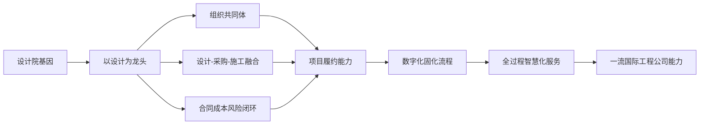

[证据块 P001104 | 评分:7 | 渠道:corpus_stores | 类型:research | 底料:133,371字 | T1命中:0 | 采集章:ch12]

路径: 《电建华东院是如何做EPC总承包？》研究报告_最终版.md

# 电建华东院是如何做EPC总承包？

## 从设计大院到全过程智慧化服务能力的一流国际工程公司的系统性复盘

**研究报告成果稿**

**总包创研院 出品**

---

> **公开信息与合规声明**  
> 本报告基于公开信息分析，并结合用户提供的合法资料以及可公开检索的行业资料进行研究，信息来源合法，公开资料使用合法；报告内容属于第三方研究与管理经验总结，不涉及商业秘密，不代表中国电建集团华东勘测设计研究院有限公司或其关联单位官方立场。报告中涉及企业、项目、规范、媒体报道和公开网页的信息，均以公开资料、已提供资料和研究分析为基础，相关权利归原权利人所有。

> **知识产权与版权声明**  
> 本报告由总包创研院组织研究形成，报告的研究框架、分析模型、文字表达、表格体系、经验提炼和方法论总结依法享有相应知识产权。未经总包创研院书面许可，任何机构和个人不得以复制、摘编、改写、汇编、上传、发布、商业培训、数据库收录、模型训练或其他方式进行商业性使用。合理引用本报告观点时，应注明“总包创研院《电建华东院是如何做EPC总承包？》研究报告”。

---

## 推荐序：向真正会做总承包的工程公司学习

工程总承包不是一种合同包装，而是一种工程企业能力结构的重建。过去许多企业理解EPC，往往停留在“设计、采购、施工打包”的表层，以为拿到总承包合同、建立项目部、把施工分包出去，就完成了从专业公司到工程公司的跨越。实践反复证明，这种理解过于简单。真正的EPC总承包能力，既要能在项目前端把技术方案、投资边界、合同风险和采购逻辑想透，也要能在项目中端把设计、采购、施工、质量、安全、进度和成本拧成一股绳，还要能在项目后端完成试运行、移交、运维衔接和知识复盘。

电建华东院的样本价值，正在于它不是从施工企业逻辑出发理解EPC，而是把长期积累的规划、勘测、设计、科研和数字化能力，转化为工程建设全过程的组织能力和履约能力。它的经验说明，设计院转型做EPC，不能简单地“补施工短板”，而应当把设计优势转化为项目全生命周期价值创造的主导能力；不能只靠项目经理个人英雄主义，而必须建设强矩阵组织、紧密联合体、专业化总承包管理体系和数字化管控平台；不能只追求项目规模扩张，而要把合同边界、风险分配、成本控制、供应链协同和质量安全管理做成标准化、可复制、可迭代的体系。

本报告的写作目的，不是为一家企业作宣传，而是从工程建设行业学习标杆的角度，拆解一个设计型工程公司如何完成EPC能力跃迁。报告以华东院公开信息、典型项目材料和用户提供资料为基础，围绕战略转型、组织体系、设计管理、采购供应链、施工分包、进度质量HSE、成本合同风险、工程数字化、国际化、PPP+EPC、重大项目案例和未来趋势十二个维度展开，力求回答一个更具普遍意义的问题：工程建设企业究竟应当怎样向先进企业学习EPC，而不是只学习表面的项目名称、合同金额和宣传口号。

对正在推进工程总承包转型的设计院、施工企业、咨询公司和投资建设平台而言，本报告更像一份“能力体检表”和“行动路线图”。读者可以对照其中的组织模式、流程机制、风险清单、项目案例和落地方法，重新审视自身是否真正具备总承包能力，是否把设计、采购、施工和商务合同纳入同一经营逻辑，是否已经形成能够穿透现场、支撑项目经理、沉淀组织经验的管理体系。只有当一家企业能够把技术优势、组织优势、商业优势和数字化优势统一起来，EPC才不再是一种高风险承包方式，而会成为企业实现高质量发展的核心能力。

## 内容简介

本报告以《电建华东院是如何做EPC总承包？》为题，在不改变既有章节框架的基础上，对华东院EPC总承包实践进行系统性扩写与深化研究。报告首先从行业转型背景出发，分析传统勘测设计院为什么必须从“输出图纸”转向“输出工程全生命周期价值”；继而梳理华东院由水电勘测设计起步、向工程总承包和全过程智慧化服务能力升级的战略逻辑，概括其“以设计为龙头、以技术创造价值、以数字化固化流程、以组织共同体保障履约”的核心方法。

报告的主体部分按照EPC能力链条展开。第二章和第三章重点分析组织体系与设计管理，解释联合体模式如何从松散协作走向紧密融合，设计人员如何从后方出图者转变为现场技术管理者、成本控制者和方案优化者。第四章至第七章聚焦采购、施工、进度质量HSE、成本合同风险，强调EPC项目真正的利润不是来自简单压价，而是来自设计采购前置集成、供应链动态评价、施工分包穿透式管理、三级进度计划、样板先行、HSE闭环、合同证据链和风险合理分配。第八章从“工程+IT”角度复盘华东院工程数字化能力，说明BIM、质量验评、在线审查、电子归档、智能感知和数字孪生如何把项目经验沉淀为组织能力。第九章至第十二章进一步讨论国际化属地管理、PPP+EPC模式创新、重大项目案例和未来全过程智慧化服务趋势。

报告选取杨房沟水电站、鄂北水资源配置工程15标、深圳茅洲河水环境综合整治、白鹤滩移民工程、卡拉水电站、巴基斯坦新能源项目等典型案例进行分析，尽量用项目事实、管理动作、公开数据、表格模型和专家复盘说明华东院经验的可学习之处。报告既关注理念和战略，也重视项目经理、设计经理、采购经理、施工经理、合同商务经理和HSE经理在真实项目中的工作方法，力求成为工程建设企业学习EPC总承包的系统读本。

## 核心研究框架

| 研究主线 | 关键问题 | 报告回答 |
|---|---|---|
| 战略转型 | 设计院为什么必须做EPC | 从图纸价值转向集成价值，从单项技术服务转向全生命周期工程服务。 |
| 组织体系 | 如何解决设计院施工管控短板 | 通过强矩阵、紧密联合体、项目部共同体和后台专家池实现能力互补。 |
| 价值创造 | EPC利润从哪里来 | 来自设计优化、采购协同、工期压缩、风险前置、变更控制和数字化提效。 |
| 管理闭环 | 如何避免EPC高风险失控 | 以合同边界、风险分配、证据链、质量安全标准化和动态成本管控形成闭环。 |
| 能力升级 | 如何从项目经验走向组织能力 | 用制度、流程、人才、平台和知识复盘把单个项目经验沉淀为可复制能力。 |

## 目录

- 推荐序：向真正会做总承包的工程公司学习
- 内容简介
- 第一章 绪论：华东院EPC总承包的战略转型与发展演进
- 第二章 顶层设计：以设计为龙头的EPC项目组织与管理体系
- 第三章 核心引擎：EPC项目的设计管理与技术价值增值
- 第四章 降本增效：EPC项目的采购与供应链集成管理
- 第五章 高效协同：施工分包管理与现场过程控制
- 第六章 铁三角管控：进度、质量与HSE（安全环保）体系
- 第七章 筑牢防线：EPC项目的成本管控与合同风险管理
- 第八章 数字赋能：“工程+IT”在EPC全生命周期中的智慧应用
- 第九章 扬帆出海：国际EPC项目的属地化与跨文化管理
- 第十章 模式创新：PPP+EPC与新型投融资商业模式的探索
- 第十一章 经典巡礼：华东院重大EPC项目实战案例深度剖析
- 第十二章 展望未来：迈向全过程智慧化服务的一流国际工程公司
- 主要公开资料来源

---
## 第一章 绪论：华东院EPC总承包的战略转型与发展演进

### 1.1 时代背景：从传统勘测设计院到工程总承包的必然选择

在全球工业体系深度重构的当下，无论是德国的“工业4.0”、美国的“先进制造业国家战略计划”，还是我国提出的“中国制造2025”，其核心逻辑均指向了产业链的垂直整合与价值链的端到端覆盖。对于中国勘测设计行业而言，传统的以“输出图纸”为核心的业务模式正遭遇前所未有的结构性挑战。

#### 1.1.1 战略背景综述：利润坍塌与生存空间被动压缩

在国家“一带一路”倡议推动的大规模海外建设中，大批工程企业面临着严重的“同质化”泥潭。特别是在机电设备领域，国内外产品在技术参数上的差距日益缩小，导致海外项目投标演变为纯粹的价格博弈。对于设计院而言，如果仅仅停留在“智力中介”的定位，其价值在DBB（设计-招标-建造）模式中会被不断摊薄。

当传统勘测设计院仅提供图纸时，其实质上在将最核心的资源整合权拱手让人。随着全球制造业利润向服务端和集成端位移，设计院若不输出体现集成价值的管理服务，其市场空间必将萎缩。因此，向“设计-采购-施工”全过程集成化管理跨越，不仅是商业逻辑的自我演进，更是对抗低水平竞争、实现价值增值的必然选择。

公开资料显示，华东院在2008年营收约10亿元，到2017年已达到150亿元，九年间营收增长14倍。这一显著增长，正是其积极向EPC总承包转型，拓展业务边界，提升价值链整合能力的结果。

#### 1.1.2 风险与机遇的深度解构：EPC模式的特殊性

EPC（Engineering Procurement Construction）模式作为国际通行的“交钥匙”合同方式，与传统模式有着本质的差异。它不仅是合同形式的改变，更是风险分配逻辑的重组。以下表格清晰地展示了这种结构性变革：

| 维度 | 传统承包模式 (DBB) | EPC 总承包模式 |
| :--- | :--- | :--- |
| **项目规模与周期** | 规模相对较小，环节拆分，周期离散 | 规模巨大，涵盖全生命周期，周期常达5-10年 |
| **合同性质** | 多数为单价合同，业主承担工程量风险 | 固定总价合同，承包商承担绝大部分风险 |
| **协调面广度** | 业主负责多头管理与接口协调 | 总承包商负责设计、采购、施工、试运行的全方位整合 |
| **责任配比** | 承包商仅按图施工，责任单一 | 总承包商对质量、安全、费用、进度全面负责 |
| **核心驱动力** | 流程驱动，各环节“铁路警察各管一段” | 价值驱动，追求项目全生命周期的最优解 |
| **风险承担主体** | 业主承担大部分设计、采购、施工界面风险 | 总承包商承担大部分项目全过程风险 |
| **利润来源** | 主要来自施工利润，设计费固定 | 来自总承包管理费、设计优化、采购议价、施工效率提升等综合效益 |

EPC模式的这种特性，要求总承包商具备强大的整合能力、风险管理能力和技术创新能力。对于设计院而言，这意味着从单一的技术服务提供商转变为全生命周期解决方案的集成者。

#### 1.1.3 必然性分析：从“绘图板”到“全产业链”的跃迁

在华东院的工程哲学中，转型是对传统DBB模式“结构性熵增”的证伪。传统模式下，设计不考虑施工，采购不匹配设计，导致大量的返工与成本黑洞。华东院通过战略自觉意识到，设计院拥有控制成本最源头的“指挥棒”——如果设计人员能将采购成本（通常占合同总额的40%-60%）和施工难度在图纸阶段就通过**限额设计**予以固化，就能实现管理效益的最大化。

这种跨越并非简单的业务叠加，而是从“工具人”向“操盘手”的身份反转。华东院以此开启了从传统勘测设计大院向国际一流工程公司的自我进化。其官网披露，华东院拥有覆盖电力、市政、建筑、公路、水运、农林、海洋、水利、铁道等十多个行业领域的100多个核心专业，形成从发展规划、项目筹划、投融资、勘测设计、工程总承包到运营维护的全产业链能力。这正是其“全产业链”战略的具象化体现。

### 1.2 华东院EPC业务的发展历程与战略布局（“三步走”战略）

华东院的转型并非盲目扩张，而是一场典型的基于组织进化的“三步走”战略布局，每一步都伴随着技术积累与管理逻辑的重构。

#### 1.2.1 第一阶段：转型初探与试点起航（2014年以前）

作为浙江省第一批工程总承包试点企业，华东院深谙“政府工程率先示范”的意义。公开资料显示，华东院早在上世纪80年代就承担了中国首个水电站工程总承包试点——浙江石塘水电站主体工程总承包。这为后续的EPC业务发展奠定了早期的实践基础。

在2014年成为浙江省工程总承包第一批试点企业后，华东院通过长兴经济技术开发区许家桥三期、陆家斗三期安置房工程等项目，完成了从图纸输出到项目现场管理的初步实战。这一阶段的核心在于建立“项目部”意识，打破了院内“处室化”的壁垒，让设计人员开始关注工序衔接与社会化协作。

**表1-1 华东院EPC业务早期探索与试点项目示例**

| 项目名称 | 项目类型 | 关键特点 | 转型意义 |
| :--- | :--- | :--- | :--- |
| 浙江石塘水电站主体工程 | 水电站 | 中国首个水电站工程总承包试点 | 奠定EPC早期实践基础，积累水电领域总承包经验 |
| 长兴经济技术开发区许家桥三期安置房工程 | 房屋建筑 | 浙江省首批EPC试点项目 | 拓展至非水电领域，验证EPC模式通用性 |
| 陆家斗三期安置房工程 | 房屋建筑 | 浙江省首批EPC试点项目 | 强化项目现场管理能力，培养复合型人才 |

#### 1.2.2 第二阶段：多元化扩张与技术引领（2014-2016年）

在这一阶段，华东院利用其在水电、风电及城市基建领域的技术积淀，实现了国内外业务的双线突破。

**1. 国内标杆项目：** 在金寨抽水蓄能、西藏藏木水电站、大渡河安谷水电站等重大项目中，华东院利用设计优势进行方案优化，有效解决复杂地质条件下的施工难题。其中，杨房沟水电站于2016年1月29日签订设计施工总承包合同，由水电七局与华东院联合体实施，被多方定位为大型水电EPC模式创新示范。该项目装机1500MW，动态总投资约200亿元，主体工程设计采购施工为一个标段，三大主材和主要机电设备采用发包人与总承包人联合采购。杨房沟项目的成功实践，标志着华东院在大型复杂水电工程EPC领域达到了新的高度。

**2. 海外突破：** 以巴基斯坦萨菲尔（Sapphire）风电项目为代表。这是华东院首个在国际金融机构（美国OPIC融资）及巴基斯坦2005年新能源法固定电价模式下运作的IPP项目。该项目面临极
