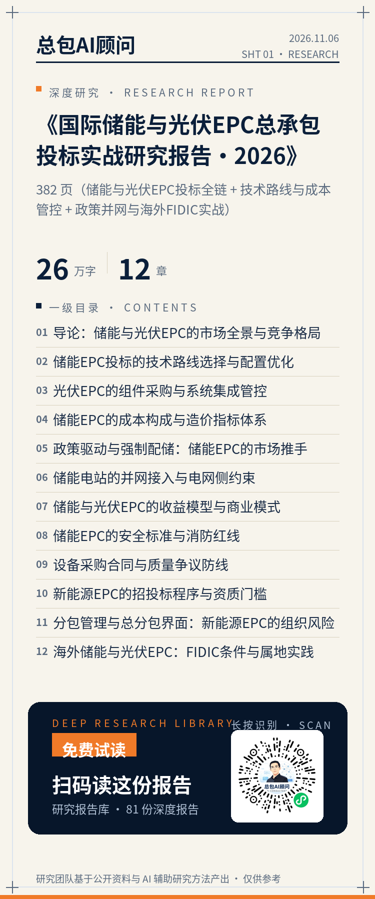

# 114号文重写了储能收益模型
出品：总包创研院研究团队

> 强制配储从「拍脑袋比例」进入「精细化落地」阶段，特许经营权竞争与前期指标获取决定项目先发优势；与此同时，电网节点容量已经取代土地和消纳，成为独立储能开发的第一约束。《国际储能与光伏EPC总承包投标实战研究报告·2026》今天上架：12章、26.2万字、382页，政策线、电网线、收益线三线并进。

## 政策不再是一句「配储10%」

第5章拆解国家与地方「风光+储能」政策演变：各省配储比例与时长的强制性红线对照、共享储能与电源侧配储的指标获取路径、竞争性配置与特许经营权协议签订要点——以及工商业与电源侧项目前期选址、用地规划与安评水保环评的合规审批链条。政策驱动下，纯合规配储正在向市场化独立储能运营演进：还在按老打法拿项目的团队会踩空，因为指标获取的规则已经换了一轮。书中把各省实施细则的差异逐项对照成表，哪省卡比例、哪省卡时长、哪省卡并网时间，一眼可查。

## 收益模型被重写了

第7章的核心判断：独立储能正由资源开发转向资产运营博弈。发改价格〔2026〕114号文确立的容量电价机制叠加现货套利，重塑了项目投资回报模型——「清单制管理」与顶峰能力折算的收益测算方法、容量电价与现货价差的组合测算框架、共享储能与工商业储能的商业模式分层，都在本章展开成可执行的测算流程。还在用单一电量价差模型做可研的团队要警觉：测算结果已经失真，据此做的投资决策正在积累风险。

## 电网侧的硬约束

第6章把并网接入的隐性门槛摆上台面：变电站间隔、主变负载、输电断面等电网节点物理约束的前置排查方法；接入系统方案设计与电能质量评估的要点；涉网性能测试（GB/T 36547/36548-2024）与并网调度协议签署流程；接入批文时限管理——部分地区批复六个月失效的规则与电网资源抢占应对。独立储能开发的第一约束已经变了，还在按旧顺序跑手续的项目，会在最贵的环节卡死。

## 招投标与分包的两道程序关

第10章处理招投标程序与资质门槛：新能源EPC招投标的程序要件、资质要求的口径变化、央企与地方国企的竞争分层；第11章处理分包管理与总分包界面：转包与挂靠的红线、总分包连带责任的裁判口径、劳务层的管理要点——程序上的一个疏漏，足以让技术标第一名的标书作废。

## 海外这条线

第12章面向出海团队：FIDIC条件下的储能与光伏EPC属地实践、国际投标的程序差异与风险分配惯例、一带一路市场的准入案例与教训实录——海外储能大单密集落地的窗口期（196MWh日本储能配套、老挝500MW光伏、沙特NREP Round5等真实项目锚源在册），规则先行者吃肉。出海不是国内打法的简单外推：合同条件、属地合规、汇率与税务、争议解决条款四件套的差异，第12章逐项对照展开。

## 政策研究的用法

本书的政策线不做成「文号汇编」而做成「决策对勘表」：每一条关键政策，对照给出——它改变了什么（指标获取方式/收益结构/并网条件）、影响到谁（开发商/总包方/设备商）、应对窗口多长、错过代价是什么。读者把自己的项目套进表里，就能定位自己所处的政策位置与下一步动作。判例与纠纷案例（设备质量、货款、验收、保函）在第9章同样按「防线清单」组织——签约前读一遍，履约期少踩一半坑。

## 三类决策者的读法

投资开发负责人：先读第5章（政策与指标）再读第7章（收益模型），两章连读等于重做一遍项目可研的框架；总包投标负责人：读第10章（招投标程序与资质）加第9章（设备合同防线），程序与合同双保险；企业战略层：读第1章（市场全景与竞争格局）加第12章（海外FIDIC），国内洗牌与出海窗口两张图一起看。382页的体量按角色拆成三条阅读动线，每条动线两到三章，一个下午能走完。

## 这本书的来路

研究团队为本书建了覆盖37个渠道、306件语料、1.87亿字的事实资料库——判决语料切片、政策文库、行业协会库、海外标讯、行业研报全谱系在册，逐章收编台账留档。书中每个政策文号、装机量、金额与造价指标都可按锚号回溯；382页里没有一句「据介绍」，要么实收原文照录，要么明示为本研究归纳。这是总包创研院研究团队的出品纪律，也是这本书敢把判断写硬的底气。

与已出版的姊妹报告（《工程造价争议判例谱系与调解实务研究报告》《固定总价EPC合同计价调价与风险管控实战研究报告》）对照着读，政策线的体感更完整：判例谱系给你裁判规则，固定总价给你合同设计，本书给你赛道与技术经济判断——三册各自独立，锚源互证，合计超过一千一百页的实战弹药库。政策研究者与战略部门可以把三册的政策章节并排摊开，交叉索引着读。

全书弹药覆盖37渠道306件1.87亿字语料，逐章台账锚号可溯，382页里每个政策文号、装机量、金额与造价指标都有出处。微信搜索「总包AI顾问」小程序，第1章导论免费试读，全本¥698——政策窗口不会等人，先把三张地图拿到手。

