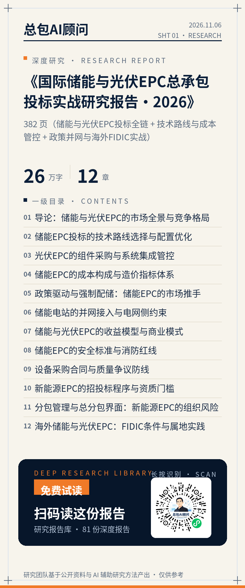

# 储能技术选型，算的是全生命周期的账
出品：总包创研院研究团队

> 储能EPC的技术标，正在从「堆参数」变成「算全生命周期的账」：磷酸铁锂还是液流、液冷还是风冷、构网型要不要上——每一个选型决定都直接写进度电成本和投标底线。《国际储能与光伏EPC总承包投标实战研究报告·2026》今天上架：12章、26.2万字、382页，技术路线与成本管控两条主线一次讲透。

## 技术路线选型：不看谁最新，看谁全生命周期最省

第2章把主流储能技术路线摆在同一张表上对勘：磷酸铁锂、液流电池、压缩空气的技术成熟度与度电成本（LCOE）演进，电池簇排布与PCS/EMS配比的定制化优化，液冷与风控的适用边界——高原、高寒、复杂地形下的电网友好性与抗恶劣环境设计是选型失误的高发区，构网型储能的黑启动与短路容量支撑已从加分项变成部分项目的门槛项。书中给出的不是参数罗列，而是「选型-场景-成本」三轴对勘方法：先定场景约束，再对成本坐标，最后锁技术路线——顺序反了就是返工的开始。

## 组件采购：接口冻结是消解返工的根本

第3章的判断句很硬：组件技术快速迭代倒逼采购前置与接口冻结。高效组件选型浮亏怎么防、供应链剧烈波动怎么对冲、设计与采购接口（DPI）错配引发的交期延误怎么解——答案是DPI早期冻结机制、三维参数化建模集成、大宗物资多项目统筹采购。书中实录了云库存管理与107个采购包沙盘推演的真实做法（167家供应商、2亿元备件协议的统筹案例），采购团队可以直接对照搭建自己的体系。智能逆变器、高压箱变、SVG无功补偿的接口匹配与调试管控，也逐项给了要点清单。

## 成本与报价：概算是底线防线

第4章把成本管控拆成可执行步骤：投资估算与WBS成本科目分解、初步设计概算编制四法（预算单价法、扩大单价法、设备价值百分比法、综合吨位指标法）实操、动态成本调价算式在投标测算中的精细化应用、消耗量定额与清单计价的底线控制——固定总价包干模式下，测算失准就是履约亏损的开始。元/Wh与元/W的行业造价坐标怎么取值、怎么对勘、怎么留余量，本章给出完整作业流程。

## 安全红线与并网门槛

第8章专章处理储能安全：热失控与消防红线的标准依据、GB层面与行业层面的安全配置要求、事故案例的教训拆解——安全不是成本项，是准入项。消防设计一旦在验收阶段被卡，整改的代价远超投标时省下的设备差价；本书把安全配置清单按「投标承诺-设计落实-验收对质」三段组织，每一段都给出标准条款出处。第6章把并网接入的隐性门槛摆上台面：变电站间隔、主变负载、输电断面的前置排查方法，涉网性能测试与并网调度协议的签署要点，接入批文时限管理（部分地区批复六个月失效的规则）与电网资源抢占应对——这些不写进投标方案的章节，正是履约期最贵的事故来源。海外项目还要叠加第12章的FIDIC条件与属地并网惯例，两条线在书中互相引用、互为注脚。

## 数字都能查的底气

本书的证据纪律是一条硬约束：所有项目名、业主、装机容量、金额、工期、造价指标、政策文号与标准号，逐字取自研究团队的事实资料库，正文随文标注锚号，读者可按锚号回溯核验——研究弹药覆盖37个渠道306件语料共1.87亿字。这个纪律在技术章节尤其要紧：LCOE坐标、元/Wh造价水位、组件价格波动区间，每一个数字都有出处；没有出处的判断，书中要么明示为本研究归纳，要么不写。

## 数字都能查

书中所有装机容量、金额、工期、造价指标与政策文号逐字取自事实资料库并随文标注锚号：海西克鲁克100MW/200MWh高原电化学储能、江苏省建筑/安装/市政消耗量定额、GB/T 51048-2025设计规范——无源不写。26.2万字（总装实测262,341汉字）、382页PDF、12章逐章台账，每个数字都可回溯核验。

## 一套可以直接照做的作业流程

把本书第2、3、4章连读，得到的是一条从选型到报价的完整作业流：先按场景约束筛技术路线（高原高寒看环境适应性，调频看响应能力，量价差看LCOE坐标）；再按采购包拆分组件与设备清单，用DPI接口冻结机制锁住设计与采购的界面，云库存与多项目统筹压采购成本；最后用概算四法与动态调价算式合成报价底线，元/Wh坐标定行业水位，留余量按风险清单逐项计提。这条流程在书中每一步都有方法卡、要点清单与真实案例对照——技术标的功夫不在临场，在流程。

## 读者的角色入口

技术总工从第2章进入（技术路线对勘三轴法），采购负责人从第3章进入（DPI冻结与云库存），成本经理精读第4章（概算四法与调价算式），投标总监读第1章与第10章（市场判断与招投标程序），安全总监读第8章（安全标准与消防红线），海外线负责人读第12章（FIDIC属地实践）。每章开篇即说明本章解决什么问题，按需取用，不必通读。

微信搜索「总包AI顾问」小程序，第1章导论免费试读，全本¥698——技术标开标前的一周，值履约期的一百天。

