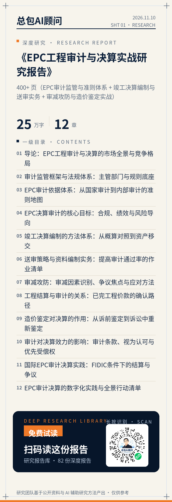

# 审减攻防：一审砍掉两千万怎么救回来
出品：总包创研院研究团队

> 送审三千万，审定两千五——中间的五百万去哪了？审减不是审计的任性，是一场有规则的攻防：工程量重复计算、单价高套、取费错档是高频扣分项，有据可依的送审是最硬的盾。《EPC工程审计与决算实战研究报告》今天上架：12章、25万字、400+页，审减攻防是全书的主战场之一。

## 审减因素清单：知其然才能防其然

第7章把高频审减因素整理成清单：工程量层面（重复计算、超量计算、签证与图纸重复计价）、单价层面（高套定额、错套子目、材料价差取定）、取费层面（费率错档、措施费分摊争议）——每一类都有真实判例的裁判口径对照。读懂清单的意义不是背诵，是反向作业：编制送审资料时逐项自查，把审减因素消灭在送审之前。

## 送审策略：资料编制的作业清单

第6章把送审准备拆成可执行步骤：竣工资料的完整性自查、决算书与概算的对照口径、签证变更的证据链整理、争议项的预沟通策略——送审质量直接决定审减幅度，资料硬的送审和资料软的送审，结果差出一个利润率。书中给出的清单按「资料-口径-证据-沟通」四段组织，可直接对照搭建自己的送审作业流。

## 造价鉴定：从诉前到诉讼中的关键一跃

谈不拢的审减进入鉴定程序。第9章拆解造价鉴定对决算的作用：诉前鉴定与诉讼中鉴定的启动条件、鉴定材料的质证要点、鉴定意见的采信与重新鉴定路径——鉴定不是终点，是争议在专业轨道上的重新开局。鉴定机构怎么选、鉴定范围怎么定、对鉴定意见的异议怎么提，每一步都有程序要点与判例对照。

## 数字都能查

全书判例切片取自2009-2021判决年卷的审计决算族：结算审减攻防、造价鉴定对决算、审计对决算效力、视为认可条款、固定总价、变更签证、停窝工、工期延误、EPC总价包干、工程款优先受偿——十族二十卷2亿字级弹药，逐字搬运入bank、逐章收编留台账。每一个案号、审减金额、裁判规则都可按锚号回溯核验。

## 审减攻防的全周期阶段模型

审减不是竣工后才开始的战斗。本书第7章给出全周期阶段模型：合同签订阶段（计价条款与审计条款的设计直接决定后期攻防空间）、履约阶段（签证变更的证据链管理是抗辩的弹药库）、编制阶段（对决算书自查自纠把审减因素前置消灭）、送审阶段（资料的完整性与口径的一致性决定第一轮砍多深）、谈判阶段（争议项的分级应对——可让可不让的排序）、鉴定阶段（谈不拢的进入专业轨道重新开局）。每个阶段都有动作清单与判例对照，把「审减是终点事故」变成「攻防是全程管理」。

## 高频审减因素的裁判口径

工程量重复计算的认定标准（图纸与签证重复计价的处理）、单价高套的甄别方法（定额子目错套的边界）、取费错档的争议分布（费率适用与措施费分摊）——每一类高频因素在书中都有真实判例的裁判口径：法院支持审减的条件、承包方抗辩成功的证据构成、举证责任的分配规则。读懂裁判口径的意义是双向的：审计方按口径找问题，承包方按口径备证据。

## 从鉴定到优先受偿的最后一公里

鉴定意见不利怎么办——重新鉴定的启动条件与实务难度；结算久拖不决怎么办——工程款优先受偿权的行使期限与顺位规则；发包方以审计未完成为由拒付怎么办——「合理期限最长不超过提交结算文件之日起一年」的司法口径与视为认可条款的成立要件。钱路的最后一公里往往最泥泞，但每一步都有规则可循——本书把规则铺成了路。

## 决算编制的三个常见坑

第5章的编制方法体系里藏着三个高频踩坑点：一是概算对照口径不统一——决算书与批准概算的口径差异没有说明，直接触发审减争议；二是尾工与预留处理不规范——尾工费用限值没有合同依据支撑就成了审减突破口；三是资产移交清单与决算脱节——移交资料不完整影响决算的整体采信。三个坑的共同解法是「编制即对勘」：决算编制的每一步都同步准备对勘底稿，送审时资料与口径自成证据链。书中的编制清单按「概算对照-决算书-资产移交」三段组织，每段有自查项与判例警示。

## 送审前的一周准备清单

把第6章的送审作业清单压缩成一周节奏：第一天到第二天，竣工资料完整性自查（签证/变更/隐蔽工程验收记录逐项核对）；第三天，决算书与合同计价条款逐条对照（计价方式/取费基数/风险分担边界）；第四天，争议项分级排序（可让/可争/必争三档，每档准备证据深度）；第五天，审减因素清单自查（工程量/单价/取费三类逐项过）；第六天，预沟通（重大争议项的非正式交换意见）；第七天，送审包定稿（资料目录+对勘底稿+争议清单密封随附）。一周的准备，换谈判桌上的从容——送审质量就是审减幅度的第一道防线。

商务经理读第6、7章（送审与审减攻防），造价人员读第5、9章（决算编制与鉴定），项目经理读第4、8章（审计目标与价款确认），法务读第9、10章（鉴定与效力规则）。微信搜索「总包AI顾问」小程序，第1章导论免费试读，全本¥698——送审前的一周准备，值审减谈判桌上的百万级得失。

