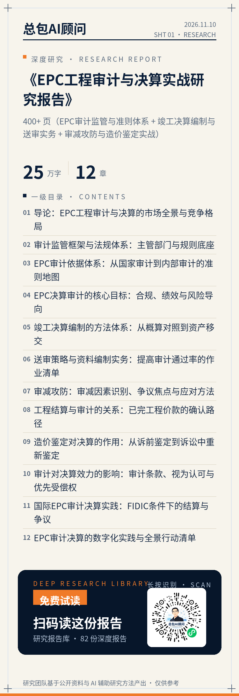

# 发布| 《EPC工程审计与决算实战研究报告》
出品：总包创研院研究团队

> 一份固定总价合同熬到竣工，最后一关是审计与决算——送审价与审定价之间的每一分差，都是利润。审计砍掉的钱有没有依据、你的抗辩有没有证据、合同里那句「以审计为准」到底意味着什么——《EPC工程审计与决算实战研究报告》今天上架：12章、25万字、400+页，从监管框架到FIDIC国际决算，把EPC工程审计与决算的每一处钱眼一次拆透。

## 为什么审计与决算是EPC的最后一公里

EPC总承包的钱路很长：投标报价、设计优化、采购管控、履约签证——每一步都算得辛苦，但最后一公里才是兑现：竣工决算怎么编、送审资料怎么备、审减怎么防、争议怎么解。行业现实是审减率动辄百分之十几起步，高估冒算与有据可依之间隔着一套完整的作业体系。本书第1章用市场全景给出判断坐标：谁在审、依据什么审、审到什么深度——先看清规则，再送审。

## 全书12章的认知地图

第1-3章立骨架：市场全景与竞争格局、审计监管框架与法规体系（审计法/决算条例/主管部门）、审计依据体系（国家审计、社会审计、内部审计的准则地图与计价标准）。第4-5章定目标编决算：决算审计的合规绩效风险三重导向、竣工决算编制方法体系（概算对照/决算报告/资产移交）。第6-7章攻送审与审减：送审策略与资料编制的作业清单、审减攻防（审减因素识别/争议焦点/应对方法）。第8-10章解效力与争议：工程结算与审计的关系（已完工程价款确认路径）、造价鉴定对决算的作用（诉前鉴定到诉讼中重新鉴定）、审计对决算效力的影响（审计条款/视为认可/优先受偿权）。第11-12章放眼看国际与数字化：FIDIC条件下的结算与争议、数字化审计与全景行动清单。

## 三类读者，三张地图

商务经理与造价人员：读第5、6、7章——决算编制、送审准备、审减攻防三件套直接用；项目经理：读第4、8章——审计目标与价款确认路径，履约期少踩坑；法务与风控：读第9、10、11章——鉴定、效力、国际三线作战；企业高管：读第1、12章——全景与体系定战略。

## 证据纪律

25万字级（总装实测为准）、400+页PDF、12章逐章收编台账。研究弹药池2.4亿字：2009-2021判决年卷按审计决算族切片（结算审减/造价鉴定对决算/审计对决算效力/视为认可条款/固定总价/变更签证/停窝工/工期延误/EPC总价包干/工程款优先受偿十族二十卷）、六兄弟战役池跨池收割1722件、行业知识库3000件。每一个案号、金额、审减数字、政策文号与标准号均可按锚号回溯核验——皖0402民初855号的判付金额、（2016）最高法民终695号的分拆结算规则、审计署决算报表制度，都有出处。382页里没有一句「据介绍」。

## 数据卡速览

审减因素的行业分布、视为认可条款的裁判口径分化、造价鉴定的启动与采信规则、FIDIC条件下的决算程序——每一张卡背后都是可回溯的锚源。报告不预测没有依据的未来，只把有据可查的规则与判例摆上台面，判断留给读者，依据全部给足。

## 与姊妹报告配对使用

本书与《工程造价争议判例谱系与调解实务研究报告》《固定总价EPC合同计价调价与风险管控实战研究报告》《国际储能与光伏EPC总承包投标实战研究报告》共用同一事实资料库的不同切面：判例谱系以裁判规则为纲，固定总价以合同设计为纲，储能光伏以赛道与技术经济为纲，本书以审计与决算的最后一公里为纲——四张地图各自独立成册，判例锚源互证。已读前几册的读者会在本书第7章（审减攻防）与第10章（审计效力）遇到熟悉的判例在新语境下的重新组织；新读者从本书进入，按需回溯另三册，学习成本最低。

## 读者的四个角色入口

商务经理与造价人员从第5、6、7章进入（决算编制、送审准备、审减攻防三件套天天要用）；项目经理从第4、8章进入（审计目标与价款确认路径，履约期少踩坑）；法务与风控从第9、10、11章进入（鉴定、效力、国际三线作战）；企业高管从第1、12章进入（全景与体系定战略，数字化趋势看方向）。每章开篇即说明本章帮读者解决什么问题，按需取用不必通读——这是本书按读者认知路径编排的本意。

## 一套可以直接照做的作业流

把第5、6、7章连读，得到的是从决算编制到审减防御的完整作业流：先按概算对照口径编制决算书与资产移交清单，再按「资料-口径-证据-沟通」四段准备送审，最后按审减因素清单逐项自查（工程量重复/单价高套/取费错档）把问题消灭在送审之前。谈不拢的进入第9章的鉴定轨道——诉前还是诉中、鉴定范围怎么定、异议怎么提，程序要点与判例对照都在。这条流程每一步都有方法卡与清单，可以直接对照搭建自己的作业体系。

微信搜索「总包AI顾问」小程序，第1章导论全章免费试读，全本¥698。审计与决战的战场没有旁观席——先把免费的导论读完，再把这套攻防体系带回你的商务部。

