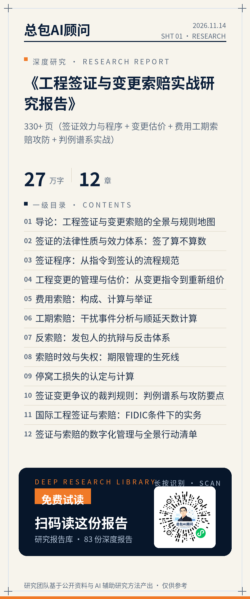

# 停窝工损失怎么算才被法院认？
出品：总包创研院研究团队

> 停工三个月，设备人员天天烧钱，索赔报上去被一句「依据不足」打回来——停窝工损失是索赔实务里举证最难、争议最大的一族。《工程签证与变更索赔实战研究报告》今天上架：12章、26.6万字、330+页，停窝工与判例攻防是全书实战浓度最高的部分之一。

## 停窝工损失：认定与计算的双门槛

第9章专章拆解：停窝工的事实认定（停工令、监理指令、往来函件的证据链）、损失的构成（人员窝工费、设备闲置费、现场维护费、赶工补偿费的分层口径）、计算方法（定额法与实际发生法的适用条件与法院采信倾向）。真实判例对照：有全额支持的完整证据链样本，也有因「笼统主张、无法量化」被驳回的反面教材——差别就在计算口径的证据化程度。

## 判例谱系：裁判规则的攻防地图

第10章把签证变更争议的裁判规则整理成谱系：签证效力的裁判口径分化（表见代理的支持与否定条件）、变更估价的争议焦点（单价高套与重新组价的边界）、举证责任的分配规则（签证缺失时的补充证据路径）、鉴定的启动与采信。读判例谱系的意义是双向的：承包方知道备什么证据，发包方知道挑什么毛病——攻防都在规则里。

## 索赔时效：别让权利睡过头

与停窝工同样致命的是时效：索赔意向28天的惯例期限、逾期失权的裁判支持条件、时效中断的补救窗口——第8章的期限管理规则是所有索赔动作的前置检查项。再硬的索赔主张，过了时效都是零。

## 国际这条线

第11章面向出海团队：FIDIC条件下的变更令程序（工程师决定的时限与效力）、国际索赔的证据标准（ contemporaneous records 的 contemporaneous 要求）、属地化争议解决的路径差异——海外项目的签证索赔，规则先行者先回款。

## 证据纪律与姊妹配对

全书弹药1.45亿字池（判决年卷十九卷切片+跨池九千件+行业知识库），逐章台账锚号可溯，330+页里每个案号、金额、天数、文号都有出处。本书与《EPC工程审计与决算实战研究报告》构成结算回款双璧：审计决算讲最后一公里的攻防，本书讲权利源头的签证与索赔——从签认到兑现的全周期规则闭环。

三类决策者的读法：风控负责人先读第8、10章（时效与裁判规则）再读第9章（停窝工计算）；商务造价团队读第4、5、9章（估价费用停窝工三把算尺）；企业高管读第1、12章（全景与行动清单定体系）。## 停窝工索赔的四周节奏

把第9章的计算方法压成一个月的作业节奏：第一周，事实固定（停工原因的证据收集——停工令、往来函件、监理纪要、影像记录，每一份都要有时间锚点）；第二周，损失分层（人员窝工按实际在场名单与合同人工单价、设备闲置按台班定额与实际停置天数、现场维护按实际发生凭证——三层分开算，混在一起的「一揽子」主张最容易被驳）；第三周，量化计算（定额法与实际发生法的双口径测算，取证据更完整的一路为主张口径）；第四周，报告成文（主张金额、计算依据、证据索引三段式，每一笔钱都能翻到对应的凭证页）。第9章的方法卡按这四段组织，可直接对照排兵。

## 本书怎么用：三个场景速写

场景一：发包人口头通知停工两个月——翻第3章补签证程序与第9章停窝工计算：口头指令的签证补正路径、停工期间的人员设备证据留存清单；场景二：索赔报告交上去三个月没回音——翻第8章时效规则：发包人逾期答复的视为认可条件、索赔时效的自我保护动作；场景三：FIDIC合同下的变更争议——翻第11章：工程师决定的时限效力与国际争议解决路径。规则就在书里，用不用在谈判桌。

## 法院认什么样的停窝工账

把第9、10章的裁判口径合并成一张「采信画像」：被全额支持的账长什么样——停工事实有指令链证据、损失有三层分明细、计算有双口径对照、每一笔钱能翻到凭证页；被驳回的账长什么样——「笼统主张、无法量化」的开放式口径、只有总额没有构成的单页报告、证据与主张对不上号的时间线。两相对照，差距不在索赔金额的大小，在证据颗粒度的粗细。这份画像的价值是反向作业：按「被支持的样子」倒推自己的证据收集清单，每一项在事发当周就开始留痕——事后再补的证据，证明力天然打折。

## 与审计决算的配对读法

停窝工索赔谈不拢会走向两条路：结算审计的审减争议，或者鉴定与诉讼的专业轨道。本书与《EPC工程审计与决算实战研究报告》的配对用法：先读本书第9、10章把索赔主张做扎实，再读审计决算一册的第7、9章看对端怎么拆解——知己知彼的攻防才是完整的攻防。两册合计七百多页的规则弹药，覆盖从签证签认到判决执行的钱路全程。

## 数字化台账：第12章的工具底座

签证与索赔管不住时效，多数不是因为不懂规则，是因为台账太乱。第12章的数字化管理方案：签证单全生命周期状态线（草拟—签认—计价—入账—结算五态跟踪）、索赔时效倒计时（每条主张挂双闹钟——意向到期与报告到期）、证据链索引（每笔主张关联到凭证影像的页码级链接）。工具不神，但工具让规则长在手边——用台账管时效的团队，和用记忆管时效的团队，一个赛季下来的索赔兑现率差距是结构性的。

微信搜索「总包AI顾问」小程序，第1章导论免费试读，全本¥698——停工损失报告递出去之前，先看看法院认什么样的账。

