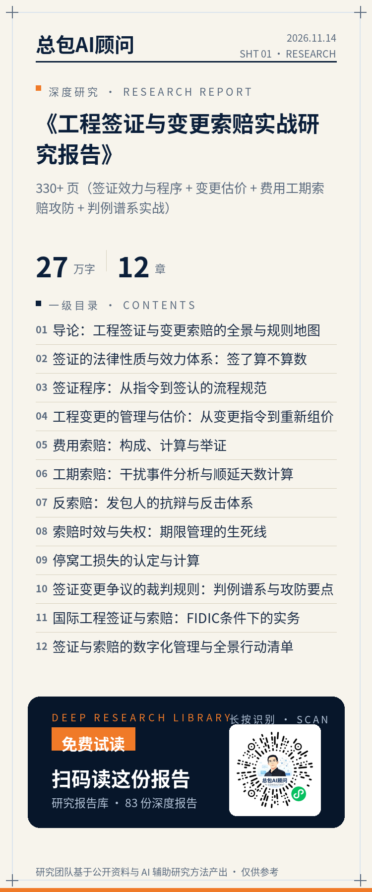

# 签了算不算数？签证效力与索赔时效的生死规则
出品：总包创研院研究团队

> 现场代表签了字，公司说不认；发包人拖了两年不答复，索赔还有没有效——签证与索赔的两头，都卡在「算不算数」这个法律问题上。《工程签证与变更索赔实战研究报告》今天上架：12章、26.6万字、330+页，效力与时效是全书最锋利的两把刀。

## 签证效力：签了算不算数

第2章拆解签证的法律性质与效力体系：谁有权签（项目经理的签字对公司有没有约束力——表见代理的裁判口径）、签了什么算数（签证单的记载事项与证据效力）、口头指令怎么办（指令签证与补签证的成立条件）。真实判例对照：有签认被全额支持的，也有签认因权限瑕疵被推翻的——分水岭就在效力要件的全套证据链上。

## 签证程序：流程规范决定证据质量

第3章把签证程序拆成可执行的流程规范：从工程师指令到现场签认的时限、隐蔽工程签证的特殊要求（覆盖后无法复核的证据唯一性）、补签证的适用条件与风险。程序规范的意义不是走形式——程序即证据：按规范走的签证在谈判桌和法庭上都硬气，程序残缺的签证签了也白签。

## 索赔时效：期限管理的生死线

第8章专章处理时效：索赔意向的提出期限（28天惯例与合同约定的关系）、逾期索赔的失权后果（法院支持失权抗辩的条件）、时效的中断与补救路径。工地上最贵的沉默往往发生在这一章——权利都有期限，期限都写在合同里，错过就是真错过。

## 费用工期双索赔与反索赔

第5-6章给出索赔主力打法：费用索赔的构成要素与计算口径、工期索赔的干扰事件分析与顺延天数计算（网络计划关键线路方法）；第7章反索赔——发包人的抗辩与反击体系（质量缺陷反诉、逾期违约金主张）。攻防一体，只练攻不练防的索赔是跛脚的。

## 数字都能查

全书判例切片取自2009-2021判决年卷的签证索赔族十九卷：变更签证效力、签证程序、费用工期索赔、反索赔、停窝工、索赔时效、隐蔽工程签证、固定总价、EPC变更边界——1.45亿字弹药逐章收编留台账。每一个案号、金额、天数、裁判规则都可按锚号回溯核验。

## 签证单的必备记载项清单

一张打得赢的签证单，记载事项的完整性是第一道关：事项描述（做了什么、为什么做——事实与原因分层写）、指令依据（谁的指令、什么形式、何时下达）、工程量（可计量的量化表述，避免「按实结算」式的开放口径）、单价与金额（有单价的写单价，无单价的写组价原则）、影像附件（施工前后对照、隐蔽部位覆盖前留证）、签收信息（谁签的、职务、权限来源、签收时间）、时限标注（指令时间与签认时间，程序合规的自证）。第3章的模板清单逐项展开，每一项都配有「缺了这一项会怎样」的判例警示——签证单不是备忘录，是未来的呈堂证供。

## 变更估价的争议焦点

签证签认之后，钱怎么算还有一道关：合同内单价的直接适用（单价合同的量价分离逻辑）、类似单价的参照适用（「类似」的认定标准与调整系数）、重新组价的触发条件（无单价可套时的组价依据与争议分布）。第4章把三条路径的适用条件、证据要求与裁判口径整理成对照表——同一张签证单，走对路径与走错路径的金额差，动辄是一个利润点。

## 效力要件的自查清单

把第2章的效力规则压成一张自查表，每张签证单签发前过一遍：签认人是否有授权（书面授权文件是否在档、岗位权限是否明示）——无授权签认的表见代理成立条件是否满足；记载事项是否完整（事项、依据、量、价、附件五要素齐不齐）；程序时限是否合规（指令后多长时间内签认、有无超期补签的痕迹）；原件是否在手（复印件的证明力折损规则）；台账是否同步（签证单编号、状态、金额是否入账可查）。五个问题全绿，这张签证单在谈判桌和法庭上才立得住——自查五分钟，省掉的是事后翻案的五个月。

## 时效红线的三个数字

第8章的时效规则浓缩成三个要记的数字：索赔意向的提出窗口（合同约定优先，FIDIC惯例28天）、索赔报告的提交期限（意向后的完整报告时限）、诉讼时效的起算点（知道或应当知道权利受损之日起算的民法口径）。三个数字写进项目管理日历，每一条索赔主张挂一个倒计时——时效管理不是法务一个人的事，是整个项目部的呼吸节奏。错过时效的索赔主张，金额再大也是零；管住时效的团队，才有资格谈索赔金额。

## 反索赔的另一面

第7章把发包人的反击体系摆在台面：质量缺陷反诉的启动条件与举证、逾期竣工违约金的主张逻辑、对索赔报告的程序性抗辩（时效失权、程序瑕疵、证据不足三张牌）。读反索赔不是替对端操心——是把自己的索赔放在对端的枪口下检查：我的时效经得起失权抗辩吗、我的程序经得起瑕疵检查吗、我的证据经不起哪一问。攻防一体的检查习惯，是成熟索赔团队的标志。

商务经理读第2、3、8章（效力程序时效三件套），造价人员读第4、5、9章（估价费用停窝工），法务读第8、10章（时效与裁判规则），国际线读第11章（FIDIC变更令与索赔程序）。微信搜索「总包AI顾问」小程序，第1章导论免费试读，全本¥698——签证单递出去之前的一小时，值谈判桌上的百万级得失。

