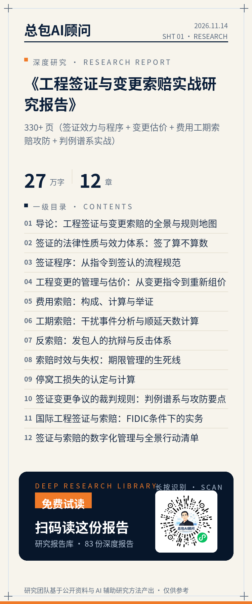

# 发布| 《工程签证与变更索赔实战研究报告》
出品：总包创研院研究团队

> 一张签证单，签下去是钱，签不下去是官司。工程签证与变更索赔是商务的第二战场：签证是权利的载体，索赔是权利的兑现——而时效是权利的生死线。《工程签证与变更索赔实战研究报告》今天上架：12章、26.6万字、330+页，从签证效力到FIDIC国际索赔，把第二战场的每一处规则与攻防一次拆透。

## 为什么签证与索赔是第二战场

第一战场（投标报价）决定能不能赚钱，第二战场（签证索赔）决定赚的钱能不能落袋。行业现实：签证签认率不高、补签证争议频发、索赔时效屡屡失权、发包人反索赔越来越专业。本书第1章给出全景判断：效力之争已成为结算头号高地、时效之刀越磨越快、总承包固定总价把变更索赔推到最前沿——先看清战场，再排兵布阵。

## 全书12章的认知地图

第1章全景与规则地图；第2-3章立签证根基：签证的法律性质与效力体系（签了算不算数）、签证程序（从指令到签认的流程规范，含口头指令与补签证）；第4章工程变更的管理与估价（变更指令到重新组价）；第5-6章攻索赔主力：费用索赔（构成、计算与举证）、工期索赔（干扰事件分析与顺延天数计算）；第7章反索赔（发包人的抗辩与反击体系）；第8章索赔时效与失权（期限管理的生死线）；第9章停窝工损失的认定与计算；第10章签证变更争议的裁判规则（判例谱系与攻防要点）；第11章国际工程签证与索赔（FIDIC条件下的实务）；第12章数字化管理与全景行动清单。

## 三类读者，三张地图

签证管理人员读第2、3、4章——效力、程序、估价三件套定流程；商务与造价人员读第5、6、9章——费用工期停窝工三把算尺；法务与风控读第8、10、11章——时效、裁判、国际三线作战。每章开篇导读卡30秒抓住章价值，按需取用不必通读。

## 证据纪律

26.6万字（总装实测266,373 CJK）、330+页PDF、12章逐章收编台账。研究弹药1.45亿字：判决年卷按签证索赔族切片十九卷（变更签证效力/签证程序/费用工期索赔/反索赔/停窝工/索赔时效/隐蔽工程签证/固定总价/EPC变更边界）、六大战役池跨池收割九千余件、行业知识库。每一个案号、金额、天数、文号均可按锚号回溯核验——皖0402民初855号的签证效力、（2016）最高法民终695号的变更规则、20天与28天的失权刻度，都有出处。330页里没有一句「据介绍」。

## 与姊妹报告配对使用

本书与《EPC工程审计与决算实战研究报告》《工程造价争议判例谱系与调解实务研究报告》构成结算回款三部曲：判例谱系给全景判例地图，审计决算讲最后一公里的攻防，本书讲签证索赔这一权利源头——从签证签认到索赔兑现的全周期规则闭环。已读前两册的读者会在本书第10章遇到熟悉的判例族在签证语境下的深化；新读者从本书进入，按需回溯，学习成本最低。

## 数据卡速览

签证效力的裁判口径分化、索赔时效的失权规则、停窝工损失的计算方法、FIDIC变更令程序——每一张卡背后都是可回溯的锚源。报告不预测没有依据的未来，只把有据可查的规则与判例摆上台面，判断留给读者，依据全部给足。

## 一套可以直接照做的签证管理作业流

把第2、3、4章连读，得到的是从指令到组价的完整作业流：收到变更指令先做程序分类（紧急抢险走简化通道、常规变更走标准流程）→24小时内出签证单初稿（记载事项按模板十项逐项填齐）→分层签认（技术条款与经济条款分开签，避免技术签认绑架经济确认）→变更估价三路径选择（合同单价适用、类似单价参照、重新组价的适用条件与证据准备）→台账登记与时效跟踪（每张签证单的状态、金额、时限一条线管理）。这条流程在书中每一步都有模板要点与判例警示，项目部可以直接对照搭建自己的签证管理体系——签证管理做得好的项目，索赔阶段的工作量减一半。

## 读者的四个角色入口

现场项目经理从第3章进入（签证程序的时限与证据要求天天要用）；商务经理从第2、8章进入（效力要件与时效红线是底线思维）；造价人员从第4、5、9章进入（估价费用停窝工三把算尺）；法务从第8、10章进入（时效与裁判规则的攻防两端）。每章开篇导读卡30秒抓住价值，章末小结要点可扫读——这是一册按工具书逻辑编排的实战手册，不是一册需要从头读到尾的专著。

## 与审计决算的接力关系

签证索赔与审计决算是同一条钱路的上下游：签证与变更索赔决定「应得多少」，审计与决算决定「实得多少」——上游的证据质量直接决定下游的攻防难度。签证单记载完整的变更，在结算审核阶段一目了然，审减争议自然少；签证残缺的变更进了审计，每一处模糊都是审减的切口。本书与《EPC工程审计与决算实战研究报告》的配对价值就在这里：一册管权利的源头，一册管兑现的终点，两册合读等于把从履约到回款的整条钱路装进口袋。已经读过审计决算一册的读者，把本书放在它前面读——先补源头，再看终点，规则闭环才算完整。

## 数据卡的用法

书中每章的判例与规则都可以当工具卡用：签证效力要件卡（遇到效力争议时逐项自查）、时效红线卡（每个索赔动作前的期限检查）、停窝工计算卡（损失主张的三层口径模板）、FIDIC程序卡（国际项目的时限与证据要求）。把卡片贴在项目部墙上，比出事后再翻书更值钱——工具书的最高用法不是读过，而是用旧。

微信搜索「总包AI顾问」小程序，第1章导论全章免费试读，全本¥698。第二战场没有旁观席——先把免费的导论读完，再把这套攻防体系带回你的项目部。

