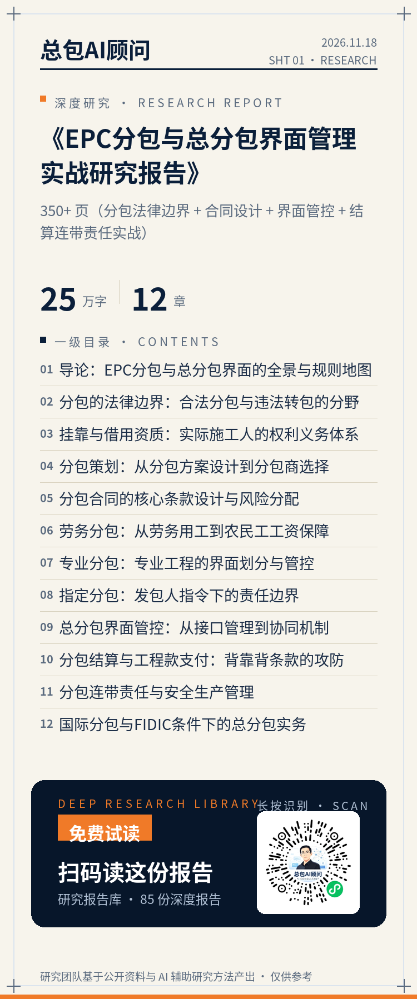

# 分包的事故就是总包的事故
出品：总包创研院研究团队

> 分包商的施工人员从脚手架坠落，伤者家属把总承包商告上法庭——这不是假设，是每天都在发生的真实诉讼。连带责任让总包无法置身事外：安全生产连带、质量缺陷连带、农民工工资连带清偿、实际施工人直诉发包人。但连带责任不是绝对的——有抗辩空间、有追偿路径、有责任边界。《EPC分包与总分包界面管理实战研究报告》今天上架：12章、90万字、350+页，第11章的连带责任与安全管理体系是全书判例密度最高的章节之一。

## 连带责任的三条主线

第11章把分包连带责任整理成三条主线：安全生产连带（分包商的施工安全事故，总包承担连带赔偿责任——安全生产法的明文规定与判例适用）、质量缺陷连带（分包工程的质量缺陷，总包对发包人承担全部责任后向分包追偿）、工资清偿连带（农民工工资拖欠，总包先行清偿后向分包商追偿——条例的刚性约束）。每条主线的构成要件、抗辩事由、追偿路径都有判例对照。

## 实际施工人：最高法司法解释的突破性规则

第3章深入实际施工人制度：最高法司法解释允许实际施工人（借用资质的挂靠人、转包的实际施工者）直接起诉发包人，突破了合同相对性原则。这一规则对总包意味着什么？总包可能面临实际施工人的直接索赔，即使总包与实际施工人之间没有合同关系。应对路径：证明实际施工人不具备认定条件、证明工程款已足额支付、援引合同相对性抗辩。每条路径的判例支持率在书中用数据说话。

## 指定分包：发包人指令下的责任重新分配

第8章处理指定分包的特殊规则：发包人指定分包商时，总包对指定分包的责任是否减轻？FIDIC条件下的指定分包商（Nominated Subcontractor）制度如何运作？指定分包的书面指令证据如何固定？——指定分包不是总包选的，但连带责任照样追到总包头上。应对策略在判例中展开。

## 国际分包：FIDIC条件下的总分包实务

第12章面向出海团队：FIDIC合同条件下的分包限制（Red Book第4.4条）、指定分包商制度（第5条）、分包合同与国际主合同的背靠背衔接、属地化分包的法律风险（伊斯兰法系/大陆法系/英美法系对分包的不同态度）。海外项目的分包界面，规则先行者先回款。

## 数字都能查

## 分包安全管理的防线体系

安全生产连带责任不是签了分包合同就结束——它是一个持续的管理义务体系。第11章把安全防线拆成三道：第一道防线（准入关）——分包商安全资质审查、安全生产许可证核验、安全员配备检查、特种作业人员持证核查；第二道防线（过程关）——安全技术交底、危险源辨识与管控、安全检查与隐患整改、应急预案与演练；第三道防线（事后关）——事故报告程序、先行赔付的资金准备、向分包商追偿的证据固定。三道防线每一关都有判例警示——安全投入省下的小钱，在事故连带赔偿面前是九牛一毛。

## 挂靠的识别清单：总包怎么保护自己

第3章提供一张挂靠识别自查表：签约主体与实际施工主体是否一致（公章、法人代表、项目经理是否真实在场）、资金流向是否经过被挂靠企业账户、材料采购由谁实际实施、技术资料由谁编制。四个信号全亮红灯=高度疑似挂靠。总包的应对动作：要求分包商提供项目部人员社保缴纳记录（证明劳动关系）、留存分包商施工现场的管理记录（证明实际管理）、在分包合同中加入挂靠违约条款（发现挂靠立即解除并追偿）。识别清单的价值不是拒绝分包，而是在纠纷发生时有证据证明总包尽到了审查义务。

## 指定分包的责任边界

发包人指定分包商（发包人选人、总包签合同）时，总包的责任是否减轻？第8章的裁判规则：指定分包不免除总包的总承包管理责任，但总包可以主张发包人对指定分包商的选择存在过错。这一规则的实际操作难度在于证据——如何证明发包人的指定行为构成干预、如何证明总包对指定分包商的资质提出了异议但被发包人否决。书中用真实判例展示成功与失败的证据组合差异。

## 本书怎么用：三个场景速写

场景一：分包商的工人在工地受伤，家属要起诉总包——翻第11章：安全生产连带责任的构成要件、总包的抗辩路径、先行赔付后的追偿程序；场景二：分包合同里写了背靠背条款，分包商起诉要钱——翻第10章：条款效力的裁判口径分布、善意履行的证据组织、付款条件成就的认定标准；场景三：发现分包商实际是挂靠——翻第3章：实际施工人的认定标准、总包的应对动作、合同解除与追偿的操作步骤。三个场景三条规则路径，规则就在书里，用不用在谈判桌。

## 与EPC商务四部曲的配对

本书与《工程签证与变更索赔实战研究报告》《EPC工程审计与决算实战研究报告》《EPC工程保险与保函实务研究报告》构成EPC商务四部曲，合计超过一千五百页的规则弹药库：签证管权利源头、审计决算管最后一公里、保函保险管全程风险保障、分包界面管组织基因——四册合读等于把EPC商务全生命周期的规则闭环装进口包。微信搜索「总包AI顾问」小程序，第1章导论免费试读，全本¥698。

