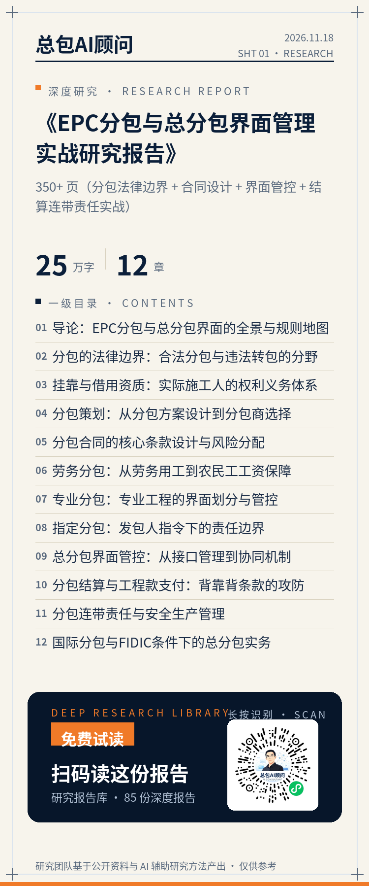

# 背靠背条款还能用吗？
出品：总包创研院研究团队

> 「业主付款后再付分包款」——背靠背条款写在分包合同里看似天经地义，但司法实践对它的效力认定分歧巨大：有法院支持（意思自治），有法院否定（显失公平），有法院折中（附条件但须善意）。《EPC分包与总分包界面管理实战研究报告》今天上架：12章、90万字、350+页，背靠背条款攻防是全书最实战的章节之一。

## 背靠背条款的三种命运

第10章拆解背靠背条款在司法实践中的三种命运：支持派认为分包合同是商事合同，背靠背条款是意思自治的体现，总包未收到业主付款时分包商无权主张；否定派认为该条款实质是将总包的经营风险转嫁给分包商，违反公平原则；折中派认为条款本身有效但总包须证明其已积极向业主主张付款（善意履行义务）。三派的裁判口径在书中按最高法到高院到中院层级梳理，每级都有真实案号。

## 转包红线：合法分包与违法转包的分野

第2章处理EPC分包最基础也最容易踩坑的问题：什么算合法分包、什么算违法转包？主体结构不能分包、专业工程只能分包给有资质的专业分包商、劳务分包不等于劳务派遣——三条红线的法律依据与判例边界在书中逐条展开。踩线后果：分包合同无效、实际施工人可以直接起诉总包、行政处罚。这条红线不是理论问题，是每一个总承包项目开工前必须自查的问题。

## 挂靠与实际施工人：最复杂的权利义务网

第3章专章处理挂靠与借用资质：实际施工人的认定标准（谁实际投入资金、材料、人力）、实际施工人可以直接起诉发包人的权利基础（司法解释的突破性规定）、被挂靠企业对外的连带责任与对内的追偿权。真实判例对照：有的挂靠人成功主张了工程款，有的挂靠人被判赔偿总包损失——分水岭在证据链的组织。

## 劳务分包与农民工工资保障

第6章处理劳务分包的特殊规则：劳务分包与专业分包的本质区别（劳务vs工程）、农民工工资先行清偿机制的适用条件、《保障农民工工资支付条例》对总包的刚性约束（总包代付责任）。条例的每一个条文号都与bank对勘，bank没有的条号如实声明不写——数字零造假在劳务领域的体现。

## 数字都能查

全书判例切片取自2009-2021判决年卷的分包界面族二十三卷，2.3亿字弹药逐章收编留台账。每一个案号、金额、裁判规则都可按锚号回溯核验。

## 背靠背条款攻防的作业清单

把第10章的裁判规则压成一张作业清单：签约前——评估业主付款信用（背靠背条款的风险源头在业主不在分包）、审查条款措辞（「业主付款后」还是「业主验收后」还是「业主结算后」——时点差异决定付款条件成就的认定）、设置合理的等待期限上限（无限期等待=变相拒绝付款）。履约中——保留向业主主张付款的积极证据（催款函、诉讼记录）、及时通知分包商业主付款状态、留存分包商的施工验收记录（证明工作已完成，与付款条件解耦）。争议时——评估善意履行抗辩的可行性、组织付款条件成就与否的证据链、必要时主张条款无效。每一步都有判例参照，项目部可以直接对照搭建自己的背靠背管理清单。

## 分包合同的核心条款设计

第5章拆解分包合同八大核心条款：价格条款（固定总价vs固定单价vs可调价格——分包计价方式与总包合同计价方式的镜像关系）、工期条款（分包工期与总包工期的衔接——分包延期是否构成总包对业主违约的免责事由）、质量条款（质量标准与验收程序——分包工程验收合格不等于总包对业主的质保责任解除）、付款条款（进度款比例与背靠背条件的平衡）、保证金条款（履约担保与质保金的扣留条件）、违约条款（违约金计算方式与损失赔偿范围）、转让条款（分包合同能否随主合同转让）、争议解决条款（诉讼vs仲裁——管辖法院的选择策略）。八大条款的模板要点与判例警示在书中逐条展开。

## 分包结算的实务要点

分包结算不是总包结算的简单按比例缩小——它有独立的问题域：分包工程量的确认方式（与总包合同工程量清单的口径差异）、分包单价的调整机制（主合同价格调整时分包价格是否联动）、分包索赔的传导路径（分包商向总包索赔后总包能否向业主索赔的传导链）。第10章把这些实务要点整理成可执行的操作指引，每一个口径差异都有判例对照——同一份分包合同在不同法院可能得到不同结算结果，分水岭在证据链的组织。

## 与审计决算的配对读法

分包结算谈不拢进入审计阶段后，分包商、总包、业主三方的结算口径差异如何协调？本书与《EPC工程审计与决算实战研究报告》的配对用法：先读本书第10章把分包结算规则做扎实，再读审计决算一册看审减如何影响分包结算——总包被审减的部分能否传导给分包商，取决于分包合同的风险分配条款。两册合计近八百页的规则弹药，覆盖从分包签约到结算回款的钱路全程。

商务经理读第5、10章（合同设计与结算攻防），项目经理读第4、9章（策划与界面管控），法务读第2、3、11章（边界、挂靠、连带三线）。微信搜索「总包AI顾问」小程序，第1章导论免费试读，全本¥698。

