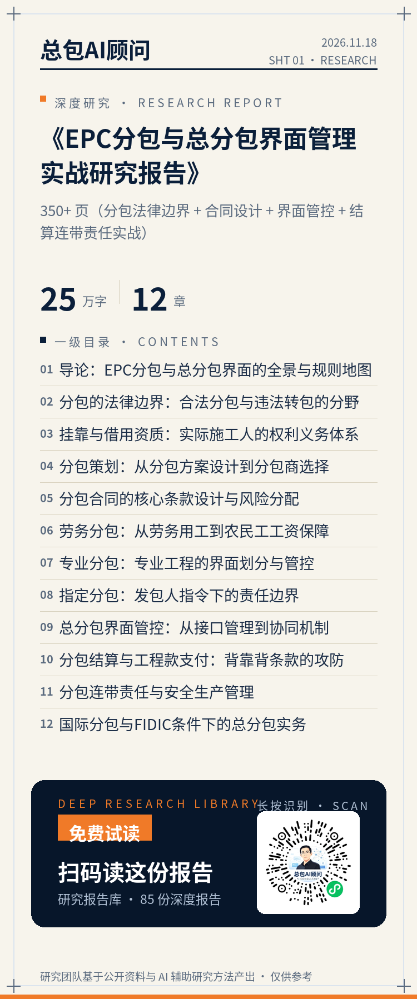

# 发布| EPC分包知识库（5953件）
出品：总包创研院研究团队

> 你在做EPC项目，需要查阅分包转包挂靠相关的判例、政策文件、行业标准——不用自己花几百小时搜集了。总包创研院把《EPC分包与总分包界面管理实战研究报告》的全部调研弹药整理成专业知识库，5953件原始材料一次性打包，¥19即可拥有。

## 这个知识库里有什么

四类原始材料，全部来自报告调研的真实弹药：判例语料（650MB判决切片，含总分包界面纠纷/转包违法分包/挂靠借用资质/劳务分包/专业分包等十二主题族的判决书切片）、行业知识库（5162件行业报告/研究论文/实务文章）、跨池收割（419件来自六大战役池的高质量材料）、政策文件（258件法律法规/部门规章/司法解释/地方规定）。

## 谁需要这个知识库

正在做EPC分包策划的项目经理——5162件行业知识库帮你快速了解行业最佳实践；处理分包合同纠纷的法务——650MB判决切片覆盖十二类分包争议，按图索骥找到同类判例；研究分包政策的造价工程师——258件政策文件帮你追溯从建筑法到最新司法解释的完整脉络。

## 与报告的配对使用

这个知识库是《EPC分包与总分包界面管理实战研究报告》（¥698）的原始弹药。报告是经过专业收编的深度分析（90万字/12章/350+页），知识库是未经加工的原始材料。买报告=买深度分析，买知识库=买原始弹药，两者互补不替代。已有报告的读者买知识库可以验证报告中的每一个数据出处。

## 数据质量

全部5953件材料经过自动质量评估，判有效率84.8%（高质量）。文件按四大类分类存放，每类目录下有完整文件索引。数据来源涵盖37个调研渠道的公开资料。

## 购买方式

## 知识库与研究报告的关系

这个知识库（¥19）和报告（¥698）的关系是「原始弹药」和「深度分析」的关系。报告90万字是经过专业收编的精加工产品——每一个数字都经过bank对勘、每一个判例都经过锚点挂接、每一章都经过五步编辑法打磨。知识库是未加工的原始材料——5953件文件直接从调研弹药池打包，保留原始格式和原始内容。买报告=买结论和方法论，买知识库=买证据和数据源。两者互补：已有报告的读者可以通过知识库验证报告中的每一个数据出处；没有报告的读者可以直接用知识库做自己的研究。

## 购买与交付流程

第一步：微信搜索「总包AI顾问」小程序，进入「智库」页面的知识库市场栏目；第二步：找到「EPC分包与总分包界面管理·知识库」，查看免费蓝图（目录+3件精选样本）确认内容质量；第三步：点击购买，输入接收知识库的邮箱地址；第四步：微信支付¥19；第五步：3秒内邮箱自动收到百度网盘下载链接；第六步：打开链接下载807MB ZIP包，解压即用。全流程自动化，无需等待人工发货。

微信搜索「总包AI顾问」小程序→智库页→知识库市场→下单购买→输入邮箱→自动收到百度网盘下载链接。长按识别海报中小程序码直达。

## 知识库的分类与索引

5953件文件不是散乱堆放——按四大类组织：判例语料目录下按十二主题族切片（总分包界面纠纷/转包违法分包/挂靠借用资质/劳务分包/专业分包/分包合同纠纷/连带责任/分包资质/指定分包/分包结算/分包安全责任/国际分包），每个主题族内的判决书保持原始格式；行业知识库目录下按行业报告/学术论文/实务文章/政策解读分类；跨池收割目录下来自六大战役池的交叉素材；政策文件目录下按法律/行政法规/部门规章/司法解释分类。每个目录下有INDEX.md全量文件索引，先看索引再决定读哪些文件——不用打开5953个文件逐个翻。

## 为什么¥19值得买

按市场价算一笔账：请一个法律数据库账号一年几千到上万，只覆盖判决书不含行业报告；请一个行业研究数据库一年也要几千，只覆盖行业不含判例。这个知识库两类都有——650MB判决切片+5162件行业知识库+258件政策文件+419件跨池材料，一次性打包¥19。不是因为材料不值钱，是因为报告产线在调研过程中已经批量获取了这些材料，边际成本接近零——把调研弹药二次变现，让利给用户。总包创研院的知识库定价原则是「1元/G基准×质量系数」，这个知识库质量系数0.848（高质量），最终价格¥19是公式计算的结果，不是拍脑袋。

## 未来更新

总包创研院的报告产线每天生产新报告、积累新弹药。后续每份报告的调研材料都会同步生成知识库产品上架。购买过知识库的用户会通过邮箱收到新知识库的上架通知。这个知识库是第一个，后面还会有签证索赔知识库、审计决算知识库、保险保函知识库等系列上架。

## 分包管理者的实用价值

分包管理是EPC项目最高频的日常战场。做分包策划时，5162件行业知识库帮你了解行业最佳实践和标杆做法——别人怎么做分包方案设计、怎么选择分包商、怎么划定分包范围边界。写分包合同时，650MB判决切片帮你预判合同条款的争议风险——背靠背条款在不同法院的命运、连带责任的构成要件、实际施工人的直诉条件。处理分包纠纷时，判决切片直接提供同类判例的裁判路径——法院怎么认定转包、怎么处理挂靠、怎么分配连带责任。管分包安全时，258件政策文件帮你追溯从建筑法到安全生产法的完整规范体系。一个¥19的知识库，覆盖分包管理的全生命周期。

微信搜索「总包AI顾问」小程序→智库→知识库市场→下单购买→输入邮箱→自动收到百度网盘下载链接。长按识别海报中小程序码直达。

