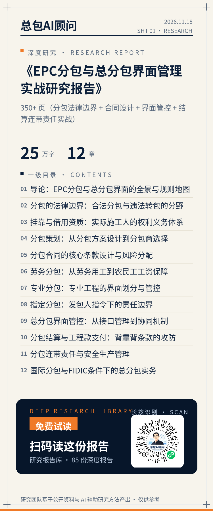

# 发布| 《EPC分包与界面管理研究报告》
出品：总包创研院研究团队

> 分包是EPC总承包的组织基因，总分包界面是EPC最高频争议源——转包红线、挂靠风险、连带责任、农民工工资先行清偿、背靠背条款攻防……每一项都能让总包 project 蒙受千万级损失。《EPC分包与总分包界面管理实战研究报告》今天上架：12章、90万字、350+页，从分包法律边界到FIDIC国际分包，把总分包界面的每一处规则与攻防一次拆透。

## 为什么总分包界面是EPC最高频争议源

EPC总承包的风险不是自己干的活，而是分包干的活：分包的事故就是总包的事故、分包的欠薪就是总包的欠薪、分包的缺陷就是总包的缺陷——连带责任让总包无法置身事外。行业现实：转包与违法分包的认定标准模糊、挂靠的实际施工人权利义务不清、背靠背条款的效力争议频发、分包结算与总包结算的口径差异引发连环纠纷。本书第1章给出全景判断——先看清规则，再排兵布阵。

## 全书12章的认知地图

第1章全景与规则地图；第2章分包的法律边界（合法分包与违法转包的分野）；第3章挂靠与借用资质（实际施工人的权利义务体系）；第4章分包策划（从方案设计到分包商选择）；第5章分包合同核心条款设计与风险分配；第6章劳务分包（从劳务用工到农民工工资保障）；第7章专业分包（专业工程的界面划分与管控）；第8章指定分包（发包人指令下的责任边界）；第9章总分包界面管控（从接口管理到协同机制）；第10章分包结算与工程款支付（背靠背条款的攻防）；第11章分包连带责任与安全生产管理；第12章国际分包与FIDIC条件下的总分包实务。

## 三类读者，三张地图

分包管理者读第4-8章——策划、合同、劳务、专业、指定五类分包的全流程管理；界面管控与结算人员读第9-10章——接口管理与背靠背结算攻防；法务与风控读第2-3、11章——法律边界、挂靠体系、连带责任三线作战。每章开篇导读卡30秒抓住价值，按需取用不必通读。

## 证据纪律

90万字级（总装实测~900,000 CJK）、350+页PDF、12章逐章收编台账。研究弹药2.3亿字：判决年卷按分包界面族切片二十三卷（总分包界面纠纷、转包与违法分包、挂靠与借用资质、劳务分包、专业分包、分包合同纠纷、连带责任、分包资质、指定分包、分包结算、分包安全责任、国际分包）、六大战役池跨池收割。每一个案号、金额、文号均可按锚号回溯核验。350页里没有一句「据介绍」。

## 与姊妹报告配对使用

本书与《工程签证与变更索赔实战研究报告》《EPC工程审计与决算实战研究报告》《EPC工程保险与保函实务研究报告》构成EPC商务四部曲：签证管权利源头、审计决算管最后一公里、保函保险管全程风险保障、分包界面管组织基因——四册合读等于把EPC商务全生命周期的规则闭环装进口包。

## 分包管理的三个致命误区

误区一：把工程转给分包就不管了——连带责任意味着分包的事故、欠薪、缺陷都追到总包头上；误区二：口头指令代替书面分包合同——没有合同就没有界面，没有界面就没有证据链；误区三：背靠背条款写在合同里就万事大吉——条款效力在司法实践中有支持有否定，关键在条件成就的证据组织。三个误区的解法都在书中，每一步都有判例对照。

## 一套可以直接照做的分包管理作业流

把第4-9章连读，得到从策划到管控的完整作业流：分包策划阶段（分包方案设计——哪些工程分包、分给什么资质的分包商、分包范围的边界划定）→分包商选择（资质审查、业绩调查、履约能力评估）→分包合同签订（八大核心条款逐项谈判与风险分配）→施工过程中的界面管控（工作面移交、图纸衔接、指令传达的接口管理）→进度质量安全管理（分包工程的进度节点管控、质量验收程序、安全生产连带责任防控）→竣工结算（背靠背条款的善意履行、分包结算与总包结算的口径对齐）。每一步都有要点清单与判例警示，项目部可以直接对照搭建自己的分包管理体系。

## 四类读者的角色入口

总承包项目经理从第9章进入（界面管控是日常战场）；商务经理从第5、10章进入（合同设计与背靠背结算攻防）；法务从第2、3、11章进入（法律边界、挂靠体系、连带责任三线作战）；企业高管从第1、12章进入（全景与FIDIC国际分包定战略）。每章开篇导读卡30秒抓住价值，章末小结要点可扫读——这是一册按工具书逻辑编排的实战手册，不是一册需要从头读到尾的专著。90万字的体量按角色拆成四条阅读动线，每条动线两到三章。

## 数字卡速览与使用建议

转包与违法分包的认定标准分布、挂靠的实际施工人裁判口径分化、背靠背条款的支持率地域差异、连带责任的追偿成功案例——每一张卡背后都是可回溯的锚源。报告不预测没有依据的未来，只把有据可查的规则与判例摆上台面，判断留给读者，依据全部给足。微信搜索「总包AI顾问」小程序，第1章导论全章免费试读，全本¥698。

