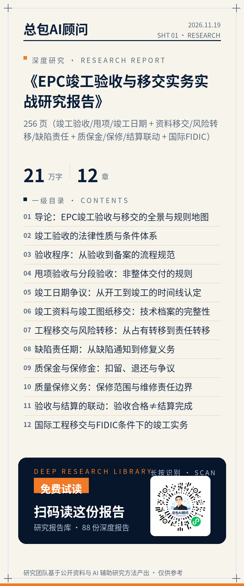

# 业主扣着质保金说工程有质量问题，法院怎么判？
出品：总包创研院研究团队

> 质保金被扣着不还，业主的理由永远是「工程有质量问题」——这句话在法庭上值多少钱？《EPC竣工验收与移交实务实战研究报告》今天上架：12章、21万字、256页，第9、10章的质保金攻防与保修举证判例谱系，把这个问题的裁判规则一次讲透。

## 先说结论：动质保金要过三重举证

法院对业主动用质保金修复费用主张的真实口径，浓缩在一个EPC案里：业主主张自费42494元更换电梯配件要求扣除，判决书给出三重理由驳回——证据是复印件（原件关）、未能进一步证明已实际履行（履行关）、未能证明引起更换配件的原因是在质保期内发生的问题（期间与因果关）。三关全过才扣得动钱；反过来，总包要守住质保金，就盯死对方这三关的缺口。

## 质保金的正当用途只有一条

最高法典型案例的意义表述值得背下来：建设工程质量保证金制度的目的是确保建设工程竣工后在缺陷责任期内的质量缺陷修复。翻译过来：扣钱的唯一正当理由是修复缺陷，不是拖延付款的杠杆。典型案例的事实更解气：工程中途停建、承包人退场、已完工部分质量合格，合同写的返还条件是竣工验收合格之日起满1年——而复工遥遥无期。法院判：质量保证金应自承包人退场之日起算1年后返还，不应无限期扣留。25万余元质保金连本带息要了回来。

## 期间届满不是自动到账，要留证据

真实分包合同条款：余款作为质保金在政府审计批复且两年缺陷责任期满后两个月内付清。这场官司里，双方庭审中一致认可已竣工验收且已满两年质保期——期间届满靠这行自认钉死。日常的对应动作：验收日、审计批复日、每笔付款日，每个节点都书面确认；两年缺陷责任期的起算、届满，在台账上挂着到期日倒计时——质保金不会自己回来，证据齐的才会。

## 保修期外的问题，业主举证更重

地方裁判指引的共识规则：质量保修期内的质量问题，承包人承担保修责任；质量保修期外的结构性质量问题，需证明系施工原因导致。一字之差，举证的重量完全换边——期内推定归承包人，期外业主要完成从表象到成因的完整证明链条。真实案例：厂房验收一年后墙体开裂，业主拿不出成因证据，三项抗辩全部落空，合同价30%加变更款45万余元照判。省下鉴定费的代价，通常是整案败诉加全部诉讼费。

## 通知都没发过，扣什么钱？

另一面镜子：业主反诉要求完成消防验收义务，总包答辩——至今从未收到过发包人发送的整改通知，消防的工程早已过了保修期。没有通知，就没有拒绝；没有拒绝，就没有代修；没有代修，就没有费用；没有费用，质保金就动不了。这条程序链对双方都成立：业主想动钱，通知四要素（部位、现象、时限、送达）一样不能少；总包想防守，回执制度先建起来——回执只签认客观状态，不认责。

## 修复费用打起来，鉴定怎么赢

三份鉴定两个结论的案子：前两家机构说收条字迹非本人所写，第三家说是本人所写，法院采第三家——理由是鉴定内容更能针对待证事实、结论能与证人陈述印证。迁移到质量修复争议：把「是不是质量问题」写成「缺陷成因鉴定」（判定施工原因、设计原因、材料原因还是使用不当）、把「修要花多少钱」写成「按某修复方案的造价鉴定」（方案先行、计价在后）——鉴定事项的写法差之毫厘，结论的证明力谬以千里。第8章的三纪律（事项对准、材料备硬、口径锁定）照做。

## 移交日之后还有多少场仗

验收合格≠结算完成、移交完成≠责任出清、质保金返还≠保修免责——收口的六件事（验收、移交、缺陷责任、质保金、保修、结算联动）环环相扣。出海项目再加三张证书：竣工试验→接收证书→履约证书，中间隔着24个月缺陷通知期，28天索赔窗口逾期即灭失——这些规则都在第12章，两张工作底表拿去就能用。

## 数字都能查

全书弹药跨池9892件、判后有效3977万字，判决年卷按竣工移交族切片逐章收编留台账——本文每一个案号、金额、比例、条款都可按锚号回溯核验，256页里没有一句「据介绍」。

微信搜索「总包AI顾问」小程序，第1章导论全章免费试读，全本¥698。

