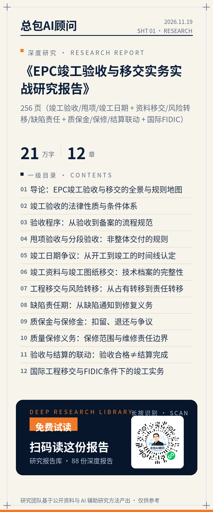

# 工程交出去了，钱和责任什么时候交割完？
出品：总包创研院研究团队

> 移交日不是终点站，是换乘站——工程实体交出去了，质保金还扣在业主手里，修复义务还背在总包肩上，三个期间（缺陷责任期、保修期、质保金存续期）三条轨并行，谁先到站、谁拦着谁，多数项目管理人员说不清。《EPC竣工验收与移交实务实战研究报告》今天上架：12章、21万字、256页，第8章的三轨期间地图是全书最实用的一张表。

## 三轨期间：钱轨、责轨、合同轨

缺陷责任期管钱（质保金什么时候还）、保修期管责（修的义务到什么时候）、质保金存续期管合同（扣留期间多长）——三个期间起点相近、终点各异、互不吸收。最典型的错配：业主以为扣着质保金就等于无限期押着保修义务——质保金到期法院判还，保修义务依然存在，钱还了责没走；反过来总包以为钱要回来了就万事大吉——保修期内的修复费用求偿照样成立。第8章把三轨收进一张对照表，任何一个缺陷争议先在表上定位，再谈攻防。

## 真实分包合同的期间条款样本

(2017)苏0106民初9500号案的分包合同条款：余款作为质保金在政府审计批复且两年缺陷责任期满后两个月内付清——一个「且」字串起两道闸门：审计不批复，缺陷责任期再久质保金也不到期；审计批复了，还要再等两年加两个月。这场官司里双方庭审中一致认可已竣工验收且已满两年质保期——期间届满靠自认钉死。教训：日常履约中对每一个时间节点（验收日、审计批复日、付款日）留痕确认，自认是把争议时间轴钉死的钉子，没有自认的场合，每一颗钉子都要自己提前钉。

## 缺陷通知：整条流水线的点火开关

第8章的反面教材来自一份EPC总承包合同：面对业主的消防验收反诉，总包的答辩是——至今从未收到过发包人发送的整改通知，消防的工程早已过了保修期。一句话两个抗辩：没有通知，就没有拒绝；没有拒绝，就没有代修；没有代修，就没有费用；没有费用，质保金就动不了。通知的四要素清单（部位、现象、时限、送达）与四级升级阶梯（保修通知→催告代修预告→扣款通知→诉讼），第8章拆成可执行的文书模板。

## 质保期内动钱的三重举证

第10章的攻防样本：业主主张自费42494元更换电梯配件要求从工程款扣——法院以三重理由驳回：证据是复印件、未能证明已实际履行、未能证明引起更换配件的原因是在质保期内发生的问题。原件凭证、因果鉴定、期间证明三件套，缺一件就是标准败诉配方。同一案里一纸维保结束确认单（2012年1月8日至2014年5月27日维修结束、比较满意）在攻防两端都被使用——纸面确认的价值，在这个案子身上尽显。

## 僵局拆解：先退场还是先打官司？

合同僵局里工程停着、损失按天涨，先处理什么？最高法典型案例的答案：界面固定先行、退出先行、争议后置——法院组织双方对施工界面进行确定并固定相关证据后，就解除合同及承包人退场先行处理，其他争议继续审理。同时并行三项鉴定：工程质量鉴定、修复方案及修复费用鉴定、已完工工程价款鉴定——三部曲缺一部，损失主张就瘸一条腿。

## 鉴定对决：三份鉴定两个结论怎么取舍

(2010)浙温民终字第1640号案：同一张收条，两家鉴定机构说字迹不是本人所写，第三家说是本人所写——法院采最后一份，理由两条：鉴定内容更能针对待证事实（字迹与签名一字之差）、结论能与见证人陈述印证。迁移到质量争议：把是不是质量问题写成缺陷成因鉴定、把修要花多少钱写成按修复方案的造价鉴定——鉴定事项的写法差之毫厘，结论的证明力谬以千里。

## 国际项目的三证书链条

出海团队再加一层：FIDIC条件下竣工与移交由证书链条承载——竣工试验合格触发接收证书（照管与风险转移的交割日），缺陷通知期届满触发履约证书（合同义务终结）。PAC与FAC两个里程碑中间隔着24个月缺陷责任期，修复不彻底等于自动续考；28天索赔窗口是定时炸弹——逾期通知，索赔权灭失。第12章的两张工作底表（条款差异速查表、三证书对照表）拿去就能用。

## 数字都能查

全书弹药跨池9892件、判后有效3977万字，判决年卷按竣工移交族切片，逐章收编留台账。每一个案号、金额、期间、条款都可按锚号回溯核验——256页里每个数字都有出处。

项目经理读第3-7章（移交全流程），商务结算读第9、11章（质保金与结算联动），法务读第8、10章（缺陷与保修攻防），出海团队读第12章（FIDIC三证书）。微信搜索「总包AI顾问」小程序，第1章导论免费试读，全本¥698。

