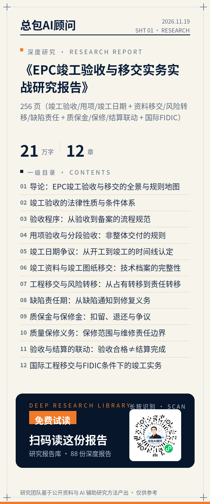

# 发布| 《EPC竣工验收与移交实务实战研究报告》
出品：总包创研院研究团队

> 竣工验收合格那天，合同并没有结束——工程交出去了，钱还扣在业主手里，修复义务还压在总包肩上，三样东西由一个词拴在一起：缺陷。《EPC竣工验收与移交实务实战研究报告》今天上架：12章、21万字、256页，从验收条件到五方验收程序，从甩项验收到竣工日期认定，从资料移交给风险转移，从缺陷责任期到质保金攻防，从保修义务到验收结算联动，再到国际工程FIDIC条件下的三证书链条——竣工验收与移交的每一处规则与攻防，一次拆透。

## 为什么移交是EPC的第二战场

EPC总承包的第一战场在建造——设计、采购、施工一体交付；第二战场在收口——竣工验收、工程移交、缺陷责任、质保金、保修、结算，六件事环环相扣，每一件都在重新分配钱与责任。行业现实：竣工验收合格不等于结算完成、移交完成不等于责任出清、质保金到期不等于自动到账、保修义务不随质保金返还而消灭——第11章的全景判断是「验收合格≠结算完成」，这条不等式贯穿全书十二章。先看清收口的规则地图，再排兵布阵。

## 全书12章的认知地图

第1章全景与规则地图；第2章竣工验收的法律性质与条件体系；第3章验收程序（从验收到备案的流程规范、五方验收）；第4章甩项验收与分段验收（非整体交付的规则）；第5章竣工日期争议（从开工到竣工的时间线认定）；第6章竣工资料与竣工图纸移交（技术档案的完整性）；第7章工程移交与风险转移（从占有转移到责任转移）；第8章缺陷责任期（从缺陷通知到修复义务）；第9章质保金与保修金（扣留、退还与争议）；第10章质量保修义务（保修范围与维修责任边界）；第11章验收与结算的联动（验收合格≠结算完成）；第12章国际工程移交与FIDIC条件下的竣工实务。

## 三类读者，三张地图

项目经理读第3-7章——验收程序、甩项分段、竣工日期、资料移交、风险转移，移交全流程的规则与文件；商务与结算人员读第9、11章——质保金攻防与验收结算联动，收口的钱怎么要回来；法务读第8、10章——缺陷责任期与保修义务的责任边界和举证规则；出海团队读第12章——FIDIC三证书链条（竣工试验→接收证书→履约证书）、缺陷通知期DNP机制与28天索赔纪律。每章开篇导读卡30秒抓住价值，按需取用不必通读。

## 证据纪律

21万字级、256页PDF、12章逐章收编台账。研究弹药跨池9892件、判后有效3977万字：判决语料按竣工移交族切片（隐蔽工程签证、分包结算、总分包界面、视为认可送审、重新鉴定质证等卷）、六大战役池跨池收割、行业知识库、国际FIDIC对比研究。每一个案号、金额、质保金比例、合同条款均可按锚号回溯核验——(2017)苏0106民初9500号的两年缺陷责任期条款、最高法典型案例的质保金退场起算规则、(2016)辽01民初507号的三重举证攻防，都有出处。256页里没有一句「据介绍」。

## 与姊妹报告配对使用

本书与《EPC分包与界面管理研究报告》《EPC工程保险与保函实务研究报告》《EPC工程审计与决算实战研究报告》构成收口四部曲：分包管过程界面、保函保险管信用与意外、审计决算管结算对砍、竣工移交管最后一公里——四册合读，从开工到质保金落袋的规则闭环全部装进口包。

## 一套可以直接照做的移交收口作业流

把第3-9章连读，得到从验收到质保金返还的全流程：竣工验收（条件自查、五方验收、备案衔接）→竣工日期固定（时间线证据链）→资料移交（清单化、签收留痕）→工程移交（占有转移、风险切割、遗留缺陷清单）→缺陷责任期管理（通知四要素、修复五步链、台账九字段）→质保金返还（期间届满、条件成就、退场起算）。每一步都有要点清单与判例警示，项目部可以直接对照搭建自己的收口管理体系。

## 移交收口的三个致命误区

误区一：以为验收合格就万事大吉——结算联动、质保金、保修三件事才刚开始；误区二：以为扣着质保金就押着保修义务——质保金到期法院判还，保修义务照样存在，钱与责是两条轨；误区三：缺陷通知发个微信就算通知了——部位、现象、时限、送达四要素缺一，扣款、代修、索赔整条流水线一台都不会转。三个误区的解法都在书中，每一步都有判例对照。

## 最高法典型案例的质保金规则

第8章开篇就是最高法配套司法解释发布的典型案例：工程中途停建、承包人退场、已施工部分质量合格——合同写的返还条件是竣工验收合格之日起满1年，而验收遥遥无期。法院怎么判？质量保证金应自承包人退场之日起算1年后返还，不应无限期扣留。典型意义一句话：质量保证金制度的目的是确保竣工后在缺陷责任期内的质量缺陷修复——扣钱的唯一正当理由是修复缺陷，不是拖延付款的杠杆。这条规则的完整拆解与操作含义，第8章三节展开。

## 国际工程的护照章节

第12章是出海团队的必修课：FIDIC红黄银三本合同条件的风险光谱、示范文本与黄皮书的近亲差异（二十条对二十一条的镜像映射）、三证书链条（竣工试验→接收证书→履约证书）、缺陷通知期DNP的一至两年期末考试、28天索赔失权的定时炸弹与弹性红线之别——习惯国内宽松环境的管理人员进入FIDIC项目，一张迟到的通知单可能意味着数百万元索赔权的灭失。

微信搜索「总包AI顾问」小程序，第1章导论全章免费试读，全本¥698。

