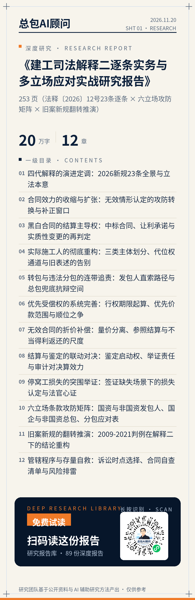

# 新规下，实际施工人还能直接告发包人吗？
出品：总包创研院研究团队

> 层层转包链条末端的施工队伍，最关心的一件事：干了活拿不到钱，能不能绕过中间的转包人，直接告发包人要钱？这个问题的答案，在解释二施行前后不一样了。《建工司法解释二逐条实务与多立场应对实战研究报告》今天上架：12章、20万字、253页，第4章把这个问题的规则变迁一次讲透。

## 先看旧规则时代的真实攻防

温州中院的柳秀娟案：层层转包链条，身份认定攻防贯穿全程——谁是实际施工人、能不能突破合同相对性、向谁主张。中冶建工的叶圣明案：转包合同无效，但已完工程验收合格，参照约定支付——转包链条末端的求偿通道。贵州郑泉涌案：主张直索发包人被驳回，法院按合同相对性划界。西安怡合案：有效分包关系下，直接告发包人的路根本不通——四个案子四种走向，胜负的关键都是身份与相对性两道门。

## 新规改了什么

解释二把「实际施工人」的笼统表述彻底重构：三类主体划分+代位权通道。翻译成大白话：不是所有干了活的人都叫实际施工人，身份先分类；直索发包人的老路收窄，代位权成了新通道——转包人怠于向发包人主张权利时，末端主体可以代位行权。「怠于行使」怎么认定、发包人「应当知道」的边界在哪——最高法答记者问自认这是未决问题，本书按从严口径推演并如实标注。

## 无效合同的钱怎么算：四个口径的胜负

合同无效不等于白干——折价补偿是求偿的底。但按什么算？量价分离（尚峰钢结构案的教科书示范：工程量按实、价格参照）、清单参照（柳秀娟案的扣除项攻防）、参照约定优先于审计（叶圣明案：审计条款挡不住参照结算）、结算书独立有效（赐福案：无效合同上签的结算书照样锁定价款）。四个口径在不同案子里的胜负，第7章用11件判例四段式拆解。

## 优先受偿权：行权期限的生死线

工程款优先受偿权是施工方最硬的权利，但行权期限从哪里起算——应付款到期日？竣工日？结算确定日？起算点认错，权利直接消灭。第6章拆解新规的行权期限规则与价款范围边界（利息、违约金、垫资进不进优先范围），配渝民申案、丰民案的真实攻防——先确认还是先主张，差之毫厘谬以千里。

## 六立场：你的位置决定你的打法

发包人、总包、分包、末端主体——每种立场在23条下的攻防姿势完全不同。国资发包人的招标合规红线、非国资总包的让利承诺效力边界、分包的保命条款——第10章六立场×23条攻防矩阵逐格展开，每格给应对要点与证据清单。做培训的人、做合规的人、做商务的人，各取所需。

## 数字都能查

官方发布全文+最高法答记者问定调底本+54卷判例切片1.7G跨十池，逐章收编留台账——本文每一个案号、条文号可按章末尾注追溯核验，253页里没有一句「据介绍」。开卷边界如实声明：新法施行未满一年无成批终审沉淀，全书判例为2009-2021旧案，按新规分析处均为「旧案新规推演」并逐处标注。

微信搜索「总包AI顾问」小程序，第1章全章免费试读，全本¥698。

