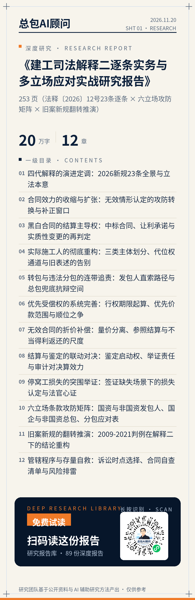

# 同一条解释二，六种读法，你的读法是哪种？
出品：总包创研院研究团队

> 解释二施行后，实务圈流传一句感慨：同一条文，站在国资发包人、非国资发包人、国企总包、非国资总包、分包、链条末端施工主体六种立场上，适用点完全不同——做培训PPT都没法只用一个版本。《建工司法解释二逐条实务与多立场应对实战研究报告》今天上架：12章、20万字、253页，第10章的六立场攻防矩阵就是为这句话而生的。

## 六立场：同一条文的六种命运

拿「先定后招认定中标合同无效」这条说：国资发包人读到的是招标合规的刚性红线（审计与巡视的问责点），非国资发包人读到的是灵活空间收窄（阴阳合同的旧玩法入刑风险），国企总包读到的是投标文件的合规自查清单，非国资总包读到的是让利承诺的效力边界，分包读到的是上位合同无效传导下来的结算依据，链条末端施工主体读到的则是「参照合同约定折价补偿」的求偿通道。同一条，六种攻防姿势——本书第10章按23条×六立场逐格展开，每格给应对要点与证据清单。

## 实际施工人：新规最锋利的重构

第4章拆解旧规时代最混乱的概念重构：「实际施工人」的笼统表述告别历史，三类主体划分+代位权通道登场。真实判例的攻防样本：温州柳秀娟案里层层转包链条上的身份认定攻防、中冶叶圣明案的无效合同参照支付、十堰伟豪案的挂靠认定举证门槛、广东胡元昌案的身份举证失败——每一案按事实、争点、裁判、启示四段式展开，再按新规推演：如果是2026年6月30日之后起诉，结论会怎么变。

## 折价补偿：无效合同的价钱怎么算

第7章处理无效合同最实务的问题：合同无效了，钱怎么算。量价分离（尚峰钢结构案的教科书示范）、清单参照（柳秀娟案的扣除项攻防）、参照约定优先于审计（叶圣明案）、结算书独立有效（赐福案）——四个口径在不同案子里的胜负，比任何理论都直观。新规下折价补偿的尺度怎么把握，11件判例+新旧对照给出答案。

## 优先受偿权：行权期限与顺位的新棋局

第6章拆解优先受偿权的系统完善：行权期限从哪里起算、优先保护的价款范围画到哪（利息？违约金？垫资？）、与抵押权人和购房人的顺位之争。真实判例里，渝民申案的共同委托审定、丰民案的工程款确认时机——先确认还是先主张，差之毫厘谬以千里。

## 旧案新规翻转推演：本书最独特的一章

第11章把已收录的旧判例放到23条下逐条重演：中冶叶圣明转包审计案在新规下还判得了吗、郑泉涌相对性案的身份之辨、中核二二鉴定攻防案的启动权换位——每一处显式标注「裁判时点为旧法时代，推演为本研究」。这种读法是把新规则的逻辑在真实案卷上过一遍，不是预言，是沙盘。

## 数字都能查

全书弹药：官方发布全文+最高法答记者问定调底本+四代新旧对照+律所专题解析+54卷判例切片1.7G跨十池。每一个案号、金额、条文号可按章末尾注追溯，253页里没有一句「据介绍」。

法务合规从第1、2、12章进入，商务结算从第3、7、8章进入，项目管理与分包从第4、5、9章进入，六立场决策者直取第10章。微信搜索「总包AI顾问」小程序，第1章全章免费试读，全本¥698。

