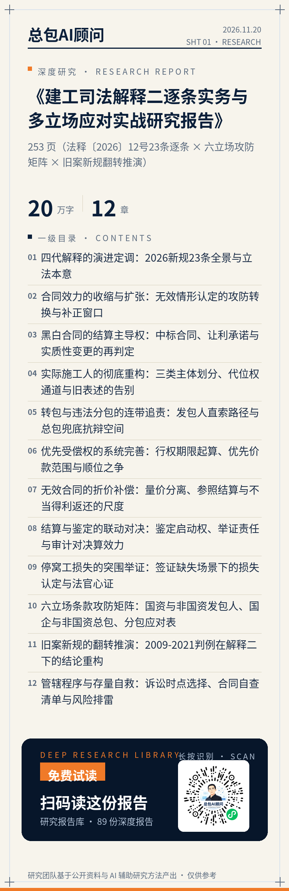

# 发布| 《建工司法解释二逐条实务与多立场应对实战研究报告》
出品：总包创研院研究团队

> 一部解释，四代演进，六种立场——法释〔2026〕12号二十三条2026年6月30日施行，把建工合同裁判规则推入第四代。《建工司法解释二逐条实务与多立场应对实战研究报告》今天上架：12章、20万字、253页，23条逐条拆解×六立场攻防矩阵×旧案新规翻转推演，三个维度交叉，织成一张每类读者都能对号入座的规则地图。

## 为什么这部解释需要一册「多立场」的书

行业对解释二的学习刚需比以往任何一代都迫切，原因不在条文多深，而在立场之多。同一条文，站在国资发包人、非国资发包人、国企总包、非国资总包、分包单位、链条末端施工主体六种立场上，适用的重点、防守的要件、进攻的窗口完全不同——实务圈的普遍感受是：解释二真好，但讲义没法只用一个版本。本书第10章把六立场×23条织成攻防矩阵，国资发包人读哪些条是护身符、非国资总包读哪些条是进攻窗口、分包读哪些条是保命通道——一张矩阵表全部对号入座。

## 全书12章的认知地图

第1章四代解释演进定调（23条全景与立法本意，官方发布全文+最高法答记者问定调底本）；第2章合同效力的收缩与扩张；第3章黑白合同的结算主导权；第4章实际施工人的彻底重构（三类主体划分+代位权通道）；第5章转包与违法分包的连带追责；第6章优先受偿权的系统完善（行权期限起算+顺位之争）；第7章无效合同的折价补偿（量价分离+参照结算）；第8章结算与鉴定的联动对决（鉴定启动权+审计对决算效力）；第9章停窝工损失的突围举证；第10章六立场条款攻防矩阵；第11章旧案新规的翻转推演；第12章管辖程序与存量自救。

## 三类读者，三张地图

企业法务与合规读第1、2、12章（规则全景与存量合同自查清单）；商务与结算人员读第3、7、8章（结算主导权与折价补偿攻防）；项目管理与分包管理者读第4、5、9章（身份重构、连带追责与损失举证）；六类立场的决策者直取第10章矩阵，对号入座后再按需回翻主题章。

## 证据纪律：54卷判例切片+官方底本

20万字级、253页PDF、12章逐章收编台账。研究弹药：官方发布全文（23条齐）+最高法答记者问定调底本+四代新旧条文对照+君合大成律所专题解析+61篇学术论文摘要汇编，判例语料54卷切片1.7G跨十池收割（折价补偿四卷、优先受偿权两卷、黑白合同两卷、转包挂靠、结算审减、停窝工、造价鉴定全主题族）。每一个案号、金额、条文号均可按章末尾注追溯至证据底料——253页里没有一句「据介绍」。

## 一项必须开卷明示的边界（也是本书的方法论）

解释二施行尚不满一年，裁判文书网上尚无成批的新法终审案例沉淀。本书全部判例审结于2009-2021年旧规时代——凡按新规分析旧案之处，均为「旧案新规推演」：第11章选代表性旧判例放到23条下逐条重演结论变化，每一处显式标注「裁判时点为旧法时代，推演为本研究」。推演不是预言，是把新规则的逻辑在真实案卷上过一遍——这种学法，比背条文快十倍。

## 实际施工人的重构：最值得先读的一章

第4章拆解新规最锋利的制度变化：旧规时代笼统的「实际施工人」表述被告别，代之以三类主体划分+代位权通道——层层转包链条末端的队伍还能不能直接告发包人、代位权怎么走、发包人「应当知道」的边界在哪，本书用温州柳秀娟层层转包案、中冶叶圣明参照支付案、十堰伟豪挂靠认定案等十余件真实判例四段式拆解（事实、争点、裁判、启示），再按新规推演结论变化。

微信搜索「总包AI顾问」小程序，第1章23条全景全章免费试读，全本¥698。

