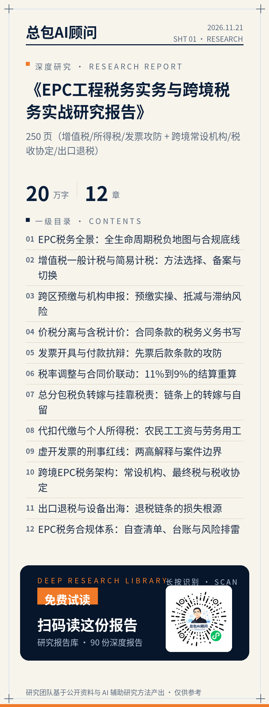

# 业主说「先开票后付款」，法院支持吗？
出品：总包创研院研究团队

> 工程干完了去要钱，业主一句「发票没开够，不能付」——这句抗辩在法庭上到底值多少钱？《EPC工程税务实务与跨境税务实战研究报告》今天上架：12章、20万字、250页，第5章用十二组真实判例把这个问题的裁判规则讲透。

## 先看结论：发票是附随义务，工程款是主给付

皖0402民初855号案：结算3633550元，承包人已开票3510000元，差额123550元——业主以此拒付。法院认定发票差额抗辩不成立，判付工程款2733550元及利息36514元。丰民初字1227号案：业主要求承包人先开全额发票才付款，法院同样不予采信。裁判逻辑一致：开具发票是附随义务，支付工程款是主给付义务，附随义务的瑕疵不能对抗主给付义务的履行。

## 合同写了「先票后款」呢

辽0103民初12994号案的合同条款写得明白：「每期付款须提供正规等额发票并承担税金」——先票后款条款写了，法院会认吗？第5章拆解条款的三种形态（付款条件型、协助义务型、违约责任型）与三类证据规则：条款写法不同，法律后果完全不同——写成付款条件的能挡住付款，写成协助义务的挡不住。

## 代扣税费：单方结算单算不算数

苏07民终3480号案：总包在结算单上代扣了税费777119元与二标段代扣税45519元，分包不认——单方制作的代扣结算单有没有约束力？第7章拆解总分包之间税负转嫁的证据规则：代扣税费要成立，得有合同依据、计算过程、双方签认三件套，缺一件就是单方主张。

## 税率从11%降到9%，降的利益归谁

税率调整省下来的税，是业主的还是承包人的？安徽高院：税金调整属政策性调整，合同约定不予调整的从其约定；宁波中院：固定包干单价之下，税率变动利益归承包方；河北阳原法院：总造价含11%增值税属意思自治，未约定税率差不扣减——三案同向：看合同怎么写。

## 合同价里的税，只能是销项税额

为什么计价规范里「应纳税金」的写法会引发争议？因为应纳税额=销项税额-进项税额，进项抵扣多少是每个企业自己的事——写进合同价就是把一方的税务经营风险转嫁给另一方。第4章的价税分离原理与合同条款范本，教你怎么把税负条款写成一句能打赢官司的话。

## 印花税：万分之三的小账

建设工程合同印花税税率万分之三——含税还是不含税计税、框架合同与补充协议怎么算，第4章专节拆解。

## 出海的税关：常设机构

项目做到印尼、乌兹别克斯坦，第一道外国税关是常设机构认定——认定为常设机构，利润要在当地缴税；不认定，可能只对常设机构利润征税。第10章用印尼常设机构认定合规指引、中企印尼最终税争议、乌兹别克斯坦财税地图三件实战专著，拆解出海EPC的税务架构与税收协定的保护边界。

## 数字都能查

27件税法底本+10件跨境税务专著+58卷判例切片，逐章收编留台账——本文每一个案号、金额、税率可按章末尾注追溯核验，250页里没有一句「据介绍」。开卷边界如实声明：所引判例多为工程款纠纷中的税务争点，税务行政与刑事判例库内密度有限，底料截断处逐案声明只引可得部分。

微信搜索「总包AI顾问」小程序，第1章税负全景全章免费试读，全本¥698。

