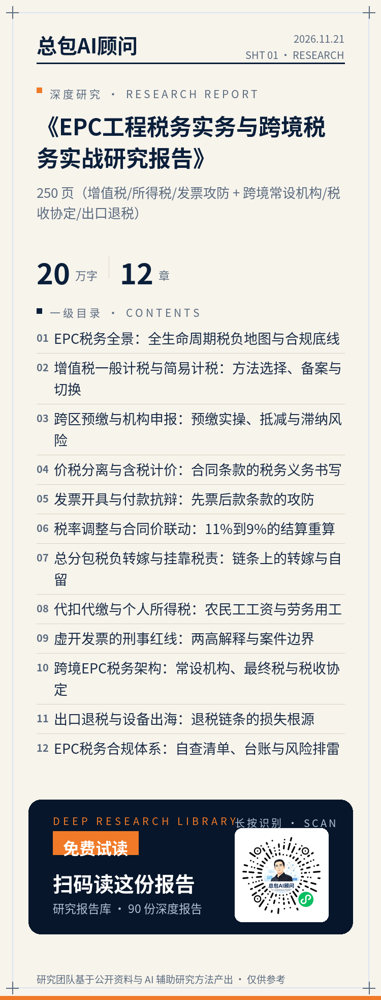

# 合同里一个「含」字，结算时差出一笔税
出品：总包创研院研究团队

> 合同价写「含税」还是「不含税」，税率调整的利益归谁，「先开票后付款」到底能不能挡住付款——工程合同里最不起眼的几个税务字眼，在结算桌上往往值几百上千万。《EPC工程税务实务与跨境税务实战研究报告》今天上架：12章、20万字、250页，第4至6章把合同里的税务字眼逐个拆开。

## 价税分离：合同价的税金是什么

第4章先立原理：增值税是价外税，合同价里的税金只能是销项税额，不能是应纳税额——应纳税额取决于每个企业各自的进项抵扣，写进合同价就是把一方的税务经营风险转嫁给另一方。计价规范选「应纳税金」引发的争议、示范文本的分项列示方法、税率调整为什么不等于「法律变化调价」——一节一节拆给你看。

## 税负承担条款的三种模型

合同里的税负条款有三种写法：税金另计（不含税价+税金据实结算）、含税包干（总价含税，税率变动不调）、税率联动（按国家政策调整）。三种模型在税率从11%调到9%时的命运完全不同——浙江温州中院的一份判决里，造价24496800元的合同写明不含税金条款；最高法院的一份判决里，工程总价下浮2%的条款明确括注「不含税金、甲供材料价差」——条款怎么写，利益就归谁。

## 税率调整：三案同向看合同

第6章拆解税率调整的利益归属三案：安徽高院认定税金调整属政策性调整、约定不予调整的从其约定；宁波中院认定固定包干单价之下税率变动利益归承包方；河北阳原法院认定总造价含11%增值税属意思自治、未约定税率差不扣减。三案同向的结论：税率差利益归谁，不取决于税法怎么改，取决于合同里那句税负条款怎么写。

## 先票后款：发票是附随义务

第5章判例最密集：业主以「没开足发票」拒付工程款，法院多不支持。皖0402民初855号案，结算3633550元已开票3510000元差额123550元，发票差额抗辩不成立，判付2733550元及利息36514元；丰民初字1227号案，全额发票拒付抗辩不予采信。发票是附随义务，工程款是主给付义务——先票后款条款要怎么写才真能挡住付款，三种形态条款的攻防对照表直接可用。

## 印花税：万分之三的小账大坑

建设工程合同的印花税税率是万分之三——数字小，坑不小：合同金额含税还是不含税、框架合同与补充协议怎么算、总包与分包合同是否重复缴纳。第4章的印花税专节给出计税依据与纳税义务发生时点的规则转述与操作清单。

## 总分包：链条上的转嫁与自留

第7章处理总分包之间的税负转嫁：总包代扣税费的单方结算单能不能算数（苏07民终3480号案的代扣税费争议）、挂靠经营下税责归谁、分包的税负如何在合同里转嫁——链条上每一环的税务身份，决定了虚开风险落在谁头上。

## 出海：常设机构是第一道外国税关

第10章进入跨境轴：工程所在国认定常设机构的门槛（印尼的常设机构认定合规指引）、最终税怎么算（中企印尼最终税争议）、税收协定能救多少、乌兹别克斯坦财税地图的国别实务——出海项目的税务架构，常设机构是第一道关。

## 数字都能查

27件税法底本+10件跨境税务专著+58卷判例切片，逐章收编留台账。每一个案号、金额、税率、文号可按章末尾注追溯核验，250页里没有一句「据介绍」。

财税商务从第1至4章进入，法务争议从第5至9章进入，出海团队读第10、11章。微信搜索「总包AI顾问」小程序，第1章税负全景免费试读，全本¥698。

