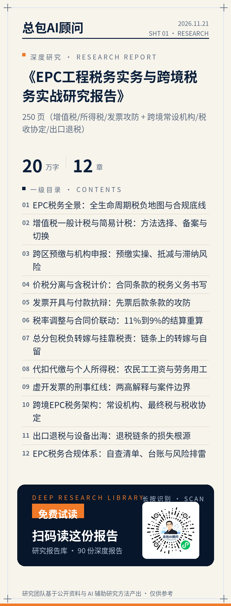

# 发布| 《EPC工程税务实务与跨境税务实战研究报告》
出品：总包创研院研究团队

> EPC的每一分利润，都要过一道税的关口：报价要含税还是要税、施工要预缴还是要抵、结算要开票还是要款、分包要转嫁还是要留、设备出海要退税还是要缴。《EPC工程税务实务与跨境税务实战研究报告》今天上架：12章、20万字、250页，从增值税计税方法到跨境常设机构，从发票攻防到虚开刑事红线，把工程税务的每一个关口一次拆透。

## 为什么工程企业需要一册自己的税务书

工程行业对税务的普遍状态是「财务的事」三个字——项目经理管进度、商务管结算、法务管合同，税务被切成每人懂一点的碎片。而税的规则恰恰要求全链一盘棋：合同条款写错一个「含」字，结算时可能就是百分之九的价差；发票流程慢一步，垫出去的税款可能压一年。本书第1章给出全景判断：EPC全生命周期的每一站都有税的关口，关口过对了利润落袋，过错了轻则垫税吃掉现金流，重则刑事红线压顶。

## 全书12章的认知地图

第1章税务全景（全生命周期税负地图）；第2章一般计税与简易计税（方法选择、备案与切换）；第3章跨区预缴与机构申报（预缴实操、抵减与滞纳风险）；第4章价税分离与含税计价（合同条款的税务义务书写）；第5章发票开具与付款抗辩（先票后款条款的攻防）；第6章税率调整与合同价联动（11%到9%的结算重算）；第7章总分包税负转嫁与挂靠税责；第8章代扣代缴与个人所得税（农民工工资与劳务用工）；第9章虚开发票的刑事红线；第10章跨境EPC税务架构（常设机构、最终税与税收协定）；第11章出口退税与设备出海；第12章税务合规体系（自查清单、台账与风险排雷）。

## 国内轴+跨境轴：两条轴合成完整地图

国内轴八章覆盖计税方法、跨区预缴、价税条款、发票攻防、税率调整、总分包转嫁、代扣个税、虚开红线八个战场；跨境轴四章覆盖常设机构、最终税、税收协定、出口退税四个出海关卡——后者在同类出版物中完全无人系统展开：乌兹别克斯坦财税地图、印尼常设机构认定、出口退税损失根源，十件跨境税务专著的实战经验一次收齐。

## 三类读者，三张地图

财税与商务人员读第1至4章（规则与条款书写）；法务与争议应对读第5至9章（判例与红线）；出海团队读第10、11章（跨境架构与退税）；企业高管读第1章定认知、第12章拿自查清单。每章开篇导读三十秒抓住价值，按需取用不必通读。

## 判例怎么说：发票抗辩为什么多败

第5章是判例最密集的一章：业主以「没开足发票」拒付工程款，法院多不支持——皖0402民初855号案，结算3633550元已开票3510000元差额123550元，发票差额抗辩不成立，判付2733550元及利息36514元；丰民初字1227号案，全额发票拒付抗辩不予采信。发票是附随义务，工程款是主给付义务——先票后款条款要怎么写才真能挡住付款，本章给出三形态条款的攻防对照。

## 税率调整：利益归谁看合同

第6章拆解税率从11%到9%的调整利益归属：安徽高院认定税金调整属政策性调整、约定不予调整的从其约定；宁波中院认定固定包干单价之下税率变动利益归承包方；河北阳原法院认定总造价含11%增值税属意思自治、未约定税率差不扣减——三案同向：税率差利益归谁，不取决于税法怎么改，取决于合同里那句税负条款怎么写。

## 证据纪律

20万字级、250页PDF、12章逐章收编台账。底本为27件税法法规文件（增值税法、企业所得税法及实施条例、发票管理办法及实施细则、税收征收管理法、两高危害税收征管刑事案件解释等）与10件跨境税务专著，判例语料取自八池工程判决切片中税务要素内嵌的58卷。每一个案号、金额、税率、文号均可按章末尾注追溯——250页里没有一句「据介绍」。

## 一项必须开卷明示的边界

所引判例多为工程款纠纷中的税务争点，纯粹的税务行政与刑事判例在库内密度有限，凡底料截断处均逐案声明、只引可得部分；税法条文以现行有效文本为准（增值税法二〇二六年一月一日施行，历史案件的税率环境已在各章标注）；虚开刑事部分仅作规则与案例的中立转述，不构成任何税务筹划建议。

微信搜索「总包AI顾问」小程序，第1章税负全景全章免费试读，全本¥698。

